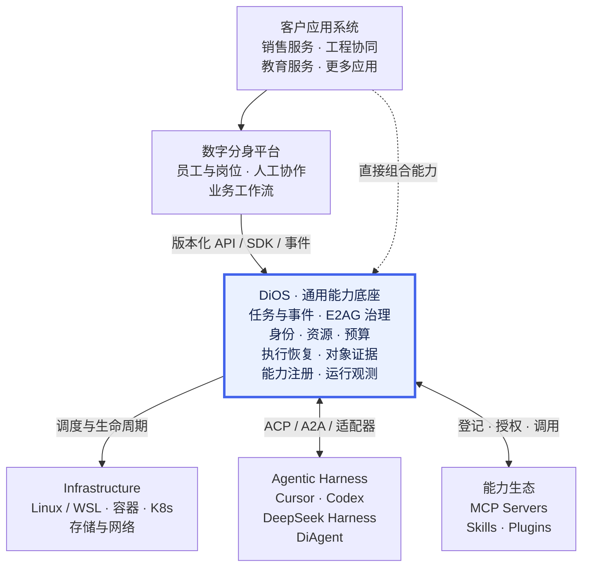
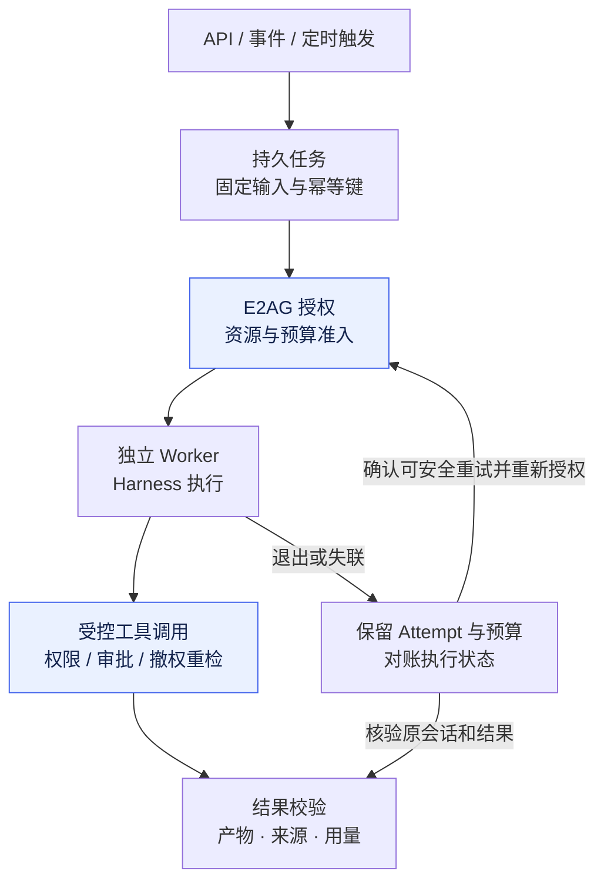
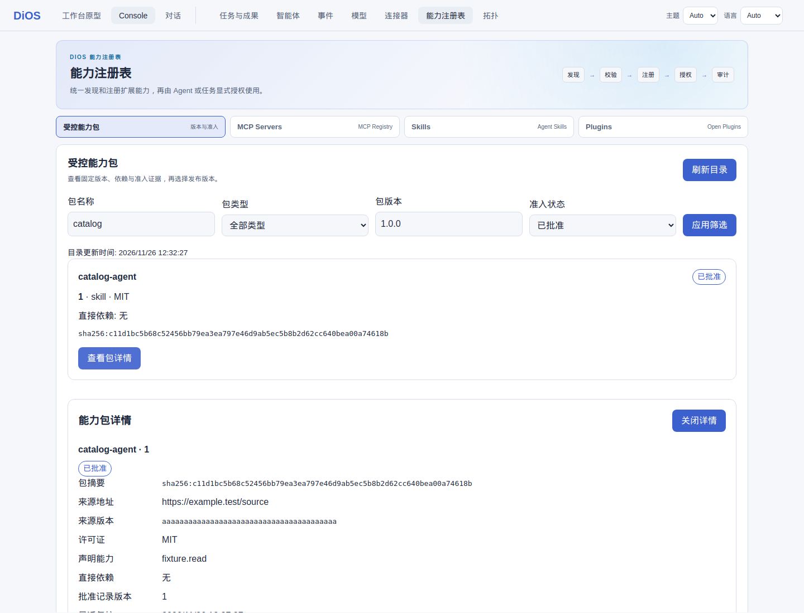
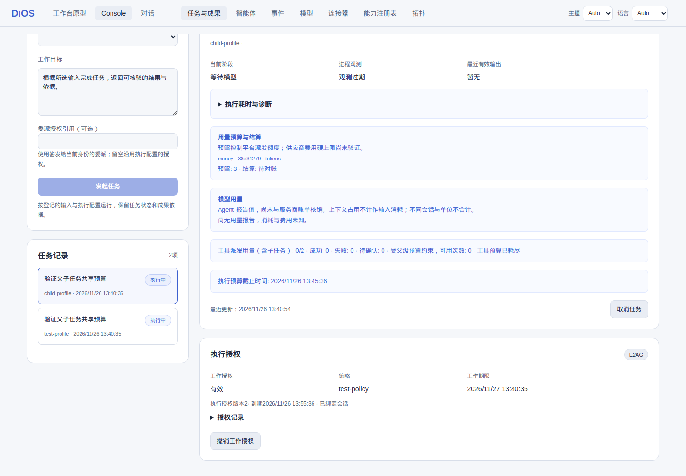
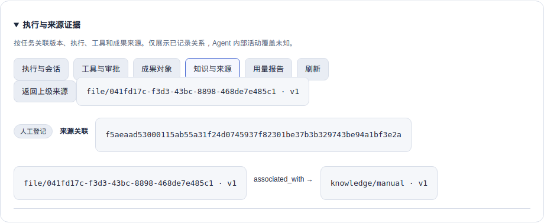

# DiOS

### 让不同 Agent 在统一权限、预算与恢复机制下工作

DiOS 是业务无关的开源 **Agent OS**：接入智能体与工具，持久调度任务，在实际执行处校验授权，保留会话、结果与证据。上层平台和应用通过 API、SDK 与事件使用这些能力。

**接入不同 Harness · E2AG 执行治理 · 持久任务与恢复 · 共享资源预算 · 可追溯成果**

[架构与原理](#架构与原理) · [实际效果](#实际效果) · [开始使用](#开始使用) · [工程路线](docs/planning/capability-wbs.md)

## 为什么需要 Agent OS

当 Agent 从一次对话进入长期业务运行，管理者需要知道：谁在执行、可以访问什么、用了多少资源、故障后如何接续，以及结果来自哪里。

| 你关心的事 | DiOS 提供的能力 |
| --- | --- |
| 现有 Agent 能否接入 | ACP、A2A 与适配器契约；Harness 保留自己的执行循环 |
| 授权、审批是否真的生效 | E2AG 在任务准入、工具派发、结果接受与恢复边界校验；撤权后拒绝后续动作 |
| 多个 Agent 会不会重复工作或争抢额度 | 幂等任务、独占租约、执行代次、共享并发额度和消费预留 |
| 断网或 Worker 退出后怎么办 | 保留执行现场与未知状态，恢复时对账；可验证的完整结果优先复用 |
| 能否解释一个结果 | Run → Attempt → Session → Artifact，关联来源、工具调用、审批和用量记录 |
| 应用如何持续演进 | 独立应用包、版本化接口；底座、上层平台、客户应用分别部署与升级 |

## 架构与原理

### 四层职责，能力复用



组织、岗位、客户、项目和业务流程由上层产品定义；DiOS 管理主体、资源引用、执行授权与运行状态。数字分身平台保持客户无关，客户应用承载各自业务。应用也可直接组合 DiOS 能力。[能力边界与独立部署](docs/adr/0011-capability-only-platform-boundary.md)

### 一项任务怎样成为可治理的执行



逻辑任务、执行尝试、Worker 进程和模型会话分别记录。失联时保留未确认执行及预算占用；租约和执行代次控制所有权，旧执行者的写入被拒绝。E2AG 将动作绑定到工作、尝试、会话、资源和授权版本，审批与恢复继续受当前权限约束。[执行模型](docs/design/domain-api-contract-v1.md) · [E2AG 集成](docs/design/e2ag-agent-integration.md)

## 实际效果

以下为真实 Console 的合成任务与演示数据界面。

### 统一发现与管理能力

MCP、Skills、Plugins 和受控能力包集中管理；查看来源、版本、依赖、许可证及准入状态，再为任务授权使用。



### 在任务旁看到预算与授权

任务详情集中展示阶段、观测新鲜度、用量预留、工具次数和工作授权。父子任务共享预算，管理者可查看约束与撤销授权。Console 支持 Light / Dark / Auto 和中英文，默认随系统主题、浏览器语言。



### 从结果回到执行与来源

在同一任务下查看执行与会话、工具与审批、成果对象、知识来源和用量报告；来源和版本引用支持继续追溯。



### 可复核的工程场景

| 场景 | 已验证的效果 | 证据 |
| --- | --- | --- |
| 跨主机身份与 E2AG | 两台 Linux/WSL 主机间权限隔离、凭据撤销、实际工具拦截通过 | [双机验证](docs/design/identity-access-qualification-33.md) |
| 企业目录到执行权限 | 独立目录桥接包在线同步受管身份；部门隔离、移组/停用拦截、限流与中断恢复、旧授权拒绝，42 项测试通过 | [目录授权接入](docs/design/directory-mapping-36.md) |
| Worker 故障与资源预算 | 双机共享预算、Worker 退出后原尝试恢复、网络重连与离线撤权通过 | [预算与恢复](docs/design/resource-recovery-45.md) |
| 外部智能体执行 | Cursor ACP 首条任务、审批、工具、报告与恢复路径已有真实执行证据 | [Harness 治理](docs/design/review-harness-58.md) |
| 数字员工到可追溯任务 | 独立员工注册包共享岗位模板、发布绑定执行版本、关联真实任务；停用触发 E2AG 撤权 | [员工发布与任务闭环](docs/design/workforce-registry-37.md) |
| 从执行结果到业务确认 | WorkItem 创建并绑定员工，关联 Run 与可核验成果；复核人明确通过或退回，撤权后拒绝确认 | [工作项与人工确认](docs/design/workitem-40.md) |
| 应用独立交付 | 参考应用通过公开 SDK/API 接入，独立打包、升级与回滚 | [应用契约](docs/design/application-contract-47.md) |

不同 Harness 的协议和控制能力存在差异，按[接入能力矩阵](docs/design/agent-integration-capability-matrix.md)逐项验证。平台预算预留约束派发额度；供应商费用硬上限需要对应通道支持。高可用、完整跨节点故障矩阵和规模容量按[既定路线](ROADMAP.md)持续推进。

企业目录中的调岗和停用通过独立[目录桥接包](applications/directory-bridge/README.md)在线对账、发布，再由 DiOS 的 E2AG 执行门禁生效。部门、岗位规则与同步账本留在上层；故障后复核目录并接续未确认变更。当前在线验证使用本地 SCIM 测试服务，企业真实目录与 SSO 联验暂缓。

### 上层员工服务如何使用底座

[数字员工注册包](applications/workforce-registry/README.md)提供“岗位模板 → 员工修订 → 受控发布 → 任务与成果 → 停用撤权”的可运行 CLI。员工档案保存在独立平台库中，执行通过公开 SDK/API 进入 DiOS；发布固定执行配置版本，后台配置变更会被拒绝。两名员工共享模板仍使用独立权限，重启应用后历史持续保留。

上层 **WorkItem** 将“任务运行成功”接到“业务确认完成”：创建工作项、固定员工发布版本、关联成果，再由独立复核人明确确认。人工确认会重新核验当前成果权限与内容完整性；执行状态、业务状态和历史决策分别保存。[运行示例与状态图](docs/design/workitem-40.md)

## 开始使用

Linux/WSL 需要 Python 3、Docker 和 Docker Compose。按 [Linux 安装指南](deploy/linux/README.md)准备对应版本的后端、前端镜像，初始化独立实例：

```bash
python3 deploy/linux/install.py init --root "$PWD/workspace/dios-local" \
  --backend-image dios-backend:candidate --frontend-image dios-frontend:candidate
python3 deploy/linux/install.py doctor --root "$PWD/workspace/dios-local"
docker --host unix:///var/run/docker.sock compose --project-directory "$PWD/workspace/dios-local" run --rm migrate
docker --host unix:///var/run/docker.sock compose --project-directory "$PWD/workspace/dios-local" up -d --wait backend frontend
```

打开 `http://localhost:3000/dios/`，API 默认位于 `http://localhost:8000`。Access Token 位于实例的受保护配置文件；执行配置与 E2AG 权限显式登记。Worker 配置、诊断和升级说明见安装指南。

Console 与 CLI 使用同一组控制面 API：

```bash
python cli/dios registry mcp github
python cli/dios registry skills mcp
python cli/dios registry plugins
python cli/dios connector types
```

## 继续了解与参与

[架构基线](docs/architecture/README.md) · [开放 Agent 接入](docs/architecture/agent-interoperability.md) · [Python SDK](sdk/python/README.md) · [工程手册](docs/engineering/handbook.md) · [任务计划](docs/planning/capability-wbs.md) · [Issues](https://github.com/HQIT/DiOS/issues)

欢迎交流共创：接入你的 Harness、贡献能力包，或用真实运行场景帮助完善执行与治理。

## License

MIT
