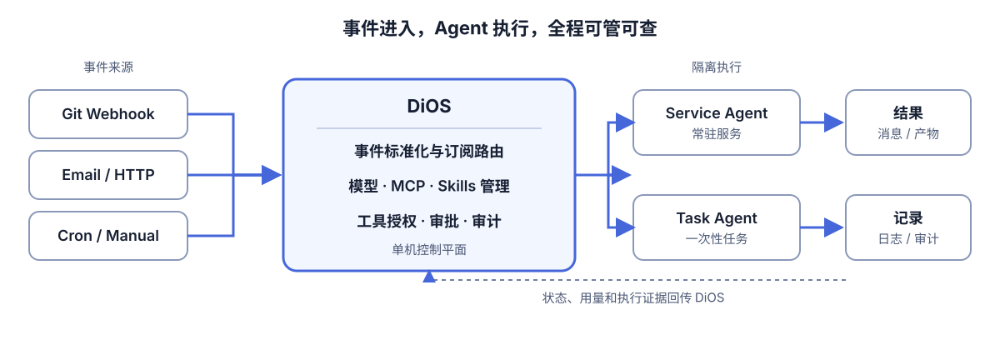
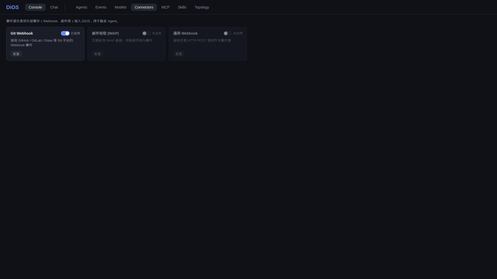
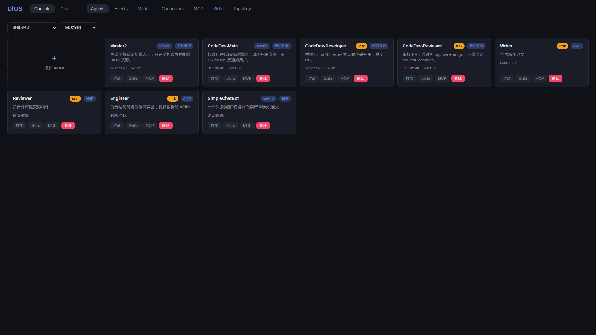

# DiOS

> 单机部署的事件驱动 Agent 控制平面：接入事件、调度 Agent、管理资源，并记录每次执行。

DiOS 管理 Agent，Agent 完成工作。当前执行实现使用 [DiAgent](https://github.com/HQIT/DiAgent)，把 Git、邮件、Webhook 或定时任务路由给合适的 Agent，在隔离容器中执行。目标架构通过 A2A、ACP 与适配器接入不同来源的智能体，由各自的 loop/harness 完成执行，详见 [开放智能体接入](docs/architecture/agent-interoperability.md)。

<p align="center">
  
</p>

## 能做什么

| 接入与路由 | 执行与治理 |
| --- | --- |
| GitHub / GitLab / Gitea Webhook、IMAP、HTTP、Cron | service 常驻 Agent 与 task 一次性 Agent |
| CloudEvents 标准化、订阅规则、条件匹配与去重 | LLM、MCP、Skills、工具授权、审批、日志与审计 |

## 界面

<table>
  <tr>
    <td width="50%"></td>
    <td width="50%"></td>
  </tr>
  <tr>
    <td align="center">统一管理事件来源</td>
    <td align="center">配置与查看 Agent</td>
  </tr>
</table>

## 快速启动

需要 Docker 和 Docker Compose：

```bash
git clone --recurse-submodules https://github.com/HQIT/DiOS.git
cd DiOS
docker compose up -d
```

打开 `http://localhost:3000`。API 默认位于 `http://localhost:8000`。

CLI 与 Console 使用同一组控制面 API：

```bash
python cli/dios registry mcp github
python cli/dios registry skills mcp
python cli/dios registry plugins
python cli/dios connector types
```

进一步了解：[架构基线与图解](docs/architecture/README.md) · [工程手册](docs/engineering/handbook.md) · [Roadmap](ROADMAP.md) · [现有架构](docs/architecture.md) · [Connector 契约](docs/adr/0001-connector-plugin-contract.md)

## 项目边界

DiOS 保持 Agent OS 内核定位，负责资源、事件、调度、运行和治理；DiAgent 负责推理与工具调用。下一阶段在内核之上建设数字员工管理与服务层，再由业务应用承载行业场景。现有 Console 与 CLI 保留为内核运维入口。

当前实现以单机可信操作者为基础，建设目标是可扩展的企业级平台；组织、岗位、工作空间和业务协作由上层服务提供。单机用于初期验证，多节点与高可用进入企业交付路线，多租户单独后置。详见 [三层架构决策](docs/adr/0003-layered-digital-workforce-platform.md) 和 [分阶段路线](ROADMAP.md)。

## License

MIT
