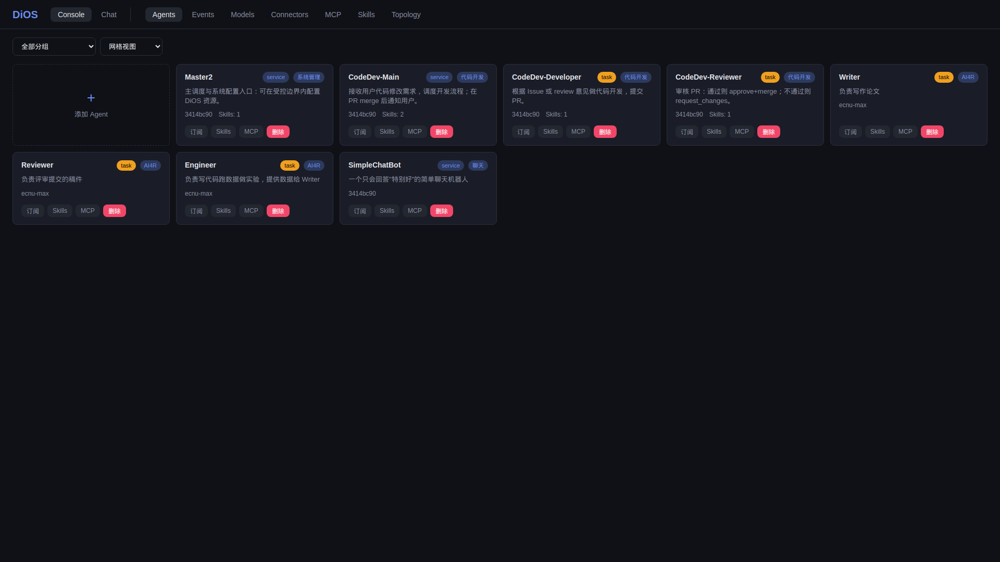

# DiOS

> 单机部署的事件驱动 Agent 控制平面：接入事件、调度 Agent、管理资源，并记录每次执行。

DiOS 管理 Agent，Agent 完成工作。它基于 [DiAgent](https://github.com/HQIT/DiAgent)，把 Git、邮件、Webhook 或定时任务路由给合适的 Agent，在隔离容器中执行。

<p align="center">
  
</p>

## 能做什么

| 接入与路由 | 执行与治理 |
| --- | --- |
| GitHub / GitLab / Gitea Webhook、IMAP、HTTP、Cron | service 常驻 Agent 与 task 一次性 Agent |
| CloudEvents 标准化、订阅规则、条件匹配与去重 | LLM、MCP、Skills、工具授权、审批、日志与审计 |

## 界面

<table>
  <tr>
    <td width="50%"></td>
    <td width="50%"></td>
  </tr>
  <tr>
    <td align="center">统一管理事件来源</td>
    <td align="center">配置与查看 Agent</td>
  </tr>
</table>

## 快速启动

需要 Docker 和 Docker Compose：

```bash
git clone --recurse-submodules https://github.com/HQIT/DiOS.git
cd DiOS
docker compose up -d
```

打开 `http://localhost:3000`。API 默认位于 `http://localhost:8000`。

部署时可在 Compose 环境中分别设置 `DIOS_DIAGENT_IMAGE` 和 `DIOS_DIAGENT_SERVICE_IMAGE`，选择已验收的一次性任务和常驻镜像。使用仓库 digest 引用时，先在 backend 所连接的 Docker daemon 上拉取镜像。

### 本地开发使用 DSH

将 DiAgent 的 `rewrite/dsh-v0.1` 分支检出到与 DiOS 并列的 `DiAgent-TS` 目录。若检出到其他位置，设置 `DIAGENT_BUILD_CONTEXT` 指向该仓库根目录。

```bash
docker compose -f docker-compose.dev.yml --profile build build diagent-task-build diagent-build
docker compose -f docker-compose.dev.yml up -d backend frontend
```

开发环境的前端在 `http://localhost:3001`，API 在 `http://localhost:8081`。backend 使用构建出的 `dios-diagent-task:dsh-dev` 和 `dios-diagent-service:dsh-dev`。已在运行的常驻 Agent 会复用现有容器，需要停止旧容器后重新启动 Agent 才会使用新镜像。常驻镜像当前支持非流式、无工具的单轮对话。

CLI 与 Console 使用同一组控制面 API：

```bash
python cli/dios registry mcp github
python cli/dios registry skills mcp
python cli/dios registry plugins
python cli/dios connector types
```

进一步了解：[Roadmap](ROADMAP.md) · [架构说明](docs/architecture.md) · [Connector 契约](docs/adr/0001-connector-plugin-contract.md)

## 项目边界

DiOS 负责事件、资源、调度和治理；DiAgent 负责单个 Agent 的推理与工具调用。当前路线以单机、单实例和可信操作者为边界，多租户与集群化暂缓。

## License

MIT
