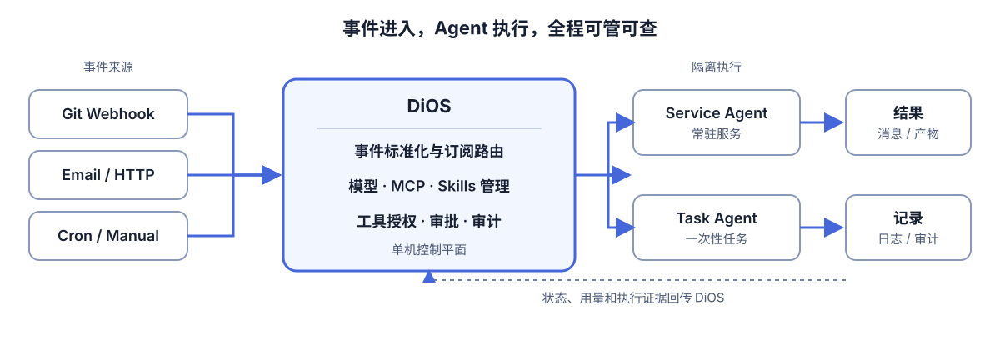

# DiOS

> 单机部署的事件驱动 Agent 控制平面：接入事件、调度 Agent、管理资源，并记录每次执行。

DiOS 管理 Agent，Agent 完成工作。它基于 [DiAgent](https://github.com/HQIT/DiAgent)，把 Git、邮件、Webhook 或定时任务路由给合适的 Agent，在隔离容器中执行。

<p align="center">
  
</p>

## 能做什么

| 接入与路由 | 执行与治理 |
| --- | --- |
| GitHub / GitLab / Gitea Webhook、IMAP、HTTP、Cron | service 常驻 Agent 与 task 一次性 Agent |
| CloudEvents 标准化、订阅规则、条件匹配与去重 | LLM、MCP、Skills、工具授权、审批、日志与审计 |

## 界面

<table>
  <tr>
    <td width="50%"></td>
    <td width="50%"></td>
  </tr>
  <tr>
    <td align="center">统一管理事件来源</td>
    <td align="center">配置与查看 Agent</td>
  </tr>
</table>

## 快速启动

需要 Docker 和 Docker Compose：

```bash
git clone --recurse-submodules https://github.com/HQIT/DiOS.git
cd DiOS
docker compose up -d
```

打开 `http://localhost:3000`。API 默认位于 `http://localhost:8000`。

部署时可在 Compose 环境中分别设置 `DIOS_DIAGENT_IMAGE` 和 `DIOS_DIAGENT_SERVICE_IMAGE`，选择已验收的一次性任务和常驻镜像。使用仓库 digest 引用时，先在 backend 所连接的 Docker daemon 上拉取镜像。

### 本地开发使用 DSH

将 DiAgent 的 `rewrite/dsh-v0.1` 分支检出到与 DiOS 并列的 `DiAgent-TS` 目录。若检出到其他位置，设置 `DIAGENT_BUILD_CONTEXT` 指向该仓库根目录。

```bash
docker compose -f docker-compose.dev.yml --profile build build diagent-task-build diagent-build
docker compose -f docker-compose.dev.yml up -d backend frontend
```

开发环境的前端在 `http://localhost:3001`，API 在 `http://localhost:8081`。backend 使用构建出的 `dios-diagent-task:dsh-dev` 和 `dios-diagent-service:dsh-dev`。已在运行的常驻 Agent 会复用现有容器，需要停止旧容器后重新启动 Agent 才会使用新镜像。

#### 常驻 Agent 的受管模型

使用支持受管推理的 DSH 常驻镜像时，可为 backend 设置 `DIOS_DIAGENT_SERVICE_MODEL_PROXY=true` 和 `DIOS_ACCESS_TOKEN`。供应商地址和 API key 在 DiOS 的模型管理里配置，响应只返回空的 `api_key` 字段。把模型分配给常驻 Agent 后，DiOS 每轮发放只可用于该 Agent 和指定模型的授权。DiAgent 启动 DSH 前会核验授权归属，推理请求由 DiOS 转发。每轮最多 32 次模型调用，有效期 5 分钟，每次最多生成 4096 tokens。会话结束后撤销授权。该授权属于短期 bearer 凭据，持有者可以在授权范围和额度内发起推理。

切换前停止旧常驻容器，使用 DiOS 工作区根目录下独立的 Agent 目录，并将旧 `models.yaml`、`mcp_servers.json`、任务配置和备份移出 Agent 可读的挂载。受管模式检查这些已知旧文件和重叠工作区。修改工作区、切换模式或删除 Agent 前，先停止相关容器并等待已有任务收尾。启用受管模式后，DiOS 通过容器环境传模型代理地址及 Agent ID，并停止生成常驻模型目录和旧 MCP 配置。该模式覆盖在线 Chat 和常驻 A2A。一次性任务使用原有模型配置。需要回退时，先停止受管常驻容器，再关闭代理开关并使用旧模式启动。旧模式会重新生成 `models.yaml`。

受管 Chat 和常驻 A2A 只装配分配给该 Agent 的 Skills。Git 导入的 Skill 保留附属文件，控制台录入的指令由 DiOS 生成 `SKILL.md`。两者只读挂载到 `/workspace/skills/<skill-name>`。旧 Agent 迁移前确认所选 Skill 已安装或有有效指令。变更分配前，在运行 Docker 的主机执行 `docker stop dios-agent-<agent_id>`，更新 Agent 后由下一次请求启动新容器。

常驻 MCP 使用受管推理的轮次授权。为 Agent 分配 Streamable HTTP MCP 服务，并在 `capabilities.governance.allowed_tools` 填入允许的工具名称或通配规则。DiOS 的 Chat 和常驻 A2A 据此开启 MCP，经现有网关过滤工具发现及调用。缺少工具名单或使用其他 MCP 传输时，该服务不会被装配。上游地址和凭据留在 DiOS。上游会话绑定到单轮授权，轮次结束后撤销，并尝试关闭上游会话。常驻网关只提供 MCP 请求响应所需通道，独立 GET SSE 返回 405。

#### DiAgent 的事件发布授权

启用控制面鉴权时，为需要 `publish_event` 的 Agent 配置独立随机令牌。将原令牌填入该 Agent 的 `env.DIAGENT_EVENT_ACCESS_TOKEN`。backend 的 `DIOS_DIAGENT_EVENT_GRANTS` 接收以 Agent ID 为键的 JSON，每项包含令牌的 64 位十六进制 SHA-256 摘要 `token_sha256`、允许的 Unix 通配来源列表 `source_patterns`，以及允许的事件类型列表 `event_types`。每个 Agent 使用不同的令牌，并与 `DIOS_ACCESS_TOKEN` 区分。

事件凭据可以读取事件目录和来源规则，并提交同时匹配两份名单的事件。DiOS 仍执行 Connector 契约、E2AG 审批和派发，并记录发布者 Agent ID。发布权限随 Agent 删除失效；移除 backend 中的授权配置并重新加载后，凭据也无法查询目录。轮换时更新授权摘要和 Agent 环境值，重建已运行的常驻 Agent 容器以读取新令牌。

在线 Chat 显示 DSH 的工具执行进度。如果提交的事件需要审批，Chat 会显示事件 ID 和事件日志入口。实际审批由 DiOS 的事件审批接口处理。

CLI 与 Console 使用同一组控制面 API：

```bash
python cli/dios registry mcp github
python cli/dios registry skills mcp
python cli/dios registry plugins
python cli/dios connector types
```

进一步了解：[Roadmap](ROADMAP.md) · [架构说明](docs/architecture.md) · [Connector 契约](docs/adr/0001-connector-plugin-contract.md)

## 项目边界

DiOS 负责事件、资源、调度和治理；DiAgent 负责单个 Agent 的推理与工具调用。当前路线以单机、单实例和可信操作者为边界，多租户与集群化暂缓。

## License

MIT
