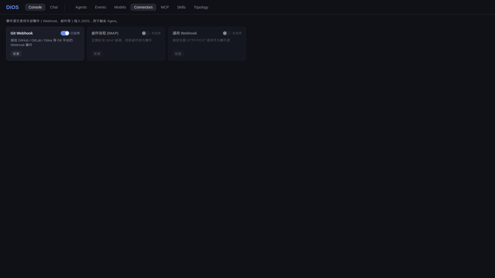

# DiOS

> 单机部署的事件驱动 Agent 控制平面：接入事件、调度 Agent、管理资源，并记录每次执行。

DiOS 管理 Agent，Agent 完成工作。它基于 [DiAgent](https://github.com/HQIT/DiAgent)，把 Git、邮件、Webhook 或定时任务路由给合适的 Agent，在隔离容器中执行。

<p align="center">
  
</p>

## 能做什么

| 接入与路由 | 执行与治理 |
| --- | --- |
| GitHub / GitLab / Gitea Webhook、IMAP、HTTP、Cron | service 常驻 Agent 与 task 一次性 Agent |
| CloudEvents 标准化、订阅规则、条件匹配与去重 | LLM、MCP、Skills、工具授权、审批、日志与审计 |

## 界面

<table>
  <tr>
    <td width="50%"></td>
    <td width="50%"></td>
  </tr>
  <tr>
    <td align="center">统一管理事件来源</td>
    <td align="center">配置与查看 Agent</td>
  </tr>
</table>

## 快速启动

需要 Docker 和 Docker Compose：

```bash
git clone --recurse-submodules https://github.com/HQIT/DiOS.git
cd DiOS
docker compose up -d
```

打开 `http://localhost:3000`。API 默认位于 `http://localhost:8000`。

部署时可在 Compose 环境中分别设置 `DIOS_DIAGENT_IMAGE` 和 `DIOS_DIAGENT_SERVICE_IMAGE`，选择已验收的一次性任务和常驻镜像。使用仓库 digest 引用时，先在 backend 所连接的 Docker daemon 上拉取镜像。

### 本地开发使用 DSH

将 DiAgent 的 `rewrite/dsh-v0.1` 分支检出到与 DiOS 并列的 `DiAgent-TS` 目录。若检出到其他位置，设置 `DIAGENT_BUILD_CONTEXT` 指向该仓库根目录。

```bash
docker compose -f docker-compose.dev.yml --profile build build diagent-task-build diagent-build
docker compose -f docker-compose.dev.yml up -d backend frontend
```

开发环境的前端在 `http://localhost:3001`，API 在 `http://localhost:8081`。backend 使用构建出的 `dios-diagent-task:dsh-dev` 和 `dios-diagent-service:dsh-dev`。已在运行的常驻 Agent 会复用现有容器，需要停止旧容器后重新启动 Agent 才会使用新镜像。

#### 常驻 Agent 的受管模型

使用支持受管推理的 DSH 常驻镜像时，可为 backend 设置 `DIOS_DIAGENT_SERVICE_MODEL_PROXY=true` 和 `DIOS_ACCESS_TOKEN`。供应商地址和 API key 在 DiOS 的模型管理里配置，响应只返回空的 `api_key` 字段。把模型分配给常驻 Agent 后，DiOS 每轮发放只可用于该 Agent 和指定模型的授权。DiAgent 启动 DSH 前会核验授权归属，推理请求由 DiOS 转发。每轮最多 32 次模型调用，有效期 5 分钟，每次最多生成 4096 tokens。会话结束后撤销授权。该授权属于短期 bearer 凭据，持有者可以在授权范围和额度内发起推理。

切换前停止旧常驻容器，使用 DiOS 工作区根目录下独立的 Agent 目录，并将旧 `models.yaml`、`mcp_servers.json`、任务配置和备份移出 Agent 可读的挂载。受管模式检查这些已知旧文件和重叠工作区。修改工作区、切换模式或删除 Agent 前，先停止相关容器并等待已有任务收尾。启用受管模式后，DiOS 通过容器环境传模型代理地址及 Agent ID，并停止生成常驻模型目录和旧 MCP 配置。该模式覆盖在线 Chat 和常驻 A2A。需要回退时，先停止受管常驻容器，再关闭代理开关并使用旧模式启动。旧模式会重新生成 `models.yaml`。

受管 Chat 和常驻 A2A 只装配分配给该 Agent 的 Skills。Git 导入的 Skill 保留附属文件，控制台录入的指令由 DiOS 生成 `SKILL.md`。两者只读挂载到 `/workspace/skills/<skill-name>`。旧 Agent 迁移前确认所选 Skill 已安装或有有效指令。变更分配前，在运行 Docker 的主机执行 `docker stop dios-agent-<agent_id>`，更新 Agent 后由下一次请求启动新容器。

常驻 MCP 使用受管推理的轮次授权。为 Agent 分配 Streamable HTTP MCP 服务，并在 `capabilities.governance.allowed_tools` 填入允许的工具名称或通配规则。DiOS 的 Chat 和常驻 A2A 据此开启 MCP，经现有网关过滤工具发现及调用。缺少工具名单或使用其他 MCP 传输时，该服务不会被装配。上游地址和凭据留在 DiOS。上游会话绑定到单轮授权，轮次结束后撤销，并尝试关闭上游会话。常驻网关只提供 MCP 请求响应所需通道，独立 GET SSE 返回 405。

#### 一次性任务的受管模型

在 DiOS backend 设置 `DIOS_DIAGENT_TASK_MODEL_PROXY=true` 和 `DIOS_ACCESS_TOKEN`，并使用支持私有任务配置的 DSH Task 镜像。为各 Task Agent 在 DiOS 分配 OpenAI 兼容模型。DiOS 通过容器私有配置提供推理地址和短期 bearer，使用自己保存的供应商密钥发送上游请求。任务最多调用模型 128 次，每次最多生成 4096 tokens。任务完成、取消或启动失败时撤销授权。已发往供应商的请求可以完成，撤销约束后续调用。

受管任务通过 Agent 环境变量 `DIAGENT_TASK_TIMEOUT_MS` 配置运行超时，默认 30 分钟。关闭刷新时，模型令牌从签发起按任务时限加 2 分钟计算有效期。超时配置变更从下一次派发生效。MCP 凭据有独立的有效期。模型令牌到期后推理接口返回 HTTP 401，耗尽调用额度则返回 HTTP 429。若需重跑，可先检查已有产物或工具副作用，再重新派发任务。

追加 `DIOS_DIAGENT_TASK_MODEL_REFRESH=true` 可启用访问令牌换发。镜像须带 `org.hqit.diagent.task-model-refresh=1`，并使用默认非特权 Docker 配置。访问令牌默认 300 秒，可通过 `DIOS_DIAGENT_TASK_MODEL_ACCESS_TTL_SECONDS` 设置。访问令牌过期后，DiAgent 的本地代理换发访问令牌并重试被 401 拒绝的推理。任务的绝对截止和剩余调用额度继续有效。任务结束或取消时，两种凭据同时撤销。关闭刷新或回退镜像前先让受管任务收尾。

`DIOS_E2AG_INTERNAL_BASE_URL` 须从任务容器访问。使用 Compose 开发环境时默认是同网络的 `http://backend:8000`。切换前为每个 Agent 准备独立工作区，将遗留模型配置、包含供应商密钥的 `.env` 与备份移出 Agent 可访问的挂载。这个 Task 开关独立于常驻开关。回退前让受管任务收尾，再关闭 Task 开关，后续任务即使用兼容配置。

#### 按 Agent 选择工具

在 Agent 的高级能力 JSON 中设置 `diagent_tools`，也可通过 Agent 创建或更新 API 写入 `capabilities.diagent_tools`。已启用受管推理的 `service` Agent 在在线 Chat 和常驻 A2A 共用同一份名单。`task` Agent 在下一次派发时使用保存的名单。

```json
{
  "diagent_tools": ["skill", "mcp"],
  "governance": { "allowed_tools": ["lookup"] }
}
```

常驻 Agent 可选择 `shell`、`publish_event`、`skill` 和 `mcp`。一次性任务支持 `publish_event`、`skill` 和 `mcp`，开启任务模型代理和刷新后也可显式选择 `shell`、`read`、`write` 和 `edit`。原生文件工具的目标限定在任务工作区。Shell 交给 DSH 沙箱执行，可运行读写命令。显式 `[]` 只做问答，省略字段时沿用旧入口的默认规则。选择 `skill` 需要先分配 Skills。选择 `mcp` 需要至少一个已注册的 Streamable HTTP MCP 服务和工具白名单。一次性任务还需启用 E2AG `enforce`，DiOS 为该任务单独签发授权。选择 `publish_event` 后继续使用现有的独立事件发布凭据。工具名或上述资源配置校验失败时，保存接口返回 422。

只改工具名单会在下一轮生效。修改分配的 Skill 目录时仍按上文重建常驻容器。若回退到兼容模式，在关闭受管推理前从相关 Agent 的能力配置中移除 `diagent_tools`。

一次性任务需要带 `org.hqit.diagent.task-tool-selection=1` 标签的 DiAgent Task 镜像。DiOS 将任务配置和 MCP 轮次凭据放进目标容器私有目录，注册的内联 Skill 和已安装的 Skill 目录均按名单只读挂载。使用旧镜像时，带显式名单的 Task 会记录为启动失败。回退到旧镜像前可移除 `diagent_tools`，恢复旧任务的默认工具。

### 一次性任务的具名子 Agent

在 Task Agent 的高级能力 JSON 或创建、更新 API 的 `capabilities` 中配置 `subagents`。每个子 Agent 沿用任务模型，并有自己的角色提示和工具名单。

```json
{
  "diagent_tools": [],
  "subagents": [
    {
      "name": "reviewer",
      "description": "评审当前任务的产物",
      "prompt": "检查报告里的证据和结论。",
      "tool_selection": { "tool_ids": ["read"] }
    }
  ]
}
```

这个主 Agent 可以委托 reviewer，reviewer 可以读取工作区文件。子 Agent 的 `tool_ids: []` 表示该角色只进行文本推理。启用具名子 Agent 需要 `DIOS_DIAGENT_TASK_MODEL_PROXY=true` 和带 `org.hqit.diagent.task-subagents=1` 的 Task 镜像。给子 Agent 授予 `read`、`write` 或 `edit` 时，还需启用 `DIOS_DIAGENT_TASK_MODEL_REFRESH=true`。

给子 Agent 单独分配 Skill 时，在其 `tool_ids` 中加入 `skill`，并填写 `skill_names`。DiOS 从 Skill 库解析并只读挂载，子 Agent 通过 Skill 工具只能发现和加载自己的名单。给子 Agent 分配 MCP 时，在其 `tool_ids` 中加入 `mcp`，同时填写注册服务 ID 数组 `mcp_server_ids` 和原始工具名数组 `mcp_tools`。MCP 需要 Streamable HTTP 服务、E2AG enforce 模式和 Task Agent 的 `governance.allowed_tools`。子名单里的每个具体工具名必须符合该治理名单。两个角色可以连接同一服务，DiOS 分别签发各自的工具授权。两类能力都需要带 `org.hqit.diagent.task-subagent-resources=1` 标签的 Task 镜像。

给子 Agent 分配 MCP 时，主 Agent 必须显式设置 `diagent_tools`，且名单中不能包含 `shell`。这样配置文件里的角色凭据只由任务运行时装配。按角色分配覆盖 MCP 工具的发现与调用。有状态的上游仍使用现有一次性任务网关的会话语义。

旧 Python 子 Agent 的 `tools` 保持原来的工具筛选含义。迁移到 DSH 时先确认每个角色需要的工作区工具、Skills、MCP 服务和工具名。回退到旧镜像前移除 DSH 子 Agent 配置，或恢复原有配置。

### 查看和下载一次性任务产物

任务结束后，在 Console 的 **Events → 活动总览** 点击对应的任务条，展开产物预览并下载。DiOS 登记 `task_result.md` 及其所在运行目录内的 UTF-8 Markdown 报告。附加报告最多登记 16 份，合计最多 256 KiB。产物快照随任务保存，随后改动工作区文件不会改变下载内容。

外部调用方可从 `GET /api/os/a2a/tasks/{task_id}` 读取产物列表和 `artifactId`，再用 `GET /api/os/a2a/tasks/{task_id}/artifacts/{artifact_id}` 下载文本。启用了访问令牌的部署继续使用控制平面鉴权。

DiOS 从本轮产物目录回收主结果和 Markdown 报告。文件需要是普通文件，附加报告按上文的数量和体积上限登记。

迁移到 TypeScript DiAgent 的在线 Chat 时，需清理已有的非空 `capabilities.reasoning` 配置。DiOS 会把它转成 `custom_fields`，目前该 Chat 入口尚未支持这个请求字段。

#### DiAgent 的事件发布授权

启用控制面鉴权时，为需要 `publish_event` 的 Agent 配置独立随机令牌。将原令牌填入该 Agent 的 `env.DIAGENT_EVENT_ACCESS_TOKEN`。backend 的 `DIOS_DIAGENT_EVENT_GRANTS` 接收以 Agent ID 为键的 JSON，每项包含令牌的 64 位十六进制 SHA-256 摘要 `token_sha256`、允许的 Unix 通配来源列表 `source_patterns`，以及允许的事件类型列表 `event_types`。每个 Agent 使用不同的令牌，并与 `DIOS_ACCESS_TOKEN` 区分。

事件凭据可以读取事件目录和来源规则，并提交同时匹配两份名单的事件。DiOS 仍执行 Connector 契约、E2AG 审批和派发，并记录发布者 Agent ID。发布权限随 Agent 删除失效；移除 backend 中的授权配置并重新加载后，凭据也无法查询目录。轮换时更新授权摘要和 Agent 环境值，重建已运行的常驻 Agent 容器以读取新令牌。

在线 Chat 显示 DSH 的工具执行进度。如果提交的事件需要审批，Chat 会显示事件 ID 和事件日志入口。实际审批由 DiOS 的事件审批接口处理。

CLI 与 Console 使用同一组控制面 API：

```bash
python cli/dios registry mcp github
python cli/dios registry skills mcp
python cli/dios registry plugins
python cli/dios connector types
```

进一步了解：[Roadmap](ROADMAP.md) · [架构说明](docs/architecture.md) · [Connector 契约](docs/adr/0001-connector-plugin-contract.md)

## 项目边界

DiOS 负责事件、资源、调度和治理；DiAgent 负责单个 Agent 的推理与工具调用。当前路线以单机、单实例和可信操作者为边界，多租户与集群化暂缓。

## License

MIT
