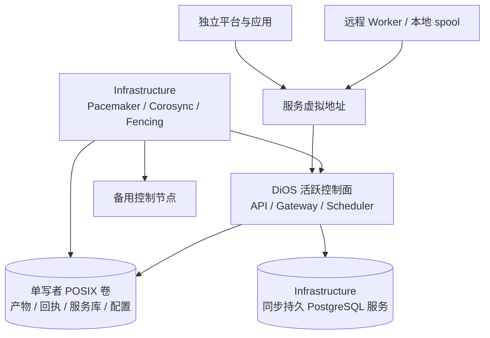

# 控制面主备与旧主隔离

DiOS 的 Linux HA 接入采用 Pacemaker/Corosync 管理主备控制面，节点隔离与持久存储由 Infrastructure 提供。API、网关、调度及其 POSIX 数据卷组成一个资源组，任一时刻由一个节点持有；远程 Worker 继续通过既有 mTLS、租约、E2AG 和补报协议执行。



## 责任与前提

| 能力 | 责任与约束 |
|---|---|
| 集群成员、仲裁、资源放置 | Corosync/Pacemaker；示例为三个投票节点，丢失多数时停止资源 |
| 旧主隔离 | Infrastructure 的受支持 STONITH 设备；确认旧节点断电或等效隔离后允许接管 |
| 产物与本地回执 | 独占挂载的持久块设备；同步持久、故障域、挂载路径由 Infrastructure 验证 |
| 权威 Runtime 元数据 | 既有 PostgreSQL 接口；数据库服务独立提供同步复制、旧主隔离和恢复契约 |
| 任务和授权 | DiOS 原有 Run/Attempt/Session、lease epoch、E2AG 与幂等检查；未知工具结果继续对账 |
| 客户业务 | 独立数字分身平台与客户应用 |

轻量部署继续使用 SQLite。该主备配置复用 [共享部署](../shared/README.md)，不向 DiOS 增加数据库复制或共识实现。产物卷同时包含旧服务库、工具回执、配置和共享安装目录，挂载点固定为 `/srv/dios-ha`。各节点上的 Docker 镜像须提前按相同摘要加载。

## 节点依赖

Ubuntu 24.04 的示例安装命令：

```sh
sudo apt-get install --no-install-recommends pacemaker corosync resource-agents-base resource-agents-extra fence-agents-virsh docker.io docker-compose-v2
```

`Filesystem` 由 `resource-agents-extra` 提供，`IPaddr2` 由 `resource-agents-base` 提供。接入前用 `crm_resource --show-metadata ocf:heartbeat:Filesystem`、`crm_resource --show-metadata ocf:heartbeat:IPaddr2` 和 `crm_resource --show-metadata stonith:fence_virsh` 检查每个候选节点；只通过 CIB 校验不能证明节点已安装代理。包名、服务权限和 firewall 管理由目标发行版的 Infrastructure 安装清单固定。

## 配置文件

- `pacemaker.example.xml`：标准 CIB 范本。资源按卷、控制服务、虚拟地址顺序启动，反序停止。卷或控制服务停止失败触发 fencing。未获允许的节点不放置资源。隔离设备失败记录在 180 秒后过期，集群每 15 秒重算；重试仍必须获得真实隔离成功回执。180 秒高于本范本最长资源操作超时 120 秒，调整操作超时时须同步调整该值。
- `dios-control.service`：集群管理的 systemd 服务。启动先核验挂载并等待 Compose 启动条件满足，再持续监视容器进程；任一容器退出结束服务。启动失败和停止均清理本组容器。服务不设置开机启用入口。
- `compose.ha.yaml`：叠加 Linux 与共享部署配置，关闭 Docker 自行重启，声明受控监听地址。需要支持 `!override` 的 Docker Compose 2.24.4 及以上版本。

Pacemaker 的服务监测观察 systemd/Compose 进程；应用请求、模型等待和远端 Worker 新鲜度继续由 DiOS 监控呈现。容器存活但应用请求失效的重启策略需在实际环境中与 #46 告警联动验收。

示例节点 `control-a/b/c`、`192.0.2.50`、`hypervisor.example.invalid` 和 `EXAMPLE-dios-ha-volume` 必须替换。`fence_virsh` 只展示标准虚拟机 fencing 接口；裸机、云主机采用对应受支持代理。fence 密钥通过节点上的受控文件提供，配置不包含明文密码。

三个节点必须能独立访问仲裁网络和隔离设备；只有共享磁盘或同宿主虚拟机无法证明物理故障域独立。将副本数设为 1、删除 Pod、改变路由或设置只读页面均不能替代旧节点隔离。

## 接入顺序

1. Infrastructure 准备节点、Corosync 成员、合格 STONITH 设备、独占持久卷和 PostgreSQL HA 服务，记录版本、故障模型及同步持久保证。验证每个节点失联时，其余节点仍能完成隔离。
2. 在共享卷的 `install` 目录准备既有 Linux/共享部署文件、固定镜像摘要和受保护配置；`DIOS_ROOT` 指向卷内安装路径。配置 `DIOS_HA_BIND=0.0.0.0`，由节点防火墙仅放行 VIP 的服务端口；服务先于 VIP 启动，不能绑定尚未存在的 VIP。节点管理地址禁止访问这些端口，服务证书覆盖虚拟服务 DNS。
3. 在每个候选节点安装本目录 unit 和覆盖文件至 `/etc/systemd/system/dios-control.service`、`/etc/dios-ha/compose.ha.yaml`，执行 `systemctl daemon-reload`。服务、卷和 VIP 均只由集群管理；旧 Compose/systemd 自动启动入口必须停用。
4. 将基础设施实际参数填入 CIB，以 `crm_verify --xml-file <候选.xml>` 检查配置，用 `crm_simulate` 查看节点失效、无仲裁和停止失败的动作图。保留现有集群资源及 fencing 配置，使用 Pacemaker 的 shadow/CIB 工具审阅后应用。
5. 首次应用保持维护状态和入口关闭。先验证资源、权限、固定版本及备份，再解除维护。既有恢复副本的 `restore_hold` 仍须完成 K02-3.02 的源控制面隔离条件。
6. 计划切换前先沿用 DiOS `upgrade drain/wait` 排空，再请求集群迁移资源。故障接管在旧节点已隔离后恢复服务，Worker 使用原任务身份重新对账；无法确定的外部动作保留未知状态。

## 资格与完成条件

`crm_verify` 与 `crm_simulate` 验证配置结构及 Pacemaker 的动作依赖；它们不执行断电、挂载或真实数据库复制。[三节点 Linux 虚拟机验证](../../docs/design/evidence/ha-live-20261126.json)已覆盖真实旧主断电接管、原任务/会话恢复、E2AG 撤权保留、旧主重新入群及无仲裁停服。D01-3.01 已完成控制面集成与[隔离/持久契约](contract.md)；[停止超时及数据库断连](../../docs/design/evidence/ha-recovery-20261126.json)、[数据库暂停](../../docs/design/evidence/ha-stall-20261126.json)补齐恢复路径。D01-3.02/.03 负责物理跨主机、复制恢复及 RPO/RTO 实测。

### 可复现的离线策略检查

```bash
docker build -f deploy/ha/qualification.Dockerfile -t dios-ha-tools deploy/ha
backend/.venv/bin/python scripts/qualify_ha_policy.py \
  --tools-image dios-ha-tools --output workspace/ha-policy-check
```

输出目录须不存在。工具容器禁用网络，仅挂载配置与输出目录，不连接 Docker socket。记录使用的镜像摘要、软件包版本、配置摘要和原生动作图；发行版软件包更新后应重新验证。

[已记录的策略结果](../../docs/design/evidence/ha-policy-20261126.json)包含七项通过检查及原生动作图：配置合法、顺序同节点启动、旧主失联、服务停止失败、卷停止失败、无仲裁反序停止、缺少隔离设备时禁止接管。缺少设备场景同时删除配置和节点执行器的设备登记；仅删除配置仍可能留下可用的孤立设备。

企业档权威元数据的已确认提交目标 RPO 为 0、单控制节点或数据库主节点失效目标 RTO 不超过五分钟，沿用 [容量契约](../../docs/design/capacity-slo-v1.md)。单宿主三虚拟机的一次旧主暂停故障中，API 在约 22 秒后恢复，原任务、尝试和会话保持一致；该样本用于控制接管验证，企业档复制及物理故障 SLO 由 D01-3.02/.03 实测。

## 故障验证

[实机资格步骤](qualification.md)包含旧主失联、隔离设备不可达、仲裁丢失、重新入群与任务/产物一致性。保留默认有限即时隔离重试次数，通过原生 `failure-timeout` 和 `cluster-recheck-interval` 恢复设备探测；不把故障记录清理或人工重启计为自动恢复。

## 方案依据

[Pacemaker 资源组](https://clusterlabs.org/projects/pacemaker/doc/3.0/Pacemaker_Explained/html/collective.html)提供顺序、同节点和反序停止；[ClusterLabs FAQ](https://projects.clusterlabs.org/w/clusterlabs/faq/)明确 fencing 对单活及数据完整性的作用；[官方命令行工具](https://clusterlabs.org/projects/pacemaker/doc/3.0/Pacemaker_Administration/html/tools.html)用于配置验证和模拟。

PostgreSQL HA 可由已有托管服务或经过资格验证的成熟实现承接。[Patroni 同步模式](https://patroni.readthedocs.io/en/latest/replication_modes.html)说明严格同步与可用性的取舍，并指出等待同步提交时取消连接可能暴露尚未复制的本地事务；[Watchdog 文档](https://patroni.readthedocs.io/en/latest/watchdog.html)说明进程暂停时需要独立隔离保障。因此复制、取消提交、权限/预算提交及外部动作必须共同进入故障资格，单纯配置同步参数不足以签署 E2AG 的完整持久保证。

Pacemaker、Corosync、资源代理和 fencing 代理通过 Infrastructure 的发行版软件包安装；许可证及支持条件随部署清单登记。DiOS 保留与集群产品独立的业务无关 API，不复制上游实现。

[Pacemaker 资源失败过期规则](https://clusterlabs.org/projects/pacemaker/doc/2.1/Pacemaker_Explained/html/resources.html)规定 `failure-timeout=0` 表示失败记录不自动过期，并要求过期时间高于最长资源操作超时；[2.1.6 隔离实现](https://github.com/ClusterLabs/pacemaker/blob/Pacemaker-2.1.6/daemons/controld/controld_fencing.c)保留有限即时重试和成功后的失败计数重置。
