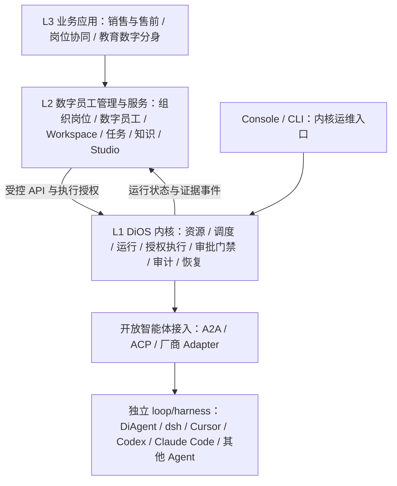

# DiOS 架构

目标架构的原则、图解与评审入口见 [架构基线 v0.2](architecture/README.md)，工程规范见 [工程手册](engineering/handbook.md)。本页保留目标概览与现有实现结构。

> 更新日期：2026-11-11。目标分层依据 [ADR 0003](adr/0003-layered-digital-workforce-platform.md)，实施顺序见 [Roadmap](../ROADMAP.md)。
>
> **NANA**（**N**etwork **A**ttached **N**ative **A**gent）是一类可通过网络接入的本地化 AI Agent 设备或系统。DiOS 是其操作系统层，与 DiAgent 同属 DiFlow 工具链。

## 目标产品分层



目标是可扩展的企业级平台，首先支持单企业内多部门、多用户、多岗位。各层可先同仓库、同进程、单机验证，以模块、接口和数据所有权建立边界；Worker、队列和存储可独立扩展，多节点运行与高可用在企业交付阶段验收。上图描述目标结构；下文“现有工程结构”起描述当前实现。

## 各层职责与数据归属

| 层 | 职责 | 数据模型 |
| --- | --- | --- |
| L1 DiOS 内核 | Agent 生命周期、事件接入与调度、资源注册、运行隔离、身份校验、策略与审批执行、用量/配额、审计及恢复 | Instance、AgentDefinition / Revision / Deployment / Run、Artifact、资源与能力引用、Policy、ApprovalRequest、AuditEvent |
| L2 管理与服务 | 组织岗位、SSO、数字员工、任务与人机协作、Workspace、知识与记忆、能力准入、Studio、发布与运营 | Organization、User、Position、DigitalEmployee、WorkItem、Workspace、KnowledgeSpace、Release、Evaluation |
| L3 业务应用 | 行业工作台、客户流程、场景模板、外部业务对象适配、业务指标 | 线索、报价、计划、课程等场景引用与配置 |

DiOS 对 Agent 实现保持中立，loop/harness 由接入的智能体提供。DiAgent 是当前执行实现；dsh、Cursor、Codex、Claude Code 等通过标准协议或厂商适配进入目标架构。托管运行与远端委派分别声明生命周期、权限控制和证据能力，见 [接入架构](architecture/agent-interoperability.md)。数字员工是 L2 的长期服务身份，可驱动多个 Agent 和多次 Run。WorkItem 负责业务完成状态，Run 负责技术执行状态。

L2 Workspace 管项目、文件、会话和协作；内核的 execution workspace 管运行目录、挂载与隔离。长期知识和记忆由 L2 Provider 管理，内核记录引用与执行证据。

### 接口与授权契约

- `/api/os/*`：现有内核 API；服务 Console、CLI 和受信集成。
- `/api/apps/{app}/*`：现有 App 专属接口。
- `/api/workforce/*`：规划中的 L2 服务接口；Schema 与版本由 P0 冻结。

依赖方向为 L3 → L2 → L1。L2 通过公共 API 或等价受控服务契约调用 L1，各层拥有独立实体与迁移；内核以通用事件反馈运行状态和证据。

组织角色、对象 ACL 和审批责任由 L2 解释；内核校验主体、代理权限、资源范围、授权期限和策略版本。关联标签不能作为权限证明。审批绑定到具体动作和参数，执行前检查审批与授权的有效性。知识服务在读取/检索边界执行源数据 ACL，内核执行对应工具、凭据、网络和文件范围约束。

Console 保留资源、事件、部署和运行治理界面。上层建设数字员工工作台、主管视图及管理界面，分别服务不同角色。

## 现有 Runtime 与 App

当前 `service` 常驻 Agent 提供 OpenAI 兼容的 `/v1/chat/completions` 接口，支持多轮会话；`task` Agent 由事件触发，执行单次任务后结束。二者使用 DiAgent，Runtime Adapter 的统一生命周期契约按 Roadmap P1 建设。

现有 Console 管理 OS 资源，Chat App 提供流式对话与自身会话持久化。它们继续使用原 API；新增通用组织、工作和共享会话服务放在 L2。

## 现有工程结构

```
backend/
  main.py
  app/
    api/
      os/                # OS 级 API（Agent/Model/Event/MCP 等管理）
        agents.py
        models.py
        events.py
        ...
      apps/              # App 级 API（各 App 的后端逻辑）
        chat.py          # Chat App: proxy to DiAgent, SSE streaming
    services/
      docker_runner.py   # 一次性任务容器管理
      agent_runtime.py   # 常驻 DiAgent 服务实例管理
      ...

frontend/
  src/
    App.tsx              # App Shell（仅负责 App 切换）
    api/
      os.ts              # OS API client
      chat.ts            # Chat App API client
    apps/
      console/           # Console App（现有管理页面）
      chat/              # Chat App（聊天界面）
    components/          # 公共组件
```

## 操作系统类比

| OS 概念 | DiOS 对应 |
|---------|-------------|
| 内核 + 系统调用 | DiOS 核心（调度 + 资源管理），API: `/api/os/*` |
| CPU / GPU | LLM 端点 |
| 文件系统、网络、设备 | Skills、MCP Server |
| 进程 | Agent（DiAgent 实例） |
| Shell / GUI | App（Chat App、Console App 等） |

## Agent Runtime Manager

OS 层核心服务，为每个 `mode=service` 的 Agent 按需启动独立的 DiAgent 容器。

**核心流程：**

1. Chat App 发起聊天请求
2. Chat API 调用 `ensure_running(agent_id)` —— 如果容器已 running 直接返回 URL，否则启动新容器
3. Runtime Manager 为 Agent 生成 `models.yaml`（从 OS 的 LLM 模型库同步）、`mcp_servers.json`
4. 通过 Docker SDK 启动独立 DiAgent 容器，注入环境变量（`AGENT_SYSTEM_PROMPT`、配置路径等）
5. 等待健康检查通过后记录到 `agent_runtimes` 表
6. 每个 Agent 有独立容器，互不干扰

**数据表 `agent_runtimes`：** `agent_id` (PK) / `container_id` / `url` / `status` / `started_at`

**配置：** `DIOS_DIAGENT_SERVICE_IMAGE` 指定服务模式镜像（默认 `dios-diagent:latest`）

**Docker Compose：** 固定的 `diagent` 服务已移除，改为 `diagent-build` profile 仅构建镜像，Runtime Manager 动态管理容器。

## Chat App 消息持久化

Chat App 管理自己的会话和消息历史，DiAgent 保持无状态。

**数据表：**

- `chat_sessions`：`id` / `agent_id` / `title` / `created_at` / `updated_at`
- `chat_messages`：`id` / `session_id` / `role` / `content` / `created_at`

**API 流程：**

1. 前端只发当前 user message + `session_id`（可选）
2. 后端从 DB 加载历史消息，拼接 system_prompt + history + user message
3. 通过 Runtime Manager 获取 DiAgent URL，转发完整 messages
4. 流式返回的同时收集 assistant 回复，完成后存入 DB
5. Response Header `X-Session-Id` 返回 session ID（新建时前端据此绑定）

**前端交互：**

- 左侧 sidebar：Agent 列表 + 选中 Agent 的会话列表
- 切换会话时从 API 加载历史消息回显
- 新建会话：首次发消息时自动创建
- 支持删除会话

## 现有实现与演进决策

- **会话状态**：放在 App 层，Chat App 自行管理 session/message 持久化，每次给 DiAgent 的是完整 messages 列表。后续多 App 共享会话通过 L2 会话服务提供，内核只保留执行关联与授权信息。
- **Agent 运行时隔离**：每个 service Agent 有独立的 DiAgent 容器，通过 Runtime Manager 按需启动和管理，互不干扰。
- **Agent 运行时统一**：常驻和一次性 Agent 底层使用同一套 DiAgent 运行时，区别仅在调度策略（长驻 worker vs 单次 job）。
- **App 可扩展性**：Backend 通过 `/api/apps/{app}/*` 为每个 App 提供独立命名空间；Frontend 通过 `apps/` 目录约定，每个 App 是独立模块，App Shell 只负责切换。新增 App 只需加一个 backend router + 一个 frontend 目录，不改 OS 核心。
