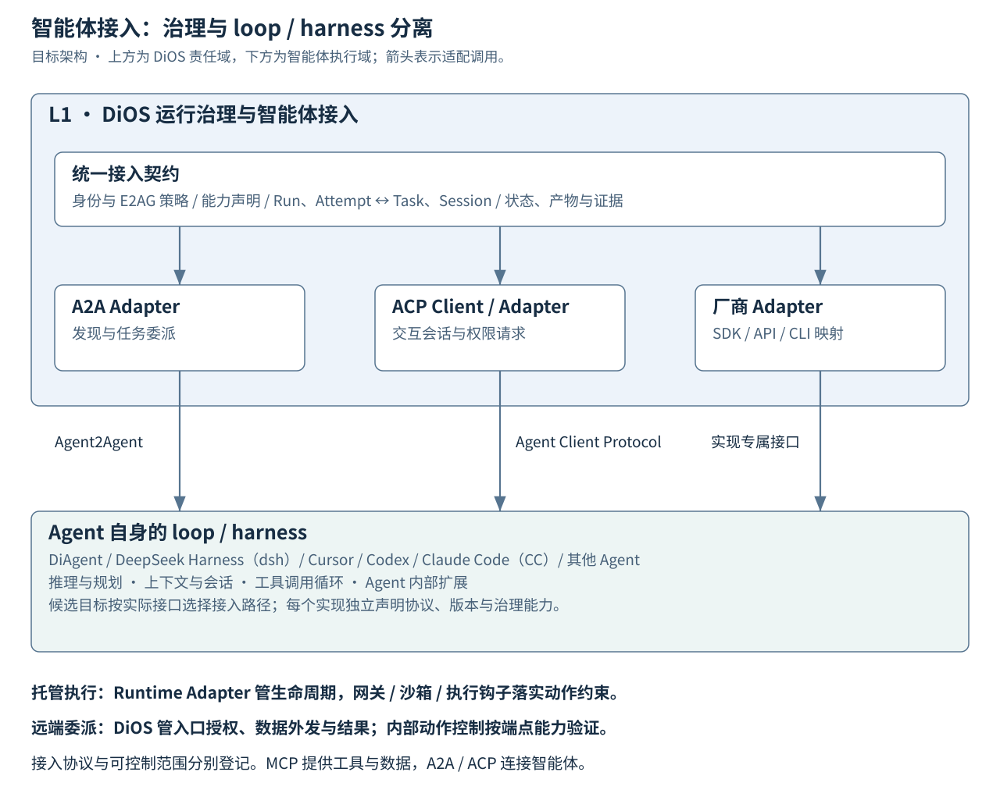

# 开放智能体与 Harness 接入

版本：0.2 · 状态：待评审 · 关联：AP-07/AP-12、AR-11、F01-1、K01-4、K03-2。

## 责任边界

DiOS 统一管理数字员工所使用的执行能力，Agent 自身负责推理、规划、上下文管理和工具调用循环。Loop/harness 可以由 DiAgent、DeepSeek Harness（dsh）、Cursor、Codex、Claude Code（CC）或其他实现提供。

L1 内的 Agent 接入模块负责协议协商、会话/任务关联、权限映射、状态转换和证据归集。Runtime Adapter 负责平台托管进程/容器的生命周期；协议 Adapter 负责与智能体交互。两种适配分别建模，可组合使用。

**图 5：DiOS 管理工作负载，智能体提供 loop/harness。** 三类接入路径按实际接口选择，图中的产品是候选接入目标。协议支持、治理能力与版本分别登记、验证。

## 协议分工

| 契约 | 交互目的 | DiOS 接入责任 |
| --- | --- | --- |
| A2A — Agent2Agent | 向独立智能体委派任务，交换状态与产物 | Agent Card/端点发现、认证、任务标识映射、结果和事件接收；取消与恢复按协商能力处理。 |
| ACP — Agent Client Protocol | 客户端驱动智能体的交互会话 | DiOS 接入模块充当 Client，管理会话、提示、流式事件与权限请求；L2 Studio 消费经授权的交互视图。 |
| 厂商 SDK / API / CLI | 接入尚无适用标准入口的实现 | 插件 Adapter 转换厂商接口；维护版本、错误与权限映射，以相同平台契约对外。 |
| MCP | 智能体访问工具、数据与资源 | 使用受控工具入口和作用域凭据；与会话/任务协议协作。 |

A2A 面向独立智能体协作，允许远端内部实现保持不透明；ACP 面向客户端与智能体的交互会话。依据：[A2A 官方说明](https://a2a-protocol.org/latest/)、[ACP 协议定位](https://agentclientprotocol.com/get-started/related-protocols)。

文档中 ACP 固定指 **Agent Client Protocol**。另一个同名的 Agent Communication Protocol 已并入 A2A，历史接入按实际需求提供迁移适配。依据：[原 ACP 项目说明](https://agentcommunicationprotocol.dev/introduction/welcome)。具体协议版本、扩展和传输在接入清单中固定，远端 ACP 能力按相应规范版本验证。

## 候选接入目标与证据

| 智能体 | 已确认的接入依据 | DiOS 后续工作 |
| --- | --- | --- |
| DiAgent | 当前 DiOS 已有 service/task 运行路径 | 纳入统一契约与治理验收。 |
| DeepSeek Harness（dsh） | 官方固定提交提供原生 ACP Profile，支持持久会话 list/resume/close | 验证取消、恢复、权限和产物；resume 与历史重放分别建模。 |
| Cursor | ACP 官方 Agent 名录列出 Cursor | 验证所选版本、认证、会话和权限能力。 |
| Codex | ACP 官方名录列出通过 Adapter 接入的 Codex CLI | 固定 Adapter 与后端版本，验证状态、审批、取消和恢复。 |
| Claude Code（CC） | ACP 名录列出通过 SDK Adapter 接入的 Claude Agent | 核对目标 CLI/SDK 组合与能力差异，形成映射和测试。 |
| 其他智能体 | 标准端点或明确的 SDK/API/CLI 契约 | 通过同一发现、准入、授权和验收过程加入。 |

协议生态信息核对日期：2026-11-11。依据：[ACP 官方 Agent 名录](https://agentclientprotocol.com/get-started/agents)、[DeepSeek Harness 项目](https://github.com/deepseek-ai/deepseek-harness)。这些信息说明可评估的接入路径；DiOS 的接入完成状态由实现与契约测试确定。

带固定版本、来源、实测证据和不支持项的详细清单见 [F01-3 能力矩阵](../design/agent-integration-capability-matrix.md)。首轮组合为当前 DiAgent 任务路径与 Cursor ACP，dsh 用于验证 Harness 替换；A2A 标准符合性和实际只读控制仍为准入条件。

## 治理能力与信任边界

平台托管的 Agent 可以由 DiOS 管理进程、凭据、挂载和网络；逐工具检查仍需真实工具网关、沙箱或可验证执行钩子。远端委派型 Agent 则由运营方管理内部执行，DiOS 控制入口授权、数据外发、任务预算、结果接收及可观测的状态。

| 维度 | 托管执行 | 远端委派 |
| --- | --- | --- |
| 生命周期 | 管理进程/容器与租约 | 管理连接和任务；远端生命周期由服务方负责 |
| 工具权限 | 在已接入网关/沙箱/执行钩子处约束 | 按远端合同能力与可验证证据约束 |
| 取消与撤销 | 撤销后续动作、凭据，停止受管进程 | 撤销本地访问并请求取消；记录远端确认及未知结果 |
| 审计与重现 | 固定版本及配置，记录边界动作 | 保存远端标识、声明版本、能力快照和返回证据 |
| 高风险动作 | 满足要求的实际执行边界后准入 | 要求等效控制与证据；能力不足的端点不分派该类工作 |

协议事件中的“工具开始/完成”用于观测；是否能阻止动作，必须由实际控制点的拒绝测试证明。ACP 权限请求可以映射为平台审批，覆盖范围由 Agent 实现决定。A2A 任务受理也不代表远端内部动作已逐项获得平台授权。

L1 Run 是平台调用与治理记录；远端 Task/Session ID 及其状态保留为独立事实。断连、超时和取消请求未确认时记录待确认状态，经查询、对账或人工处理收敛。外部端点的调用不得套用“重启本地进程”恢复规则。

## 统一接入契约与验收

接入清单至少记录协议/版本、传输、端点或启动方式、认证方式、Adapter 版本、Agent 版本或不透明标记、配置摘要、支持的会话/任务能力、取消/恢复语义、产物类型、用量可见性、审批与工具控制点、数据外发/保留范围及证据等级。

能力需逐项声明并验证；策略按工作风险匹配必要能力。能力缺失返回明确的不支持结果，变更执行范围需重新授权。平台身份、远端服务账号和用户授权分别映射，凭据使用 Secret 引用与最小作用域。

首轮验收选择至少两个不同来源的 Agent，其中包含一个第三方 harness；覆盖可用的 A2A 任务路径和 ACP 交互路径。验证会话/任务关联、流式输出、产物、取消、断连重连、重复消息、审批拒绝和权限撤销。高风险任务必须证明实际执行约束；不透明端点在能力矩阵中标明可见与可控制范围。

任务安排：F01-3 勘察真实接口与能力并确定首轮组合；F01-1 固定接入契约，F02-1 固定跨边界授权；K01-4 实现协议适配，K03-2 实现基础治理，K01-5 完成跨智能体联合验收。见 [整体计划与下一批工作](../planning/open-agent-plan.md) 和 [ADR 0004](../adr/0004-open-agent-harness-interoperability.md)。
