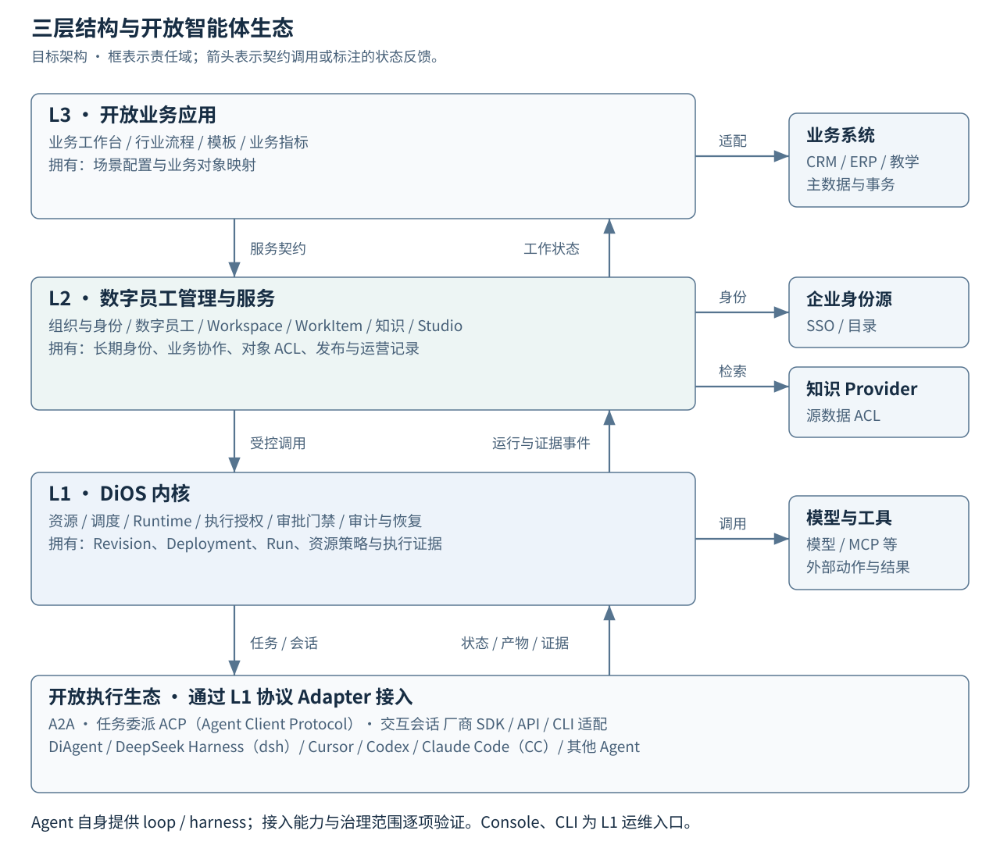
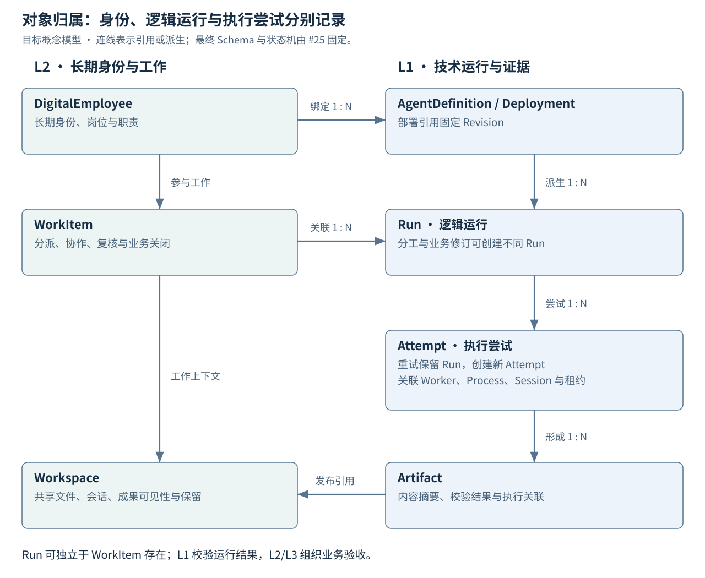
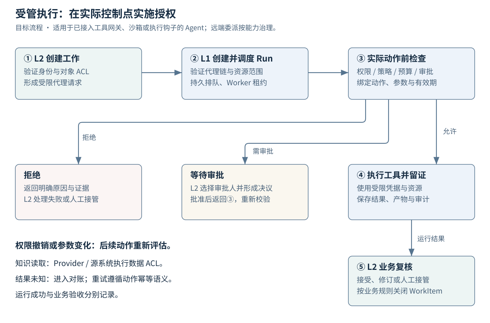
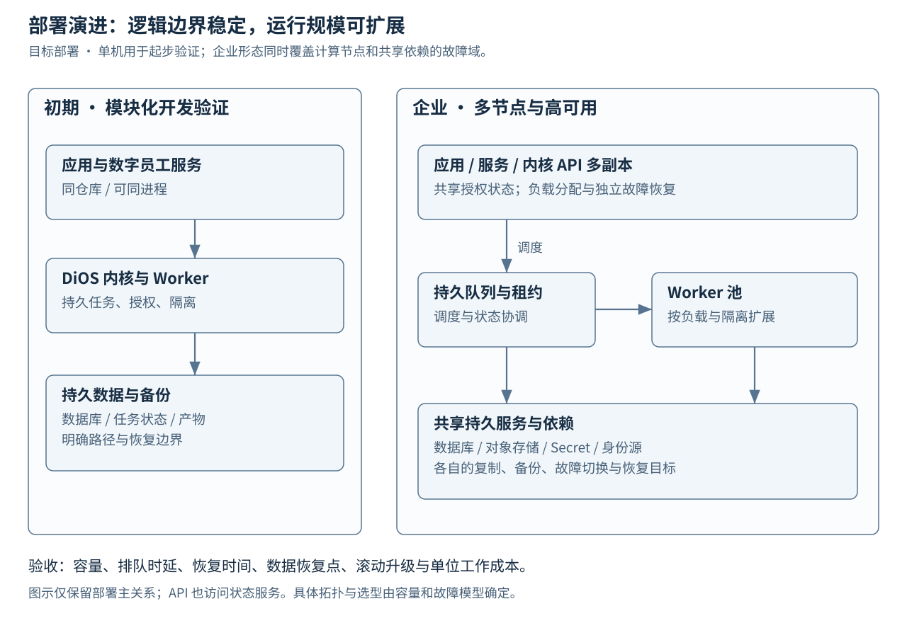
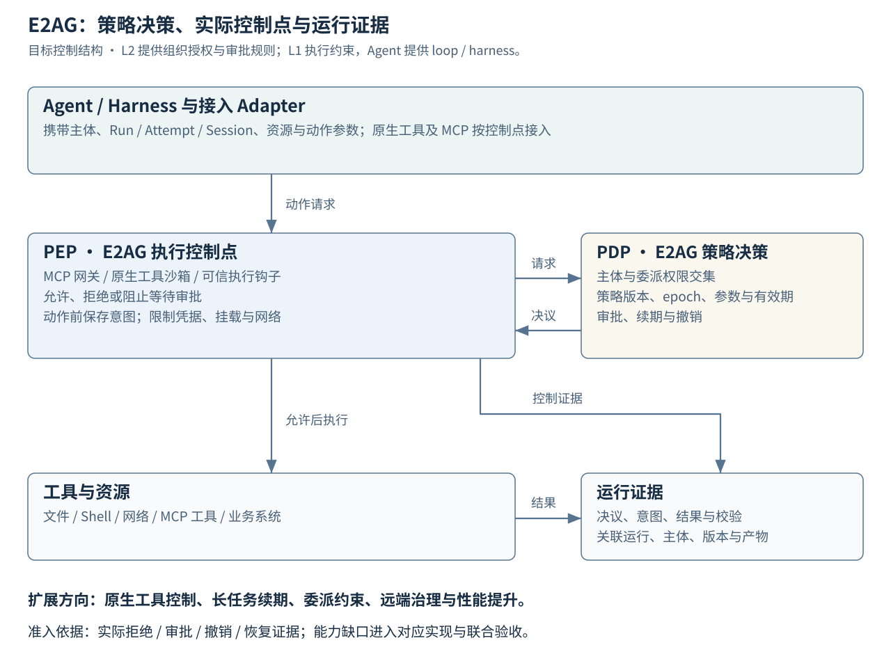

# 架构逻辑与图解

版本：0.3 · 状态：已接受（G0）。本文说明目标结构；现有代码范围见 [现有架构](../architecture.md)。

## 1. 从企业工作到受控运行

用户通过业务工作台使用数字员工。管理服务确定员工职责、工作上下文、协作关系与授权，再调用 DiOS 创建和治理执行。DiOS 调度 Runtime，限制工具与资源访问，并返回运行状态和证据。管理服务据此组织业务复核，应用呈现最终成果。

**图 1：责任边界决定模块边界。** 实线框表示目标责任域；向下箭头表示受控调用，向上箭头表示通用状态与证据事件。图中各层均含自身持久状态，箭头跨越显式契约。企业身份源、知识和业务系统通过适配契约接入。

L1 提供资源、调度、生命周期、隔离和执行授权等操作系统能力。L2 提供可跨场景复用的组织、数字员工、Workspace、WorkItem、知识与运营服务。L3 管理场景流程、界面和外部业务对象映射。Console 与 CLI 是内核运维入口。

**Agent loop/harness 由接入的智能体提供。** DiOS 通过 A2A、ACP（Agent Client Protocol）与厂商适配接入 DiAgent、DeepSeek Harness（dsh）、Cursor、Codex、Claude Code（CC）等实现。协议 Adapter 管交互，Runtime Adapter 管托管进程生命周期；远端 Agent 可作为独立服务被委派。具体图解、协议分工与治理能力见 [开放智能体接入](agent-interoperability.md)。

### 契约与数据边界

| 边界 | 输入与输出 | 所有权与一致性 |
| --- | --- | --- |
| L3 → L2 | 工作请求、业务引用；工作状态与成果引用 | L3/外部系统拥有业务主数据；L2 拥有工作协作记录。 |
| L2 → L1 | 固定 Revision、执行输入、主体与受限授权、关联标识；Run 与 Artifact 引用 | L1 拥有运行事实；L2 通过查询与事件投影工作状态。 |
| L1 → 托管 Runtime | 经验证的执行计划、短期凭据与资源限制；运行信号和结果 | L1 是受管运行记录权威；Worker 仅在有效租约内执行。 |
| L1 → 独立 Agent | 任务或会话请求、端点授权；状态、结果和产物 | L1 保存平台 Run；远端拥有其执行事实，Task/Session 独立映射并对账。 |
| L2 → 知识 Provider | 调用主体、数据范围、查询和版本；受 ACL 约束的结果与来源 | Provider/源系统执行实际数据访问控制；L2 管理知识配置与权限映射。 |
| L1 → 外部工具 | 授权动作、受限参数与幂等标识；业务结果或待确认状态 | 外部系统拥有其事务事实；平台保存响应与对账引用。 |

层间各自提交本地事务。可靠事件传递、重复消费去重、版本和乱序处理进入 F01-1/K01-2 详细设计；可评估事务发件箱及等价机制。事件表达已发生的事实，携带对象、版本、关联与来源标识。消费者可重建投影，通过权威查询校正遗漏；跨层事务的补偿责任需明确。

## 2. 数字员工、工作和执行的关系

**图 2：身份、工作与运行分别持久化。** 连线表示引用关系，基数为目标概念约束，最终 Schema 由 F01-1 固定。L2 保存业务验收；L1 保存运行事实。运行删除与产物保留遵守独立生命周期策略。

数字员工可以绑定多个 AgentDefinition 和 Deployment。一项 WorkItem 可以经历多次 Run，承载分工与业务修订；同一逻辑 Run 的重试创建新的 Attempt；自动化事件也可以直接触发没有 WorkItem 的内核 Run。存在 WorkItem 的运行携带其关联标识，具体父子运行模型在领域设计中确定。

L2 Workspace 管文件、会话、协作与共享，L1 execution workspace 管一次执行可访问的目录、挂载和隔离范围。Artifact 记录运行产物及摘要；发布到共享空间时由 L2 决定可见性、版本、保留和业务归属。引用与审计证据按照保留策略处理，涉及个人数据时另行确定删除与留存规则。

## 3. 一项需要审批的企业工作

以“数字员工整理资料并提交一份对外报价”为例。查询资料与发送报价分别声明权限；审批绑定实际提交对象、动作、参数摘要、主体和有效期。

**图 3：托管执行中的动作授权。** 主流程按编号阅读；拒绝、等待审批和继续执行是不同结果。该流程用于已接入实际执行控制点的 Agent；远端委派的可控制范围见开放智能体接入说明。Run 的成功结果进入 L2 复核后，才能由业务规则关闭 WorkItem。

1. L2 验证用户身份、工作对象 ACL 与数字员工职责，创建 WorkItem，形成受限代理请求。
2. L1 验证服务身份和代理链，并将调用者、受托服务、工作负载和目标资源的授权约束取交集。标签与组织名称只用于关联。
3. 调度器持久化 Run 与 Attempt，Worker 领取带 fencing epoch 的租约；实际工具调用前由 E2AG 的决策服务与执行控制点检查授权、策略版本、预算与动作参数。
4. 需要审批时，L1 形成 ApprovalRequest 并阻止动作；L2 负责选择审批人、待办和升级。审批结果送回 L1 校验，参数或授权变化触发重新评估。
5. 工具执行后记录运行结果、产物与证据；L2 处理业务复核、修改或人工接管。

知识检索在 Provider/源数据访问边界执行 ACL。执行期间权限撤销需要传播到后续动作、凭据与挂载访问；撤销生效时限由 F02-1 定义，K03-3 验收。已经发生的外部副作用通过补偿或业务处置处理。

### 故障与恢复责任

| 情况 | 系统行为 | 主要责任 |
| --- | --- | --- |
| 重复事件或客户端重试 | 基于业务/运行幂等标识去重，返回已有结果或状态 | L1 接入与调度，L2 工作创建 |
| Worker 宕机或租约到期 | 提高所有权 epoch，拒绝旧所有者写入；核对进程/远端状态和副作用后决定恢复 | L1 调度与 Runtime Adapter |
| 查询超时或事件过期 | 标记观测过期/待确认，保留任务所有权；单独检查进程和远端状态 | L1 观测与 Adapter |
| 网络/限流/额度恢复 | 按错误类别退避；单路半开试恢复成功后逐步恢复并发 | L1 调度与 Provider 健康管理 |
| 运行中升级 | 停止领取新任务，等待活跃 Attempt 排空并对账，再转交所有权 | L1 调度、Runtime 与交付运维 |
| 外部动作超时，结果未知 | 保留待确认状态，查询外部结果；必要时对账和人工接管 | L1 Connector + L2 业务流程 |
| 策略或审批过期、撤销 | 在动作边界拒绝或重新审批；反馈可处理原因 | L1 强制执行，L2 协调 |
| 数据库或必要审计不可用 | 停止需要持久确认的动作；恢复后核对任务与证据 | L1/L2 各自服务与交付运维 |
| Run 成功但成果不合格 | WorkItem 保持待复核或退回，发起修订运行 | L2/L3 业务验收 |

## 4. 部署从模块化验证演进到企业规模

**图 4：逻辑边界稳定，部署形态逐步扩展。** 两栏都是目标部署设计，左栏说明初期验证形态，右栏说明企业验收形态。组件数量、数据库、队列与高可用产品由容量设计决定。

初期可同机运行应用与管理服务、内核和 Worker。需要保留持久数据路径、明确备份边界，并使调用经过同样的身份与权限检查。企业形态将管理服务和内核 API 多副本部署；Worker 按资源和隔离等级扩展，共享持久队列、数据库与对象存储支持恢复和调度。

多副本 API 需要共享会话/授权状态或可验证凭据，调度器需要租约、互斥或分区领导语义，Worker 需要防止过期执行者覆盖结果。共享存储、队列和身份源也必须进入故障域分析；多 Worker 本身不足以构成端到端高可用。

容量设计先定义峰值请求、活跃员工数、并发 Run、任务时长分布、工具频率、产物大小、保留期和故障模型，再约定端到端时延、排队时延、恢复时间、数据恢复点和单位工作成本。P0 形成目标，P1 验证恢复机制，P4 在选定部署上进行负载和故障验收。

## 5. 架构到工程交付

每项需求关联原则、设计、Issue、变更与验收。架构评审确认责任划分和关键取舍；详细设计固定状态机、Schema、权限与失败语义；实现随后进入契约、安全和恢复验收。

基线接受决议见 [评审记录](review-v0.3.md)，工程门槛见 [工程手册](../engineering/handbook.md)。数据库、队列、模块物理拆分和数值 SLO 属于待决事项，均有后续任务承接。

## 6. 持久执行与数据契约

| 对象 | 权威责任 | 约束与关联 |
| --- | --- | --- |
| WorkItem | L2 | 长期工作身份与业务验收；关联一个或多个 Run。 |
| Run | L1 调度 | 一次逻辑任务；幂等键含业务范围和输入版本，重复触发返回已有运行。 |
| Attempt | L1 调度 | 一次执行尝试；保留重试原因、部分输出、起止时间与校验结果。恢复同一尝试须先确认存活、所有权和远端恢复能力。 |
| Worker / Process | L1 Runtime | Worker 身份、主机与进程启动标识分别保留；PID 可复用，不能单独作为任务身份。真实并发依据活跃进程与会话证据统计。 |
| Session / RemoteTask | 协议 Adapter；远端为其执行事实权威 | 与 Run/Attempt 显式关联，保留厂商 ID、版本和恢复能力；上下文恢复与历史重放分别声明。 |
| Lease / epoch | L1 持久所有权服务 | 领取与续约原子化；状态写入校验 epoch。租约过期不证明进程已死；外部副作用还需要工具侧幂等、撤销或对账。 |
| Artifact / Validation | L1 产物服务；领域规则由 L3 提供 | 内容摘要、完整性、格式和必要证据校验可追溯；完整结果先恢复校验，缺失结果不记成功。业务接受由 L2/L3 决定。 |
| Event / Projection | 各对象所属层产生事件 | 事件 ID、对象版本、关联与来源标识；事务发件箱或等价机制，消费去重与过期写保护，支持增量重建和权威查询。 |

目标状态按三个维度表达：生命周期（排队/运行/完成等）、执行阶段（准备/建会话/等模型/输出/校验等）、观测新鲜度（在线/离线/过期/未知）。协议终态、进程状态与校验结论分别保存；最终 Run 状态由调度器按契约归并。#25 固定状态转移与版本化 Schema，#30 实现持久转换与恢复。

小事件和查询投影用于进度，大详情进入按内容寻址的产物存储；上传进度与产物各自重试，产物待同步状态可查询。统一查询服务提供筛选、统计及导出依据。持续评审的分支范围、固定 SHA、覆盖分母、共享代码上下文及缺陷质量属于 L3；L1 保存不可变输入引用和通用执行证据。现有快照作为历史导入来源，目标由事件、对象存储与查询投影承接。

## 7. E2AG：决策、执行控制与证据

**图 7：授权在动作发生处落实。** PDP 负责策略决策，PEP 负责允许、拒绝或阻止等待审批；证据服务关联决议、执行意图和结果。图中三类控制点是目标接入路径，当前证据见 [E2AG 能力评估](../design/e2ag-agent-integration.md)。

L2 给出组织权限、业务对象 ACL 和审批人规则；L1 将调用者、委派链、工作负载与资源权限取交集。协议 Adapter 把 ACP 权限请求映射为受控动作，Runtime Adapter 在进程、挂载、网络及原生工具边界配置可验证限制。MCP 调用由网关控制；原生 Shell、文件与网络通过沙箱或可信钩子承接。远端服务按其可验证控制能力准入。

授权绑定主体、Run/Attempt、Session、目标资源、参数摘要、策略版本与 epoch。长任务续期重新检查当前权限；授权缩减和撤销传播到后续动作。调用前持久记录执行意图；响应丢失形成 result-unknown，先对账再决定重试。强制执行或必要审计不可用时停止相关动作；降级策略须有明确范围和期限。

E2AG 的不足进入持续建设：#27 固定授权与控制点契约，#33 承接续期和撤销，#34 集成 MCP 参数/stdio/意图持久化及原生工具控制，#35 扩展委派与参数约束，#56 映射协议权限，#58 验收真实 Agent 链路；#26/#46/#54 定义、测量并改进时延、吞吐和撤销传播能力。详细决议见 [ADR 0005](../adr/0005-e2ag-integration-evolution.md)。
