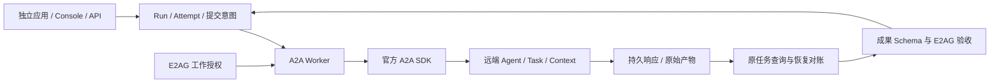

# 远端 A2A 执行与恢复

DiOS 可通过官方 A2A Python SDK 调用已注册的远端 Agent，持久关联本地 Run / Attempt 与远端 Task / Context，统一提供任务查询、取消、成果校验和恢复对账。适配固定 A2A 0.3.0 JSON-RPC；远端服务独立部署，业务输入及成果 Schema 由应用注册。



## 职责与控制范围

| 对象 | 责任 |
| --- | --- |
| 应用注册 | 任务输入 `parts`、输入摘要、结果 Schema 与展示信息 |
| 操作员配置 | 固定 endpoint、Agent Card、skill、产物路径、凭据引用、响应上限与并发额度 |
| Runtime | 独占领取、租约、提交意图、Attempt、原始产物、取消意图、恢复及审计事件 |
| 官方 SDK | `message/send`、`tasks/get`、`tasks/cancel` 与协议模型 |
| 远端 Agent | 内部执行、模型会话、工具调用与远端自身的授权治理 |
| E2AG | 本地发起、授权存续、撤权后的取消与成果接收校验 |
| Console | 本地任务与远端报告分开展示，保留任务和上下文标识及观测新鲜度 |

此接入的控制范围为 `remote-boundary`。本地 E2AG 可控制外部任务调用和成果接收；远端内部工具的强制授权需要远端暴露并接入相应控制点。首批配置拒绝本地工具网关参数。远端报告 `working` 不产生本地进程 ID，也不计为已确认的本机进程并发。

## 配置与执行

配置使用 `bridge: a2a-0.3-jsonrpc` 和 `governance.mode: e2ag`。示例见 [远端配置](../../examples/runtime/a2a-outbound.profile.json)。注册输入的 `parts` 直接形成 A2A 用户消息；Console 的 `goal` 是本地任务说明。远端所需的业务参数应放入应用输入，平台不改写它们。

Agent Card 必须匹配固定 endpoint、协议版本、JSONRPC 传输与 skill。HTTPS 为默认要求；仅显式启用的 loopback 测试允许 HTTP。同源 Card、RPC 和允许的产物目录共享一个版本化 Bearer 凭据引用，凭据由既有 Secret Provider 读取。配置不接受内嵌密钥，不跟随重定向或环境代理。

通过 Console/API 提交已注册应用输入，沿用既有 CLI 启动 Worker：

```bash
cd backend
.venv/bin/python -m app.runtime.cli \
  --database-url "$DIOS_RUNTIME_DATABASE_URL" --scope "$DIOS_RUNTIME_SCOPE" \
  worker --profile /etc/dios/profiles/remote.json \
  --artifacts /var/lib/dios/artifacts --policy-file /etc/dios/work-policy.json \
  --secrets-file /etc/dios/secrets.json
```

首批结果支持一个 Artifact 中的一个 JSON DataPart 或 `application/json` FilePart；文件可为内联 Base64 或允许目录内的 URI。响应默认上限 256 KiB，成果上限 64 KiB，读取后验证 UTF-8、JSON、注册 Schema，以及远端提供的摘要与字节数。原始响应独立保存，证据不足的成果不计成功。

## 提交、租约与恢复

1. 按配置在同一事务中检查容量并领取任务，活动和结果未知的 Attempt 均占用额度。
2. E2AG 授权通过后先保存 `prepared` 意图，再原子标记 `dispatched`，随后调用一次 `message/send`。
3. 响应先写入带身份摘要的持久回执，再关联远端 Task、Context 和原始产物。响应绑定检查包括 JSON-RPC 请求 ID、远端 Task / Context、配置与 Attempt。
4. 已知远端 Task 时只查询原任务；本地查询超时进入待对账，不新建 Attempt、不重发模型任务。
5. Worker 重启后等待原租约失效，通过显式恢复入口查询和验收。旧 Worker 的观察、取消意图和成果写入仍受旧 epoch 拒绝；保留的响应可供恢复入口使用。

[A2A 0.3.0 规范](https://a2a-protocol.org/v0.3.0/specification/)未规定通用的 `messageId` 重发去重保证。若提交已发出而响应与远端 Task ID 均丢失，任务保持待对账并占用容量。恢复需要端点专有的回执查询或操作员提供经过验证的远端身份；本实现不自动重发。仅 `prepared` 且确认未派发的意图可直接结束。

取消请求持久化后调用 `tasks/cancel`，最终查询证实 `canceled` 才记为已取消。远端在取消前已经完成则记录取消过晚。授权撤销后继续尝试取消，成果不再验收为成功。远端终态响应一经持久保存不回退为活动状态。

## 验证与接续

[执行证据](evidence/a2a-outbound-20261125.json)记录两套隔离 HTTP 服务、独立 CLI Worker 和 Docker Agent 的完成、进程终止后恢复、执行中取消。三种场景两端均只有一次 Attempt；重启恢复等待自然租约到期。12 项出站契约覆盖提交响应丢失、查询超时、回执入库故障、旧所有者拒绝、撤权、成果不足、原子容量、配置变化及凭据目的地约束。

此验证在同一物理主机使用合成 Agent，真实外部供应商、跨主机 TLS、网络分区和凭据轮换资格继续归入 #58。持久退避、供应商限流/额度熔断、流式消息、输入补充、多产物和异步回调尚待接续；现有恢复循环每次查询有超时与响应大小限制。#56/#58 保持进行中。
