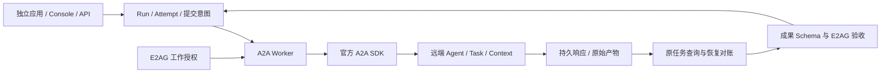

# 远端 A2A 执行与恢复

DiOS 可通过官方 A2A Python SDK 调用已注册的远端 Agent，持久关联本地 Run / Attempt 与远端 Task / Context，统一提供任务查询、取消、成果校验和恢复对账。适配固定 A2A 0.3.0 JSON-RPC；远端服务独立部署，业务输入及成果 Schema 由应用注册。



## 职责与控制范围

| 对象 | 责任 |
| --- | --- |
| 应用注册 | 任务输入 `parts`、输入摘要、结果 Schema 与展示信息 |
| 操作员配置 | 固定 endpoint、Agent Card、skill、产物路径、凭据引用、响应上限与并发额度 |
| Runtime | 独占领取、租约、提交意图、Attempt、原始产物、取消意图、恢复及审计事件 |
| 官方 SDK | `message/send`、`tasks/get`、`tasks/cancel` 与协议模型 |
| 远端 Agent | 内部执行、模型会话、工具调用与远端自身的授权治理 |
| E2AG | 本地发起、授权存续、撤权后的取消与成果接收校验 |
| Console | 本地任务与远端报告分开展示，保留任务和上下文标识及观测新鲜度 |

此接入的控制范围为 `remote-boundary`。本地 E2AG 可控制外部任务调用和成果接收；远端内部工具的强制授权需要远端暴露并接入相应控制点。首批配置拒绝本地工具网关参数。远端报告 `working` 不产生本地进程 ID，也不计为已确认的本机进程并发。

## 配置与执行

配置使用 `bridge: a2a-0.3-jsonrpc` 和 `governance.mode: e2ag`。示例见 [远端配置](../../examples/runtime/a2a-outbound.profile.json)。注册输入的 `parts` 直接形成 A2A 用户消息；Console 的 `goal` 是本地任务说明。远端所需的业务参数应放入应用输入，平台不改写它们。

Agent Card 必须匹配固定 endpoint、协议版本、JSONRPC 传输与 skill。HTTPS 为默认要求；仅显式启用的 loopback 测试允许 HTTP。同源 Card、RPC 和允许的产物目录共享一个版本化 Bearer 凭据引用，凭据由既有 Secret Provider 读取。配置不接受内嵌密钥，不跟随重定向或环境代理。

通过 Console/API 提交已注册应用输入，沿用既有 CLI 启动 Worker：

```bash
cd backend
.venv/bin/python -m app.runtime.cli \
  --database-url "$DIOS_RUNTIME_DATABASE_URL" --scope "$DIOS_RUNTIME_SCOPE" \
  worker --profile /etc/dios/profiles/remote.json \
  --artifacts /var/lib/dios/artifacts --policy-file /etc/dios/work-policy.json \
  --secrets-file /etc/dios/secrets.json
```

首批结果支持一个 Artifact 中的一个 JSON DataPart 或 `application/json` FilePart；文件可为内联 Base64 或允许目录内的 URI。响应默认上限 256 KiB，成果上限 64 KiB，读取后验证 UTF-8、JSON、注册 Schema，以及远端提供的摘要与字节数。原始响应独立保存，证据不足的成果不计成功。

## 提交、租约与恢复

1. 按配置在同一事务中检查容量并领取任务，活动和结果未知的 Attempt 均占用额度。
2. E2AG 授权通过后先保存 `prepared` 意图，再原子标记 `dispatched`，随后调用一次 `message/send`。
3. 响应先写入带身份摘要的持久回执，再关联远端 Task、Context 和原始产物。响应绑定检查包括 JSON-RPC 请求 ID、远端 Task / Context、配置与 Attempt。
4. 已知远端 Task 时只查询原任务；本地查询超时进入待对账，不新建 Attempt、不重发模型任务。
5. Worker 重启后等待原租约失效，通过显式恢复入口查询和验收。旧 Worker 的观察、取消意图和成果写入仍受旧 epoch 拒绝；保留的响应可供恢复入口使用。

[A2A 0.3.0 规范](https://a2a-protocol.org/v0.3.0/specification/)未规定通用的 `messageId` 重发去重保证。若提交已发出而响应与远端 Task ID 均丢失，任务保持待对账并占用容量。恢复需要端点专有的回执查询或操作员提供经过验证的远端身份；本实现不自动重发。仅 `prepared` 且确认未派发的意图可直接结束。

取消请求持久化后调用 `tasks/cancel`，最终查询证实 `canceled` 才记为已取消。远端在取消前已经完成则记录取消过晚。授权撤销后继续尝试取消，成果不再验收为成功。远端终态响应一经持久保存不回退为活动状态。

## 验证与接续

[执行证据](evidence/a2a-outbound-20261125.json)记录两套隔离 HTTP 服务、独立 CLI Worker 和 Docker Agent 的完成、进程终止后恢复、执行中取消。三种场景两端均只有一次 Attempt；重启恢复等待自然租约到期。12 项出站契约覆盖提交响应丢失、查询超时、回执入库故障、旧所有者拒绝、撤权、成果不足、原子容量、配置变化及凭据目的地约束。

此验证在同一物理主机使用合成 Agent，真实外部供应商、跨主机 TLS、网络分区和凭据轮换资格继续归入 #58。流式消息、输入补充、多产物和异步回调尚待接续。#56/#58 保持进行中。

## 持久退避与单路恢复

远端恢复复用 `runtime_fault_bindings`、`runtime_retry_plans` 和 `runtime_circuits`，没有增加任务数据库。任务在 `reconciliation_required` 状态保存查询计划、错误分类、下次查询时间和独占探测租约；计划状态 `observing` 表示再次查询原任务，恢复后变为 `observed`。Console 同时显示限流/额度/网络分类与原任务的下次查询时间。

HTTP 429 映射为限流，连接中断、超时与 502/503/504 映射为网络类故障；401/403 与支付要求分别保存。HTTP 402 本身不证明额度不足。明确的 DiOS 端点错误 `error.data.dios.code = PROVIDER_QUOTA_EXHAUSTED` 可映射为额度类；该字段是 DiOS 端点扩展，第三方服务的配额含义需要通过其 Adapter 资格验证。

默认网络退避基数为 5 秒、上限 300 秒，额度退避基数为 300 秒。远端查询等待加入抖动，并遵守有界的 `Retry-After` 秒数或 HTTP 日期（最多一天）。策略可在执行配置的 `remote.recovery` 中设置，沿用既有 `resource`、`base_delay`、`max_delay`、`quota_delay` 字段；`replay_safe` 必须为 `false`，`max_attempts` 限制未派发预检的总尝试次数，默认 3、可设 1–10。显式设为 1 关闭预检重试。策略属于配置指纹，更换后须重新授权。

共享资源故障打开熔断，暂停新的任务领取。冷却到期时仅允许一个探测者查询，探测成功关闭该资源的熔断；探测失败重新退避。进程重启不清空冷却时间。探测进程退出后，可在查询租约过期后重新竞争；旧探测令牌不能清除新探测者的状态。查询成功说明该端点的请求恢复，远端内部模型账户的余额和执行能力仍由端点能力与实际任务结果证明。

授权撤销、取消意图和成果 Schema 校验在恢复期间继续生效。完整远端结果下载失败时保留终态回执，冷却后只重试成果下载。没有远端 Task ID 的未知提交继续保留身份等待对账。

## 首次连接预检恢复

首次 Agent Card 发现遇到网络或限流错误时，确认 Attempt 仍为 `claimed`，且没有进程、Session、远端意图或派发记录，才保存 `retry_wait` 和 `RETRY_UNLAUNCHED`。旧 Attempt 记为失败并关闭执行 Grant，Run 与 Work 保留；预算、当前权限和未结工具检查通过后，恢复领取创建新 Attempt 并重新取得 E2AG 执行授权。

预检等待使用原有指数退避、共享熔断与单路探测，并同时满足 `Retry-After`。Worker 重启读取持久计划；多个 Worker 竞争时仅一个探测者执行。认证拒绝、配置错误、撤权、取消或预算耗尽会阻止重试，具体原因保留在账本。任何新增派发、进程或会话证据都会使“未派发”依据失效。

这一规则沿用 [HTTP 幂等重试语义](https://www.rfc-editor.org/rfc/rfc9110.html#section-9.2.2)和 [Retry-After](https://www.rfc-editor.org/rfc/rfc9110.html#section-10.2.3)。发现阶段的 GET 可以再次执行；已发送的 `message/send` 结果未知时，继续查询/对账原请求。预检恢复不会授权重放远端业务提交。

Console 显示“尚未派发”、故障分类、下次重试时间和原任务状态。每次预检均保留独立 Attempt；成功恢复后关联唯一远端 Task、Session 和成果。[预检恢复证据](evidence/a2a-preflight-20261125.json)记录真实 429、首次连接前停机、独立 Worker 重启及 Docker 远端执行；两场景各有两次本地 Attempt、一次远端提交与一次远端执行。中英文桌面、移动端的实时状态与刷新通过验证。

实现依据为 [RFC 9110 Retry-After](https://www.rfc-editor.org/rfc/rfc9110.html#name-retry-after)、[AWS 超时、退避与抖动](https://aws.amazon.com/builders-library/timeouts-retries-and-backoff-with-jitter/)和 [Azure 熔断状态模式](https://learn.microsoft.com/en-us/azure/architecture/patterns/circuit-breaker)。查询重试与创建任务分别处理，有副作用的提交保留原幂等门槛。

[故障与恢复证据](evidence/a2a-recovery-20261125.json)包含真实 HTTP 429、明确额度错误、目标 API 实际停止/重启、独立 Worker 重启，以及中英文桌面/移动端的实时冷却展示。SQLite 写事务沿用读连接已有的缓冲操作取消保护，先完成驱动操作并清理事务再释放连接；测试验证中断后的回滚与下一次写入，符合 [SQLAlchemy 事务清理要求](https://docs.sqlalchemy.org/en/20/errors.html#can-t-reconnect-until-invalid-transaction-is-rolled-back-please-rollback-fully-before-proceeding)。
