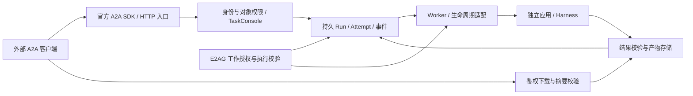

# A2A 标准任务入口

DiOS 提供 A2A 0.3.0 JSON-RPC 任务入口，使用官方 `a2a-sdk[http-server]==0.3.26`。外部客户端可发现已授权的执行配置、提交任务、查询成果并请求取消。执行仍由 Runtime Worker 承担，工作授权与结果验收沿用 E2AG。应用输入和结果 Schema 由独立应用注册，平台不引入客户业务规则。

## 接口与职责



| 接口 | 行为 |
| --- | --- |
| `GET /api/os/runtime/a2a/profiles/{profile_id}/.well-known/agent-card.json` | 按当前主体返回可提交配置的 Agent Card；包含协议版本、Provider URL、JSONRPC 传输、Bearer 认证和实际能力声明 |
| `POST /api/os/runtime/a2a/profiles/{profile_id}` | 官方 SDK 处理 `message/send`、`tasks/get`、`tasks/cancel` |
| 原有 Runtime 产物下载接口 | A2A Artifact 提供 URI、SHA-256、字节数和 Attempt 关联；下载时重新验证权限 |

运行配置名称可描述应用能力；命令、镜像、挂载、凭据和权限只来自操作员注册配置。HTTP 请求不启动进程。执行配置停用或移除后，已有任务仍可按对象权限查询和取消；只取得任务读取授权的共享用户无需拥有新任务提交权限。

现有 `/api/os/a2a` 继续作为 legacy 路径。新标准入口与原 `A2ATask` 数据分开登记，历史任务没有隐式迁移。

## 消息、身份与持久性

`message/send` 接受一个用户 `DataPart`，内容为 `goal` 与 `sample_id` / `input_payload` 二选一。动态输入须满足已注册应用 Schema。首批契约使用非阻塞提交和查询；同一任务追加对话、文件输入、推送、流式输出、重订阅暂不支持。Agent Card 对流式、推送和状态转移历史均声明 `false`。

```json
{
  "jsonrpc": "2.0",
  "id": "request-1",
  "method": "message/send",
  "params": {
    "message": {
      "kind": "message",
      "role": "user",
      "messageId": "stable-client-message-id",
      "contextId": "client-context",
      "parts": [{"kind": "data", "data": {
        "goal": "执行已注册能力并返回可核验成果",
        "sample_id": "registered-input-id"
      }}]
    },
    "configuration": {"blocking": false}
  }
}
```

`Task.id = Run.id`。`messageId` 与协议版本、配置和可信主体共同确定幂等键；消息内容、上下文和提交输入进入不可变回执摘要。相同消息重发返回原任务，相同身份键携带不同内容返回 `IDEMPOTENCY_CONFLICT`。不同主体的相同消息标识不会互相命中。

上下文、消息标识和请求摘要作为 `transport_binding`，与 Run 和 E2AG Work 在同一事务落库。响应丢失后可以重发取得原回执。无须增加另一套任务数据库或 SDK 内存 TaskStore。客户端 `contextId` 只是关联标识，不赋予访问权限；省略时由服务生成稳定值。

首次提交仍通过既有授权准入，执行、续期、撤销、工具审批和结果验收仍经过原控制点。A2A 查询与取消按当前主体和对象授权检查。查询返回状态不创建尝试、不扩大权限、不重复派发。

## 状态与取消

| Runtime 状态 | A2A 状态 |
| --- | --- |
| queued | submitted |
| executing / validating / retry_wait | working |
| reconciliation_required | unknown |
| succeeded | completed |
| failed | failed |
| cancelled | canceled |

`metadata.dios` 保留 Runtime 状态、版本、Attempt、观测时间和 `cancelRequested`。`tasks/cancel` 对未领取任务立即确认取消；执行中的任务先持久化取消请求，收到停止证据后才返回 `canceled`。重复取消不会重复写入请求。已成功或失败的任务返回 `TaskNotCancelableError`。查询超时与执行失败分别处理，结果未知继续对账。

已校验结果按当前 `artifact.read` 权限投影为 Artifact；原始输出和部分结果仍在 Runtime 历史中保存。A2A 不把原始日志作为成功产物。下载地址不包含临时凭据或存储路径。

## 协议边界与验证

固定依据为 [A2A 0.3.0 规范](https://a2a-protocol.org/v0.3.0/specification/)与 [官方 Python SDK v0.3.26](https://github.com/a2aproject/a2a-python/tree/v0.3.26)。正常请求与响应使用官方模型及公开 ASGI 接口。入口补充 SDK 默认值/错误映射未覆盖的严格 JSON-RPC 版本、请求 ID、参数类型和未启用能力检查；包括分块传输在内的请求体上限为 256 KiB。

13 项契约测试覆盖官方客户端、身份隔离、共享只读权限、重复并发、响应丢失、数据库重开、历史配置移除、E2AG 撤权、产物访问、未知执行、取消及非法 JSON/UTF-8。真实 TCP 验证使用固定 Docker 镜像、独立数据库和合成任务，记录进程、会话、Attempt、退出状态和产物摘要，见 [执行证据](evidence/a2a-runtime-20261125.json)。

```bash
cd backend
PYTHONPATH=.:tests .venv/bin/python -m unittest -v test_runtime_a2a
cd ..
backend/.venv/bin/python scripts/check_runtime_a2a.py \
  --directory workspace/a2a-qualification-new \
  --image dios-worker-fixture:local
```

资格脚本通过真实 TCP 调用官方 `ClientFactory`，再驱动真实 Worker 与执行容器。它创建新的隔离目录，并要求已有 fixture 镜像。模型服务没有参与本项协议验证；Cursor、DSH、Codex 的模型与工具治理证据见各自接入文档。

## 接续范围

#56/#58 保持进行中。下一段实现 DiOS 主动调用远端 A2A Agent：提交意图先落库，持久关联本地 Run/Attempt 与远端 Task/Context，断连后优先查询和对账。远端不提供幂等或查询依据时，保持结果未知；取消回执与实际停止证据分开登记。

跨物理主机、生产 HTTPS、远端内部工具可控性、完整续期/委派/旧 epoch 矩阵和 G2 独立权限评审继续按既定门槛验收。首批入口资格不替代这些实测。
