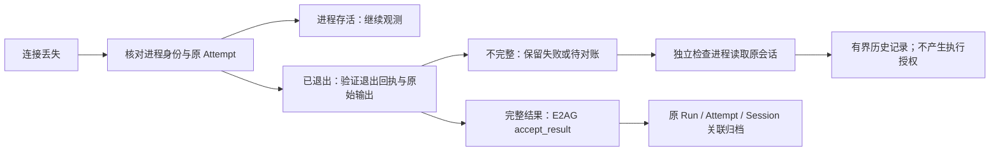

# ACP 会话恢复与执行授权

DiOS 将会话历史恢复、活动请求续接和已完成结果对账分别处理。Cursor、DeepSeek Harness、Codex 已通过原会话跨进程检查；当前固定 ACP v1 组合没有提供经过验证的原始 prompt 续接入口，运行恢复保持查询和对账，不自动重发模型请求。

## 固定版本与实际行为

官方 Python `agent-client-protocol==1.0.0` 负责 RPC。DiOS SDK 0.1.5 提供能力协商和受限检查客户端，static-review 0.1.4 使用相同协商逻辑。实测在同一 WSL 主机的独立 Docker 进程中进行，状态目录跨容器保留，输入为合成文本。

| Harness | 声明的恢复能力 | 正常完成后跨进程检查 | prompt 未返回时强制结束进程，再检查原会话 |
| --- | --- | --- | --- |
| Cursor CLI 2026.11.05-86047df | load；无 resume | load 成功，包含原问答 | load 成功，本次没有返回历史 |
| DSH 0.2.2-rc.5 / ECNU Max | resume；无 load | resume 成功，历史通知 0 | resume 成功，历史通知 0 |
| Codex ACP 2.11.0 / CLI 0.172.0 | load、resume | load 成功，包含原问答 | load 成功，包含原提问，没有最终答案 |

三组中断场景都在原 prompt RPC 尚未返回时终止容器，退出码 137，原客户端收到 `ACP_PROCESS_EXITED`。新客户端沿用原 Session ID，检查阶段发送 prompt 次数为 0；这项计数不代表供应商内部调用量。DSH 的成功响应证明 resume 接口可用，其上下文语义没有通过追加提问验证。跨物理主机和模型供应商侧请求终止另行验收。

[证据索引](evidence/acp-sessions-20261125.json)包含镜像摘要、独立进程、原 Session ID、通知类型、历史摘要和测试结果。完整检查记录保存在隔离资格目录，未作为 Runtime 成功产物入库。

## 通用 SDK 与治理边界

`AcpSessionInspector` 只用于已获授权状态的独立检查进程。调用方先验证状态目录访问权并提供隔离配置；公开 Runtime/API/CLI/Console 继续沿用既有执行和对账入口。

检查客户端按 `initialize` 返回值选择 `session/load` 或 `session/resume`，不猜测能力，也不在失败后回退到新会话。恢复请求固定为空 MCP 列表；权限、文件读取、终端等客户端回调全部拒绝。检查期间及之后的会话通知只进入有界记录，不进入实时输出、工具成功记录或结果帧。超时保留已收到的记录，同一检查客户端不重复恢复、不发送 prompt。

`load` 的历史重放会包含旧工具调用和旧答案。它们不能满足当前 Attempt 的工具证据要求，不能重放审批，不能触发 E2AG 派发。检查客户端的拒绝控制覆盖 ACP 客户端回调；Harness 内部能力仍由隔离配置、工具禁用和出口策略约束。

执行权仍由 Runtime 的独占所有者、租约和 epoch 决定。会话恢复成功不会恢复旧 Worker 的 execute 授权；结果对账继续单独校验当前 `accept_result` 权限。取消、撤销和旧 epoch 检查沿用既有 E2AG 链路。

## 能力准入与接续安排

SDK 源码、安装环境和离线镜像各 52 项测试通过；核心 SDK 在无 ACP/后端依赖环境中 9 项通过。相关 Runtime/E2AG 回归 80 项通过、43 项按数据库类型跳过，设计契约 681 项通过。

SDK 0.1.5 的独立应用镜像已在资格环境运行：DSH 批准前工具调用 0 次，批准后 1 次并生成成功报告；Codex 审批等待中撤权后，旧授权返回 `AUTH_REVOKED`，原 prompt 确认取消，工具调用与成功结果帧均为 0。三个 Harness 镜像与离线包已构建，开发 API 健康。Windows 绝对路径通过契约测试；实际进程恢复验证环境为 WSL/Linux。

`reconnect`、上下文 `resume`、历史 `replay`、`queryInFlight`、提交去重和取消确认继续分别登记。当前矩阵新增的是跨进程会话检查；活动请求续接保持未准入。已有完整结果对账和 A2A 原 Task 查询恢复继续可用。

后续恢复实现必须先取得 Harness 提供的稳定请求身份与查询/续接语义，再接入所有权转移、当前授权和工具绑定。重新发送 prompt 会创建新一轮执行，需要独立的重试依据和授权，不能由 load/resume 成功推导。

#56/#58 下一段优先补齐三种 Harness 的续期、委派与旧 epoch 联合验证。ACP 活动请求续接跟随标准和固定 Adapter 的实际能力推进；跨主机、企业出口、独立权限评审与用户验收沿用既定门槛。

协议依据：[ACP v1 Session Setup](https://agentclientprotocol.com/protocol/v1/session-setup)规定 load 的历史重放与 resume 的无历史恢复；[ACP v2 迁移说明](https://github.com/agentclientprotocol/agent-client-protocol/blob/main/docs/protocol/v2/migration.mdx)将 prompt 生命周期和请求响应分离。当前固定 v1 Adapter 不据此声明 v2 能力。
