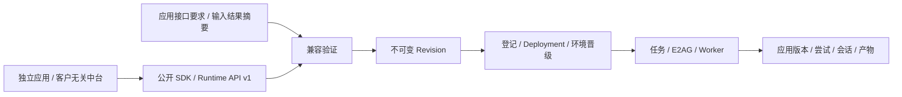

# 应用接入与版本兼容契约

独立应用通过版本化 Runtime API、输入/结果契约和明确能力要求接入 DiOS。应用契约固定到 Revision，任务保留应用 ID、版本及摘要；发布和执行沿用 E2AG、Registry、Deployment 与环境晋级门禁。



## 契约内容

执行 Profile 的 `application_contract` 是数据声明，不包含可执行代码。字段固定如下：

| 字段 | 含义 |
|---|---|
| `schema_version` | 清单格式版本，目前为 1 |
| `id` / `version` | 应用标识和 PEP 440 版本 |
| `deployment` | `independent`，应用独立构建与运行 |
| `requires` | 接口名称到 PEP 440 版本范围的映射 |
| `input.kind` | 应用自定义任务类型 |
| `input.schema_digest` | 输入 JSON Schema 的规范 JSON SHA256 |
| `input.result_schema_digest` | 结果 JSON Schema 的规范 JSON SHA256 |

必须声明 Runtime API、任务事件、输入结果 Schema、E2AG、Revision/Deployment，以及实际执行接口。摘要编码沿用 SDK 的 `digest()`：UTF-8、键排序、紧凑分隔符、禁止非有限浮点数，前缀为 `sha256:`。

```json
{
  "schema_version": 1,
  "id": "independent-reference",
  "version": "1.0.0",
  "deployment": "independent",
  "requires": {
    "runtime-api": ">=1,<2",
    "runtime-events": ">=1,<2",
    "input-result-schema": ">=1,<2",
    "e2ag-work": ">=1,<2",
    "revision-deployment": ">=1,<2",
    "worker-jsonl": ">=1,<2"
  },
  "input": {
    "kind": "external.example/v1",
    "schema_digest": "sha256:<输入 Schema 摘要>",
    "result_schema_digest": "sha256:<结果 Schema 摘要>"
  }
}
```

Profile 同时固定 `console.input_catalog_data`，提供输入和结果 Schema，并启用 E2AG。JSONL 执行暴露 `worker-jsonl=1.0`，配置受控工具通道后可声明 `governed-tool-channel=1.0`；远端 A2A 执行暴露 `a2a-jsonrpc=0.3`。未知能力或不满足的版本范围直接拒绝。Harness 内部能力须由对应适配与资格证明，应用声明本身不授予权限。

### 可确认取消

需要取消完成确认的应用，在 `requires` 中增加 `"confirmed-cancellation": ">=1,<2"`。托管 `jsonl-v1` 执行以原生进程退出作为确认条件；只发送取消请求不会产生取消成功。执行节点不可观察时仍需对账，能力声明不承诺网络分区期间的固定完成时限。

当前远端 `a2a-0.3-jsonrpc` 执行不提供这项保证，兼容预览返回 `APPLICATION_INTERFACE_UNSUPPORTED`，要求此能力的 Revision 无法发布或准入。Endpoint 自报 `capabilities.cancel` 不会改变结果。已有应用未声明此要求时维持原兼容规则。

`GET /api/os/runtime/contracts` 的可选新增字段 `execution_interfaces` 按执行桥接类型公布能力与版本；CLI `application_contract.py platform`、SDK `runtime_contract()` 和 Console“应用接入”读取同一数据。

依据 [A2A 0.3 规范](https://a2a-protocol.org/v0.3.0/specification/) §5.5.2/§7.4，AgentCapabilities 没有标准取消保证字段，`tasks/cancel` 可返回 `TaskNotCancelableError`；[ACP Prompt Turn](https://github.com/agentclientprotocol/agent-client-protocol/blob/main/docs/protocol/v1/prompt-turn.mdx) 同样区分取消通知与 prompt 取消结束。`confirmed-cancellation` 是 DiOS 应用兼容接口，复用现有取消及退出确认实现。

## 固定版本和登记

应用契约通过现有 Revision 发布器创建不可变版本。已有能力包仍经 Registry 的文件摘要、依赖锁、来源/许可准入进入发布路径；`application_contract` 随执行配置一并固定。无需新增应用数据库或修改历史 Schema。

启用沿用管理员控制的 Profile 目录指针：

```json
{"id":"<能力定义 ID>","revision_ref":"<已发布 Revision>","enabled":true}
```

使用 Deployment 管理升级时，指针改用 `deployment_id`。受控环境先建立环境绑定，再执行技术评测与独立审批。停用将目标指针 `enabled` 设置为 false，停止新准入；在途任务继续按原 Revision 完成。历史查询不依赖登记文件。应用业务数据、UI 和迁移脚本由独立应用管理。

发布时和每次解析固定版本时均执行兼容核验；携带应用契约的未固定内联 Profile 返回 `APPLICATION_REVISION_REQUIRED`。任务记录中的 `application` 来自服务端 Revision，调用者不能提供或替换。

## API 与事件版本

`GET /api/os/runtime/contracts` 返回当前 Runtime 接口版本、事件规则与应用清单格式。调用者通过 `X-DiOS-Runtime-Contract: 1` 明确选择接口主版本；不支持的值在业务处理前返回 `409 RUNTIME_CONTRACT_UNSUPPORTED`。成功响应回传同名版本头。未指定版本的既有客户端保持现有行为。

版本 1 的任务事件沿用任务详情中的 `events`，每项保留 `id/version/type/state/created_at`，在所属 Run 内以 `version` 排序，详情返回最近 30 条。完整历史和关联查询沿用现有历史/证据入口。新增事件类型或响应字段允许向后兼容增加，消费者保留未知事件类型；改变已有字段含义、删除必需字段或改变状态语义需要新主版本。业务事件内容与此 Runtime 事件契约分开。

这沿用 [Kubernetes API 兼容政策](https://kubernetes.io/docs/reference/deprecation-policy/) 的显式版本和兼容演进原则；范围比较直接采用 [Python Packaging Version Specifiers](https://packaging.python.org/en/latest/specifications/version-specifiers/)。Runtime 任务历史保留现有数据格式，平台业务事件继续使用各自的 CloudEvents 接口。

## 客户端与管理入口

`dios-sdk==0.1.19` 提供 `runtime_contract()`、`applications()`、`application_compatibility()`。严格模式在首次写请求前验证服务端契约；读写响应继续校验版本头。写请求后的版本异常保留 `ContractMismatch.ambiguous` 与原幂等键，调用者查询原任务身份后再重试。

```python
from dios_sdk import TaskClient

client = TaskClient(base_url, platform_token, required_contract="1")
print(client.runtime_contract())
report = client.application_compatibility(revision_ref)
assert report["compatible"]
run = client.submit_input(profile_id, application_input, goal,
                          idempotency_key=persistent_task_key)
```

接口版本发现向已认证调用者开放。兼容检查和登记目录属于管理权限；上层平台后端保存管理凭据，终端用户沿用原任务与对象权限。

| 操作 | API | CLI |
|---|---|---|
| 平台接口版本 | `GET /runtime/contracts` | `application_contract.py platform` |
| 已启用应用登记 | `GET /runtime/applications` | `application_contract.py list` |
| 精确版本核验 | `POST /runtime/applications/compatibility`，`{revision_ref}` | `application_contract.py check REVISION` |
| 候选声明预览 | 同上，增加 `contract` 字段 | `application_contract.py check REVISION --contract candidate.json` |

CLI 使用已安装的公开 SDK 和 `DIOS_ACCESS_TOKEN`，`--url` 指定 HTTPS 或本地开发端点。Console → **应用接入** 展示平台接口、应用版本、登记 Revision 和兼容差异。候选预览不会修改登记、批准能力或启动 Worker。

工程证据见 [应用契约验证](evidence/application-contract-20261126.json)。升级停用、两执行实现替代与各自原输出恢复见 [独立应用生命周期](application-lifecycle-47.md)。
