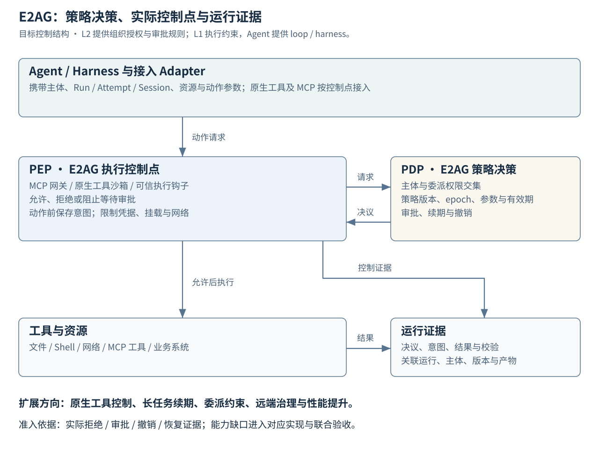
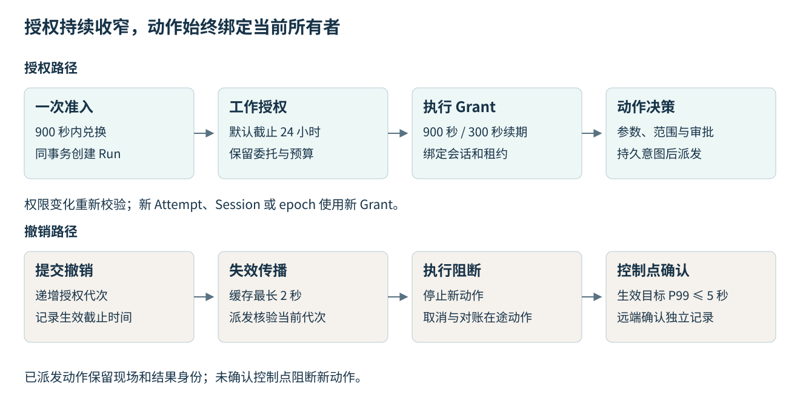

# 身份委托、授权与 E2AG 治理契约

版本：AUTHZ-1.0.0 · 2026-11-11 · #27 设计基线。

DiOS 以调用者、服务、工作负载和资源四层权限的交集决定执行范围。每次工具动作绑定实际 Run、Attempt、AgentSession、Worker 和 lease epoch；E2AG 在受控入口完成决策，在实际控制点执行，在证据账本保存结果。长期任务通过受限续期持续运行，授权变化通过撤销代次阻断后续动作。

## 1. 身份与职责

| 对象或层 | 权责与信任来源 |
| --- | --- |
| 用户 / ServicePrincipal | 来自受信身份提供方的主体；服务 actor 与原始用户 subject 分别记录 |
| DigitalEmployee | L2 岗位及配置对象；名称、角色说明和提示词不产生权限 |
| WorkloadPrincipal | L1 为获准工作创建的受限执行身份，绑定委托链与 Run |
| WorkerPrincipal | 机器注册身份，使用受限机器凭据；进程 PID 和模型 Session 另行记录 |
| L2 管理服务 | 组织、Workspace、员工及业务资源 ACL，审批人资格与职责分离；向 L1 提交委托请求 |
| L1 授权与 E2AG | 准入、权限交集、PDP、Grant、PEP、撤销代次、持久意图和证据；统一约束 API、CLI、Console、MCP 及原生工具 |
| 外部系统与 Agent | 通过 Adapter 映射账户、会话和能力；源系统 ACL 与凭据权限进一步收窄范围 |

API 身份由服务端认证上下文产生。客户端提交的 actor、role、employee 名称及模型输出均不能作为认证依据。基础设施运维角色没有默认业务内容读取权；审批人身份取自认证上下文，并与请求主体及批准组校验。

委托链记录 subject、actor、父委托、目标 audience、权限、到期时间和授权代次，最多三层。每级委托只能收窄权限和有效期；暂停或撤销任一上游主体使对应执行授权失效。跨主机使用机器身份与发送方绑定，外部账户只传 Secret 引用，令牌内容不进入模型上下文、事件或产物。

## 2. 权限表达与公共接口

权限单位是 `(action, resource_kind, resource_id, resource_version, constraint_revision)` 完整元组。有效权限为调用者、服务、工作负载、资源 ACL 与现有 Grant 的交集；显式拒绝优先，缺失任一层或无法解析资源时拒绝。分别合并动作列表与资源列表会形成越权组合，契约禁止这种计算方式。

资源定位、版本与约束修订由服务端解析。约束采用固定的路径根、数据分类、目标端点、预算和有效期操作符，数值上限取最小值，允许列表取交集；无法识别的约束拒绝执行。工具参数先通过工具 Schema 校验与标准化，再形成摘要；摘要由可信服务计算。参考样例采用 UTF-8、对象键排序与无多余空格的 JSON 编码；生产跨语言参数规范化及数值测试向量由 #34 固定版本，令牌只绑定服务端生成的摘要。资源类型与 ID 同时参与比较，避免同名不同类资源串权。源码路径校验应使用规范化路径和受控文件句柄，防止符号链接、路径穿越及校验后替换。

机器文件位于 [contracts/authz/v1](../../contracts/authz/v1/README.md)：20 个 Schema、39 项接口权限映射、52 个决策场景。`DecisionContext` 是 PDP 的可信内部输入；公共请求不能直接提交其中的认证、控制点实测及资源校验布尔值。`permission-matrix.json` 为核心 31 项接口与新增 8 项接口指定动作、对象解析及缺省拒绝规则。

| 接口 | 结果与责任 |
| --- | --- |
| POST /api/internal/v1/authorization/admissions | L1 校验委托，签发一次准入凭据 |
| POST /api/internal/v1/authorization/grants | 按当前 Attempt/Session/Worker/epoch 签发执行 Grant |
| POST /api/internal/v1/authorization/grants/{id}/renew | 对版本、身份、资源权限、租约与期限重新校验后续期 |
| GET /api/os/v1/authorization/decisions/{id} | 按证据 ACL 读取允许、拒绝或待审批依据 |
| GET /api/os/v1/authorization/approvals/{id} | 按业务归属读取审批绑定及状态 |
| POST /api/internal/v1/authorization/approvals/{id}/consume | 对具体 invocation 原子消费审批并取得持久意图 |
| POST /api/os/v1/authorization/revocations | 提交撤销，返回代次、截止时间与待确认控制点 |
| GET /api/os/v1/authorization/revocations/{id} | 区分已提交、生效、部分确认与远端取消状态 |

已有核心 E2AG 决策和 L2 审批处理接口继续使用；新增接口负责授权生命周期。内部写接口要求机器 mTLS、受限令牌及 Idempotency-Key。核心 OpenAPI 的权限元数据更新为 1.1.0，字段结构保持 #25 的设计；实现时同步消费方契约测试，旧的宽泛 `os.read` 权限不能直接代替托管 Profile 的资源授权。

## 3. 准入、签发与长期任务

准入凭据有效期为 900 秒，仅用于兑换 Run。准入兑换、Run 创建、WorkloadAuthorization 和幂等结果在 L1 同一事务中提交；重复请求返回同一身份。WorkloadAuthorization 默认截止时间为 24 小时，可按获准预算调整。执行 Grant 最长 900 秒，每 300 秒续期，且不超过工作授权期限。900 秒准入期限与任务运行期限分别管理。

Grant 绑定 Run/Attempt/Session/Worker、租约 epoch、策略版本、工作主体和委托引用。任务准备阶段使用受限 Worker 身份读取不可变快照；模型工具授权在真实 Session 建立后签发。新 Attempt、Session 或所有权 epoch 必须取得新 Grant。

续期要求授权服务与审计可用、expected_version 匹配、上游主体和工作授权有效、当前租约有效、完整四层权限已解析。新权限只能收窄，新到期时间不得越过上游期限。策略改变触发协调器重新评估并签发；超过原工作授权范围或期限需要新的委托授权。故障恢复后由持久调度器先对账和单路试恢复，再续期或重新签发，避免永久暂停及重复执行。

首实现使用高熵不透明令牌，随机熵至少 256 位，服务端只存令牌哈希及主体、audience、证书绑定、到期时间和代次。凭据代理从统一 Secret Provider 解析引用。用户 SSO、外部账户与密钥存储通过 Provider 接口替换。

## 4. 审批、意图与结果

审批绑定 action、资源及版本、参数摘要、权限摘要、策略版本、授权代次和完整执行绑定。默认有效期 600 秒，并受 Grant 与工作期限限制。外发业务动作需要当前授权的独立审批人；审批不扩大 ACL。参数、所有者、权限或策略变化使原审批失效。

单次审批只对应一个 invocation。事务中以版本比较完成消费和意图创建；同一幂等请求返回已有意图，其他 invocation 重放被拒绝。实际派发前，PEP 对当前策略、代次、租约及审批再次检查，并将意图从 prepared 原子转为 dispatched。消费审批与创建意图可先完成；派发时必须继续核验已消费审批属于当前 invocation。

工具调用发生在 dispatched 之后。网络中断或 RPC 悬挂产生 result_unknown 时，保留尝试、部分输出和意图，先查询或验证完整产物；幂等能力不明确的副作用进入对账，不能凭超时重复执行。业务结果合格后才记成功；控制点与结果证据分别归档。

执行状态分别维护：AdmissionReceipt 为 issued → redeemed（或 revoked/expired）；WorkloadAuthorization 与 Grant 为 active → revoked/expired；ApprovalBinding 为 pending → approved/denied，approved → consumed/expired/invalidated；InvocationAuthorization 为 prepared → dispatched → succeeded/failed/result_unknown。result_unknown 仅经证据对账转为成功或失败，重新执行使用新的尝试身份；审批、工作和 Grant 的终止状态不能原地恢复为 active。

对外错误沿用核心 Error：认证失败对应 UNAUTHENTICATED；资源越权、审批重放与撤销对应 FORBIDDEN；旧所有权对应 STALE_OWNER；版本竞争对应 VERSION_CONFLICT；控制点能力缺失对应 CAPABILITY_UNSUPPORTED；授权/审计故障对应 UNAVAILABLE；未知副作用对应 RECONCILIATION_REQUIRED。具体拒绝原因保存在 DecisionEvidence.reason_code，由 evidence_refs 关联；恢复策略依据错误类型、当前身份和证据确定。

## 5. 撤销、缓存与隔离

撤销提交递增主体、工作、Grant、会话、凭据或策略的授权代次，同时记录事件。派发事务与撤销更新共享受锁定的授权记录，以数据库提交顺序决定动作是否已获派发。撤销阻止其后的派发；已派发动作通过取消、隔离和结果对账处理。

治理目标为撤销生效 P99 ≤ 5 秒，控制缓存最长 2 秒，决策凭据最长 5 秒；派发仍检查当前代次。控制点确认分别记录，未确认控制点显示 partially_confirmed 并阻断新动作。托管 Profile 在授权服务或持久审计不可用时暂停新动作；缓存状态查询可继续，需标明新鲜度。离线执行配置为 false。

远端取消请求、取消确认、凭据撤销和数据留存分别记录。撤销无法收回已外发字节；远端 Agent 的内部工具若没有可验证控制点，只能声明入口及数据外发治理能力。要求严格只读的工作在能力不满足时拒绝准入。

## 6. 原生工具、协议与持续静态评审

受控 MCP Gateway 是一个工具路径。文件、Shell、网络及 Agent 原生工具均需登记实际控制点、版本和实测证据。仅有工具事件、提示词、Agent 的只读模式声明不足以签发严格托管 Grant。

持续评审使用不可变源码快照与受控只读检索，拒绝源码写入、业务代码编译/测试/执行及通用 Shell。可信静态分析器按固定二进制版本、配置和独立输出目录授权，关闭仓库 hooks、过滤器与可执行配置。Git 准备凭据与模型调用凭据分离；模型端点、账户、数据分类和外发范围显式授权。

ACP 权限请求映射到 E2AG 当前动作；首批使用单次批准。会话级批准不能替代逐动作权限校验，协议无法表达所需边界时返回 CAPABILITY_UNSUPPORTED。ACP 工具通知用于观察，不代表执行已被拦截。A2A 远端端点按准入、输入外发、结果回收和可证控制能力登记；远端能力不足时采用可控本地 Adapter 或降低业务准入要求后重新批准。定时触发复用任务身份，外部消息发送需要独立业务动作授权。

## 7. 验证、集成与扩展

[参考检查](evidence/authorization-contract-checks-20261111.json) 覆盖身份伪造、发送方不匹配、权限交集、旧 Attempt/epoch、审批重放、参数改变、撤销、只读违规、续期及未知授权上下文。参考决策器用于契约一致性，实际密码验证、沙箱隔离与数据库竞争由实现测试证明。

现有 E2AG 证据包括原分支 10 项及候选快照 54 项测试，覆盖范围见 [能力勘察](e2ag-agent-integration.md)。当前 900 秒 task grant 和 3600 秒审批期限需演进为工作授权、短期执行 Grant 与 600 秒动作审批；既有 task/actor 字符串绑定升级为不可伪造主体及执行实例绑定。

| 后续任务 | 实现与验收 |
| --- | --- |
| #30 持久调度 | 任务身份、事务幂等、租约/epoch、未知结果对账；准备、续期、撤销与排空协同 |
| #33 凭据服务 | 机器认证、Secret 引用、audience/发送方绑定、受限续期、并发版本冲突及撤销 |
| #34 基础治理 | 统一 PDP/PEP、原生工具与只读隔离、审批消费、持久意图及撤销/派发竞争 |
| #35 委派治理 | 三层委托、职责分离、跨服务收窄与上游撤销传播 |
| #56 / #58 协议与联合验收 | 两来源 Agent 的真实允许/拒绝、过期、撤销、取消确认、进程退出与重启恢复 |
| #46 / #54 观测与容量 | 分段授权耗时、拒绝原因、待确认控制点；并发下撤销和续期 SLO 实测 |

E2AG 的缓存、批处理或异步证据优化必须保持当前代次校验、权限交集、意图先持久化、审批单次消费与未知结果对账。每项瓶颈登记基准、改进和回归结果；P1 先完成受控运行，P3/P4 扩展性能与多节点能力。

## 8. 标准依据

[RFC 8693](https://www.rfc-editor.org/rfc/rfc8693.html) 提供 subject/actor 与委托表达参考；[RFC 7662](https://www.rfc-editor.org/rfc/rfc7662.html) 提供活跃令牌与权限查询语义；[RFC 8705](https://www.rfc-editor.org/rfc/rfc8705.html) 提供 mTLS 和证书绑定思路。DiOS 的内部授权 Profile 按上述语义组织，具体认证 Provider 的协议符合性单独验证。[ACP 工具调用规范](https://agentclientprotocol.com/protocol/v1/tool-calls) 区分执行通知与权限请求，适配能力以 #57 固定版本和后续实测为准。

实现选择见 [ADR 0008](../adr/0008-governance-semantics-and-provider-selection.md)：本契约的原子消费、持久确认与撤销顺序是语义要求，可由事务库、事务 KV 或等价权威状态机实现。
