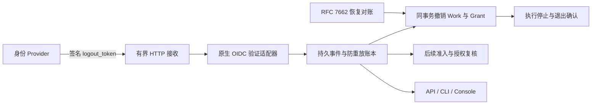

# 标准身份注销与 E2AG 撤销

所属：#35 / K03-3。DiOS 接收身份 Provider 的标准注销事件，撤销相关 Work/Grant，并阻止失效会话获得新工作授权。组织、岗位与客户业务规则继续由上层应用负责。

## 协议与组件

协议采用 [OpenID Connect Back-Channel Logout 1.0](https://openid.net/specs/openid-connect-backchannel-1_0-final.html)。签名与 OIDC 声明验证由 [coreos/go-oidc v3.21.0 `VerifyLogout`](https://pkg.go.dev/github.com/coreos/go-oidc/v3/oidc#IDTokenVerifier.VerifyLogout)承担；本地一次性 Go 适配器通过 stdin/stdout 与 Python 接收端交互。事件落库与 E2AG 撤销复用 Runtime 数据库事务。

组件比较：Authlib 稳定版 1.9.10 缺少专用接收实现；其 1.10 文档对应预发布线。PyOIDC 的通用解析入口还需显式约束算法及事件时效。Spring Security 有成熟接收链路，但当前部署没有 JVM 网关。go-oidc 的专用验证接口与独立适配器边界匹配，适配器构建后只需部署二进制。[模块、测试与构建说明](../../adapters/oidc-logout/README.md)记录依赖锁定与受支持 profile。



接受 RS256/ES256、精确 issuer/client audience、有效签名、`jti`、`sid` 或 `sub`、空注销事件对象，拒绝 `nonce`。当前支持 profile 要求 `exp`，有效期最长 300 秒，`iat` 不早于接收前 120 秒、不晚于接收后 30 秒。超过时效的事件由来源恢复对账兜底。这些限制需与 IdP 配置共同验收；它们是本部署的接受条件。

## 关联、原子性与恢复

来源登记从受信 RFC 7662 响应保存 `sid` 和可用的 `auth_time`。访问 Token 的刷新时间 `iat` 不参与身份会话新旧判断。

带 `sid` 的事件按 scope、issuer、client 和会话匹配；同时提供 `sub` 时要求主体也匹配。仅带 `sub` 的事件撤销该主体在事件发生前建立的会话；可信 `auth_time` 晚于事件的会话保留。缺少可信认证时间的主体来源采用保守拒绝。旧来源记录缺少 `sid` 时继续通过 RFC 7662 对账确认失效，新登记记录携带 Provider 提供的会话元数据。

事件身份为 scope、issuer、client、`jti` 的摘要。同身份同语义重复投递返回成功；语义冲突返回 400。验证成功后，一个 scope 事务内撤销匹配的有效 Work/Grant 并写入事件；失败整体回滚。事件与准入共用事务串行边界，因此先注销后准入会被拒绝，先准入后注销会被撤销。历史幂等回执仍返回原 Run，授权保持撤销。

账本保留事件摘要、来源关联、发出/接收时间和撤销数量，不保存原始 JWT。事件作为后续准入的撤销标记，不能随着短时 JWT 过期删除；清理需另行证明所有旧来源与历史恢复窗口均已关闭。schema 纳入显式迁移、备份校验及恢复。

数据库事务保证授权账本的一致性。已派发外部动作的停止、远端确认与副作用处理仍由执行恢复状态记录；跨服务严格撤销排序属于 #35 后续验收。

## 部署与接口

1. 按 [构建说明](../../adapters/oidc-logout/README.md)安装适配器，先备份、排空，再执行现有 `runtime.cli migrate`。
2. 配置 `DIOS_RUNTIME_LOGOUT_CONFIG` 与 `DIOS_RUNTIME_LOGOUT_VERIFIER` 为管理员维护的绝对路径。配置样例见 [logout-providers.json](../../examples/runtime/logout-providers.json)。issuer、RP client ID 和 JWKS 地址均来自可信配置。
3. 在 IdP 对应 RP client 注册 `POST /api/os/runtime/identity/logout/{provider_id}`；浏览器入口参考 [精确 Nginx location](../../examples/runtime/browser-gateway/logout-location.conf.example)。只有此精确路径绕过浏览器登录，签名 Token 是其权限依据。
4. 保留 [身份恢复对账](identity-reconciliation-35.md)，监测接收失败与来源观测过期。

IdP 必须能够直接访问回调地址。需要独立内部入口时可使用[精确来源限制的 Nginx server 样例](../../examples/runtime/browser-gateway/backchannel-server.conf.example)，只开放指定回调；非开发网络配置 TLS。部署配置中的回调主机、端口与来源范围按实际网络填写。

Keycloak 的 HTTP 客户端支持代理环境变量与原生 `proxy-mappings`。内部回调应命中明确的 `NO_PROXY` 规则，外部请求保留既有代理策略，见[配置样例](../../examples/runtime/keycloak-outgoing.conf.example)。小写代理环境变量优先；检查对象是实际 IdP 进程或容器。开发验证中，Docker 注入的代理变量曾使内部回调走外部代理，使用官方配置后原生投递恢复。[Keycloak HTTP 客户端配置](https://www.keycloak.org/server/outgoinghttp)

需要恢复开发 IdP 管理权限时，采用官方离线 `bootstrap-admin service`，停止所有相关节点并保留同一数据库配置；完成回调登记后删除临时管理身份。该方式保留既有 realm、主体身份和签名密钥，数据库备份与导出按凭据材料管理。[Keycloak 管理恢复](https://www.keycloak.org/server/bootstrap-admin-recovery)

回滚时先排空任务并保留事件账本。接收过注销事件的环境必须继续使用能读取撤销标记的授权控制点；恢复迁移前备份需先重放备份之后的撤销记录，再开放准入。直接降级到不识别该账本的代码会丢失后续准入约束。

接收 form 的唯一字段为 `logout_token`。请求体上限 32 KiB、Token 上限 16 KiB、单 API 进程最多四个并行验证；JWKS 拉取有界超时和大小限制，拒绝重定向及未配置 URL。接受返回空 200；无效消息/冲突返回 400；过载、依赖不可用或未迁移返回 503，供 Provider 重试。网关日志不记录 body、查询参数或凭据。

`GET /api/os/runtime/runs/{id}` 的 `authorization.source_event` 返回关联事件摘要及时间，沿用对象读取权限。Console 中英文显示注销原因和接收时间；存在注销事件时优先显示撤销事实，不以旧的成功对账观测覆盖它。管理 CLI：

```sh
python -m app.runtime.cli --scope enterprise identity-events --limit 20
```

工作结束或授权不可用时，Console 将未完成审批显示为历史记录，保留原申请、参数与状态，关闭审批入口。

## 验证与剩余资格

专项覆盖签名/算法/受众/时效、伪造 Token、重复及冲突事件、会话隔离、主体事件乱序、新登录与刷新差异、并发准入、重启和备份。原生 Keycloak 26.8.2 在隔离测试 realm 主动投递签名事件；测试关闭周期对账，验证对应 Work/Grant 撤销及其他会话继续有效。该原生协议测试使用真实 HTTP 和数据库，未启动执行进程。

上述协议与回归结果见[初始验证证据](evidence/backchannel-logout-20261124.json)。既有开发浏览器 realm 已完成原生回调注册和精确入口配置，[真实执行证据](evidence/backchannel-logout-live-20261124.json)覆盖两个独立 Worker 的 PID、模型会话和 Docker 生命周期：A 注销后，事件落库、Work/Grant 撤销、进程退出并清理；B 保持原 Attempt/Session 与授权期限，经独立审批完成报告。事件验证期间关闭周期身份对账，完成后恢复定时器。

执行链路 17 项、真实浏览器 8 项通过；历史审批提示更新另通过 7 项浏览器检查，包含中英文、移动布局和报告入口。原有 67 条历史完整保留，当前 77 条、无活跃任务；此前失败的资格运行同样保留。浏览器脚本支持从已完成证据读取历史，无需重新派发任务：

```sh
node scripts/probe_backchannel_logout.mjs /absolute/private-fixture.json /absolute/observation.json /absolute/completed-evidence.json
```

fixture 提供本地开发入口 `base`、`username` 和 `password`，完成证据提供 `runs.revoked`、`runs.peer`。凭据文件不进入版本库。省略第三参数会发起两个任务，需要外部资格驱动提供独立 Worker、审批及 `.logout` / `.event` 控制信号，仅用于隔离开发环境。

#35 继续推进三层委派收窄、审批人资格变化和跨服务严格撤销排序；新账本的 PostgreSQL 与物理多主机资格仍待验证。
