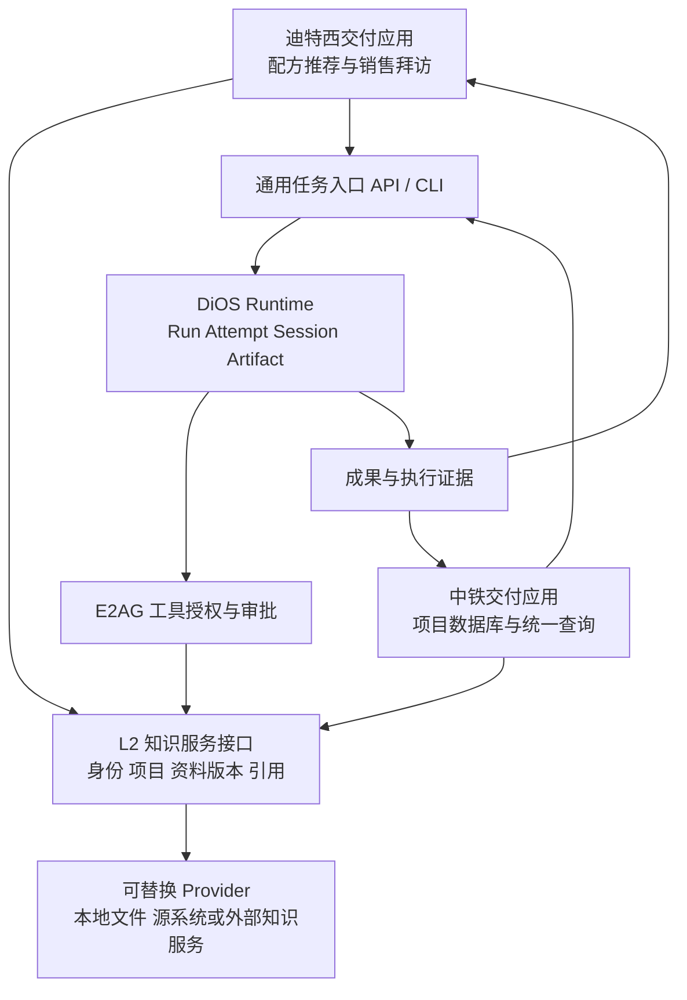

# 业务应用与 DiOS 授权知识接入

2026-11-23。当前工程切片对应 #39、#56；#36、#37、#38、#40 保留各自完整交付范围。

## 2026-11-24 边界修订

[ADR 0011](../adr/0011-capability-only-platform-boundary.md) 优先适用。L2/L3 为外部业务产品；当前本地知识 Provider 和资料核查是同仓参考实现。独立构建、应用包、公开 SDK 和动态输入已接入，见[发布契约](application-packages-47.md)。project_id 属于参考应用输入协议，通用任务入口只作登记 Schema/摘要校验，不解释项目权限。

原末节中 #36/#37 的组织/岗位、#40 业务确认归外部平台；DiOS 先交付 #33/#35/#38 的主体、受控授权与对象权限。新增任务类型通过数据目录登记，使用默认 E2AG 要求，见 [输入登记契约](application-input-registration.md)。

## 分层与当前能力

DiOS 内核提供执行、E2AG 授权、工具审批、恢复与产物存储。L2 知识服务管理受限资料供给和来源版本。客户交付应用独立管理业务规则、数据模型、界面和业务验收；通过公开接口调用通用服务。

`backend/app/runtime` 保持通用执行职责。`applications/knowledge-source` 是 L2 的轻量本地 Provider；`applications/knowledge-evidence` 是运行于 Worker 容器的 L3 参考应用，只整理资料依据。`examples/business` 保存工程样例输入，客户名、实际业务记录与客户规则均留在交付应用及其配置中。Console 是运维与联调入口，客户产品继续使用各自 UI。

## 实现契约

管理员在执行 profile 的 `console` 中登记 `input_kind=knowledge-evidence` 和绝对路径 `input_catalog`。输入目录包含 `version=1`、`inputs`；每项有 id、name、filename、source、task_kind、project_id、query、tool、sha256。sha256 为其余字段的 Runtime canonical JSON 摘要。API 接收已登记的 profile、输入 ID 或符合登记 Schema 的动态输入、goal 和幂等键，客户端无法传路径或命令。

原 `/api/os/runtime/samples`、提交字段 `sample_id`、CLI `task samples` / `--sample` 保持兼容；profile 增加 `input_kind` 与 `input_ids`，Console 据此过滤输入。业务任务仍使用现有 Run、Attempt、Session、Artifact，取消、撤销、列表、预览和下载共用原接口。

参考应用从 `DIOS_WORK_INPUT` 读取已冻结输入，用 Worker 工具通道调用 `knowledge_search`。检索前后的执行授权及审批由现有 E2AG gate 校验，引用产物形成前验证同一 Attempt/Session 中确有成功的对应调用。知识凭据仅留在网关，Worker 配置 `worker_secret_refs=[]`、`network=none`、只读根文件系统。

Provider 提供已有 MCP Streamable HTTP 版本的 `search({query})`。网关注册固定端点、输入/结果 schema、credential_ref 和带版本的 knowledge.search 权限。Provider 根据凭据映射 subject、project_id、documents；documents 为资料 ID 到版本指纹的映射。身份和资料范围由服务端配置确定。

读取时先过滤项目与资料授权，再匹配文字；返回前重读授权。资料指纹覆盖正文、来源、版本、定位和更新时间，版本变化需重新授权。每次检索最多返回三份、每份正文最多 8 KiB；未命中或证据损坏无法生成成功成果。当前检索为确定性的文字匹配，后续向量、图谱和源系统适配沿用授权与引用契约。

成果包含 project_id、citations、evidence、markdown、review_status=pending_review。引用保留原文、source、locator、version、updated_at 与 digest。Markdown 对来源文字转义，防止资料中的链接或图片触发额外请求。工具批准与业务确认分别归属 E2AG 和 L3/#40。

## 两项目的接续范围

迪特西已确认方向是知识问答、给客户推荐配方，以及拜访前准备、拜访后跟进并由销售确认。沿用原 57 项清单、UI 和 20261120 准备清单；首批功能组合、责任人和演示日期由原实施会议确认。当前样例只核查配方推荐的资料依据，真实配方及客户记录等待授权资料和接口到位。

中铁依据 20261116 合同终稿附件 1：资源盘点、项目数据库、行业知识库、统一查询与共享接口、试点交接。数据与知识服务承担授权供给、引用和更新；辅助员工应用承担业务任务与人工确认。首批部门、数据和接口遵循确认实施清单。当前样例核查项目资料引用。

需求来源：DiOS 开发话题收到的授权接续要求、迪特西话题 `01a16bf1-fdeb-7790-bc2a-42a20e744e48`、中铁话题 `01a18011-4363-7be0-97ec-078e3ec93bf5`。工程样例为合成数据，客户原材料继续保留在各项目工作目录。

## 工程验证与下一段

证据见 `evidence/business-evidence-20261123.json`。覆盖资料越权、同查询不同身份、撤销后读取、来源及正文变化、失效资料、伪造引用、输入绑定、Markdown 注入，以及浏览器到实际 Docker Worker 的审批和报告链路。API/CLI/Console 使用同一持久任务和产物。

当前 Console 为可信操作员模型，同一 scope 内操作员可读取全部任务成果。企业用户、项目角色、对象级成果权限与分享撤销由 #36/#38 接续；已有产物的访问授权、留存与删除也在该层管理。客户资料接入前先完成这些权限。#37 接续长期员工身份及岗位绑定；#40 接续业务确认、待办和关闭，#39 再扩展源系统 ACL 与更新/删除传播、替代 Provider 验证。客户应用沿用原项目交付计划，工程样例与客户验收分别记录。
