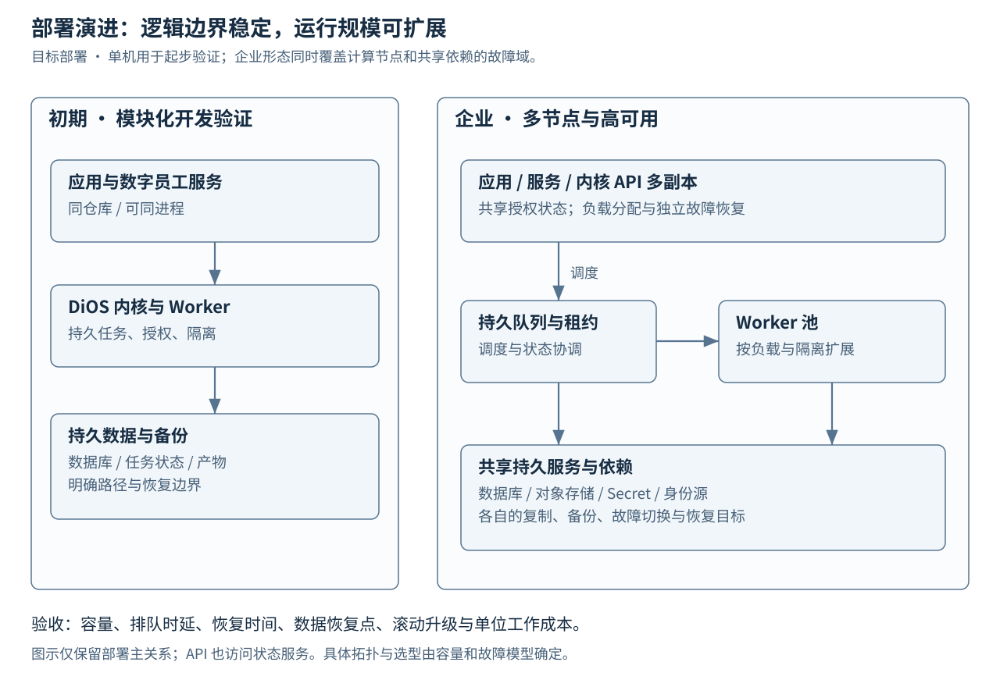

# DS-F01-2：容量、SLO 与部署设计 v1

状态：已接受（P0 参数化设计） · 日期：2026-11-11 · 任务：[#26](https://github.com/HQIT/DiOS/issues/26)。
依据：ARCH-BASELINE-0.3、AP-05/08/11/13、持续评审负载、#57。编制与计算核验：Codex；容量依据：用户确认“小型试点与多节点扩展两档假设”。业务容量与企业性能仍待实测，模型价格待确认；局部意图事务实测见本页末尾的存储比较。

## 1. 两档输入与容量结果

[输入参数](../../contracts/v1/capacity-profiles.json) 与 [计算脚本](../../scripts/model_capacity.py) 可独立运行，完整结果见 [估算 JSON](evidence/capacity-estimate-20261111.json)。所有数字为设计假设或计算值。

| 指标 | 小型试点 | 多节点扩展 |
| --- | --- | --- |
| 用户 / 同时活跃 / 数字员工 | 50 / 10 / 20 | 1000 / 200 / 300 |
| 每天逻辑任务 / 额外尝试比例 | 200 / 10% | 2000 / 10% |
| 平均尝试时长 / P95 场景时长 | 10 / 30 分钟 | 15 / 60 分钟 |
| 峰值系数 / 设计利用率上限 | 2 / 70% | 2 / 70% |
| 计算所需峰值槽位 / 调度上限 | 5 / 6 | 66 / 72 |
| Worker 主机 / 每机槽位 | 2 / 3 | 7 / 12（含节点故障余量） |
| 模型账户有效并发假设 | 6 | 72 |
| 每尝试产物 / 日志 | 20 / 5 MiB | 50 / 10 MiB |
| 阶段/进度事件每天 | 17,600 | 198,000 |
| 审计记录每天 | 26,400 | 264,000 |
| 峰值事件+审计写入 | 约 1.02 次/秒 | 约 10.69 次/秒 |
| 满槽位租约+授权续期 | 约 0.32 次/秒 | 约 3.84 次/秒 |
| 90 天元数据容量（试点双副本/企业三副本，1.5 倍余量） | 约 21.24 GiB | 约 328.61 GiB |
| 同口径产物+日志容量 | 约 1,450.20 GiB | 约 34,804.69 GiB |
| 详情平均上传带宽 | 约 0.53 Mbps | 约 12.82 Mbps |
| 24 小时断网缓存每机，满槽位保守估算 | 约 21.55 GiB | 约 137.26 GiB |

活跃用户与员工数用于管理查询负载，不能直接当作模型并发。每个有效槽位要求独立进程和 Session 证据；max_slots 是容量配置。多节点档一台 Worker 丢失后剩余 72 个槽位，仍覆盖所需 66；控制面、数据库和对象存储还需各自 HA 验收。

计算采用 attempts/day = runs/day × (1 + extra_attempt_ratio)，所需槽位 = ceil(attempts × mean_seconds / 86400 × peak / target_utilization)。有效槽位取 Worker、配置、账号配额最小值。事件量包含每尝试 60 条阶段事件及每 30 秒一条进度；工具假设每尝试 40 次，每次 3 条审计。模型 token 假设每尝试输入 20,000、输出 3,000；每天分别为试点 440 万/66 万、多节点 4400 万/660 万。费用 = token × 实际每百万单价，价格与实测吞吐均为 null。

90 天容量按未压缩内容、无去重复用收益计算，产物复制因子 2、元数据试点 2/企业 3、索引/存储余量 1.5；备份与异地保留另计。实际产物长期保留会主导存储，#32/#52 按 ACL、证据价值、热/冷分层和备份周期细化。不能为降低容量删除当前覆盖清单或有效证据。

## 2. 部署与技术选择

控制面通过事务状态与持久队列调度 Worker；Worker 经协议 Adapter 和 E2AG 访问模型及工具。小事件驱动查询投影，大产物独立进入对象存储。

权威状态后端由 [ADR 0008](../adr/0008-governance-semantics-and-provider-selection.md) 的统一实验选型。PostgreSQL/SQLite 保留为参考实现；生产候选包括对象粒度关系事务、事务 KV 与分布式 SQL。Repository 约束原子认领、epoch/version 和状态/事件可恢复性，允许不同实现机制。轻量控制服务可通过 API 管理跨主机 Worker，SQLite WAL/LMDB 按 ADR 0009 验证；数据库文件仅在服务主机访问。共享事务路线优先产品化 PG 对象粒度实现，企业容量与复制假设按最终候选复算。

产物使用内容寻址的对象存储 Provider；单机可用文件系统，企业使用支持校验、权限、生命周期和可靠复制的对象服务，具体产品由 #32/#52 选择。相同摘要的复用仍经过权限域校验。跨主机只暴露 API/受限对象访问，Worker 不持有数据库管理员凭据。机器 mTLS、短期服务身份、Secret 引用和日志脱敏进入 #27/#33。

| 资源 | 试点起始配置假设 | 多节点起始配置假设 |
| --- | --- | --- |
| 控制面 | 1 × 4 vCPU / 8 GiB | 2 × 8 vCPU / 16 GiB，独立故障域 |
| Worker | 2 × 4 vCPU / 16 GiB，3 槽/机 | 7 × 12 vCPU / 48 GiB，12 槽/机，正常调度最多 72 槽 |
| 事务库 | 独立持久卷与备份，容量按估算留余量 | 3 个数据节点，主/同步备及候选备；多数仲裁与旧主隔离、故障切换和独立备份 |
| 对象与缓存 | 独立进度/详情队列，建议至少 32 GiB spool/机 | 复制对象存储，建议至少 192 GiB spool/机 |
| 网络与凭据 | 固定依赖和显式代理，受控外发 | Worker 到控制面/对象/模型的独立连通性与账号配额 |

上述规格来自每槽 2 GiB、0.5 CPU 和 70% 利用率假设，静态分析 CPU/内存峰值需单独压测。Windows Worker 使用预检过的绝对可执行路径、固定环境与隐藏后台启动；交互终端 PATH 不作为服务依赖。远端 Agent 只占委派/连接配额，其内部并发和硬件不计入本地实测槽位。

## 3. SLO 与故障目标

目标窗口为滚动 30 天；统计平台受理的合规请求，数据库/内部依赖失败计入平台错误。另提供含外部模型/端点失败的完整工作完成率，模型影响单列归因。

| 指标 | 试点目标 | 企业目标 | 测量条件 |
| --- | --- | --- | --- |
| 控制面可用性 | 99.5% | 99.9% | 有效读/写成功率；维护和内部依赖失败纳入 |
| Run 受理 P95/P99 | 500/1500 ms | 500/1500 ms | 至 2 倍模型峰值受理 + 管理查询，含鉴权与持久提交 |
| Ready 任务领取 P95/P99 | 5/15 s | 5/15 s | Worker 有空槽、账号有额度；另报含资源等待的队列时长 |
| 查询 P95/P99 | 500/1500 ms | 500/1500 ms | 每页 ≤100，试点 10 QPS/企业 100 QPS；大导出异步 |
| 进度新鲜度 P95/P99 | 60/120 s | 60/120 s | 从权威事件提交到远端可见；采样间隔单独计量 |
| 完整详情同步 P95/P99 | 10/20 min | 10/20 min | 单产物 ≤100 MiB、网络正常；断网样例另测积压清空 |
| 心跳过期检测 | ≤60 s | ≤60 s | 20 秒心跳，过期只标未知并触发核对 |
| 可恢复任务重新就绪 | ≤5 min | ≤5 min | 旧执行及外部副作用已确认，健康依赖恢复后计时 |
| 控制面 RTO | ≤60 min | ≤5 min | 试点恢复/企业单控制节点或 DB 主节点故障演练 |
| 权威元数据 RPO | ≤15 min | 已确认提交目标 0 | 试点 PITR/备份频率满足；企业要求同步复制及正确仲裁 |
| 已封存关键产物 RPO | ≤15 min | 单节点故障目标 0 | 定义 seal 的持久复制确认；全地域灾难另立交付目标 |

网络分区且仲裁不足时停止新写与新领取；活跃执行仅在仍有效的授权内继续，权限不可确认或必要证据无法持久化则停相关动作。可用性和安全性共同测试。模型“十几分钟无最终答案”属于外部执行时延指标：保留首事件、首有效输出、最终答复及无结果比例；显示独立的模型、调度、同步健康，不能用查询超时推导任务死亡。

## 4. E2AG 的性能与扩展门槛

| 分段 | 目标 | 取样与约束 |
| --- | --- | --- |
| PDP 决策（含策略读取） | P95 ≤50 ms，P99 ≤150 ms | allow/deny/审批三类；冷缓存和撤销后缓存单测 |
| PEP 本地检查+意图持久化 | P95 ≤100 ms，P99 ≤300 ms | 意图提交后才能执行，吞吐优化保留确认语义 |
| 平台附加治理开销 | P95 ≤150 ms，P99 ≤450 ms | 同一 trace 从动作到可转发，直接测量，不相加各段分位数 |
| 撤销传播到新动作拒绝 | P99 ≤5 s | 在途动作与后续动作分别计量；严格路径验证策略/epoch |
| 长任务授权续期 | 到期前 300 秒余量；恢复后成功率 ≥99.9% | 900 秒 grant 初值、每 300 秒检查；权限收缩不续旧范围 |
| 拒绝与意图证据完整度 | 100% | 抽样完整链与计数对账；必要审计故障禁止动作 |

普通请求样本与安全失败样本分别报告，任何权限绕过、过期 epoch 成功写入或无意图副作用均为失败。缓存提升需要绑定策略版本与撤销代次；并行化不能跳过授权确认；异步观测可优化，必要执行意图保持先持久化。发现瓶颈按 #34/#35 提升控制点与委派机制、#46 完善分段观测、#54 验证改进收益。

## 5. 断网、背压与扩缩容

进度与详情各有缓冲、预算和重试队列；日志分块、内容复用和压缩由 Provider 承接。spool 按满槽位运行 24 小时输出、额外一轮活跃任务余量及 2 倍安全系数估算；这是一项存储上界假设，断网是否继续执行仍由租约与授权决定。

使用率达到 70% 告警，85% 停止新领取，95% 保护活跃任务证据并要求处置。进度通道保留独立空间；禁止通过丢弃必需证据或缩减评审范围减压。断网恢复时进度优先，大详情限流并校验摘要，旧水位写入被拒绝。

队列最老 ready 年龄 >30 秒持续 10 分钟且槽位利用率 >70%，先检查账号额度/限流；账号允许时扩 Worker。DB 提交 P99 >500 ms、连接池 >70% 或 outbox 延迟 >60 秒持续 10 分钟，检查慢查询、索引、批处理及分区后再扩状态服务。CPU/内存 >70% 持续 15 分钟触发资源评估。缩容先 drain，等待活跃 Attempt、待确认副作用及必要证据提交；没有强制时限杀死活跃模型会话。

## 6. 参数化基准与验收

所有场景保存硬件、OS、数据库/Adapter/Agent 版本、配置、固定源码集、模型账户限制、随机种子和完整 trace；预热 15 分钟，稳定负载至少 2 小时，长任务/恢复场景持续 24 小时。至少三次重复，报告样本数、错误、P50/P95/P99、尾部和资源峰值。

| 场景 | 参数 | 判定与责任 |
| --- | --- | --- |
| 控制面与数据 | 两档 + 2 倍突发；10/100 QPS 查询；预装 90 天索引 | SLO、过期写拒绝、查询/导出水位一致；#30/#32/#46/#54 |
| 真实并发与长任务 | 6/72 独立槽位，10% 额外尝试，30/60 分钟尾部任务 | PID-start/Session/Attempt 证据；配置并发与实际并发分别展示；#58/#54 |
| E2AG 混合动作 | 70% allow、20% deny、10% 审批；40 次工具/尝试及 10 倍突发 | 拒绝不转发、意图先写、性能分段与 100% 关联；#34/#35/#58 |
| 撤销与续期 | 并发动作中撤销、缩权、到期；策略服务故障 | ≤5 秒目标、旧 epoch 拒绝、失效不放行；#27/#33/#34 |
| 限流/额度/无答案 | 429、额度恢复、HTTP/2 中断、20 分钟有事件无最终答复 | 单路探测恢复；保存部分输出；模型/平台归因独立；#30/#56/#58 |
| 故障与升级 | 重复触发、进程崩溃、重启、单 Worker/API/DB 主故障、滚动升级 | 单所有者、未知结果先对账、活跃任务自然排空；#30/#53/#58 |
| 同步与大对象 | 24 小时断网、100 MiB/1 GiB 产物、UTF-8 任意字节分块 | 小进度独立、spool 背压、原始摘要一致、恢复后限流排空；#32/#54 |

先用确定性模拟 Adapter 测平台开销，再用真实第三方 Agent 测外部依赖组合。模拟结果与真实模型报告分开。源场景 36 KB/分钟进度和 12.3 MB 详情仅作兼容样本，平台容量按事件与产物速率建模。

## 7. 交付与风险归属

本设计固定两档负载、公式、拓扑方向、SLO、恢复与基准口径。#26 的完成依据为参数可计算和验收可执行；实际达标由 #54 证明。账号并发、模型价格、静态工具资源峰值、对象压缩率保持未知并在试点测量后回填。

#30/#32 实现后端中立的认领与状态/事件契约，并按 ADR 0008 比较候选，#52/#53 固定产品版本、部署、备份和故障切换，#27/#33 落实跨主机身份与授权，#46/#54 建立性能证据。并发实验同时比较锁粒度、证据布局、事务次数及后端；按相同持久保证与故障矩阵验收。

技术依据：[PostgreSQL 18 SELECT / SKIP LOCKED](https://www.postgresql.org/docs/18/sql-select.html) 支持队列型竞争领取；原子领取、fencing 和 outbox 的组合是本项目设计，仍须数据库竞争测试。决议见 [ADR 0006](../adr/0006-durable-contract-and-storage.md)。

## 存储实现比较

[单节点实验](provider-selection-32.md) 记录意图提交路径及故障证据；既定峰值写入仍为业务假设。轻量控制服务与共享事务服务按 [ADR 0009](../adr/0009-lightweight-and-shared-runtime-storage.md) 分档验证。控制面多副本、复制 RPO 与备份恢复继续作为独立验收项。
