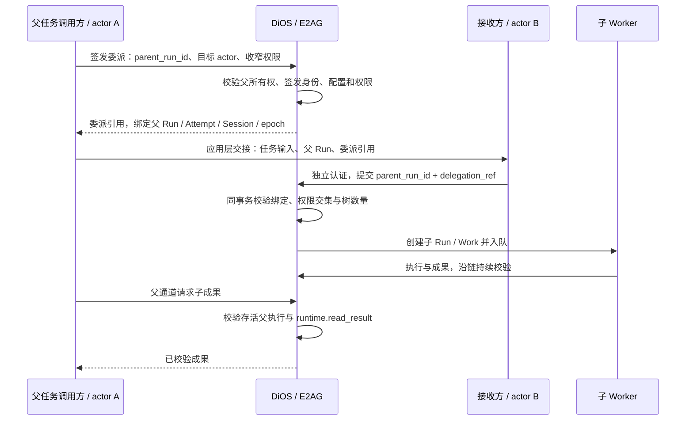

# 跨执行身份的子任务委派

DiOS 允许受托服务以自己的认证身份接收子任务，同时保留原始主体、签发身份、父执行和 E2AG 权限交集。签发与接收均使用现有认证 API，凭据留在各自调用方。父 Agent 的 MCP 通道继续按管理员登记的配置工作。

## 身份与协议

[RFC 8693](https://www.rfc-editor.org/rfc/rfc8693.html#section-4.1)区分原始主体、当前 actor 和历史 actor；历史 actor 信息用于追溯。DiOS 的授权依据来自当前认证身份、受信委派记录、运行所有权及实时策略检查。

[Keycloak 官方方案](https://www.keycloak.org/securing-apps/token-exchange)提供稳定的目标受众交换；包含 `actor_token`、`may_act` 与 `act` 的 Token Exchange Delegation 当前列为预览能力。其访问令牌交换不提供完整的级联撤销。因此，Provider 负责认证和令牌交换，DiOS 继续持久维护工作依赖和执行撤销。此接入复用 DiOS 的认证委派 API，不新增令牌格式或 STS。

## 签发和接收



签发方调用 `POST /api/os/runtime/delegations` 时增加 `parent_run_id`。服务端捕获父执行所有者、Attempt、Session、租约 epoch、授权 epoch 和目标 profile/digest；委派记录、签发来源及执行绑定同事务保存。原始主体从父授权继承，目标 actor 由受权签发方选择。权限不得超出父授权、签发身份及父 Work。委派期限不超过上级授权与签发身份，子 Work 再受父 Work 期限约束。

接收方使用自己的认证凭据调用 `POST /api/os/runtime/runs`，同时提供 `delegation_ref` 和 `parent_run_id`。服务端要求直接上级授权匹配、原始主体相同、当前 actor 对应接收方、签发来源等于父任务捕获的来源，且签发时的父执行与当前父执行完全一致。调用方无法指定 Worker、Session、epoch 或 principal。

父 profile 的子配置须显式开启接收方准入：

```json
{
  "path": "/operator/profiles/child.json",
  "profile_id": "child-service",
  "profile_digest": "64-character-image-and-launch-fingerprint",
  "authenticated_recipient": true
}
```

该条目位于 `tool_channel.children.profiles.<alias>`，与数量、深度限制共同纳入 profile 指纹。父身份需要目标 profile 的 `delegation.issue` 权限；父 Work 需要对应 `runtime.spawn` 权限。注册配置、父身份及接收方权限在外部策略等待后再次检查。

## 接口与成果边界

SDK 0.1.9 的 `issue_delegation`、`submit`、`submit_input` 均支持 `parent_run_id`：

```python
delegation = issuer.issue_delegation(
    parent_authority, child_profile, recipient_actor, permissions, deadline,
    idempotency_key="handoff-step-1", parent_run_id=parent_run_id,
)
child = recipient.submit(
    child_profile, registered_input, goal,
    idempotency_key="receive-step-1", delegation_ref=delegation["id"],
    parent_run_id=parent_run_id,
)
```

CLI 接收沿用调用方自己的 `DIOS_ACCESS_TOKEN`：

```bash
cli/dios task submit --profile child-service --sample registered-input \
  --goal '处理已登记输入' --key receive-step-1 \
  --delegation DELEGATION_ID --parent PARENT_RUN_ID
```

重试保留原幂等键和输入；已完成任务返回原回执。无父绑定的普通委派不能挂接跨身份子任务；有父绑定的委派及其后代不能用于执行树之外的任务。父取消、撤权、租约失效或执行替换均阻止后续动作，子任务沿既有取消和恢复流程处理。

父任务通过绑定通道读取跨身份成果时，必须获得目标 profile 的 `runtime.read_result` 完整权限元组，并通过 E2AG 委派链检查。原 `runtime.spawn` 不包含这一权限。读取前后均核对父执行；普通 API 的跨身份访问及 Console 的关联过滤继续遵守各自对象权限。

## 存储与升级

新增 `runtime_child_handoff_schema` / `runtime_child_handoffs`，保存委派引用与不可变父执行绑定。该表采用既有增量 Migration、SQLite 一致备份和摘要校验机制；原 Run、Attempt、Session、产物及来源记录保持原身份。

升级先停止领取新任务、排空并备份，再迁移和切换服务。回滚需保留升级后新增任务、委派、撤销和产物，恢复成套代码与数据；不得仅删除新绑定表后继续运行。服务端部署完成后，上层应用按各自发布流程采用 SDK 0.1.9。

## 验证与后续

[验证证据](evidence/child-recipients-20261125.json)覆盖认证 HTTP、原生 OPA、父执行冒用、跨执行树使用、角色权限撤回、并发幂等、数量限制、成果读取及备份。真实 Docker 子任务验证完成报告和父撤权后的原尝试退出；该场景的父执行采用 Runtime 所有权/会话夹具，没有父模型进程。

既有[异构 Harness 验证](mixed-harness-children-35-58.md)覆盖同一身份下的三组真实父子模型。[跨身份 Harness 交接](recipient-harnesses-35-58.md)进一步覆盖应用独立认证接收、父模型发现子任务、成果回传、撤权和 Worker 失联。外部 Provider actor-token 交换资格、物理跨主机和严格跨 Provider 撤销排序仍按整体计划独立验收。
