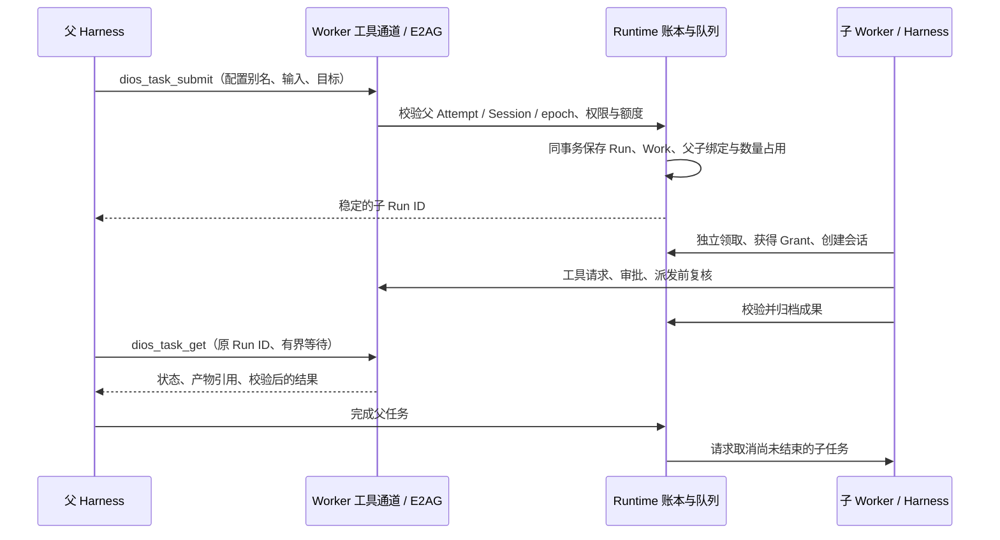

# 运行中 Agent 的受控子任务

运行中的 Agent 可通过 SDK 或 MCP 创建子任务、查询进度并读取已验证成果。DiOS 管理任务身份、权限、队列、独立执行和父子生命周期；任务拆分方式与业务成果校验由上层应用负责。所属：#35 / K03-3、#58 / K01-5。

## 生命周期与授权



生命周期采用 [Temporal Child Workflows / Parent Close Policy](https://docs.temporal.io/child-workflows) 的独立子执行和父结束策略语义，沿用 DiOS 的持久 Runtime。固定策略为 `request_cancel`：排队子任务直接取消，活跃子任务先记录取消请求，确认进程退出后结束。父任务成功、失败、取消、撤权或租约 epoch 变化均触发传播。查询等待到期只返回观测结果。

子任务绑定父 Run、Attempt、Worker、Worker instance、Session、租约 epoch 和授权 epoch。每次执行、工具操作和成果接收均递归检查父执行。父任务重试产生新 Attempt，旧绑定不能被新尝试接管。关系和取消事件持久化，控制端重启后继续可查。

父任务必须拥有目标 profile 的 `runtime.spawn` 权限，且子 Work 的有效权限属于父 Work 四层权限交集。目标 profile 使用 ID 与 digest 固定版本；只有管理员配置的别名可以选择。子任务保留父任务的 subject、actor 和认证来源，不接受 Agent 提供身份、路径、凭据或授权层。父 Work 使用委派时，子 Work 必须保留该祖先，准入继续执行 OPA 检查；工作期限取父子授权期限的较小值。

每棵任务树最多 32 个子任务、最多 3 层，可进一步收紧。入队与额度占用同事务，竞争请求不能超额；完成或取消不返还数量。这里计量任务数与深度，金额、Token 和跨服务资源配额继续由后续预算能力承接。

## 配置与接口

父 profile 的 `tool_channel` 可仅包含子任务能力：

```json
{
  "tools": {},
  "acp_names": {
    "mcp__dios__dios_task_submit": "dios_task_submit",
    "mcp__dios__dios_task_get": "dios_task_get"
  },
  "children": {
    "profiles": {
      "delegate": {
        "path": "/etc/dios/profiles/child.json",
        "profile_id": "child-profile",
        "profile_digest": "REPLACE_WITH_64_HEX_PROFILE_DIGEST"
      }
    },
    "max_children": 4,
    "max_depth": 2
  }
}
```

子 profile 需要登记输入、E2AG 策略及对应 Worker。跨主机通道中的配置路径属于控制端。父子模型服务与运行配置可以不同，凭据分别由各 Worker 按已授权配置解析。

| 接口 | 输入与结果 |
|---|---|
| SDK `ToolChannelClient.submit_child` | profile 别名、goal、稳定 key；sample_id 与 input_payload 二选一；返回子 Run 摘要 |
| SDK `ToolChannelClient.child` | 原 Run ID；`wait_seconds` 默认 0，范围 0–30；返回状态、阶段、产物引用 |
| MCP `dios_task_submit` | 同样的配置和输入；MCP 请求 ID 与当前桥实例组成幂等 key |
| MCP `dios_task_get` | 默认等待 20 秒、最长 30 秒；`wait_exhausted` 表示本次等待到期，可继续查询原 ID |
| Console / API / CLI 任务详情 | `family.parent` 与 `family.children`；按相关 Run 的当前读取权限过滤；Console 支持双向跳转 |

同 key、同父执行、同输入返回原 Run；内容变化返回冲突。响应丢失后 SDK 复用原 key。查询不会启动新尝试。读取成功结果时检查对象摘要与访问权限，内联上限 64 KiB，较大成果保留引用。SDK 版本为 0.1.7；实际调用审计绑定父 Attempt、Session 与参数摘要，ACP 工具活动须与审计对应。

有界等待参考 [RFC 7240 §4.3 的 wait 语义](https://www.rfc-editor.org/rfc/rfc7240.html#section-4.3)，通过本通道的 `wait_seconds` 参数表达；当前接口使用 Unix socket/MCP，不宣称实现 HTTP Prefer。等待期间持续复核父执行，撤权及时结束读取。

子任务准入的 Run、Work、关系和数量占用原子提交；通道成功响应审计随后保存。准入后响应或审计失败时，保留已接受任务并允许同 key 查询确认。父任务关闭仍会取消未完成子任务。

## 验证与升级

[验证证据](evidence/child-task-channel-20261125.json)包含真实 DSH / ECNU Max 的父子会话、分离的 Worker 控制进程与工作负载进程、OPA 授权、人工审批、一次工具调用和父成果引用。合成源代码作为独立静态评审应用的输入；底座没有评审业务分支。[开放 Harness 示例](../../examples/runtime/dsh_child_coordinator.py)展示模型通过 MCP 委派与读取成果。

回归覆盖并发幂等、最后一个数量额度竞争、三层执行与第四层拒绝、身份/会话/epoch 伪造、权限扩大、父撤权与租约失效、取消事务回滚、控制端重启、备份关系、查询等待及相关对象权限。真实首次短轮询触发 Harness 无进展退出时，子任务收到取消并确认退出；有界等待后的完整链路通过。中英文桌面、手机界面均验证关联导航。

多 Worker 并发回归还覆盖共享补报队列的确认竞争。其他进程持有投递租约时，单轮 relay 返回不能证明回执已确认；启动和结果接收控制点等待原 event ID / digest 的持久 ACK，最长 15 秒，超时保留原回执进入恢复。该处理沿用 [Transactional Outbox 的幂等消费与确认后删除机制](https://docs.aws.amazon.com/prescriptive-guidance/latest/cloud-design-patterns/transactional-outbox.html)。实际复现中，旧实现将一个尚待其他进程确认的回执误报为 `REPORT_DELIVERY_PENDING`；确定性回归验证等待期间不会启动进程，收到确认后仅启动一次。

升级新增 `runtime_child_schema` / `runtime_child_runs`，使用既有 migration 和备份校验机制。开发部署先排空、备份、停止旧控制进程，再迁移并启动新版本；保留原 Run 身份。回滚应恢复成套代码与升级前数据库备份，已产生的新任务和产物须先归档，不能直接覆盖。

物理跨主机联合验收、异构 Harness 的父子组合、活动会话恢复绑定、金额/Token 预算及严格跨 Provider 撤销排序继续由既定任务承接。当前同一身份可选择不同受信 Harness 配置；切换为另一 actor 的子任务需要独立授权交换与来源映射。
