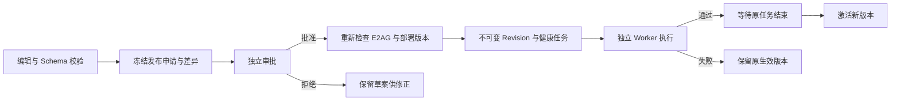

# 配置工作台

Console → Studio 提供运行配置的副本编辑、JSON 校验、字段差异审阅、自然语言建议、JSON 草案导出及受控发布。配置覆盖通用执行 Profile；岗位、客户流程和业务模板由独立上层应用管理。

## 编辑与审阅

选择现有配置并载入副本，或将 JSON 文件导入当前草案。左侧保留基准，右侧编辑草案。校验先检查 JSON 语法和字段类型、范围，再调用 Runtime 已有的 Profile、Secret 引用和执行边界校验。语法错误提供行列，Schema 错误提供 JSON Pointer、校验规则与预期值。校验通过后展示每项修改前后的值及标准 JSON Patch。

未提交的草案保存在当前页面，导出后可重新导入。发布申请持久保存基准、候选、差异、健康检查输入、策略摘要与目标部署版本；刷新后可继续审批，或载入快照修正。正式生效沿用不可变 Revision、健康检查与排空流程。

差异使用 [RFC 6902](https://www.rfc-editor.org/rfc/rfc6902) 与 BSD 许可的 [python-json-patch](https://pypi.org/project/jsonpatch/1.33/)。错误定位复用 [jsonschema 的实例路径与校验规则](https://python-jsonschema.readthedocs.io/en/stable/errors/)。配置限制为 64 KiB、32 层、4096 个节点及单数组 512 项；重复键、非有限数、无效 UTF-8 与内联凭据拒绝进入建议和 diff。Secret 使用既有引用契约。

## 自然语言建议

配置建议智能体通过 `dios-config-proposal-v1` 输入契约注册，启用动态输入与 E2AG。首条路径使用 Cursor ACP 和现有 SDK，任务进入原持久队列，由独立 Worker 执行。任务、Attempt、Session、结果产物与授权证据沿用 Runtime。

建议以输入配置摘要为基准。结果先校验，再显示差异；用户点击“应用到草案”后才修改编辑器。任务运行期间草案发生变化时，旧建议返回 `STUDIO_PROPOSAL_STALE`。重复请求复用幂等键，浏览器观测失败保留原任务。执行或结果接收授权被撤销时沿用 E2AG 拒绝路径。

[配置建议工作负载](../../capabilities/configuration-assistant/README.md) 和 [输入/结果契约](../../examples/runtime/studio-inputs.json) 可供其他 Harness 适配器复用。当前首批真实验证使用 Cursor，后续实现按原 Harness 资格任务推进。

## API 与 CLI

API 使用既有可信操作员认证，独立上层应用的普通身份不能访问管理配置正文。

| 接口 | 内容 |
| --- | --- |
| `GET /api/os/runtime/studio/profiles/{id}` | 现有配置副本、来源 Revision 与摘要 |
| `POST /api/os/runtime/studio/compare` | `{base, draft}` 两段 JSON 文本；返回校验问题、摘要、Patch 与逐项差异 |
| `POST /api/os/runtime/studio/suggestions` | `{profile_id, text, instruction, idempotency_key}`；返回原 Runtime 任务 |
| `POST /api/os/runtime/studio/suggestions/{run_id}/review` | `{text}` 当前草案；校验基准摘要，返回候选 JSON 与差异 |

本地 CLI 复用同一校验与 diff：

```bash
backend/.venv/bin/python scripts/config_studio.py \
  --base profile.json --draft profile-draft.json
```

有效配置返回退出码 0，错误返回 1；正文返回结构化校验和差异。本地比较命令仅做校验；受控发布使用下述 API 客户端。

## 验证

[工程证据](evidence/configuration-studio-20261126.json) 关联 API/CLI 测试、真实 Cursor 任务、E2AG 决策、浏览器编辑修错、人工应用、文件导出导入，以及中英文、明暗主题和移动视口。历史任务身份与既有配置保留检查单独记录。[发布与端到端资格](evidence/studio-release-20261126.json) 记录审批、幂等、撤销、版本冲突、真实容器健康检查、失败保留原版本、旧任务继续完成，以及 API/CLI/界面的一致性。工程资格与责任人的产品接受分别记录。

## 审批与发布

发布遵循明确审批人、冻结对象和独立启动发布的流程，采用 [GitLab 部署审批](https://docs.gitlab.com/ci/environments/deployment_approvals/)中的职责划分，独立审批身份沿用 DiOS `FileApprovers`。发布审批资格为指定 scope 下的 `studio.publish`；审批人必须独立于请求主体及当前 E2AG 工作主体。凭据通过请求头传入，数据库保存审批身份、意见与决定。



申请状态为 `pending → approved/denied → published`；审批人资格被撤销并被发布检查发现后进入 `invalidated`。`published` 表示 Revision 与健康任务已原子提交，实际生效以 Deployment 的 `active_revision_id` 为准。审批有效期为 24 小时。申请版本用于并发检查，重复请求、审批和发布复用原回执。

申请冻结配置、健康检查输入和目标 Deployment 的预期版本。审批后编辑草案须另行提交。发布时复核审批资格与 E2AG 策略摘要，创建 Revision、入队健康任务和写入发布回执在同一事务内完成。健康任务由 Worker 执行，工具和 Harness 沿用其既有 E2AG 控制点。健康结果通过固定结果 Schema 后，Deployment 等待旧任务及未决工具调用结束再激活。失败和查询中断保留申请与执行证据。

运行 Profile 使用固定镜像摘要、冻结输入/结果契约和 Secret 引用；配置摘要需获得管理员的 E2AG 准入。现有配置副本会固化可信来源的输入契约。HTTP 发布接受数据快照；镜像构建、受控文件打包沿用运维侧 Revision CLI。新增授权由管理员明确配置，审批界面仅消费已授权配置。

### 发布接口

所有接口位于 `/api/os/runtime/studio`，沿用管理端操作员认证。

| 接口 | 内容 |
| --- | --- |
| `POST /releases` | `{base, draft, deployment_id, deployment_version, idempotency_key, sample_id 或 input_payload}`；校验、授权检查并保存申请 |
| `GET /releases?after=…` | 每页 30 项申请摘要，以最后一项 ID 继续查询 |
| `GET /releases/{id}` | 申请快照、差异、审批状态与发布回执 |
| `GET /releases/{id}/probe` | 当前申请绑定的健康任务、Attempt/Session、失败原因及 E2AG 授权证据 |
| `POST /releases/{id}/approval` | `{expected_version, decision, reason}`；`X-DiOS-Approver-Token` 验证独立审批身份 |
| `POST /releases/{id}/publish` | `{expected_version}`；发布已批准快照，返回 Revision、健康任务和 Rollout 标识 |

Runtime 数据库增加独立迁移 `studio_release_schema`，发布申请的每次转换写入不可变记录。SQLite/PostgreSQL 均由数据库触发器禁止更新或删除这些记录，既有 Schema 文件保持冻结。部署详情及健康任务继续通过原 Runtime API 查询。

### 发布 CLI

`DIOS_ACCESS_TOKEN` 与 `DIOS_APPROVER_TOKEN` 从环境读取。默认地址为本机 `13081`；跨主机使用 HTTPS。

```bash
backend/.venv/bin/python scripts/studio_release.py request \
  --base profile.json --draft profile-draft.json \
  --deployment capability-demo --deployment-version 0 \
  --key release-request-001 --sample health
backend/.venv/bin/python scripts/studio_release.py show RELEASE_ID
backend/.venv/bin/python scripts/studio_release.py approve RELEASE_ID \
  --version 1 --reason '已审核配置与健康检查输入'
backend/.venv/bin/python scripts/studio_release.py publish RELEASE_ID --version 2
```

`deny` 提交拒绝决定，`list --after ID` 继续查询历史。请求超时后读取原申请，并使用原幂等键或原预期版本重试。CLI 与 Console 调用同一接口。
