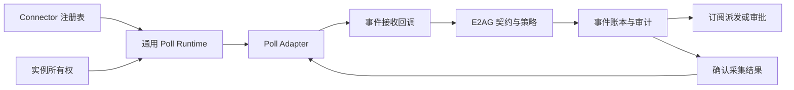

# DS-K01-3：通用 Connector 轮询运行时

通用运行时发现注册表中声明 `poll` 能力的已启用实例，调用其适配器采集事件，经现有 E2AG 入口写入事件账本。外部系统的协议、游标和确认操作归适配器，调度与实例所有权归 DiOS。新增轮询源只需增加 manifest 与适配器。

关联：[#9](https://github.com/HQIT/DiOS/issues/9)、K01-3、[ADR 0001](../adr/0001-connector-plugin-contract.md)。责任域：L1 Connector。工程证据：[验收记录](evidence/connector-poll-20261124.json)。工程实现完成后，G2 独立评审与产品验收分别登记。

## 成熟机制与选择

[Apache Camel Scheduled Poll Consumer](https://camel.apache.org/components/4.18.x/scheduler-component.html) 将采集适配器、固定间隔和轮询故障处理分离。DiOS 沿用这一职责划分，复用已有 asyncio 服务生命周期、注册表、事件去重和 E2AG 派发，无需增加独立 Java 运行环境或另一个任务队列。

实例所有权采用 [filelock](https://py-filelock.readthedocs.io/en/stable/api.html) 4.3.1 的原生操作系统锁，MIT 许可；关闭软锁回退、保留锁文件路径，进程退出由操作系统释放锁。阻塞 IMAP I/O 使用 Python 标准库 [asyncio.to_thread](https://docs.python.org/3.12/library/asyncio-task.html#asyncio.to_thread)，不阻塞 API 事件循环。[imaplib](https://docs.python.org/3.12/library/imaplib.html) 使用 UID 定位、显式连接和读取超时。

## 契约与执行

| 接口 | 责任 |
| --- | --- |
| `ConnectorManifest.poll_adapter` | 声明可调用的异步适配器；缺少适配器的 poll manifest 注册失败 |
| `poll_interval_seconds` | 每轮完成至下一轮开始的固定间隔，默认 60 秒；须为有限正数 |
| `PollInstance(id, config)` | 与数据库会话分离的配置快照，配置不进入对象默认文本表示 |
| `PollAdapter.poll(instance, emit)` | 执行一批采集；阻塞 I/O 离开事件循环；`emit` 成功后确认外部消息 |
| `emit(CloudEvent)` | 独立数据库会话、订阅匹配、E2AG 判定、去重、持久审计；无落账证据时抛出错误 |
| `PollOwnership.hold(instance_id)` | 独占采集和冷却期；返回 false 表示其他所有者占用，禁止采集 |

默认每秒扫描配置，最多四个实例同时采集，每个实例最多一轮在途。新增、禁用、删除或配置变更由扫描及下一轮读取生效；禁用和停机均排空已开始的一轮。不同实例的失败独立处理，下轮按既定间隔重试；日志仅记录实例 ID 与异常类，外部服务错误内容不写入日志。

`start` 重复调用不会增加调度器。`stop` 停止发现与领取，等待在途适配器完成，随后释放所有权。线程取消不等于网络 I/O 结束，IMAP 适配器在取消时仍等待原线程结束。部署应给予排空时间，确认旧进程退出后再接管。

## IMAP 兼容与确认

保留 `imap/{id}`、`email.received`、60 秒间隔、每轮最多 10 封、2000 字符正文预览、单封失败继续处理其他邮件。选取 `UNSEEN`，使用 `UID FETCH (BODY.PEEK[])`；事件持久化后才 `UID STORE +FLAGS \\Seen`。

事件 `data.message_id` 使用邮箱目录、UIDVALIDITY 和 UID 组合成稳定投递标识，区分同主题邮件以及邮箱重建后的 UID 复用。其余既有数据字段保持兼容。重复消息必须关联到确实存在的去重事件记录才允许确认；只有 pending claim 时保持未读。E2AG 拒绝、等待审批及派发失败仍保留完整事件，由已有治理/重试链路处理。接收确认表示事件已由 DiOS 持久接管。

邮件服务与数据库之间存在提交后、确认前的崩溃窗口，采用至少一次接收和现有时间窗去重。超过去重窗口的重放可能生成新事件；全时段精确一次接收不在本次保证内。TLS 协议测试覆盖窗口内重复投递复用同一账本记录。

## 部署、消费者与权限

数据库结构保持不变，无数据迁移。API 生命周期由 `connector_poller` 驱动；旧 `imap_poller` 导入保留兼容别名。`GET /api/os/connectors/types` 增加 `poll.interval_seconds` 描述，其他类型为 null。既有 CRUD API、CLI、Console 动态配置和订阅目录沿用 manifest，不新增管理入口或权限绕过。Secret 不进入公开 manifest；IMAP 的既有配置存储沿用现状，凭据引用标准化由 #33 的适配器接线承接。

| 设置 | 含义 |
| --- | --- |
| `DIOS_CONNECTOR_POLL_ENABLED` | 默认 true；设为 false 停用本进程的轮询服务 |
| `DIOS_CONNECTOR_POLL_LOCK_DIR` | 同一安装的所有轮询进程共享的本机持久目录；默认 `workspace_root/connector-poll-locks` |

多个 API 进程或同主机容器必须共享同一个本地锁目录。每个 Connector ID 一个锁，采集及冷却期间持续持有。禁止删除正在使用的锁文件目录。开发验收覆盖 Linux/WSL；Windows 文件锁后端尚待实机验收。

多主机部署先将采集限定在指定主机，其余主机设置 `DIOS_CONNECTOR_POLL_ENABLED=false`。后续远程所有权 Provider 必须同时提供事件写入与外部确认的 fencing；仅设置分布式 TTL 租约不足以阻止迟到采集。相关资格归 #30 与部署任务，不将本机锁宣称为多主机互斥。

回滚先关闭轮询、排空旧实例并停止旧进程，再恢复原镜像；Connector、事件记录和任务历史继续保留。回滚至旧 IMAP 实现会恢复旧的取信确认行为，需要在变更评审中明确接受。

## 验收

专项覆盖动态注册后经原 CRUD 自动运行、类型目录序列化、E2AG 拒绝与审计、事件去重、慢/失败实例隔离、双运行时互斥、冷却期间所有权、禁用/重启与配置刷新、停机排空、独立进程被终止后的锁释放、IMAP 确认顺序、UIDVALIDITY、中文与截断、阻塞 I/O 和取消排空。真实 TLS fixture 使用原生 imaplib 与实际 SQLite 事件账本；不连接客户邮箱或启动客户 Agent。

交付门槛包含后端全量回归、专项测试、变更文件 lint、后端镜像构建与运行、开发 API 部署及历史保留校验。证据记录通过、跳过和未验证项；工程结果与 G2/产品验收分开登记。
