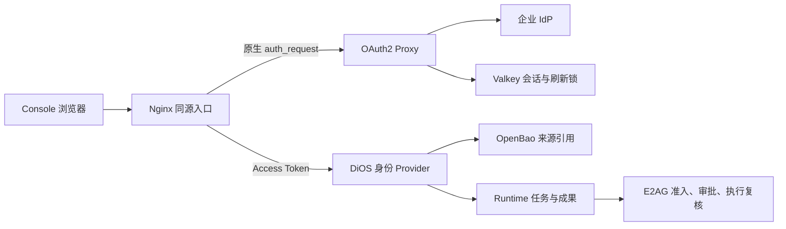

# Console 企业浏览器入口

2026-11-24 · #33 / #34

Console 使用企业账号登录，展示当前主体可用的任务与成果，并提供退出入口。登录、会话保存、刷新、刷新锁和退出使用 OAuth2 Proxy 与 Valkey 的原生机制。Nginx 通过官方 `auth_request` 集成，把经过验证的 Access Token 交给 DiOS 既有身份 Provider；E2AG 继续决定任务和工具的当前执行权限。

## 成熟方案与接入边界

采用 [OAuth2 Proxy 官方 Nginx 集成](https://oauth2-proxy.github.io/oauth2-proxy/configuration/integrations/nginx/)及 [Nginx 原生授权子请求](https://nginx.org/en/docs/http/ngx_http_auth_request_module.html)。浏览器只保存 HttpOnly/Lax 会话票据；企业部署启用 HTTPS/Secure Cookie。原生服务端会话保持票据小于单 Cookie 容量，刷新响应的 Set-Cookie 由网关传回浏览器。



浏览器入口只暴露 `/dios/api/os/runtime/`、认证状态及明确的 OAuth 路径。运维 API、内部授权子请求和其他路径不开放。请求头采用白名单：运行接口的 Bearer 来自授权子请求，调用者提供的身份头和 Cookie 不传给 API；同时提供 Bearer/Access Token 与浏览器入口凭据的请求返回 400。独立审批所需的 `X-DiOS-Approver-Token` 保留传递，后端仍验证审批主体、对象权限和审批凭据。CLI/SDK 沿用独立的 Bearer 接口。

API 不信任网关用户名或任意转发头。直接调用后端时，Cookie 和伪造转发头均不能建立身份。反向代理与 API 的真实凭据传输需要专用监听、网络隔离或受认证加密通道。

## 写请求与错误语义

CSRF 采用 [OWASP 的 AJAX/API 自定义请求头模式](https://cheatsheetseries.owasp.org/cheatsheets/Cross-Site_Request_Forgery_Prevention_Cheat_Sheet.html#employing-custom-request-headers-for-ajaxapi)，由 Nginx 原生 `map`/请求规则执行。写请求同时要求固定部署 Origin 精确匹配、`X-CSRF-Token: 1` 和 Fetch Metadata 同源；缺少 Fetch Metadata 的客户端仍须通过前两项。该头是触发浏览器同源策略的标志，不作为秘密令牌。`null`/外站/仅同站 Origin、缺少标志和跨域预检均被拒绝。后端宽泛 CORS 响应不透传到 Cookie 入口。

登录回调沿用原生 state、PKCE S256 和 nonce；应用写请求使用上述独立控制。退出只允许同源 POST，再由 Nginx 转为 OAuth2 Proxy 原生退出请求。GET 退出返回 405。

API 会话失效返回 401，Console 显示重新登录；依赖失败保留 503 语义。网关不把 API 请求重定向到 HTML 登录页。浏览器按钮通过明确的登录路径发起 OIDC 流程，登录后进入任务页。中文版和英文版沿用现有 Locale/主题设置。

## 刷新后的幂等回执

按 [Amazon Builders' Library 的请求身份与重试语义](https://aws.amazon.com/builders-library/making-retries-safe-with-idempotent-APIs/)，客户端提交键表示一次明确请求。DiOS 保留既有作用域/主体隔离和事务唯一键，新增不可变提交摘要，覆盖主体、目标、输入、登记契约、执行配置和 Secret 引用。

同一主体以新来源重试相同请求，在当前提交/读取权限仍有效时返回原 Run。原 Work、来源引用、期限、Grant、审批与历史均保持原值；返回回执不触发新准入或续期。任务输入或执行配置变化仍产生 409。两个有效来源并发首次提交时，由数据库事务保留一个 Run/Work；失败方读回胜出的回执。

历史记录不补写摘要。已有记录沿用完整输入和原权限快照精确匹配，跨来源重试可能仍为 409，可通过历史查询找回原 Run。长任务续期、来源注销事件和严格撤销排序继续按 #34/#35 推进。

## 部署与复现

配置位于 `examples/runtime/browser-gateway/`。构建前端并将 dist 挂载为 `/srv/dios`。用显式变量列表替换 Nginx 模板中的 `${DIOS_*}`，保留 `$http_*` 等原生变量；配置包括固定公开 Origin、Host、监听地址、协议、API 与 OAuth2 Proxy 上游。执行 `nginx -t` 后再加载。HTTPS 可由受信任 TLS 入口终止或在此 Nginx 配置证书；公开来源、回调和转发协议必须一致。

OAuth2 Proxy 示例使用独立 confidential OIDC 客户端、受限 Secret 挂载和服务端会话。`cookie_refresh`、IdP Token TTL、最大会话期限和 DiOS Work TTL 需一起设置；刷新不会扩大已有 Work 的绝对期限。API audience、subject/client/scope 映射继续在 DiOS 受信目录配置。

开发演示复用既有 public PKCE 测试客户端及其已注册 `/callback`，由 Nginx 原生 URI 转发到代理回调；不改变 IdP、原来源目录和历史数据库。此回环演示采用 HTTP，生产配置使用独立客户端、标准 `/oauth2/callback` 和 HTTPS。

```bash
node scripts/probe_browser_sso.mjs \
  /private/browser-fixture.json workspace/browser-sso-evidence.json
```

私有 fixture 包含回环 `base`、测试 `username/password`、可选 `api_base`。默认验证登录、CSRF、刷新、退出与界面；`run_flow: true` 另行通过 UI 提交一项测试任务，并写 `<output>.pending.json`，供独立审批流程处理。fixture 和产物目录应受主机权限保护；仅对明确的开发实例启用任务流程。

实测证据见 [机器记录](evidence/console-browser-entry-20261124.json)。浏览器从真实企业登录进入 DiOS，完成真实 Worker、独立审批、报告摘要与引用验证；来源刷新后六路重复提交返回同一任务和原期限。真实浏览器携 Cookie 的跨 Origin 表单被拒绝。单机开发资格与部署已覆盖；企业 IdP、TLS、物理多主机、HA、注销事件和受控续期仍需按既定计划验收。
