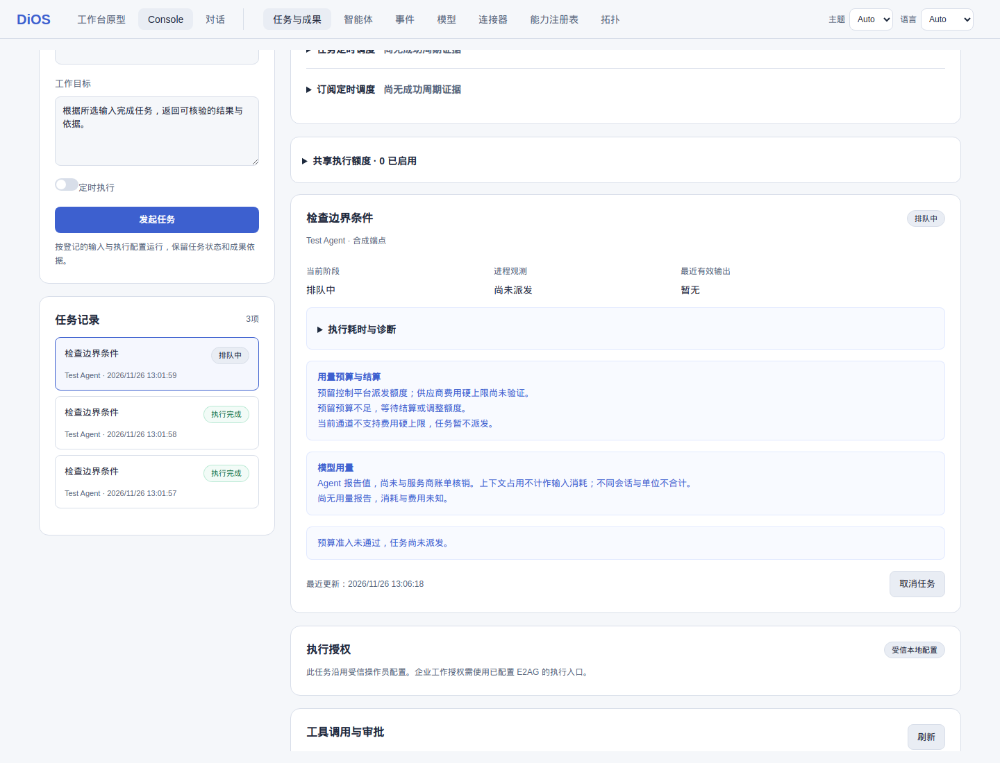

# 用量预留与结算

DiOS 在创建执行尝试的同一事务中预留 token 或金额额度。并发任务共同占用作用域内的预算；结算有确定证据后释放差额。取消、超时、失联和任务失败均保留未对账占用，下一次尝试重新预留。

## 设计依据与能力条件

[TigerBeetle 两阶段转账](https://docs.tigerbeetle.com/coding/two-phase-transfers/)采用预留、入账与释放，并区分待处理金额和已入账金额。[LiteLLM 预算机制](https://docs.litellm.ai/docs/proxy/users)在发送请求前估计并预留费用，响应计价后替换为实际费用。DiOS 沿用预留与结算分离的原则，复用现有作用域事务和 SQLite/PostgreSQL；无需增加账本数据库。

[ACP 用量协议](https://github.com/agentclientprotocol/agent-client-protocol/blob/main/docs/protocol/v1/prompt-turn.mdx)中的上下文窗口占用与累计费用是不同指标。当前 `usage_update` 和 PromptResponse 用量保留为智能体上报证据；不自动把窗口 token 数当成累计计费量，也不把模型输出作为结算权限。

平台账本与供应商费用分别处理：

| 模式 | 执行条件 | 含义 |
| --- | --- | --- |
| `required`（默认） | 需要经过资格验证的供应商侧强制上限；当前通道返回 `PROVIDER_COST_CAP_UNSUPPORTED`，保留排队任务 | 管理者要求的硬上限必须有实际控制证据 |
| `reservation_only`（显式选择） | 各适用账户均有足够预留余额，同时满足 E2AG、并发、时限及工具策略 | 约束平台派发额度；实际费用可能超过预留 |

供应商侧硬上限允许路径及自动账单回执对账仍属 K04-2.01 的剩余工作。Cursor ACP 当前费用通道不具备已验证的强制上限，严格模式拒绝派发。界面明确显示该限制。

## 账户与事务

账户按作用域和 ID 定位，选择器沿用 scope、受信工作主体或 Profile 集合。账户的选择器与单位不可更改；额度、每次尝试预留量、启用状态和执行模式通过预期版本更新并记录前后值。账户从配置后新认领的尝试开始计账，既有执行和历史费用不自动追溯归入。

单位使用整数：`tokens` 表示 token，`micro:USD` 等表示百万分之一货币单位。不同单位分别保存，不做隐式汇率换算。金额最小精度为百万分之一；管理者应按供应商计价精度保守向上预留。

`可用额度 = 最大额度 − 已结算量 − 未结算预留量`。所有匹配账户共同限制一次 Attempt。SQLite 写入事务或 PostgreSQL 作用域锁保护查询与预留；新 Attempt、预留与认领事件一起提交或回滚。查询在 SQL 中排除受阻范围，长队列不会阻止其他可执行 Profile。

每个账户/Attempt 只有一份预留和一次最终结算。`key` 固定请求摘要，重复请求返回原回执，不同内容使用同一 key 返回冲突。实际量超过预留时如实入账并显示超额，余额可以为负；后续派发被阻止。账本没有自动到期释放，避免网络超时后已发生费用被忽略。

## 结算与证据

管理员可在 Attempt 已完成、失败或取消确认后提交结算。仍运行或 `result_unknown` 的尝试不能释放预算。证据引用已有 Object/Artifact，校验作用域、固定摘要和可用性，记录依据类别、操作人及时间。`provider_statement` 表示管理员采用供应商账单，`operator_reconciliation` 表示人工对账；二者均为管理员提交，当前不会自动验证供应商签名或重算账单。

零消耗也需要明确的结算证据。失败前已产生费用的尝试保留该费用；重试建立新 Attempt 和新预留。相同幂等请求可读取既有结算回执，证据后来失效不会重复执行扣费或释放。原始上报用量、结算结果和任务结果分别保留。

## 管理入口与观察

| 操作 | HTTP（平台管理身份） | CLI |
| --- | --- | --- |
| 预算与余额 | `GET /api/os/runtime/consumption` | `consumption status` |
| 创建或更新账户 | `PUT /api/os/runtime/consumption/accounts` | `consumption set --file account.json` |
| 最终结算 | `POST /api/os/runtime/consumption/settlements` | `consumption settle --file settlement.json` |

账户输入包含 `account_id`、`selector`、`unit`、`maximum`、`per_attempt`、`expected_revision`、`key`、`actor`，可显式指定 `enforcement` 和 `enabled`。结算输入包含 `account_id`、`attempt_id`、`actual`、`evidence`、`key`、`actor`；`evidence` 包含 `ref`、`digest` 和 `basis`。

Task API 与 Console 详情显示每次尝试的账户、单位、预留、结算和阻塞原因。全局预算管理仅向平台管理身份开放，终端应用用户继续使用既有任务访问权限。账本按生命周期备份，恢复时保留预算、Attempt 与结算身份；恢复冻结不释放已有占用。

启用预算后，控制面回退需要使用识别预算账本的版本。旧版本没有这些执行检查，不能作为携带未结算预算的运行目标；此条件随既定安装升级资格核验。

工程证据见[预算账本与执行验证](evidence/consumption-ledger-20261126.json)。验证使用隔离数据库、合成成本凭据和真实 Docker 执行，包含 E2AG 授权与撤销；供应商硬上限资格仍待完成。

