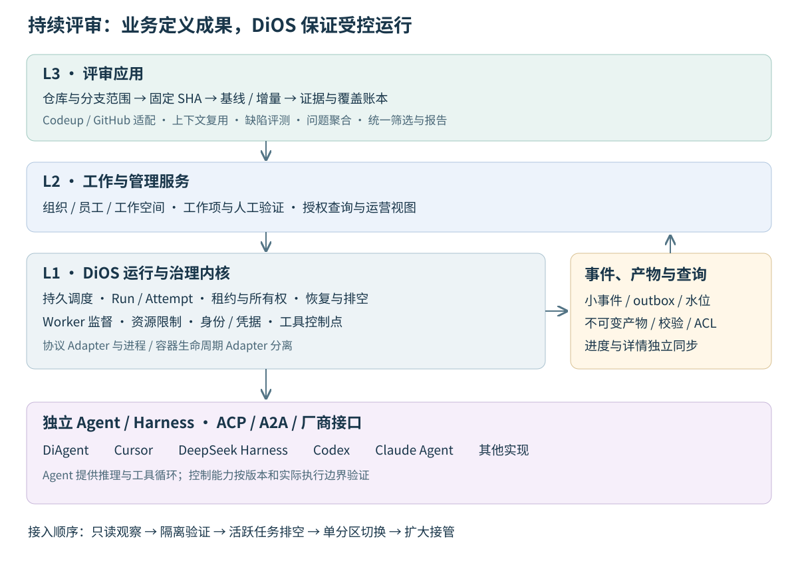

# 持续代码静态评审：能力评估与接入设计

日期：2026-11-11 · 状态：设计提案 · 关联：F01-3 #57、F01-1 #25、K01-2 #30、K01-4 #56、K01-5 #58。

## 结论与交付目标

持续代码静态评审适合成为 DiOS 的首个长期后台业务参考场景：L1 提供可靠执行与治理，L2 提供工作、权限和运营服务，L3 负责代码评审规则与成果。Cursor、模型、Windows 和 Sites 均作为可替换实现登记。平台面向跨主机与多节点演进，首个接入范围可以很小。

当前代码具备事件接入、有限去重与重试、A2A 风格任务记录、DiAgent/Docker 执行和部分工具授权基础。生产接管仍需补齐持久调度、执行所有权、任务恢复、独立进程监督、结果验收和数据投影。建议先接入只读观察，再用隔离样例验证新执行链，达到故障验收门槛后按仓库/分支分区切换。

本提案交付能力判断、边界、契约草案和验收条件。现有评审保持运行；迁移和部署属于后续实施任务。

## 1. 证据基线

| 证据 | 范围与判断限度 |
| --- | --- |
| 当前工作目录 | 原 WSL `NANA-OS`，分支 `feat/connector-registry-api`，HEAD `63b2e1c`；架构与路线文档为本地待评审内容。 |
| 最新远端分支 | `origin/codex/e2ag-research`，`e7723ba`，2026-10-08；与当前目录比较，关键 A2A 执行、Cron 和事件重试实现相同。研究分支的工具治理证据不能代替持久任务验收。 |
| 其他产品工作树 | 现有 `DiOS-e2ag-product` 有未提交治理实现；未将其计为当前已交付能力。 |
| 来源执行机 | 用户提供的 Windows 来源会话包含 2026-11-11 运行、进程、会话和同步记录。属于历史运行证据；本主机没有 `D:\CodexOps`，未直接读取源 SQLite、配置和产物。 |
| 现有驾驶舱 | Sites 元数据为已发布版本 34；数据库概览包含 `dashboard_snapshots`、`sync_content_chunks`、`managed_repositories`、`executor_repository_status`、`control_plane_state`、`control_audit_events`。发布信息不等于执行机实时状态。 |

来源记录显示，独立 Worker PID、ACP 子进程 PID 与不同 Session ID 曾同时存在；另一个时刻只有一路恢复尝试，不能把历史三路证据延用为当前并发。记录还显示会话持续有事件但长时间没有最终答案、HTTP/2 故障后冷却恢复，以及进度与详情同步时间不同。

下列矩阵的“已有”仅指列出的实现事实；未在本轮重跑生产环境。源数据库结构、当前队列规模、源机 Agent 精确版本、全部暂停/恢复规则和完整权限配置仍待只读清点。

## 2. 能力支持矩阵

| 能力 | 判断 | 实际依据与下一步 |
| --- | --- | --- |
| GitHub 事件接入 | 已有局部能力 | `git_webhook/manifest.py` 声明 GitHub/GitLab/Gitea；不包含仓库与分支治理全流程。 |
| Codeup 与仓库自动发现 | 可适配，尚未交付 | 新增 RepoProvider；分别校验 Codeup API/现有 cuctl 和 GitHub API 的分页、权限、限流及版本语义。 |
| 范围、六个月规则、基线/增量 | L3 新增 | ReviewScope/ScopeRevision 冻结分支与 SHA；主业务分支由管理者选择。 |
| 共享代码复用与覆盖账本 | L3 新增 | 当前无可核验 ReviewUnit/Occurrence/CoverageLedger；内容去重与语义复用分别处理。 |
| 事件幂等与有限重试 | 已有局部能力 | `event_dispatcher.py:53` 使用唯一去重声明；`:168` 默认排除 cron/manual 触发。`event_retry_worker.py` 有次数与指数退避。 |
| 持久定时、合并触发、任务去重 | L1 新增 | Cron 的 `_task`、`_last_fire` 为进程内状态；事件去重不能提供调度器独占与执行恢复。 |
| 任务记录与本地执行 | 已有局部能力 | `A2ATask`、`AgentRuntime`、Docker 路径可复用；服务调用与容器轮询通过 `asyncio.create_task` 运行。 |
| Cursor/dsh/Codex/CC 接入 | 可适配 | [能力勘察](agent-integration-capability-matrix.md) 区分原生 ACP、桥接 ACP 和厂商接口；当前 DiOS 尚无这些统一 Adapter。 |
| 跨主机独立 Worker 与资源限制 | L1 新增 | 需要 Host/Worker/Attempt/Session、进程监督、资源配额和机器身份；现有容器实例不构成完整分布式 Worker 协议。 |
| 租约、fencing、排空与升级 | L1 新增 | 当前未发现持久任务租约、旧所有者写入隔离及 drain 协议。 |
| 取消与中断 | 当前不足 | `a2a_service.py:554` 取消主要更新数据库状态；尚未形成进程退出、会话确认、迟到结果的闭环。 |
| 分类恢复与单路试恢复 | L1 新增 | 事件级退避不包含账户额度、网络、会话和产物错误的分类恢复；投递成功也不证明业务成功。 |
| 结果完整性和证据验收 | L1 框架 + L3 规则新增 | 容器任务当前按退出码判成功（`a2a_service.py:406`）；评审需要清单、结构、证据和覆盖验证。 |
| 只读静态执行 | 需新增强制控制 | 当前 Docker 工作区挂载为 `rw`；提示词、ACP ask/plan 或工具事件均不足以证明执行只读。 |
| 工具、MCP、Skills、Registry | 已有基础，需扩展 | 保留配置、登记和部分治理；新增版本能力快照、只读工具集、Agent 接入和准入测试。 |
| 质量评测、根因聚合、导出 | L3 新增 | 真实缺陷/修复对照、证据状态、来源关联、统一查询和 Excel/Markdown 报告。 |
| 运行监控与历史趋势 | L1/L2 新增 | `metrics.py` 为内存计数和最近 100 次投递耗时；缺少持久阶段事件、实际并发与小时/日统计。 |
| 事件增量与大产物存储 | L1 新增 | 当前 A2A 产物内嵌 JSON；需事务 outbox、内容寻址存储、增量投影和水位。 |
| 组织权限与跨主机凭据 | L1/L2 新增 | 当前可选全局 Access Token 提供入口门禁；需服务身份、Secret 引用、工作空间 ACL、审计和撤销。 |
| 原 Sites 驾驶舱 | 可作过渡查询端 | 通过业务查询/同步适配消费投影；产品界面逐步归入 L2/L3，Sites 不进入内核依赖。 |
| 无人值守 Windows | 可适配并验证 | Worker Supervisor 固定依赖、绝对路径、环境和隐藏启动；不能直接套用交互终端环境。 |
| 不透明远端逐工具强制治理 | 暂不支持此类保证 | 只有经过拒绝测试的网关、沙箱或执行钩子才能作为控制证据；能力不足时不准入严格只读评审。 |

## 3. 分层与协作

L3 评审应用负责“审什么、算什么完成”：仓库/分支发现，活动摘要，范围与版本冻结，评审单元划分，静态工具和 LLM 策略，覆盖账本、问题与证据、根因聚合、评测及报告。仓库访问封装为 RepoProvider；评审可跨 Agent 实现复用。

L2 负责“谁负责、谁能看、如何处理”：组织、数字员工、工作空间、工作项、人工待验证队列和运营查询。第一条业务链只需这些服务的最小切片，完整 Studio 与行业应用生态可后续扩展。

L1 负责“可靠运行并留下事实”：持久队列、定时触发、所有权、尝试、Worker 生命周期、协议 Adapter、故障恢复、权限与凭据、事件、产物和观测。Codeup 分支选择、问题严重度和缺陷合并规则留在 L3。厂商 loop/harness 保持独立，通过 ACP/A2A 或厂商接口接入；MCP 提供受控检索和工具访问。

## 4. 核心对象与接口草案

### 身份和责任

| 对象 | 所有者 | 稳定身份与关键字段 |
| --- | --- | --- |
| ReviewScope / ScopeRevision | L3 | 范围 ID、修订、仓库/分支/SHA、纳入/排除原因、冻结时间、策略版本。 |
| ReviewUnit / Occurrence | L3 | 实际评审单元与每个分支版本中的来源；共享结果保留全部来源关联。 |
| WorkItem | L2 | 业务工作与责任人；关联范围、执行 Run 和人工验证，不承担进程调度。 |
| Run | L1 | 一次逻辑执行请求；输入清单、能力/权限要求、幂等键、预算、结果验收契约。重试保持 Run ID。 |
| Attempt | L1 | 每次执行尝试独立 ID；所有权 epoch、Worker、会话、错误、部分输出、起止时间和配置快照。 |
| Worker / Process | L1 Supervisor | Host ID、机器 boot ID、PID、进程创建时间、可执行文件摘要、资源/依赖状态。 |
| AgentSession | L1 Adapter 映射 | Agent/Adapter 版本、协议能力、外部 Session/Task ID、认证主体、会话状态；与 Attempt 显式关联。 |
| Artifact | L1 存储；L3 解释 | 不可变内容摘要、大小、编码、类型、ACL、来源 Attempt、完整性/校验状态。 |
| Event | L1 事实日志 | event ID、聚合 ID/版本、Attempt、epoch、发生/接收时间、schema version、内容摘要。 |
| Lease | L1 持久调度 | 所有者、期限、续租序列、单调 fencing epoch；数据库原子领取与提交校验。 |
| Finding / Evidence / Cluster | L3 | SHA/文件/行号、可达条件、证据与影响、状态、产物定位；聚类保留原始问题和 Occurrence。 |

一次模型重试创建新 Attempt；完整输出的重新解析/校验记录 ValidationAttempt，无需重新调用模型。进程、会话和 Run 不采用一一对应假设：平台保存实际关联；本业务的独立 Worker 模式要求每路独立进程与独立会话。

### 最小契约

以下是待 F01-1 固定的语义接口，路径和语言绑定尚未定稿。

| 接口 | 必须保证的语义 |
| --- | --- |
| `RepoProvider.discover/listBranches/resolveSnapshot` | 分页与权限明确，返回不可变 SHA、活动时间来源和代码规模；自动发现与手工配置按 provider/repo ID 合并。 |
| `ReviewPlanner.freeze/planDelta` | 固定范围版本；新提交创建增量修订；不重置既有覆盖。 |
| `Run.submit(input, idempotencyKey)` | 同作用域同键同输入返回同 Run；同键不同摘要返回冲突。 |
| `Worker.claim/renew/report` | 原子领取、租约与 fencing；所有写入校验 Attempt 和 epoch；过期所有者不能覆盖结果。 |
| `AgentAdapter.discover/open/submit/observe/cancel/reconcile` | 声明版本能力；保存外部身份；区分取消请求、确认及未知；不支持时返回明确能力错误。 |
| `Artifact.stage/seal` + `ResultValidator.validate` | 字节校验后封存；按业务契约生成验收证据；成功由持久验收结果驱动。 |
| `Event.append` + `Projection.consume` | 状态与 outbox 同事务提交；至少一次投递、消费者去重、按聚合版本防过期写入。 |
| `Worker.drain` / `Partition.transferOwnership` | 停止新领取；等待活跃任务和输出提交完成；所有权切换采用更高 epoch。 |
| `ReviewQuery.query/export(QuerySpec, asOf)` | UI、图表、贡献者、问题、Excel 与 Markdown 使用相同筛选、时区、范围版本和数据水位。 |

不承诺网络分区下模型调用严格 exactly-once。远端受理结果未知时进入对账；具备远端幂等键或可查询身份才自动恢复派发，否则隔离等待处理。

### 状态、恢复与观测

Run 主状态为 `queued → executing → validating → succeeded`，可进入 `retry_wait / failed / cancelled / needs_verification / reconciliation_required`。Attempt 单独记录 `claimed / preparing / opening_session / waiting_model / streaming / validating / completed / interrupted / failed`。业务成功必须同时满足完整产物、必需证据及覆盖清单校验。

阶段、健康和新鲜度分别保存：例如“等待模型 + Worker 在线 + 输出过期”与“调度器离线”有不同处置。记录 `last_heartbeat`、`last_protocol_event`、`last_meaningful_output`、`last_completed`、`next_retry_at`、`last_progress_sync`、`last_detail_sync`；缺失值显示未知。查询超时只改变观测新鲜度。

实际并发按新鲜的 Host/boot/PID-start/Session/Attempt 证据计数，旁列配置上限和未知路数。模型内部不可见的并发不作推断。阶段耗时覆盖准备、检索、首个事件、首段有效输出、生成、校验和同步；重叠阶段以 trace span 表示，不能简单相加。

| 故障 | 恢复策略 |
| --- | --- |
| 网络、HTTP/2 keepalive、同步超时 | 保存部分输出与外部身份；查询/对账优先；指数退避加抖动，上传与执行分别重试。 |
| 限流 | 尊重 Retry-After；按账号/端点限流，恢复时一条探测通路成功后逐步放开。 |
| 额度不足 | 熔断该账号/模型通路，按可配置低频探测恢复；禁止全量 Worker 同时试探。 |
| 凭据错误、依赖缺失、会话创建失败 | 分别归因；环境预检失败不占模型槽位；凭据问题进入待处理，已确定的暂态错误可重试。 |
| 子进程退出但 RPC 未返回 | Supervisor 以真实进程退出终结等待中的 RPC，保存 stderr/退出码与部分产物，再按任务恢复策略处理。 |
| 主机离线或重启 | 心跳过期进入观测未知；根据 boot ID、进程证据、租约与远端会话对账；禁止只因查询超时重派。 |
| 结果格式错误 | 先恢复完整输出并重解析；失败后有限次修复/重试，所有原始结果保留。 |
| 证据不足 | 进入待验证；补充静态证据或人工判定，不能计为成功覆盖。 |
| 长时间无最终答案 | 分别显示仍有事件/仍有有效输出/完全沉默；按明确预算询问、对账或取消，不因看板等待超时自动杀进程。 |

熔断状态采用 `closed → open → half_open`，恢复协调器持久运行；half-open 只允许一条探测，成功后按窗口逐步提高并发，失败重新退避。租约过期使旧 Worker 失去写入权，但不会自动终止远端执行，必须先对账。

## 5. 覆盖、质量与只读约束

范围决策页面合并自动发现和手工仓库，展示最近活动及其数据来源、最新 SHA、文件/代码规模和待审量。默认排除六个自然月未活动的分支，管理者可覆盖并记录原因。不能推断 main/master 是业务主分支。活动时间优先使用可靠的分支活动元数据；缺失时使用末次提交时间并标明口径，不能把时间未知直接算作不活跃。

每次基线冻结 ScopeRevision 和分支 SHA；新提交进入增量版本。覆盖分母是该修订的完整清单，排除项、不可解析项、失败和待验证均可核验。新增范围产生新修订，进度不通过删除困难单元提高。

共享内容首先按字节摘要复用存储。复用评审结果还需匹配依赖/调用上下文、构建配置、语言与规则、检索范围、提示/工具/模型策略版本；同 blob 在不同上下文中可以产生独立评审。`ReviewUnit → Occurrence[]` 保留仓库、分支、SHA、路径、行号映射和复用依据；增量发生依赖变化时重新评估影响范围，不能仅审 diff 行。

同时报告：当前范围逻辑覆盖、去重后实际评审单元、复用来源数、失败/未知，以及全历史首次验收通过量。小时/日完成量按首次有效验收计数，重试次数另列。覆盖率说明清单被评审的程度；缺陷召回率通过独立样本评测。

执行使用冻结源码快照、只读挂载和受控检索。模型不持有仓库写凭据；Git 准备阶段禁用不可信 hooks/filter，子模块、LFS 和外部下载单独授权。静态分析器采用受信版本与固定参数，禁止调用业务构建、测试或仓库自带可执行配置；输出写入隔离产物目录。源码中的指令按不可信数据处理，文件写入、Shell、网络外发分别做实际拒绝测试。

发现须包含精确位置、可达条件、代码证据、影响和适用版本。问题聚类保存根因及全部原始来源。质量集使用已确认缺陷及修复版本，冻结标签、单独留出测试集，盲评对照工具与多种 Agent；记录误报、漏报、覆盖、耗时与成本，阈值由基线实验确定。

## 6. 数据、查询与凭据

推荐以事务数据库保存任务、租约、覆盖索引和事件/outbox；内容寻址存储保存完整结果、日志与 Markdown；独立投影服务生成管理查询。单节点开发可以使用 SQLite，跨主机的权威任务库建议采用支持事务并发的服务数据库；禁止多个主机共享挂载一个 SQLite 文件作为分布式任务队列。具体数据库/对象存储在容量与运维 ADR 中确定，首阶段无需引入完整事件溯源系统或大型消息集群。

进度事件使用独立小消息通道与持久缓冲，大产物上传有独立队列、限速、退避和保留策略。产物先暂存，校验后封存；摘要可标明“执行已验收、远端详情同步中”。本地完整证据未落盘或校验失败不能判业务成功。

消费者通过 event ID 去重，按聚合版本和 ownership epoch 拒绝过期更新，保存消费水位；支持从水位重放。主机断网时本地 spool 有容量告警和背压，达到不可持久化阈值暂停领取，保留活跃任务输出。

原始 UTF-8 字节摘要与传输压缩摘要分开记录，使用增量解码器或按字节传输后统一解码，禁止按任意管道块独立转成字符串。完整度校验以解压后的字节数和摘要为准。现有无损压缩/分块复用保留为兼容导入、备份或大对象传输机制；平台日常查询改为分页和增量投影，详情不随每次进度全量上传。

现有约 36 KB/分钟进度和 12.3 MB 详情是来源场景样本，容量模型仍需统计任务/事件速率、日志增长、保留期和断网缓存。投影展示时间、仓库、分支、SHA、位置、描述、状态、产物引用与新鲜度；贡献者归属口径和问题数量口径独立定义。导出固定 QuerySpec 摘要与 as-of 水位；Excel 对不可信文本做公式注入防护。

Host 采用独立服务身份和可撤销凭据，Worker 只领取授权工作空间的任务；RepoProvider、模型账号与用户身份分开。Secret 使用引用和最小权限，按 host/workspace 约束发放；日志脱敏。内容复用必须先校验 ACL，不能因摘要相同跨权限域泄露源码或结果。定时运行复用稳定工作身份，不创建聊天；消息渠道需单独配置和授权。

## 7. 接入、切换与回滚

| 阶段 | 交付与进入条件 | 执行所有者 |
| --- | --- | --- |
| M0 只读清点 | 一致性数据库备份/只读 API、表结构、ID、队列状态、配置摘要、环境依赖、产物清单和同步水位；明确存量成功含义。 | 现有系统 |
| M1 观察接入 | 旧系统通过增量导出/只读桥向 DiOS 投影；核对范围与历史口径、时间、摘要和新鲜度。无任务领取权限。 | 现有系统 |
| M2 隔离验证 | 使用公开或合成缺陷样例，验证协议、真实独立 Worker、只读、故障恢复和结果验收；不消费生产队列。 | 隔离测试控制器 |
| M3 单分区试点 | 新任务库/权限/恢复门槛通过；选定一个仓库与分支范围，旧调度器对该分区停止领取，活跃任务自然排空并提交结果，然后切换所有权。 | 同一分区仅一个所有者 |
| M4 扩大接管 | 对账覆盖、质量、耗时、故障与回滚证据满足阈值后逐分区扩大；最后退役旧通用调度和同步实现。 | DiOS |

身份映射采用 `(source_system, legacy_id) → platform_id` 唯一表，分别映射任务、尝试、会话和产物。保留原时间、错误、状态、原始内容摘要及来源；不能只导入聚合问题。无法确定的历史状态标记 unknown/imported-unverified，与新系统严格验收通过分开统计；历史导入不重新调用模型。

定时触发通过持久 ScheduleRun 和逻辑任务幂等键合并：同一个未结束范围修订只唤醒一次规划；期间发现新 SHA 记录 pending watermark，当前规划结束后创建增量，不能丢失变更。切换前旧系统必须具备可核验的分区停止领取能力；如果只能整体停领，则选择整体自然排空，不能在同一队列双写派发。

排空完成条件包括活跃 Attempt 终结、实际子进程和远端会话已对账、RPC 结束、产物落盘、outbox 发出和最终水位对齐。无法确认的远端任务保持 reconciliation_required，切换延期。新系统通过原子所有权更新取得更高 epoch 后才能领取；网络端更新失败时仍以权威所有权记录为准。

切换验收核对 ID 映射唯一、历史计数与状态分布、产物摘要抽检、全部范围账本、未完成任务清单、UI/导出同口径和无双调度证据。历史旧成功可以保留原状态，但不能自动获得新版质量认证。

切换前回滚只需停用观察端。切换后回滚先排空 DiOS、同步新增任务和结果，再以更高 epoch 交还所有权；旧实现必须能消费新增映射和状态。禁止用旧 SQLite 快照覆盖新增历史。若旧系统无法理解新记录，保留权威数据、暂停新领取并前向修复。

## 8. 端到端验收清单

| 场景 | 故障注入/动作 | 必须观察到的结果 |
| --- | --- | --- |
| 重复触发 | 同一范围连续触发十次，上一轮仍在运行 | 一个有效规划所有者、同幂等键一个 Run；新 SHA 留有待处理水位。 |
| 真实并发 | 配置三路并进入模型阶段 | 三个独立 Worker/子进程及 Session 证据；空闲、未知、上限分别展示。 |
| 断网恢复 | Worker 或模型链路中断后恢复 | 输出保留、未知任务先对账、恢复后自动推进，无盲目重复派发。 |
| 子进程崩溃 | 终止隔离测试 Worker 的 ACP 子进程 | 悬挂 RPC 有界结束，Attempt 留存错误与部分输出，后续任务可继续。 |
| 主机重启 | 重启隔离执行机 | 新 boot ID，遗留任务逐一恢复/对账；无永久占槽、无伪成功。 |
| 限流/额度恢复 | 注入 429、quota 错误后恢复供应方 | 冷却时间明确，单路 half-open，成功后恢复并发；不会永久暂停。 |
| 完整输出抢救 | 完整产物已写入但状态提交中断 | 恢复校验后完成同一 Run，模型调用数不增加。 |
| 不完整/证据不足 | 截断 JSON 或移除必要代码证据 | 原始输出保留；不进入成功覆盖，分别重解析或待验证。 |
| 查询超时与长等待 | 观察 API 超时，模型仍持续有事件 | 显示观测过期/等待模型，不重启或重派；可区分调度与同步故障。 |
| 僵尸所有者 | 旧 Worker 在租约转移后回传结果 | 旧 epoch 无权覆盖新状态，原输出进入隔离审计；远端重复执行风险有记录。 |
| 同步中断/大产物失败 | 阻断详情上传，重复/乱序投递进度 | 小进度继续、新鲜度独立、消费去重、旧版本不能覆盖；恢复续传一致。 |
| UTF-8 分块 | 在中文多字节边界分块并中断/续传 | 回读原始字节摘要一致，文本无损；压缩与原文摘要区分。 |
| 运行中升级 | 三路活跃时发起 drain | 停领、自然排空、最终对账后切换；升级期间不重复创建会话。 |
| 无人值守环境 | 计划任务环境移除 Git PATH/代理配置 | 预检指明缺失依赖；恢复配置后可运行，无频繁控制台弹窗。 |
| 只读边界 | 样例要求写源码、构建、运行脚本或越权外发 | 控制点拒绝，源码摘要不变；拒绝证据与 Attempt 关联。 |
| 覆盖与复用 | 相同 blob 放入不同依赖上下文，再新增分支 | 存储可复用；评审按上下文判断；分母/复用/历史计数可追溯。 |
| 质量与报表 | 缺陷/修复留出样本及同条件 UI/导出 | 误报漏报可复算；统计、Excel、Markdown 同 QuerySpec 和水位。 |
| 回滚 | 新系统产生结果后回交旧系统 | 新历史完整保留，分区只有一个所有者；不兼容时禁止不安全切回。 |

这些场景是准入测试设计，尚未构成 DiOS 已通过的测试报告。探测仅在隔离环境执行，生产任务自然运行。

## 9. 优先级、待决问题与替代路径

第一优先级：F01-3 固定 Agent 能力和控制点；F01-1/F02-1 固定 Run/Attempt/Session、权限与所有权；F01-2 以真实历史量形成容量模型。随后 K01-2 实现持久任务、恢复与排空，K02/K03 补齐数据、凭据与基础治理，K01-4 接入协议，K01-5 以本业务故障集验收。L3 覆盖账本和最小评审查询与这些基础能力同步设计。

第二优先级：只读观察桥、历史映射与隔离业务样例，由 [A01-5 #59](https://github.com/HQIT/DiOS/issues/59) 承接；第三优先级：企业交付条件满足后的单分区接管与回滚，由 [D01-5 #60](https://github.com/HQIT/DiOS/issues/60) 承接。路线保持开放行业应用与多节点目标，本场景作为通用内核的验收样本。

实施前需要确定三项：

1. **代码与模型的数据边界**：哪些仓库可发送至哪些服务、是否允许源码/日志离开执行网络；建议未配置的仓库默认不外发。
2. **试点范围与质量预算**：首个仓库/分支、严重缺陷要求、允许误报/漏报、时限与费用；建议小范围完整基线加缺陷/修复对照。
3. **部署和切换窗口**：平台数据库与产物存放位置、Windows/Linux Worker 约束、身份体系以及最长自然排空等待；据此确定 RPO/RTO 和回滚窗口。

通用能力未达标时，旧系统继续作为唯一执行器，DiOS 只接观察与工作视图。Agent 缺少严格只读能力时，使用受控快照/检索网关或选择已通过控制测试的其他实现。来源接口不足时先采用一致性只读导出；历史原件保留，查询端逐步替换。

## 依据索引

当前代码：[任务服务](../../backend/app/services/a2a_service.py)、[事件去重](../../backend/app/services/event_dispatcher.py)、[事件重试](../../backend/app/services/event_retry_worker.py)、[定时器](../../backend/app/services/cron_scheduler.py)、[Docker](../../backend/app/services/docker_runner.py)、[数据模型](../../backend/app/models/tables.py)、[指标](../../backend/app/services/metrics.py)、[入口门禁](../../backend/app/middleware/access_token.py)、[Git Webhook](../../backend/app/connectors/builtin/git_webhook/manifest.py)。

相关设计：[三层架构](../architecture/system-design.md)、[开放接入](../architecture/agent-interoperability.md)、[能力矩阵与验证方案](agent-integration-capability-matrix.md)、[计划](../planning/open-agent-plan.md)。运行来源与私有历史仅作本地评估依据，公开仓库文档不包含客户源码、凭据、执行机详细会话标识或数据库内容。
