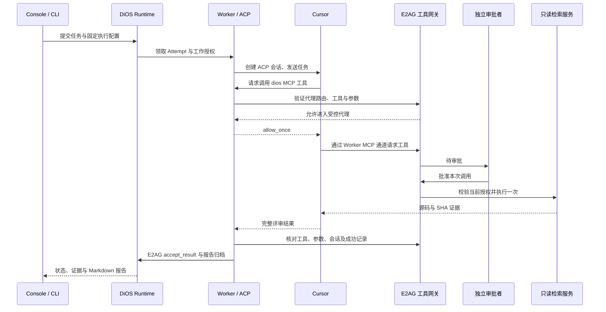

# Cursor ACP 受控执行切片（#56 / #58）

Cursor CLI 固定版本 `2026.11.05-86047df`。本批在 Linux/WSL Docker 中使用真实 Cursor 模型，覆盖固定样例任务、E2AG 工具审批、证据报告和 Worker 中断恢复。原有 Windows 持续评审保持独立运行。

当前主路径使用 dios-sdk[acp] 0.1.11 和 ACP 官方 SDK 1.0.0；真实取消、撤权与正常批准路径见 [取消与受控执行契约](acp-cancellation-56-58.md)。

## 执行与授权

ACP 的 `allow_once` 只允许请求进入 DiOS 提供的 MCP 代理。工具网关随后独立生成调用记录、等待审批、校验工作授权并派发；批准代理路由时真实工具调用数仍为零。只有注册的 `dios` MCP 工具名称与参数能通过该路由；终端、文件写入及其他原生动作继续拒绝。

`permit_proxy` 与 `verify_required` 均绑定当前 Run、Attempt、Worker、Session、租约及授权版本，沿用自动 Worker 凭据和远程控制通道。前者没有审批或执行权限；后者要求同一尝试/会话下存在参数摘要一致、执行成功的工具记录。任务声称使用检索但缺少该记录时返回证据不足。

通用 SDK ACP 客户端负责协议生命周期和流式事件；`dios_sdk.cursor` 负责 Cursor 工具元数据与最终答案格式，独立 `dios_review.cursor` 应用负责报告入口。Runtime 调度、恢复和 E2AG 共用通用执行契约。

## 实际兼容性

| 项目 | 固定版本的处理 |
| --- | --- |
| 工具参数流 | `tool_call_update` 在完成前可补齐参数；终态后的变更拒绝，最终参数与网关记录逐项核对 |
| 权限请求 | Cursor 的权限请求可能仅带 toolCallId；按同会话的已观察调用关联参数，缺少可靠关联时拒绝 |
| MCP 子进程 | 显式提供 DiOS 模块路径；不把模型凭据传入工具进程配置 |
| 答案输出 | 原始流完整保留；从最终完整 JSON 对象生成业务结果，拒绝截断或尾随不完整内容 |
| ACP 进程退出 | `end_turn` 后关闭输入可能返回非零退出码；保留已验证结果及退出证据，由配置中的 `accept_complete_on_error` 显式决定是否接收 |
| 观察超时 | 记录为 deadline，不自动当作进程死亡重放 |
| 未识别错误 | 保留标准化诊断，进入不可自动重试的未知类别；不依据自由文本猜测限流或额度不足 |

## 工程证据与能力声明

后端回归 395 项：391 项通过、4 项按数据库类型跳过；前端构建与 9 项工作台测试通过，设计契约检查 681 项通过。并发测试采用放行屏障，取得三个独立 Worker/容器/会话的真实同时运行证据。

证据索引：[真实执行记录](evidence/cursor-acp-development-20261120.json)、[后端回归](evidence/cursor-acp-regression-20261120.json)。

- 批准路径：真实 Cursor 发起源代码检索；审批前调用次数 0，批准后 1；报告包含源文件、行号、触发条件、代码引用与影响。
- 拒绝路径：独立审批身份拒绝后工具调用次数 0；任务没有成功报告。
- 中断恢复：在完整结果入库前终止 Worker 进程，新进程读取原始输出与退出凭据；Run/Attempt/Session 不变，新增模型启动 0。
- 沙箱：非 root、只读镜像、无宿主工作区挂载；实际根目录写入失败，直接外连失败，代理拒绝未许可域名。`/tmp` 为临时可写空间。
- 开发 Console：通过真实 UI 提交、查看审批和实际并发、批准并下载 Markdown；工程身份与真实用户产品验收分别登记。

完整输出的持久对账继续沿用原 Run/Attempt/Session。Cursor 原生 `session/load` 已通过跨进程检查，见 [会话恢复契约](acp-session-recovery-56-58.md)；活动请求续接和供应商结构化故障映射继续单独验收。当前 profile 的 `replay_safe=false`，不会自动重发模型任务。

固定 Cursor 的 MCP、Shell、文件和网络控制已完成首轮资格，见[原生工具控制](cursor-native-controls.md)。编辑/执行通知与实际副作用分别核验；当前仅开放固定样例，没有企业源码挂载。模型凭据在执行容器内使用，更强的凭据代理隔离由 #33/#58 继续推进。

网络代理仅放行当前实测需要的 Cursor 服务域名，模型提供商能看到提交的固定样例与工具证据。企业源码、企业数据外发策略和真实仓库准入由后续场景配置与验收确定。

## 复现和运维

1. 从 Cursor 官方分发源取得固定版本 Linux 包，记录包摘要，并将二进制和 DiOS 应用代码固化进镜像；profile 使用镜像 ID。
2. 使用版本化 Secret 引用提供 `CURSOR_API_KEY` 或 `CURSOR_AUTH_TOKEN`，凭据由宿主秘密目录挂载。仓库示例不包含凭据。Worker 的 `worker_secret_refs` 必须显式允许对应引用。
3. 选择 `dios-cursor-review --config ... --required-tool repository_search`，注册工具别名、ACP 名称映射、工作权限和独立审批身份。工具动作仍由网关持有。
4. 将执行容器放入内部网络，仅经许可域名代理访问模型。受控检索服务位于可信端，Agent 通过 Worker 工具通道访问。
5. 工程验证使用 `scripts/fixtures/runtime_review_source.py --root <隔离样例目录>` 提供两个固定源文件，以及 `scripts/check_runtime_cursor.mjs <开发配置目录>` 验证 Console 路径。该样例服务用于资格测试。
6. 更新前停止领取、等待活跃任务和工具调用排空，保留数据库、对象、任务身份与旧配置。新配置失败时恢复旧 profile/服务配置；已有任务和历史继续保留。

Console、API 与 CLI 继续共用既有任务契约；CLI 通过注册 profile 选择 Cursor，凭据和厂商参数保持在运维配置中。

## 后续安排

#56/#58 保持进行中。Cursor、DSH、Codex 与标准 A2A 均已有实际接入证据；三种 ACP Harness 的跨进程检查见 [会话恢复契约](acp-session-recovery-56-58.md)。三种 Harness 的续期、三层委派与旧 epoch 联合验证已通过，见[授权与工具收尾](harness-governance-56-58.md)。首条路径集中交付 Cursor ACP；下一项 K01-4.03 复用原生工具证据核对能力声明与实际控制点。第二 Harness 额外实测后置。活动请求续接、跨物理主机、原生工具额外路径、企业网络与凭据、G2 独立评审及用户验收继续沿用既定门槛。

协议参考：[Cursor ACP 文档](https://cursor.com/docs/cli/acp)、[ACP 会话设置](https://agentclientprotocol.com/protocol/v1/session-setup)。本页能力结论以固定版本实测为准。
