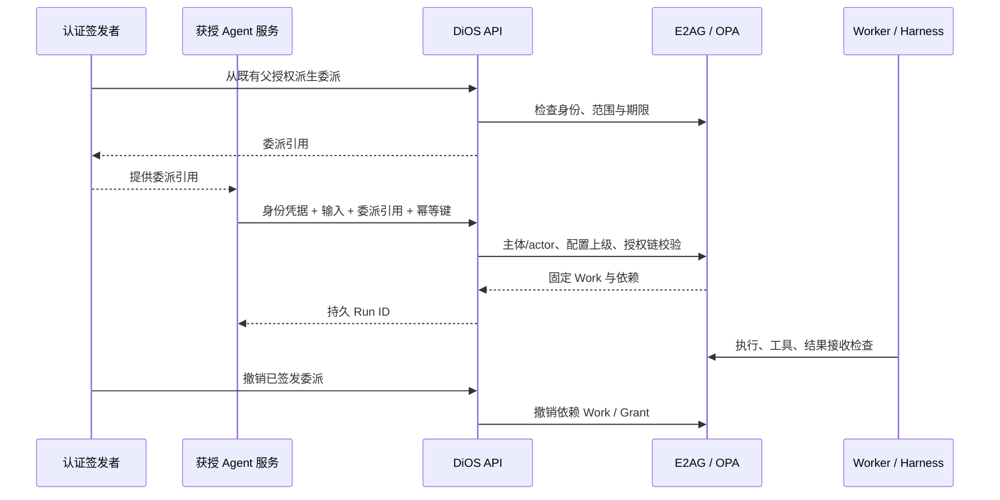

# 认证委派与任务准入

认证客户端可在提交任务时使用刚获得的委派，无需修改执行配置。API、Python SDK、CLI 和 Console 共用同一准入事务；E2AG 在执行、工具派发和结果接收时继续校验原授权链。

## 权限与身份

`POST /api/os/runtime/runs` 增加可选的 `delegation_ref`。它引用已有授权记录，主体与 actor 均由认证上下文决定。提交者仍须拥有该 profile 的 `run.submit`、`run.read` 及相应权限；引用的叶节点必须与当前 subject、actor 一致，且位于同一 scope。

有效权限取 profile、认证身份、四层工作权限和委派链的交集。配置已指定上级委派时，请求只能使用该节点或其后代。替换成其他链返回 `DELEGATION_ANCESTOR_REQUIRED`。未指定请求引用时沿用原配置；配置没有上级约束时，请求引用可用于进一步收窄已有权限。

原生 OPA 在同一准入事务中检查整条链的权限、期限、状态、授权代次与签发身份。Work 的绝对期限取各来源期限的上界约束，保存不可变回执和撤权依赖。任一检查失败时不创建 Run 或 Work。

身份语义沿用 [RFC 8693 的 actor 定义](https://www.rfc-editor.org/rfc/rfc8693.html#section-4.1)：当前执行者与历史代理分别记录；委派签发和执行权限由现有 E2AG 账本维护。



## 接口与重试

```python
leaf = issuer.issue_delegation(
    parent_ref, profile_id, target_actor, permissions, expires_at,
    idempotency_key=issue_key,
)
run = agent.submit(
    profile_id, input_id, goal,
    idempotency_key=task_key, delegation_ref=leaf["id"],
)
```

`issuer` 和 `agent` 使用各自的身份凭据。管理员在身份目录或身份 Provider 中配置原始 subject 与当前 actor 的受信映射。`submit_input` 同样支持委派引用，输入继续按登记 schema 校验。

```sh
dios task submit --profile PROFILE --sample INPUT --goal GOAL \
  --key STABLE_TASK_KEY --delegation DELEGATION_REFERENCE
```

CLI 从既有 `DIOS_ACCESS_TOKEN` 读取认证凭据。Console 在已认证身份模式下显示“委派授权引用（可选）”，详情沿用授权链、来源巡检与审计视图。共享操作员入口不接受请求指定的委派；受信本地配置继续由原 CLI 管理。

幂等摘要包含委派引用。相同身份、输入、引用及 key 返回原 Run；同 key 更换引用返回 `IDEMPOTENCY_CONFLICT`。重试不会续期、重开或替换原 Work，已结束任务仍返回原历史。服务端定时任务继续绑定管理员批准的 profile 策略，其模板不接受请求级委派引用。

## 验证与后续衔接

[执行证据](evidence/delegated-submission-20261125.json)记录原生 OPA/HTTP 准入、DSH + ECNU Max 的真实任务、独立审批、一次工具调用和成功报告；签发者通过 API 撤权后，另一条排队任务在创建进程前被拒绝。CLI 重复提交保留同一 Run，中英文桌面与手机页面完成引用提交、错误反馈及授权链查看。

此接口完成认证客户端的委派消费。下一步接入运行中 Agent 的自动子任务通道，绑定父 Run、Attempt、Session、epoch 和预算；父任务结束后子任务的继续、取消与结果归属需要明确契约。生命周期可参考 [Temporal Child Workflows / Parent Close Policy](https://docs.temporal.io/child-workflows)，独立授权检查继续由 DiOS 控制点承担。跨物理主机、严格跨 Provider 撤销排序和 G2 验收仍按整体计划推进。
