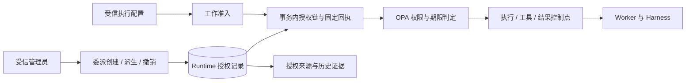

# 委派授权生命周期

DiOS 在现有 Runtime 事务内保存委派授权、工作回执与依赖关系，由原生 OPA 判定权限收窄。根授权后最多三层委派，工作准入、执行续期、工具派发及结果接收均检查当前授权。客户、岗位和项目含义由上层应用映射为主体、受托方和资源权限。

## 权威状态与策略边界

采用 [OPA External Data 的 Option 2：在 input 中携带数据](https://www.openpolicyagent.org/docs/external-data)。Runtime 从当前数据库事务读取完整授权链及固定工作回执，构造 `input.context.delegation`；模型参数和提交请求不能提供该字段。OPA 负责原生 Rego 判定，Runtime 负责记录生命周期、事务排序、时间复核和执行约束。

授权数据以 Runtime 数据库为准，无需向 OPA 复制可变授权快照。OPA 的规则仍通过现有 Bundle revision/provenance 绑定。PDP 无响应、策略版本不符或返回拒绝时，控制点失败关闭。等待 PDP 后重新读取数据库时间，检查委派、Work、Grant、租约和工具调用期限。



## 创建、派生与撤销

`delegation issue --file request.json` 接受 `key`、`subject`、`actor`、`permissions`、`expires_at`，根授权另含 `policy_evaluator`；子级另含 `parent_ref` 和 `issuer_actor`。期限采用 Unix 秒。权限为完整五字段元组：`action`、`resource_kind`、`resource_id`、`resource_version`、`constraint_revision`。

根授权由受信主机管理员签发。子级发起者须匹配父级 actor，subject 保持一致，权限为父级子集，期限不晚于父级；PDP 配置从父级继承。当前 CLI 的身份依据是主机管理权限；面向应用的认证签发 API 待接入。

相同 scope/key 和相同请求返回原记录；请求内容不同返回 `IDEMPOTENCY_CONFLICT`。授权范围、父级和期限签发后不可修改。撤销后需要新 key 建立新授权，原回执和历史记录保留。

```sh
cd backend
.venv/bin/python -m app.runtime.cli --scope validation delegation issue --file request.json
.venv/bin/python -m app.runtime.cli --scope validation delegation show DELEGATION_REF
.venv/bin/python -m app.runtime.cli --scope validation delegation revoke DELEGATION_REF --version 1
```

`revoke` 使用记录版本进行并发检查，并在同一事务中递增授权代次、撤销依赖该节点的活跃 Work 与 Grant、记录撤销事件。重复撤销返回终态。子级记录保留自身状态，整条链因祖先撤销而失效。

## 工作绑定与执行

受信 Work policy 的 profile 可配置 `delegation_ref`，该字段参与 profile 授权策略摘要。准入时核验 `execute` 与 `accept_result`，保存有序链 ID、各级授权代次、Run、scope、subject、actor 和固定 PDP 配置。Work 期限取原期限与整条链期限的最小值。

| 控制点 | 检查与结果 |
| --- | --- |
| 工作准入 | 绑定受信 profile 指定的授权链；拒绝请求自行指定委派 |
| 领取、续期与心跳 | 当前 Work/Grant、租约、主体及链有效；等待 PDP 后复核期限 |
| 工具请求、审批、派发 | 原有四层权限、具体工具完整元组、审批及委派约束同时满足 |
| 结果接收 | `accept_result` 与固定执行绑定仍有效；撤销后拒收成功结果 |
| 查询与 Console | 返回链来源、准入代次及当前代次、期限和状态；历史报告保持可读 |

撤销和本地执行提交通过现有数据库事务排序。已派发到外部系统的操作仍按既有幂等、未知结果和对账机制处理。跨服务授权源与外部效果之间的严格撤销保证需要对应端点契约及独立验证。

## 数据与升级

增量迁移加入 `runtime_delegations`、`runtime_delegation_receipts`、`runtime_delegation_dependencies`、`runtime_delegation_events` 及 schema 版本表。依赖索引用于定位受撤销影响的工作。备份、校验和恢复识别新增表；恢复后沿用既有暂停领取机制。

部署顺序为停止领取、排空活跃任务、备份并校验、迁移、启动兼容版本、恢复领取。回滚须使用与数据库结构兼容的版本；回退到迁移前数据库需单独处置迁移后任务历史。现有未配置委派的 profile 保持原授权链路。

## 验证与后续

[验证记录](evidence/delegation-lifecycle-20261124.json)包含原生 OPA 生命周期测试、完整后端回归、真实 Worker 的审批报告与撤销退出、备份恢复，以及中英文和手机宽度浏览器检查。开发数据库原 78 条历史保留，新增 2 条验证任务；WSL 重启后授权链和报告仍可读取。

下一步接入认证服务的委派管理 API，将发起者绑定到实际认证身份，并纳入上游身份撤权依赖。跨服务 audience 转换、远程授权源排序、PostgreSQL 并发及物理多主机资格继续按 #35 和整体计划推进。PDP 查询在授权事务内执行，吞吐和延迟仍需容量实验；当前结果证明功能链路，不构成性能结论。
