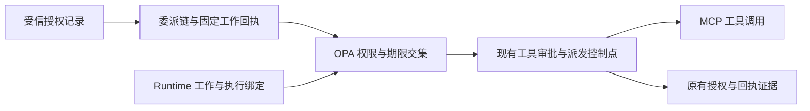

# 三层委派：OPA 策略与 Runtime 接入

2026-11-24 · #35 / K03-3

DiOS 的委派约束以受信授权记录为依据：根授权后最多三层，每级权限和期限收窄；工具调用必须同时满足当前工作授权、四层权限、审批和委派链。组织、岗位与客户场景由上层应用配置。

## 标准与实现选择

[RFC 8693 §4.1](https://www.rfc-editor.org/rfc/rfc8693.html#section-4.1)中的嵌套 `act` 表达历史参与者。资源端只使用顶层声明及当前 actor 做访问判断，历史 actor 用于追溯。DiOS 的上游权限依据来自独立授权记录，不能从 Token 中的历史 actor 列表推导。

[Keycloak 标准交换](https://www.keycloak.org/securing-apps/token-exchange)提供稳定的 Token Exchange；委派特性仍属 Preview，访问 Token 的交换也不建立自动撤销链。现有身份与 Token Exchange 接入继续使用，三层治理通过 Runtime 授权记录与成熟策略引擎组织。

[OPA 数据与策略模型](https://www.openpolicyagent.org/docs/philosophy)支持在原生 Rego 中检查上下文和受信数据。采用现有 OPA 适配器、Bundle 版本约束和工具 PEP；授权链由 Runtime 在当前事务内通过 input 提供。[策略组件及数据契约](../../examples/policies/opa-delegation/README.md)

## 执行逻辑

原生策略从当前 `authorization_ref` 定位回执，核对 Run、scope、subject 和 actor，然后检查根授权到叶节点。每级 ID、parent、depth、scope、subject、audience、状态和授权代次必须一致；完整权限元组逐级包含，期限逐级缩短且当前有效。循环、缺链、第四级、错 actor、越权字段组合和未知格式均拒绝。

工作回执固定准入时的各级授权代次。上游撤销并递增代次后，旧回执失效；生命周期管理仅允许用新 key 签发新授权。无关链路更新不参与本工作的决策。工具策略组件以逻辑交集组合，登记独立的 `dios/delegated_tools/allow` 入口。Runtime 生命周期接入通过 `dios/delegation/allow` 独立检查当前链，与既有工具权限及审批检查共同约束执行。

## 已有验证

[原生验证证据](evidence/delegation-policy-20261124.json)通过真实 OPA、SQLite Runtime 和 MCP HTTP 端点运行。根授权及一至三层链路均能经审批完成工具调用与回执；各级撤销、权限扩大、动作/资源交叉拼接、期限扩大、过期、错主体/范围/受众、错工作绑定、循环、缺链和旧授权代次均被拒绝。MCP 初始化期间撤销上游后，最终派发复核阻止工具调用。继承的策略换版、服务故障、审批人撤权与重复派发检查同时执行。

## 生命周期接入与剩余工作

[委派生命周期](delegation-lifecycle-35.md)已覆盖受信 CLI 创建、受限派生、撤销、不可变工作回执，以及工作准入、Grant 续期、工具与结果接收。OPA 采用官方 external-data Option 2，直接判定 Runtime 当前事务持有的授权快照；可变授权数据无需跨服务复制。

开发环境通过三层委派真实任务、审批报告、祖先撤销与原生进程退出验证。认证服务管理 API、上游身份依赖、跨服务 audience 与严格撤销排序继续按[成熟方案矩阵](e2ag-mature-solutions-20261124.md)推进。#35 保持开放。
