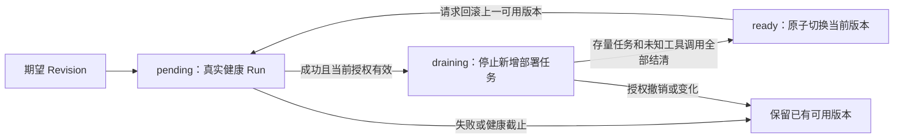

# Deployment 激活与回滚

Deployment 将一个运行定义的期望 Revision、当前可用 Revision 和上一可用 Revision 持久关联。候选版本必须完成真实健康任务，并等待该 Deployment 的存量任务自然结束，才可切换执行入口。失败保留当前可用版本；回滚也必须经过当前 E2AG 授权与新的健康任务。

本能力属于 DiOS 通用运行治理层。Revision 固定配置、执行镜像及受控依赖；Deployment 选择执行版本；Run、Attempt、Worker、会话和产物沿用现有身份模型。客户业务数据与流程由上层应用提供。

## 状态与执行边界



| 对象 | 责任 |
| --- | --- |
| Deployment | 期望、当前和上一版本；状态与 CAS 版本号 |
| Rollout | 单次发布或回滚；健康 Run、截止时间、结果和操作者 |
| Run / Attempt | 真实执行、授权、租约、恢复、结果校验和产物 |
| Worker | 领取匹配 Revision 的任务；现有进程和会话证据体现实际执行 |
| Controller | 每两秒有界对账，读取持久状态；重启后继续同一发布 |
| Receipt / Event | 幂等请求身份、版本化状态变更及审计关联 |

`pending` 阶段仍可向当前可用版本提交业务任务；首次发布尚无可用版本时不可提交。健康任务成功后进入 `draining`，阻止新的 Deployment 任务，等待已有排队、重试、执行和恢复中任务结束。已派发或结果未知的工具调用也必须结清。切换不杀进程，不替换 Run 或 Attempt。

健康截止只拒绝本次激活，原健康 Run 保留并继续按运行层规则恢复；它仍未终结时，拒绝创建新的发布健康任务。截止后迟到的成功结果不会重新激活已拒绝的发布。应用升级处于全局排空期间，Controller 不激活候选版本。

Worker 由现有运行部署提供，使用 `--revision-ref` 绑定候选或旧版本。Deployment 不创建主机或副本；缺少兼容 Worker 时，健康任务保留在队列直至执行或达到健康截止。排空期间旧版本 Worker 必须继续服务存量任务。

## 一致性与 E2AG

Deployment、Rollout、Receipt、健康 Run 和首次事件在同一作用域事务中创建。幂等键相同且请求一致时复用原 Rollout；参数变化返回冲突。`expected_version` 防止并发覆盖。客户端不能在任务输入中伪造 `deployment_id` 或 `deployment_rollout_id`，服务端绑定它们并在同一提交事务中验证当前版本与状态。

候选发布要求 E2AG 模式。健康 Run 使用现有工作授权、工具审批和结果校验路径；激活前重新核对当前策略及健康 Run 的授权摘要。回滚复用不可变 Revision，重新生成授权和健康任务，不复用过期批准。

部署状态采用既有领域契约 `deployment`，附加 `status` 返回当前版本、上一版本和错误。详情给出当前 Rollout、真实健康 Run 与最近 30 条事件；完整审计持久保留。列表默认 50 条、最多 100 条，按 ID 游标分页。

## 接口与使用

API 由 Console 操作者凭据管理：

| 接口 | 用途 |
| --- | --- |
| `GET /api/os/runtime/deployments` | 分页状态 |
| `GET /api/os/runtime/deployments/{id}` | 版本、健康任务和审计 |
| `POST /api/os/runtime/deployments` | 请求发布或回滚，返回 202 |
| `POST /api/os/runtime/deployments/{id}/reconcile` | 立即执行一次幂等对账 |

发布请求：

```json
{
  "id": "review-primary",
  "revision_ref": "rev-<immutable-sha256>",
  "idempotency_key": "release-001",
  "expected_version": 0,
  "probe_input": {"payload": {}},
  "timeout": 300,
  "rollback": false
}
```

`probe_input` 由操作者选择可执行的代表输入，可包含 `payload`、`input_registration` 和 `task_kind`。健康任务沿用对应 Worker 的执行结果验证；业务质量的完整资格由版本发布端到端验收承接。`timeout` 范围为 10—3600 秒。回滚使用当前 `expected_version`、新幂等键及 `rollback: true`，目标由服务端取上一可用版本。

CLI 沿用 `python -m app.runtime.cli` 的数据库与作用域配置：

```text
deployment --policy-file policy.json request --file rollout.json
deployment --policy-file policy.json show review-primary
deployment --policy-file policy.json reconcile review-primary
deployment list
enqueue --deployment-id review-primary ...
worker --revision-ref rev-<immutable-sha256> ...
```

CLI 请求文件使用 `key` 对应 API 的 `idempotency_key`，并显式传入 `actor`。Console 的受信配置可使用 `{"id":"review","deployment_id":"review-primary","enabled":true}`，任务提交时解析当前可用 Revision。运维界面展示期望、当前、上一版本，验证任务和审计；中英文与窄屏适配，读取失败保留已有信息并标记观测过期。发布和回滚由 API/CLI 发起。

## 持久化与验证

新增独立 Deployment schema 组件，支持 SQLite/PostgreSQL，使用显式迁移及备份校验；原有已发布 schema 保持不变。开发部署先排空、备份，再迁移和恢复服务，保留全部历史身份。

[工程证据](evidence/deployments-20261125.json)包括双后端契约、离线镜像、独立 CLI 进程与真实 Docker 执行、中英文浏览器状态核验及开发环境历史保留。物理跨主机资格按 W4 推进。外部端点升级和远端实现回退能力由 K02-1.04 承接，完整发布端到端资格由 K02-1.05 承接。

状态对账、健康门禁和失败保留可用版本参考 [Kubernetes Deployment](https://kubernetes.io/docs/concepts/workloads/controllers/deployment/) 与 [Argo Rollouts Analysis](https://argo-rollouts.readthedocs.io/en/stable/features/analysis/)；DiOS 将健康执行纳入已有 Run/E2AG 模型。不可变执行内容见 [Revision 设计](revisions-31.md)。
