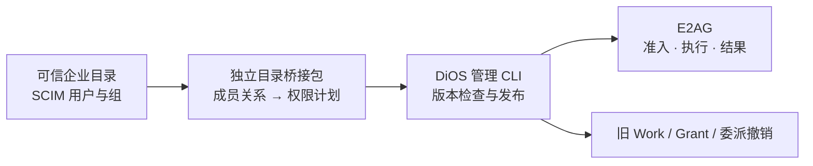

# 企业目录授权映射

## 目标与边界

上层平台把目录成员关系映射为已登记 DiOS 主体的权限，DiOS 在执行时继续校验 E2AG。组织、部门、岗位、目录连接配置归独立平台；DiOS 保有认证主体、版本、动作和资源权限。对应 #36 / S01-1，沿用 [ADR 0011](../adr/0011-capability-only-platform-boundary.md)。

`applications/directory-bridge` 为独立 wheel 与 CLI，无 DiOS 后端或数据库依赖。上层包消费公开管理命令 `identity-policy` 的安全投影；发布沿用 `identity-update`。跨产品既不共享 ORM，也不直接改表。核心运行、主体认证和撤权机制复用已验证实现。

## 接口与权限语义

| 输入/操作 | 规则 |
| --- | --- |
| 完整目录快照 | SCIM User/Group ListResponse，明确 active；列表数量、分页、唯一 ID、成员引用与新鲜度校验 |
| 可信映射 | source + issuer + scope 固定；用户 ID 绑定已有主体；组 ID 对应完整 profile 授权 |
| 权限计划 | 固定预期主体修订、来源用户/组、输入摘要与有效期；无变化不产生补丁 |
| 安全投影 | issuer、scope、principal_id、revision、enabled、profiles；无令牌、令牌摘要和来源凭据 |
| 发布 | 单主体版本比较及幂等重放；旧版本冲突拒绝；旧 Work、Grant 与委派持久撤销 |
| 重新启用 | 主体和历史连续；原执行授权保持失效，新任务重新准入 |

移组仅改变受管主体的 profile 权限；对象分享由独立的对象访问接口管理。停用主体会同时阻止其后续身份认证和授权动作。部门共享同一执行配置仍保留主体及成果隔离。多个角色的权限并集是上层请求授权，实际权限继续受 E2AG 其他策略层约束。

目录来源或导出失败产生错误，不能当作空目录。默认快照有效期 300 秒；计划发布前由运维确认新鲜度并保存回执。完整空目录代表批量停用，按批量身份变更审批。多主体发布逐项执行，部分成功后以新投影重新计算剩余变更。

## 工程证据

[本地资格报告](evidence/directory-mapping-36-20261128.json)：29 项通过，0 项跳过。运行使用安装后的独立 wheel、真实子进程管理 CLI、API 中间件、E2AG 准入/执行/结果校验和隔离 SQLite。执行载体为确定性测试适配器；此次未调用外部模型。

覆盖的场景包括双部门任务与成果拒绝越权、移组后拒绝新任务和排队执行、停用/重新启用不恢复旧授权、旧补丁拒绝、相同变更重放、缺页/过期/未来时间/重复成员 ID/嵌套组拒绝、安全投影无凭据，以及原身份更新事务和失败恢复回归。

运行方法和合成示例见[目录桥接包](../../applications/directory-bridge/README.md)。GitHub Actions `Directory mapping qualification` 独立构建 wheel 并保留报告。

## 原计划中的后续交付

| #36 应用切片 | 状态 | 交付条件 |
| --- | --- | --- |
| 完整目录快照与授权映射 | 工程完成 | 已安装包、安全投影、CLI 发布与 API/E2AG 拦截通过 |
| 在线目录同步与生命周期 | 待完成 | 标准服务分页/水位、删除停用、过期和来源故障、可恢复逐主体发布；源目录仍需选定 |
| 企业身份与服务代理联合接入 | 待完成 | 已选 IdP 的 SSO 身份映射、代理链及双部门服务矩阵；结合 #37/#40 上层应用联验 |

上述切片属于既定 #36 应用范围，不加入 79 项底座能力分母。#36 原依赖和最终验收保持；独立安全审查与产品接受仍按工程手册办理。物理故障、HA 和规模容量资格继续暂缓。

## 标准依据

- [RFC 7643](https://www.rfc-editor.org/rfc/rfc7643.html)：SCIM 用户、组和成员数据模型。
- [RFC 7644 §3.4.2](https://www.rfc-editor.org/rfc/rfc7644.html#section-3.4.2)：ListResponse 与分页；本切片只消费已完整导出的数据。
- [OPA 外部数据](https://www.openpolicyagent.org/docs/external-data)：授权规则消费可信来源，目录复制新鲜度需独立处理；当前复用 DiOS 的版本化发布与 E2AG 门禁。
