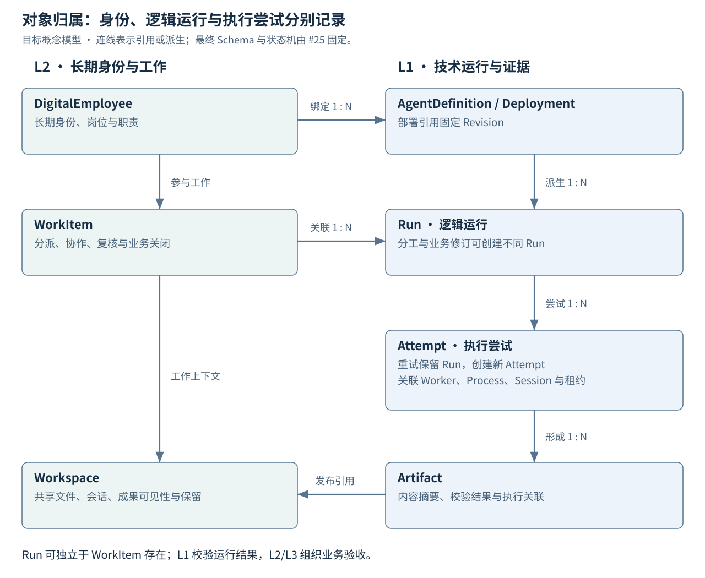
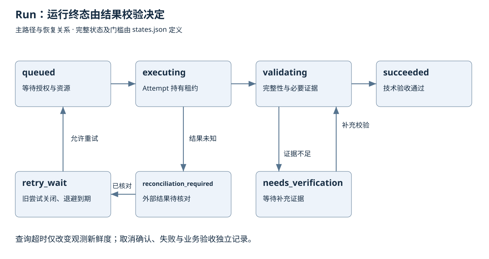

# DS-F01-1：领域对象、API 与状态契约 v1

状态：已接受（P0 设计交付） · 日期：2026-11-11 · 任务：[#25](https://github.com/HQIT/DiOS/issues/25)。
依据：ARCH-BASELINE-0.3（`1c0f90d6a673691a8395f010568c7834983afdab`）、#57 能力证据、AP-01—13、AR-01—13。编制与契约核验：Codex；推进授权：本会话用户。设计验收记录见 [联合交付记录](review-f25-f26.md)。

## 1. 目标与交付边界

冻结 L1/L2/L3 的对象所有权、核心跨层 API、运行状态、事件和兼容语义，使不同 Agent、操作系统和行业应用共享执行底座。机器可读来源为 [JSON Schema](../../contracts/v1/domain.schema.json)、[OpenAPI 3.1.1](../../contracts/v1/openapi.json)、[状态转换表](../../contracts/v1/states.json)、[协议 Profile](../../contracts/v1/protocol-profiles.json)。契约版本为 1.0.0；这些文件描述待实现接口。

本切片覆盖运行/Worker/产物/E2AG 接入、员工/工作项及评审查询。组织目录、Studio、知识 Provider 的完整业务 CRUD 由各自模块扩展；其对象所有权和授权约束沿用本设计。#27 固定授权矩阵和凭据签发；执行该矩阵的实现须通过对应 G1/G2 门槛。

## 2. 对象所有权与身份

| 所有者 | 对象 | 关键约束 |
| --- | --- | --- |
| L1 资源与接入 | AgentDefinition、Revision、Deployment、AgentImplementation、Capability | 长期定义与不可变版本分开；实现、端点、协议 Adapter、生命周期 Adapter 独立引用。外部版本不透明用 null，保留能力快照。 |
| L1 执行 | Run、Attempt、Worker、Process、AgentSession、Lease | Run 为逻辑任务；重试新建 Attempt。Worker 身份、主机 boot ID、PID 与启动时间共同识别进程。Session 与 Attempt 多对多关联，远端任务 ID 单列。 |
| L1 数据与治理 | Artifact、Validation、Event、AdmissionGrant、Grant、Decision、InvocationIntent、ApprovalRequest | 保存不可变证据与执行事实；L1 调用注册的领域校验器。组织审批人规则由 L2 管理。 |
| L2 工作服务 | DigitalEmployee、Workspace、WorkItem；Organization/Department/Position/User/Group | 员工可绑定多个 Deployment；WorkItem 关联多个 Run；业务验收独立。组织目录通过 PrincipalReference 映射至 L1。 |
| L2 能力服务 | KnowledgeSpace、Release、Evaluation、ServiceCatalog | 管 ACL、来源、评价与发布流程；Provider、图谱和记忆后端可替换。 |
| L3 评审应用 | ReviewScope、ScopeRevision、ReviewUnit、Occurrence、CoverageEntry、Finding、Cluster、LegacyIdentityMap | 范围、覆盖、上下文复用、问题聚合和历史语义由应用解释；完整 CoverageLedger 是不可变清单与逐 Occurrence 记录的组合。 |
| L3 其他应用 | 客户/报价/课程等场景对象 | 通过通用 application_ref 关联 WorkItem，不新增 L1 专属字段。 |

持久对象 ID 为不透明字符串，发行方保证唯一、永久不复用；新对象使用带类型前缀的随机 UUID。整数 version 从 1 单调增加。外部 ID 以 endpoint/source_instance_id 和实体类型组成命名域。删除采用墓碑及独立保留策略；业务删除不级联清除审计。跨层仅保存标识及不可变版本引用，迁移由拥有层负责。

AgentSession 是执行协议关联；L2 的长期交互与记忆保留自己的会话 ID。一次协议进程可以承载多个 Session；持续评审的“独立 Worker”配置另要求每路独立进程和会话，并保存证据。

## 3. 状态与所有权

图示为主路径；完整合法边见 states.json，未列出的转换一律拒绝。Run 的技术终态 succeeded/failed/cancelled 不重开；修订业务创建新 Run。同一 Run 重试使用新的 Attempt，旧尝试和部分输出保留。WorkItem 独立按 draft → assigned → in_progress → awaiting_review → completed 推进，可退回 changes_requested；接受需业务证据和必需运行校验结果。

Attempt 生命周期与执行 phase 分开：claimed/active/validating/reconciliation_required/终态；phase 包含 preparing、opening_session、retrieving、waiting_model、streaming、waiting_approval、validating、cooldown、finished。状态与心跳新鲜度分别存储，query_timeout/heartbeat_stale/protocol_event/sync_timeout 只更新观测。阶段区间可重叠，耗时以 span 计量。

领取响应包含 Run、Attempt 和 Lease；无可领取任务返回 204。领取事务锁定可执行 Run，创建 Attempt 和 Lease、增加 epoch、写入 outbox。一个 Run 最多一个有效执行所有者。租约期限以权威库时钟判断，试点参数为 60 秒、每 20 秒续租；客户端时钟用于展示。续租/报告/封存必须匹配 worker、attempt、epoch、未过期租约和 expected_version，失败返回 STALE_OWNER 或 VERSION_CONFLICT。报告重试的 report_id 保留去重记录。

租约过期先撤销旧写入权，进入 reconciliation_required。检查本地进程、远端受理标识和副作用，再决定续接原尝试或创建新尝试；续接必须获得新的 epoch 并撤销旧绑定。旧 Worker 可上传隔离的诊断字节，不能提交有效运行结果或覆盖产物。对外调用还需外部幂等/对账，数据库 fencing 只控制平台写入。

取消请求持久保存 cancel_status=requested，立即撤销后续动作并发送所选 Adapter 的取消请求；真实进程退出或远端确认且副作用已处理后才记录 cancelled。未收到确认保留 unconfirmed，预算到期进入对账。queued 未执行任务可直接确认取消。完成与取消竞争使用同一版本事务，迟到回包保留为证据。

## 4. API、幂等与错误

| 契约域 | 核心路径与方法 | 语义 |
| --- | --- | --- |
| 运行与观测 | POST/GET `/api/os/v1/runs`；GET `/runs/{id}`、`/runs/{id}/attempts`、`/sessions/{id}`、`/events`；POST `/runs/{id}/cancel` | 提交、查询、尝试、外部关联、游标事件和取消回执。 |
| Worker | GET `/api/os/v1/workers`；POST `/workers/{id}/drain` | 返回配置槽位与实际证据；drain 停止领取，活跃尝试及证据清空后才 drained。 |
| 内部执行 | POST `/api/internal/v1/claims`、`/leases/{id}/renew`、`/attempts/{id}/report` | 机器服务身份、分区权限、租约与乐观版本校验；原子领取。 |
| 产物 | POST `/api/internal/v1/artifacts`、`/artifacts/{id}/seal`；GET `/api/os/v1/artifacts/{id}` | 上传授权按所属 Attempt/ACL 发放；原始字节摘要校验后封存。 |
| E2AG | POST `/api/internal/v1/e2ag/decisions` | 决策绑定身份/epoch/参数；返回 allow/deny/approval_required。 |
| 员工与工作 | GET `/api/workforce/v1/employees`；POST/GET `/work-items`；POST `/work-items/{id}/transitions`、`/approvals/{id}/resolve` | L2 保持对象 ACL、业务状态、审批身份与版本；L1 校验最终动作绑定。 |
| 评审 | `/api/apps/review/v1/scopes/{id}`、`/scopes/{id}/revisions`、`/revisions/{id}/coverage`；POST `/query`、`/exports` | 固定范围版本及查询水位；UI、统计、Excel/Markdown 使用同一 QuerySpec。 |

OpenAPI 列出每项路径参数、请求/响应、权限动作和错误。内部接口使用机器凭据与双向 TLS 网络身份；请求体中的 worker/principal 关联须与凭据绑定校验，客户端提交的 employee ID 不赋予权限。权威调用身份来自认证上下文。业务 API 逐对象 ACL；表与存储后端仅向拥有服务开放。

提交 Run 的 grant_ref 引用 AdmissionGrant，约束主体、部署和资源范围；Run/Attempt/Session 创建后再签发执行 Grant。准备阶段由受限 Worker 服务凭据执行基础设施动作，Agent 工具动作须绑定已创建的 Session；#27 固定两种授权的签发与撤销规则。

变更请求携带 Idempotency-Key；对象状态变更同时使用 If-Match 与 expected_version，相互不一致返回 INVALID_ARGUMENT。幂等作用域为认证主体、资源作用域和操作，至少保留至任务/调用结束后 90 天；仍运行和 result_unknown 记录不清理。查询/导出具有独立键空间。

同键同输入返回同一对象及当前状态；同键不同输入摘要返回 409 IDEMPOTENCY_CONFLICT。先认证并校验对象访问权，再查幂等记录。摘要对象为 Schema 校验后的业务请求，JSON 键排序、UTF-8、紧凑分隔、禁止 NaN；数组次序保留、字符串不做隐式归一化，缺省值按版本固定后计算。当前核心请求仅含整数、布尔和字符串；将来引入浮点必须升级规范化规则。资源输入必须为已封存不可变引用，授权更新另用显式操作。

429 返回 RATE_LIMITED 与 retry_after_seconds；额度不足为 QUOTA_EXHAUSTED。DEPENDENCY_MISSING/SESSION_FAILED/PROCESS_EXITED/RESULT_INVALID/EVIDENCE_INSUFFICIENT 分别归因。403 FORBIDDEN、409 STALE_OWNER/RECONCILIATION_REQUIRED、412 VERSION_CONFLICT、422 CAPABILITY_UNSUPPORTED/PROTOCOL_INCOMPATIBLE、503 UNAVAILABLE 具有明确含义。Error.retryable 是重试建议，调度器仍检查所有权、预算和未知副作用。

运行创建响应 202 只表示受理；返回 succeeded 必须有完整 sealed 产物和必需 Validation.passed。校验器的规则属于 L3，L1 验证其身份、版本、输入摘要及结果。完整输出重新解析新建 Validation，复用原 Attempt，避免再次模型调用。

## 5. 事件、数据与查询

领域状态、幂等记录和 outbox 在所属服务事务内提交，事件至少一次投递。event ID 去重，aggregate_version 单调；消费者保存每个聚合版本与全局投影水位，发现版本缺口先补齐或权威重建，不能把整个批次当成连续成功。跨层无共享写事务，由持久订阅或补偿协调。

持久定时触发的唯一键为 schedule_id + scheduled_at；重复触发合并到同一触发记录。上一轮活跃时，新版本输入保留为下一轮候选，不启动第二个调度器；输入相同复用当前 Run。领取、下一轮指针和触发水位在同一事务更新，#30 细化 Schedule/Trigger 存储。

Event 保留 occurred_at/recorded_at、source、Trace、Attempt/epoch 、内联小 summary 和可选不可变 payload 引用；小状态投影独立于大日志/产物。读取 summary 和 payload 均按聚合对象 ACL 检查。staging 产物的摘要和大小允许 null，seal 校验后必须完整；stage 回执提供限定大小、短时有效的上传 URL，该 URL 不进入审计日志或长期存储。传输摘要与解压后 raw_digest、raw_size_bytes 分开，UTF-8 在完整字节或增量解码后解析。seal 按部署持久化策略确认关键副本后完成；replication_state 表示远端详情视图的同步状态。大产物上传失败不阻断小进度，详情显示待同步；必需原始证据未可靠落盘时不能记成功。

列表使用不透明游标，默认 100、最多 500。查询的 FindingView 同时包含问题与所有来源 Occurrence，提供时间、仓库、分支、SHA、文件行号和产物证据引用。QuerySpec 固定范围版本、时间半开区间 [from,to)、IANA 时区、筛选及 as_of。首次查询用 `as_of=latest` 获取具体水位；分页、图表及导出必须沿用返回水位和筛选摘要。水位超保留期限返回 CURSOR_EXPIRED，要求重新查询；不能静默换到最新。导出产物包含 query_digest、as_of、生成时间，读取再次校验 ACL，Excel 文本做公式注入防护。

## 6. 开放 Agent 与 E2AG 接口

初始标准 Profile 固定为 A2A 0.3.0 JSON-RPC/HTTPS 与 ACP v1 stdio；具体能力与 Agent/Adapter 版本共同固定。A2A 先实现 message/send、tasks/get、tasks/cancel；streaming/resubscribe 只有真实实现后声明。现有 legacy 网关保留独立命名，#57 的八项差异由 #56 修复后获得该 Profile。后续协议版本以新增 Profile 接入，禁止混用结构。

ACP 先 initialize → authenticate（需要时）→ session/new → session/prompt。load/resume、历史重放及取消逐实现协商；当前官方 v1 文档有 `$/cancel_request`，Cursor 勘察使用的 `session/cancel` 单独登记，Adapter 必须按固定实现选择。发出通知、收到取消答复和进程结束分别留证。

| 候选与证据 | 本契约处理 | 后续验收 |
| --- | --- | --- |
| Cursor 已实测输出及同进程 load | Profile=ACP1；同进程恢复可登记 tested，跨进程 unknown | #56/#58 活动取消、排空、跨进程恢复 |
| DiAgent service/task；A2A 有八项差异 | legacy 实现 ID 独立；映射 Run/Attempt，保留原 Task ID | #56 A2A 固定规范请求/响应与错误回归 |
| dsh 原生 ACP 文档声明 | resume 与 history_replay 分别声明，权限能力待测 | #58 替换验证 |
| Codex Schema、Claude Adapter 源码声明 | evidence_level=schema/supplier；缺失能力拒绝所需工作 | #56/#58 固定版本真实运行 |
| E2AG 64 项局部测试 | 作为网关/stdio/参数/意图能力依据，控制点逐项登记 | #34/#58 真实 Agent → 工具边界验收 |

AgentAdapter 的逻辑接口为 discover/open/submit/observe/cancel/reconcile；RuntimeAdapter 为 start/inspect/stop/drain。返回未知与不支持须区分；Run 与远端 Task/Session 的映射先持久化再接受回包。提交远端前先写 InvocationIntent，网络断开且远端 ID 未获知时进入 reconciliation_required，只有可用幂等键/查询证据才允许重发。

E2AG ActionRequest/Grant/Decision/InvocationIntent 共用 ExecutionBinding，包含主体、委派、Run、Attempt、Session、Worker、lease_epoch、policy_version；资源、动作与参数摘要绑定审批。调用前持久化意图并再次验证决议未过期、授权未撤销和当前 epoch。续期不扩大授权，重新评估权限交集；新的 Attempt/Session 重新签发绑定。#27 固定签名、缓存撤销、委派深度与审批矩阵，#33/#34/#35 实现，#46 观测，#58 联合验收。

## 7. 持续评审与历史映射

ReviewScope 合并自动发现与手工配置；默认六个自然月无活动分支排除，覆盖需原因；时间未知单列，业务分支由管理者选择。ScopeRevision 冻结仓库/分支/SHA/清单摘要和 denominator。新范围或新 SHA 创建新修订，旧分母不变。

ReviewUnit 的复用键同时包含内容、依赖/调用/构建上下文及评审策略版本；Occurrence 保留每个仓库/分支/SHA/路径/行号。CoverageEntry 每个 Occurrence 唯一，accepted 必须引用通过的证据；同根因聚类只合并展示，不删除来源。排除项有明确原因且按冻结清单口径报告；当前范围覆盖、物理执行单元、复用次数与历史首次有效完成量分别统计。

LegacyIdentityMap 唯一键为 source_instance/entity_type/source_id；保留源摘要和 origin_status。旧系统 done 若缺完整证据，导入为 verification=unverified，保留历史报告同时不计新增可核验覆盖。旧身份不可通过重复导入生成新任务。#59 固定应用实现；#60 验收只读导入、历史对账、活跃任务排空、单分区所有权切换与回滚。现有评审保持当前运行。

## 8. 兼容、变更和验收

| 消费者 | 当前入口 | 迁移与测试要求 |
| --- | --- | --- |
| Console / CLI | `/api/os/*`、现有 agent/registry/resources | 保留 legacy；新增命令/视图消费 v1，CLI 的本地 HIL 不替代服务端授权。旧字段意义保持，未知状态显示原值及降级提示。 |
| Chat App | `/api/apps/chat/*` | 聊天身份保留，显式映射执行 Session；定时 Run 不创建聊天。 |
| L2 Portal / SDK | 新 workforce v1 | WorkItem 和 Run 分别显示，支持待验证/取消未确认/观测过期，权限回归与 API 相同。 |
| Adapter / Worker | 新 internal v1 | Schema + fencing + 幂等 + 协议/Profile 兼容测试；升级先 drain。 |
| 评审 UI / 导出 / Sites 过渡查询 | review v1 QuerySpec | 筛选、时区、水位、覆盖分母与导出一致；详情失败时进度仍新鲜。 |

新增可选响应字段向后兼容，客户端忽略未知可选字段；未知枚举按 unknown 展示并保留原值，不能映射成功。新必需字段、删字段或语义变化升级 API 大版本。保留旧入口至少两个已发布小版本且不少于 90 天，满足消费方迁移证据后停用；生产时间由发布记录起算。

迁移按扩展表/回填映射/影子查询/分区切换/清理执行，数据库方案由 #32 落实；应用回退保留新列和映射，已提交副作用走对账。当前契约交付不变更产品路由或生产数据。

契约样例验证结构、非法字段、绑定、状态门槛、幂等、旧 epoch 和未知结果；真实数据库竞争、真实 Agent 权限、模型行为和 UI 由 #30/#34/#56/#58 进行集成验收。新增“资料摘要”等应用使用 application_ref 与 ResultContract，即可复用 Run，无需增加内核业务字段。

依据：[OpenAPI 3.1.1](https://spec.openapis.org/oas/v3.1.1.html)、[A2A 0.3.0](https://a2a-protocol.org/v0.3.0/specification/)、[ACP v1 初始化](https://agentclientprotocol.com/protocol/v1/initialization)、[ACP v1 取消](https://agentclientprotocol.com/protocol/v1/cancellation)。协议来源核对日期为 2026-11-11；选择固定版本用于本设计，更新以 Profile 和契约回归为单位。
