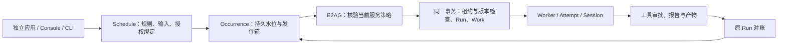

# 持久 Run 定时与 E2AG 服务授权

DiOS 的定时能力将已登记的 Profile、输入和工作目标提交为普通 Run，复用 Worker、恢复、工具审批和产物链路。计划保存时间规则及服务授权绑定，每次触发生成独立且有期限的 Work；同一触发恢复时保持原 Run 和 Work。业务覆盖、客户范围和领域判断由独立应用负责。

## 公开方案与实现选择

[Temporal Schedules](https://github.com/temporalio/documentation/blob/main/docs/encyclopedia/workflow/schedule.mdx) 将 Schedule 与每次 Workflow Execution 分离，并提供重叠、补触发及暂停语义。本实现采用相同的对象分离和 `buffer_one` 语义，沿用现有 RuntimeStore、SQLAlchemy 事务及 croniter；引入 Temporal 服务端仍需单独评估部署成本、Worker 适配和迁移。

[Kubernetes ServiceAccount](https://kubernetes.io/docs/concepts/security/service-accounts/) 使用独立服务身份和有期限、可轮换的绑定令牌。[OAuth 2.0 Client Credentials](https://www.rfc-editor.org/info/rfc6749/) 为机密客户端提供服务授权。DiOS 首个授权来源复用已配置的 `FileWorkPolicy`；用户浏览器令牌和登录会话不写入计划。后续服务身份 Provider 可替换该来源，接入客户端凭据时仍需固定授权范围、令牌对象及撤销语义。

持久水位与待提交记录采用事务发件箱模式：参考 [AWS Transactional Outbox](https://docs.aws.amazon.com/prescriptive-guidance/latest/cloud-design-patterns/transactional-outbox.html)。新 Run 的幂等回执、租约检查与 Work 创建落入现有运行数据库事务；无需增加第二套执行队列。

## 能力分层



L1 保存计划、触发记录、认领租约、事件和运行关系，负责重叠控制及恢复。E2AG 负责工作准入、执行授权和结果接收；工具仍经过原审批与执行控制点。Console 和 CLI 调用相同操作员 API。上层应用提供登记过的输入及工作目标，不通过计划接口传递命令、凭据或权限集合。

## 对象与状态

| 对象 | 关键字段与责任 |
|---|---|
| Schedule | scope、幂等键、模板、表达式、服务授权摘要、版本、启停、next_due、活动及缓冲引用 |
| Occurrence | 首末计划时间、合并次数、模板与授权快照、固定提交键、Run ID、错误、退避和状态 |
| 租约 | owner、递增 epoch、数据库时间计算的 30 秒期限 |
| Run / Work | 原运行与工作授权对象；每个新触发独立创建，恢复不延长原授权 |
| 调度事件 | 创建、失败、Run 关联、启停、重新授权及人工处置，保存内容摘要和操作原因 |

触发状态为 `buffered → pending → running → succeeded / dead_letter`，另有 `discarded` 和 `expired`。`running` 表示已关联 Run，Run 可能仍排队、冷却或等待对账；实际并发由 Worker 的进程与会话证据决定。

认领、计划推进与新 Run 提交分别使用短事务。提交时在 RuntimeStore 的同一写事务内验证租约 owner/epoch/期限、计划启用状态和版本、活动触发身份及授权绑定。租约丢失、暂停或重新授权先提交时，旧持有者无法再入队。数据库负责仲裁；本轮原生资格覆盖同主机独立进程和共享 SQLite，跨物理主机与 PostgreSQL 故障切换待单独验收。

Run 已提交但调度观察尚未落盘时，通过原提交键及输入摘要恢复关联。原 Run 的未知状态占住活动位置；查询异常不创建替代 Run。失败或取消的原 Run 进入死信，模型恢复仍归原运行链路负责。

## 时间与授权

采用五字段 UTC CRON、24 小时补触发窗口和一活动项加一缓冲项。积压触发保留首末时间和次数，合并成一次后续执行。窗口外范围单独保存为 expired，次数为 null；业务覆盖不因此计为完成。

暂停停止新派发并保留活动和缓冲记录；恢复从当前时刻计算未来规则，同时继续已保留的待派发项。重新授权重新核验服务策略并绑定当前摘要，跳过尚未接收的旧触发，从当前时刻建立后续计划；已接收 Run 保持原 Work，由其自身授权状态控制执行。

Profile、输入登记、服务主体、执行 actor、策略及其摘要必须与绑定一致。来源策略变化导致新派发失败并进入待处理；操作员通过带版本和原因的重新授权接口确认新来源。工作准入读取当前配置快照，Worker 在执行与结果接收控制点再次核验；文件策略更新不与运行数据库构成分布式原子事务。

暂时不可用的来源和有界写入队列错误沿原触发退避，最多五次；60、120、240、480 秒后重试，第五次失败进入死信。授权、输入或绑定错误直接进入死信。`retry` 只允许没有已接收 Run 的派发前失败；`discard` 记录原因后释放活动位置。处置幂等键绑定动作和原因；重复提交不重复执行处置。

## 接口与操作

基础路径：`/api/os/runtime/run-schedules`，仅操作员可管理服务计划。

| 方法与路径 | 用途 |
|---|---|
| GET / POST 基础路径 | 分页查询 / 幂等创建 |
| POST `/{id}/control` | expected_version、enabled、actor、reason |
| POST `/{id}/reauthorize` | expected_version、actor、reason |
| GET `/{id}/occurrences` | 按首次计划时间及 ID 分页 |
| POST `/{id}/occurrences/{occurrence}/resolve` | retry / discard、actor、reason、idempotency_key |

创建模板固定 `profile_id`、`goal` 及 `sample_id` 或 `input_payload`。客户端提供 `cron_expression` 和 `idempotency_key`；重试同一请求须复用原键。actor 是操作员提供的审计标签，API 身份仍由访问凭据校验。

```bash
python cli/dios run-schedules list --base-url http://localhost:13081
python cli/dios run-schedules create --template-file task.json \
  --cron '0 1 * * *' --key daily-review --base-url http://localhost:13081
python cli/dios run-schedules history SCHEDULE_ID --base-url http://localhost:13081
python cli/dios run-schedules pause SCHEDULE_ID --revision 1 \
  --actor OPERATOR --reason 'maintenance' --base-url http://localhost:13081
```

CLI 通过 `DIOS_ACCESS_TOKEN` 读取操作员凭据。Console 在“任务与成果”的提交表单提供定时选项，并显示 UTC 规则、服务身份、最近观测、活动及缓冲项、触发历史和原任务链接。启停、重新授权及死信处置均要求填写原因；界面支持中文、English 和现有主题。

## 安装、升级与验收

`runtime_schedule_schema` 是独立增量组件，不改动冻结的运行 v1 表定义。先排空兼容层和内核新任务入口，备份应用库、运行库及策略，显式执行 `dios runtime migrate`，再以 `DIOS_RUNTIME_SCHEDULES_ENABLED=true` 启用后台扫描。默认关闭；API 不自动建表。排空期间可持久记录待触发，禁止创建新 Run，也不消耗派发失败次数。

停机后租约到期由新进程接续。回退先关闭新版本调度并排空已接收 Run，保存当前数据及配置，再切换不运行该调度器的旧版本；旧版本保持新增调度表，禁止以旧快照覆盖新增历史。返回新版本时重新核验策略并根据既存水位恢复。

资格覆盖重启与提交后观察中断、独立进程竞争、提交点过期所有者、暂停竞争、策略撤销、显式重新授权、未知 Run 占位、分类退避、排空、死信和 API 权限。原生 Worker 使用合成输入与报告验证进程、Work、会话和产物关联；真实供应商与跨主机资格继续按 #56/#58 推进。

后续按 #30/#51 完成服务身份 Provider、跨控制主机仲裁验证、可配置时区及补触发策略、全局死信运营、历史归档和容量验收。[兼容订阅定时](durable-subscription-schedules-30.md)继续使用其原事件与审批链路。
