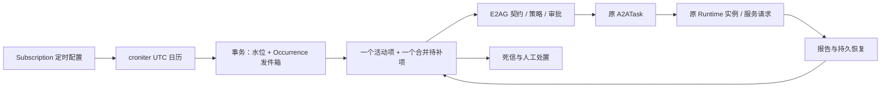

# 持久订阅定时与重叠触发

DiOS 将定时规则转换为可核验的触发记录，再通过现有 E2AG 事件准入和 A2A 执行链路提交任务。订阅、时间水位和待投递记录保存在应用数据库中；控制进程重启后沿用原事件、任务和执行对象。

## 组件选择

| 公开方案 | 已有能力与约束 | DiOS 接入判断 |
|---|---|---|
| [APScheduler 3](https://apscheduler.readthedocs.io/en/3.x/userguide.html) | 持久 Job Store、misfire、coalescing；[多个调度进程不能共享 Job Store](https://apscheduler.readthedocs.io/en/3.x/faq.html#how-do-i-share-a-single-job-store-among-one-or-more-worker-processes) | 可承担独立定时服务。引入后仍需与 DiOS 队列、原任务身份及 E2AG 建立可靠交接，不能以回调结束代表 Agent 完成。 |
| [Celery Beat](https://docs.celeryq.dev/en/stable/userguide/periodic-tasks.html) | 单调度所有者；任务可能重叠，需要额外控制；适合已有 Celery 部署 | 当前 DiOS 已有队列、Worker 和恢复协议，新增 Broker 与另一套执行生命周期增加运维和语义整合成本。 |
| [Temporal Schedules](https://python.temporal.io/temporalio.client.ScheduleOverlapPolicy.html) | 提供 SKIP、BUFFER_ONE、BUFFER_ALL 等重叠策略和[补触发窗口](https://python.temporal.io/temporalio.client.SchedulePolicy.html) | 采用 BUFFER_ONE 与有界补触发的产品语义。多节点调度可继续评估 Temporal Provider；不把 Temporal 服务设为轻量默认安装依赖。 |
| [事务发件箱](https://docs.aws.amazon.com/prescriptive-guidance/latest/cloud-design-patterns/transactional-outbox.html) + [croniter](https://github.com/pallets-eco/croniter) | 水位更新与待发送消息同事务；消费端负责幂等；成熟 CRON 日历解析 | 复用现有 SQLAlchemy、原生 filelock 和 croniter，以少量适配代码接入 DiOS 原执行链路。 |

这是嵌入式控制服务的实现选择。调度语义不依赖具体模型、操作系统、客户业务或数据库品牌。多控制主机共享调度需要经过独立的所有权和失效隔离验证。

## 数据与执行关系



`CronCursor` 保存订阅修订、配置、下次触发、活动项和待补项。`CronOccurrence` 保存首次/末次计划时间、合并触发次数、固定 EventLog ID、派发失败次数、退避时间和处置记录。唯一约束绑定 scope、订阅、修订及首次计划时间。

时间水位和 Occurrence 原子提交后才允许投递。调度进程在 EventLog 创建前后、A2ATask 创建前后退出，都通过同一记录恢复。已有 A2ATask 时只查询原任务；未知结果继续占用活动位置。

本机多个调度进程共享原生文件锁。进程退出后锁由操作系统释放；锁文件存在不代表持有者存活。所有 API 进程必须使用同一个应用库、runtime scope 和原生锁目录。当前没有跨控制主机仲裁资格。

## 时间与重叠规则

- 五字段 CRON，时区为 UTC，最小粒度一分钟；拒绝随机、哈希及无可达日期表达式。croniter 日历搜索限制为八年。
- 新建或修改规则从变更时刻计算下一次触发。旧订阅首次接入以接入时刻为起点，已有历史不倒推成新任务。
- 最多一项活动交付和一项待补触发。运行期间所有后续触发合并记录首次/末次时间及次数；原任务结束后交付待补项。
- 重启补触发窗口为最近 24 小时。更早区间单独记录 `expired`；其 `trigger_count=null` 表示未逐项枚举。该区间不计完成，业务覆盖账本仍由应用维护。
- 关闭、删除、修改规则取消尚未准入的待投递项和缓冲项；已接受任务自然结束，原报告与身份保留。重新启用从启用时刻建立新修订。
- 观察时间单独返回。界面的调度状态表示最近对账结果，实际运行并发仍由 Worker、进程和会话证据判断。

## 恢复、审批与死信

`pending → running / approval_required → succeeded / denied / dead_letter`。结果未知保持活动位置；查询超时不重派。排空期间保留待投递项，不消耗失败重试次数。

尚未形成交付证据的失败采用 120、240 秒退避，第三次失败进入死信。死信阻止同订阅继续派发，后续触发仍可合并到一个缓冲项。已有任务失败时保留原 Task、日志和产物，进入死信，不自动创建新模型调用。

操作员可选择：

- `retry`：仅对不存在 EventLog 和 A2ATask 的明确派发前失败开放，沿用原 Occurrence/Event ID；再次通过 E2AG。
- `discard`：记录操作员、原因、幂等键与前次失败，释放该活动项，后续缓冲项可继续派发。任何原任务仍活动时禁止此操作。

已有交付证据的故障优先对账原执行；确需新执行时，应用通过正常任务入口发起明确的新任务。通用事件重试 Worker 和旧的手动事件重试接口不能另行重派定时交付。

审批记录创建和审批后派发之间的崩溃可恢复。恢复中的原事件重新核验准入策略；已提交的批准沿用原审批身份。工具调用继续由现有 E2AG 执行控制点授权。死信处置校验并追加原审计链，不签发新工作或工具授权。

## API、CLI 与 Console

订阅 CRUD 保持原路径，保存并校验 `cron_expression`，响应增加 `schedule` 摘要。Console 显示 UTC 规则、下次触发、活动事件、缓冲次数、失败代码、下次重试和观测时间，支持中英文和刷新。

受操作员权限保护的接口：

| 接口 | 用途 |
|---|---|
| `GET /api/os/runtime/schedules` | 查询调度摘要 |
| `GET /api/os/runtime/schedules/{subscription_id}/occurrences?limit=50&before=...` | 按计划时间倒序分页查询触发记录 |
| `POST /api/os/runtime/schedules/occurrences/{id}/resolve` | 提交 action、actor、reason、idempotency_key |

```bash
python cli/dios schedules list
python cli/dios schedules history SUBSCRIPTION_ID --limit 50
python cli/dios schedules resolve OCCURRENCE_ID --action retry \
  --actor OPERATOR --reason 'transport restored before dispatch' --idempotency-key RESOLUTION_ID
```

CLI 使用部署的同一数据库和配置，由本机操作员运行。查询返回 `no-store`；大报告仍通过既有产物接口取得。

## 部署与后续

新增 `cron_cursors`、`cron_occurrences` 两张表，沿用应用初始化的增量建表。升级先停止领取并排空活跃执行，备份应用库与运行库，再切换版本。调度水位和发件箱必须随应用库共同备份。回退旧版时需停用其内存 CRON，避免旧、新调度器并行投递。

当前范围为兼容订阅入口。Profile/Run 的定时提交、长期工作授权来源、跨控制主机仲裁、可配置时区/补触发策略及全局死信运营仍在 #30 后续范围内。兼容事件派发沿用原串行准入链路，服务请求在后台处理，容器准备可能增加派发延迟；规模与延迟资格需继续验证。现有生产评审未迁移。

验证覆盖：首次触发、同点重复、独立进程竞争、持久水位与发件箱崩溃、原任务身份、E2AG 拒绝与审批恢复、未知结果、排空、退避、死信、关闭/删除/重新启用、时钟回退、有界补触发和 API 权限。原生 Docker 演练使用合成任务报告，无供应商模型调用。
