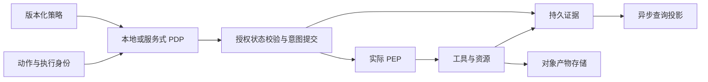

# E2AG 实现选择与运行时后端评估

日期：2026-11-11 · 单节点比较已完成，按部署档位推进产品化验证 · 关联 #30/#32/#34/#54、ADR 0008。

E2AG 定义治理语义；具体实现围绕冲突域、关键持久写、数据布局与故障模型选择。平台统一的是对象身份、授权继承、完整中介、单次状态转换和可核验证据，数据库与规则引擎保持可替换。

## 论文提供的依据

论文 [v1.1.48 固定源文件](https://github.com/HQIT/DiOS/blob/e7723ba6dc589ebcbf44990e3efb9e22c5221926/docs/paper/latex/e2ag-body-v1.1.48.tex) 第 6 节记录：纯契约、目标策略、参数判定 p50 各小于 0.05 ms；并发 1 时能力签发、调用意图和响应记录分别约 4.16、3.83、5.84 ms。并发 8 的 issue 完成速率从 57.24 降至 31.05 次/秒，治理增量约 113—115 ms。测试中数据库限额 0.5 CPU/512 MiB，应用等合计 1.5 CPU/1536 MiB，并启用同步提交。

该对照固定 PostgreSQL，比较直通与完整治理；它定位到状态访问、证据持久化及宿主处理路径，未完成数据库之间的性能排名。异构实验比较 SQLite/PostgreSQL 的治理结果，42 项配置—场景运行验证了可替换性所需语义。论文第 7 节及结论已说明跨层对象组织可以与具体判定机制分离。

当前参考实现的 Workspace 级锁进一步扩大了冲突范围。即使替换数据库，保留相同串行临界区仍会限制同一 Workspace 的吞吐。因而后端实验必须把锁粒度、事务次数、证据大小及同步保证作为独立因素。

## 实现边界

| 能力接口 | 必须保持的语义 | 可选择的实现 |
| --- | --- | --- |
| PolicyEvaluator | 输入绑定策略版本，输出决策、约束与依据 | 内置纯函数、OPA 或其他可替换策略引擎 |
| AuthorizationStateStore | 当前主体/委托/Grant/撤销代次，条件修改 | 关系事务库、事务 KV、复制状态机 |
| ExecutionStateStore | 幂等提交、独占认领、单调 epoch、状态与事件原子可恢复 | 行级条件更新、事务 KV、按对象分区的状态机 |
| InvocationCommitter | 审批单次消费、意图持久化、撤销与派发排序 | 同事务提交或等价的单一权威提交点 |
| EnforcementAdapter | 文件/Shell/网络/MCP/远端出口的实际拦截 | 本地代理、沙箱、可信运行时钩子 |
| EvidenceJournal | 不可变记录、对象依赖、顺序/完整性和持久确认 | 追加记录表、持久日志、分区日志与冷归档 |
| QueryProjection / ArtifactProvider | 明确新鲜度与水位，按字节校验产物 | 查询库、分析库、对象存储；按用途选择 |

策略分发与执行路径如下，方框代表职责，可按部署需求合并进程：

“本地判定”省去策略计算的网络往返；当前权限、审批消费及强撤销仍需满足自己的协调契约。OPA 官方提供策略性能及本地集成机制，适合作为可选判定器；完整治理仍由其周围的对象绑定与执行控制承担。[OPA 性能文档](https://www.openpolicyagent.org/docs/policy-performance)、[集成接口](https://www.openpolicyagent.org/docs/integration)。

## 优先比较的实现改进

1. **按冲突对象组织并发。** Run 状态按 Run 比较版本，Approval 按单条审批消费，队列按分区认领。撤销影响的授权根与派发必须有共同排序点，多个锁使用固定次序。不同 Run 在同一 Workspace 内并行。
2. **减少关键路径往返。** 在语义允许时合并当前授权状态校验、审批消费与调用意图提交；获得必要的持久确认后才转发。批提交可共享持久化成本，每个动作等待本批确认，不能提前报告已保存。
3. **证据按记录追加。** 用不可变记录及小型链头条件更新替代反复复制整条 JSON 审计链。顺序按 trace 或已定义分区维护；并行分支需要显式依赖，变更哈希/顺序格式使用版本化验证器。
4. **查询和详情退出执行临界区。** 进度事件独立交付，图表和检索使用投影，完整产物使用对象存储。同步故障保留重试身份与水位，关键调用意图继续满足持久化要求。
5. **缓存具有明确授权语义。** 策略包可按版本缓存；严格 Profile 的撤销与派发顺序保持强约束。若新增有界陈旧 Profile，须独立定义适用动作、最长陈旧窗口和业务批准，不能沿用严格 Profile 名称。

## 后端候选

| 方案 | 适用设计与待验证项 | 当前定位 |
| --- | --- | --- |
| PostgreSQL / MySQL InnoDB | 短事务、行级条件更新、队列分区；验证热点锁、提交次数、WAL/redo 与连接池等待 | 关系型对照，先优化算法后比较引擎 |
| FoundationDB | 有序 KV 与多键事务；验证键分布、冲突范围、重试、提交结果未知及应用索引成本 | 多节点事务 KV 候选 |
| SQLite WAL / LMDB | 嵌入式事务存储、单控制服务与远端 Worker；验证单写者排队、轻载尾延迟、索引和恢复 | 轻量部署正式候选，已完成单节点比较 |
| etcd CAS | 同步事务及条件更新；验证重试、热点及证据保留成本 | 已完成单节点比较 |
| TiDB | 分布式 SQL 及悲观/乐观事务；验证热点、跨分区事务、节点故障和部署成本 | 分布式 SQL 候选 |
| 协调服务＋持久分区日志 | 小型协调状态与证据分工；验证撤销、审批及派发的唯一提交点，避免不一致双写 | 组合架构实验，先证明故障语义 |

MySQL 提供锁定读与跳过已锁记录的队列使用机制；FoundationDB 提供默认严格可串行化事务，并要求处理冲突重试和提交结果未知；TiDB 支持悲观及乐观事务。这些能力构成候选资格，性能取决于实际工作负载。[MySQL](https://dev.mysql.com/doc/refman/8.4/en/innodb-locking-reads.html)、[FoundationDB](https://apple.github.io/foundationdb/developer-guide.html)、[TiDB](https://docs.pingcap.com/tidb/stable/pessimistic-transaction/)。

etcd 可参与小型协调状态设计，其请求及存储限制要求控制记录规模；大量证据与详情需使用合适的数据服务。[etcd 系统限制](https://etcd.io/docs/v3.6/dev-guide/limit/)。不在首轮同时部署所有候选：先做优化后的关系型实现与一种非 SQL 实现，再按结果扩展比较。

## 统一实验与选择门槛

实验输入见 [后端评测配置](../../contracts/runtime/provider-evaluation-v1.json)。保留现有 Workspace 串行版本作为正确性对照；增加对象粒度关系型版本和事务 KV 版本。固定策略、事件、工具响应、CPU/内存/磁盘、网络、持久确认和复制保证。单节点和多节点分别比较，不能以异步确认与同步持久提交混排。

并发采用 1/8/32/128，分均匀负载、同 Run/审批热点、长证据链和撤销突发。先使用固定执行器隔离模型波动，再使用真实 Harness 验证接入。闭环负载用于复现论文，开放到达负载用于观察饱和、积压和长尾。分开计量 PDP、授权状态查询、锁等待、事务提交、意图落盘、转发、结果记录和投影延迟。

指标包括吞吐、p50/p95/p99、CPU/内存/磁盘、每动作事务与写入字节、热点冲突、重试次数、恢复时间、撤销生效和单位成本。成功率与正常业务放行率一同报告。故障集包含进程/节点终止、响应丢失、断网、磁盘写失败、撤销与派发竞争、重复审批、旧 epoch 及日志重放。

候选先通过不变量检查，再比较性能和成本。没有证据缺失、重复副作用或未授权执行，目标并发下满足治理 SLO，故障恢复保持授权与任务身份，许可及商业分发条件明确，才进入生产选型。业务内核接口和验证器保持不变，由候选 Adapter 承担差异。

## 本轮代码与下一步

SQLite/PostgreSQL 参考后端通过 [94 项后端回归](evidence/runtime-foundation-checks-20261111.json)，含独立进程认领、事务崩溃、撤销后的状态写入拒绝、字节产物校验及 legacy API/CLI。它尚未接管现有调度，也未实现完整 E2AG 工具派发；Workspace 锁及每次检查 Schema 均列入待优化成本。

本轮 #32 已完成后端中立原子操作探针、六种实现比较与一致性检查。下一步 #30/#32 将接口接入正式 Runtime，验证轻量公平写入队列与 PG 对象粒度并发；#34 接入完整 E2AG 执行链，#54 承接长期混合负载与多节点验收。轻量默认后端在 SQLite/LMDB 的补充验证后冻结。

## 分档选型证据

[单节点实现比较](provider-selection-32.md) 与 [ADR 0009](../adr/0009-lightweight-and-shared-runtime-storage.md) 将轻量服务纳入正式路线。SQLite/LMDB 具备本轮治理事务能力；共享事务路线先产品化 PG 对象粒度实现。默认轻量后端需补齐公平有界写入、混合负载与备份恢复验收。单控制服务可以管理远端 Worker，平台扩展目标保持多节点。
