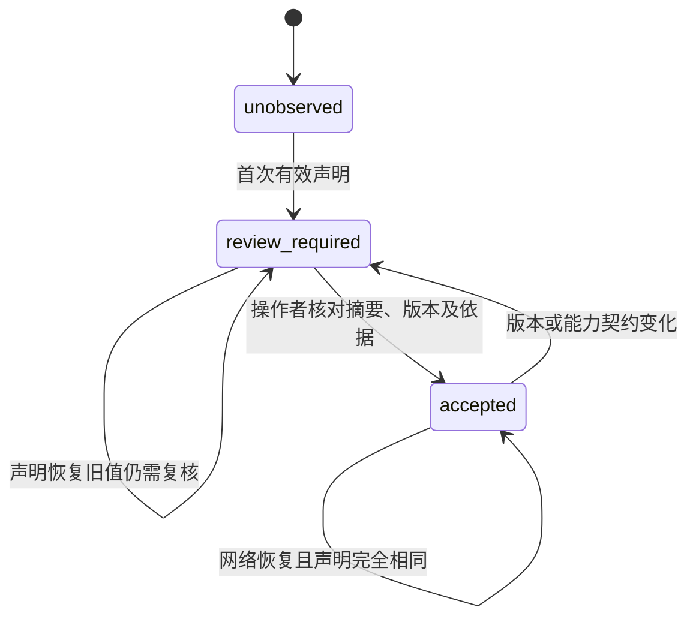

# 外部实现升级兼容门禁

版本化 A2A 执行在新任务发送前读取 Agent Card，保存协议、端点、报告版本和能力契约摘要，并要求操作者接受当前声明。声明变化后重新进入待复核状态。已发送任务继续查询原远端任务 ID，恢复链路不重新提交业务请求。

此门禁与 E2AG 分别负责兼容性和执行权限。接受端点声明不会创建、延长或恢复工作授权；每次实际执行仍经过当前策略、身份、工作授权和工具审批。

## 接入类型与回退范围

| 接入类型 | 可固定内容 | 升级检查 | 回退能力 |
| --- | --- | --- | --- |
| 受控 Docker 内的 ACP / CLI Harness | 镜像、受控配置与打包依赖 | 不可变 Revision 与镜像摘要；ACP 原有协议初始化检查 | 回退已保留的镜像和配置 |
| 外部 A2A 端点 | DiOS 配置、Adapter 与凭据引用 | 每次版本化派发前读取声明，检测契约变化并要求复核 | 可回退 DiOS 配置；当前协议适配器不支持远端实现回退 |
| Harness 内部模型或不可观察实现 | 只能保留已公开声明 | 实现摘要未知时标记 opaque / declared | 不宣称可恢复远端模型或隐藏实现 |

ACP 的进程、初始化和会话控制沿用 [ACP 接入](cursor-acp-56-58.md)；其受控镜像与配置固定机制见 [Revision](revisions-31.md)。本门禁处理外部 A2A 服务的可变端点。A2A 无法保证服务在声明读取与后续请求之间不变化，也无法检测未更新声明的内部替换；报告版本与源码摘要分别展示。

## 状态、并发与审计

状态按资源作用域与运行配置摘要隔离：



网络不可用单独记录错误和新鲜度，阻止新派发；同一声明恢复后保留原接受决定。协议不兼容、所需技能消失、出现不支持的必选扩展或声明格式无效，会撤销原兼容接受，恢复旧声明后仍须重新复核。

读取请求记录其起始版本，迟到的旧响应不能覆盖较新的声明或接受决定。操作者接受使用 `expected_version` 与 `snapshot_digest` 双重条件，冲突返回 409。并发接受只有一个成功。正常重复观测刷新时间，不重复追加同一审计事件。声明变更、接受、观测故障和恢复保留版本化事件及声明摘要。

接受与派发要求最近 60 秒内的有效观测。每次版本化 Worker 派发先观测；准备和发送意图落库时再次验证接受状态与同一声明摘要。Attempt 保存派发所依据的摘要。Deployment 激活还会核对健康 Attempt 的声明摘要：新声明的接受不能替代旧健康任务的执行依据。长时间排空期间允许保留此前健康结果，但发现声明变化或观测错误时拒绝激活。

首次引入门禁不会修改历史 Run、旧 Revision 或已发送请求。未绑定 Revision 的兼容运行入口继续沿用原协议检查；使用版本发布与回滚的入口必须绑定 Revision，执行本门禁。

## 操作者接口

API 与 CLI 使用同一持久状态。API 限制为 Console 操作者凭据；业务身份不能接受底座兼容性声明。观测只允许访问 Revision 固定的端点，凭据由现有 Secret Provider 解析，不接受客户端传入 URL、令牌或文件路径。

| API | 功能 |
| --- | --- |
| `GET /api/os/runtime/revisions/{ref}/compatibility` | 声明、接受状态、新鲜度、审计和分别列出的回退能力 |
| `POST /api/os/runtime/revisions/{ref}/compatibility/observe` | 在当前 E2AG 策略下读取真实端点声明，不创建模型任务 |
| `POST /api/os/runtime/revisions/{ref}/compatibility/accept` | 以当前版本、摘要和评审依据接受声明 |

接受请求：

```json
{
  "expected_version": 1,
  "snapshot_digest": "<observed-sha256>",
  "evidence": "兼容性检查与结果契约的评审依据"
}
```

CLI 沿用 `python -m app.runtime.cli` 的数据库与作用域参数：

```text
compatibility --policy-file policy.json --secrets-file secrets.json observe rev-...
compatibility show rev-...
compatibility accept rev-... --version 1 --snapshot-digest ... --actor operator --evidence ...
```

结果分别返回 `configuration_rollback`、`implementation_visibility`、`implementation_rollback`、`implementation_digest` 和模型可见性。首次观测为 `unobserved`，可观察的远端自报版本为 `declared`，本地受控镜像为 `pinned-image`。观测失败或过期由 `qualification.error`、`observed_at`、`observed_stale` 表达。

SQLite 与 PostgreSQL 使用独立追加迁移组件，纳入现有备份完整性校验。工程证据见 [外部兼容门禁验证](evidence/endpoint-compatibility-20261125.json)。完整版本发布与外部 Harness 资格由 K02-1.05 继续验证。

## 公开协议依据

[A2A 0.3 Agent Card](https://a2a-protocol.org/v0.3.0/specification/) 定义代理版本、协议、能力、技能及安全声明；当前适配器维持已验证的 0.3 JSON-RPC 契约。[ACP v1 初始化](https://agentclientprotocol.com/protocol/v1/initialization) 提供协议协商、能力和可选代理版本信息。声明比较与显式重新接受建立在这些协议字段之上，未增加自定义远端回滚命令。
