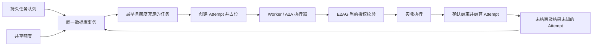

# 共享执行并发额度

DiOS 在任务领取事务中控制共享并发。多个本地 Worker、远程 Worker 和 A2A 出站执行器使用同一额度账本；额度按控制域、已接受 Work 的主体、一个或多个运行配置设置。额度属于基础能力，客户、岗位和行业概念由外部应用映射到主体及运行配置。

## 控制逻辑



并发额度采用 aggregate quota 的准入语义；Worker 自身槽位继续约束进程的执行容量。这两个层次分别参考 [Kubernetes ResourceQuota](https://kubernetes.io/docs/concepts/policy/resource-quotas/) 和 [Temporal Worker slots](https://docs.temporal.io/develop/worker-performance)。DiOS 复用现有数据库事务与 Attempt，无需增加调度中间件。

SQLite 使用 `BEGIN IMMEDIATE`，PostgreSQL 使用控制域级事务 advisory lock。读取额度、计算占位、选择任务、创建 Attempt 和写入领取事件在同一个事务中提交。事务失败同时撤销占位。多节点部署需共享支持该事务契约的后端；多台主机各自持有 SQLite 文件会形成独立额度域。

所有匹配且启用的额度共同生效。达到上限的选择条件直接加入队列 SQL，允许后续具有可用额度的任务继续执行。排序仍为任务创建时间及 ID。共享配置组可表示同一模型账户、运行资源或服务池，但组成员由运维配置，任务输入不能修改额度。

未配置共享额度时沿用现有 Worker 槽位和执行配置限制；迁移不会自动设置或改变业务容量。

主体从持久化 Work 记录读取。未建立 Work 的兼容任务仍受控制域和配置组额度约束；主体额度只覆盖具有该主体 Work 的任务。需要全量控制时同时设置控制域额度。

## 占位与恢复

`claimed`、`preparing`、`creating_session`、`waiting_model`、`streaming`、`validating` 和 `result_unknown` Attempt 均占用额度。进程、网络和控制面失联后，占位一直保留到执行结束得到确认。取消意图、撤权、观测超时和租约过期本身不释放额度。

确认完成、确认失败、确认取消或可信未启动拒绝会结束 Attempt，从而释放占位。恢复过程保留原 Attempt 与事件，不需要修复一份独立计数器。E2AG 在领取后的执行、会话和工具控制点继续校验；额度可用本身不赋予执行权限。

降低额度影响新领取，已有执行自然结束。额度设为 `0` 暂停匹配任务的新领取；`enabled:false` 停用该条限制。父子任务各自占位。会等待子任务的父任务必须配置足够的共享容量，否则子任务持续排队；等待模型或等待子任务不会虚假释放父进程占位。

## 运维接口

本地可信管理命令沿用数据库运维权限。当前没有 Agent 工具或普通应用写接口。创建使用预期 revision `0`，后续修改要求当前 revision；每次修改保存原值、新值和来源 `trusted_local`，并与配置更新原子提交。

```json
{
  "id": "shared-model-pool",
  "selector": {"kind": "profiles", "profiles": ["cursor-review", "dsh-review"]},
  "max_concurrent": 2,
  "enabled": true
}
```

```sh
# DIOS_RUNTIME_DATABASE_URL 由受控执行环境提供。
python -m app.runtime.cli --scope local capacity set --file capacity.json --revision 0
python -m app.runtime.cli --scope local capacity status
```

仓库 CLI 同步支持 `dios runtime --scope local capacity set/status`。

另外两种选择器为 `{"kind":"scope"}` 和 `{"kind":"subject","subject":"subject-id"}`。每控制域最多保留 64 条额度，每组最多 32 个配置，最大并发值为 100000；这些是配置边界，容量目标仍须实测。

`status` 返回配置 revision、占位 Attempt 数、结果未知 Attempt 数、匹配的排队任务数、剩余额度和观测时间。占位数包含准备及未知状态；实际并发继续读取 `workers` 的进程与会话证据。多个额度匹配同一任务时，其排队数有重叠，不应求和作为总任务量。

## 升级与验收

新增 `runtime_capacity_schema`、`runtime_capacity_limits`、`runtime_capacity_changes`，原有 schema 保持校验和不变。升级顺序为停止新领取、排空并确认执行、备份、停止旧执行器、显式迁移、切换全部执行器、恢复调度。旧版执行器不具备额度门禁，应在启用额度前全部切换。备份校验包含新表；回滚采用升级前备份及原程序，并保留切换后产生的数据供对账。

可重复验证入口：

```sh
PYTHONPATH=backend:backend/tests backend/.venv/bin/python -m unittest -v test_runtime_capacity
backend/.venv/bin/python scripts/qualify_runtime_capacity.py --output workspace/capacity-check
# 使用明确的隔离测试库；不指向现有业务数据库。
backend/.venv/bin/python scripts/qualify_runtime_capacity.py --postgres --output workspace/capacity-pg-check
```

容器验证使用现有 `dios-worker-fixture:local` 镜像、三个独立 Worker、真实容器进程和会话。检查共享额度 2、第三个任务排队、降额保留活动任务、E2AG 拒绝未授权执行、策略恢复后的任务成功，以及最终占位归零。合成任务不调用模型。

[实测记录](evidence/execution-capacity-20261125.json)包含 SQLite/PostgreSQL 原生执行结果、专项及回归测试、发布镜像与开发切换证据。物理跨主机部署仍需单独验收。

后续工作包含共享额度管理 UI、可观测的排队阻塞原因、运行时长与调用频率限制、Token/金额预留与可靠用量核销，以及远端服务不提供成本硬限制时的准入策略。网络、凭据与工作区限制继续由现有执行配置和 E2AG 工具治理承担，完整 #45 验收仍需统一验证这些约束。
