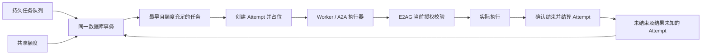

# 共享执行并发额度

DiOS 在任务领取事务中控制共享并发。多个本地 Worker、远程 Worker 和 A2A 出站执行器使用同一额度账本；额度按控制域、已接受 Work 的主体、一个或多个运行配置设置。额度属于基础能力，客户、岗位和行业概念由外部应用映射到主体及运行配置。

## 控制逻辑



并发额度采用 aggregate quota 的准入语义；Worker 自身槽位继续约束进程的执行容量。这两个层次分别参考 [Kubernetes ResourceQuota](https://kubernetes.io/docs/concepts/policy/resource-quotas/) 和 [Temporal Worker slots](https://docs.temporal.io/develop/worker-performance)。DiOS 复用现有数据库事务与 Attempt，无需增加调度中间件。

SQLite 使用 `BEGIN IMMEDIATE`，PostgreSQL 使用控制域级事务 advisory lock。读取额度、计算占位、选择任务、创建 Attempt 和写入领取事件在同一个事务中提交。事务失败同时撤销占位。多节点部署需共享支持该事务契约的后端；多台主机各自持有 SQLite 文件会形成独立额度域。

所有匹配且启用的额度共同生效。达到上限的选择条件直接加入队列 SQL，允许后续具有可用额度的任务继续执行。排序仍为任务创建时间及 ID。共享配置组可表示同一模型账户、运行资源或服务池，但组成员由运维配置，任务输入不能修改额度。

未配置共享额度时沿用现有 Worker 槽位和执行配置限制；迁移不会自动设置或改变业务容量。

主体从持久化 Work 记录读取。未建立 Work 的兼容任务仍受控制域和配置组额度约束；主体额度只覆盖具有该主体 Work 的任务。需要全量控制时同时设置控制域额度。

## 占位与恢复

`claimed`、`preparing`、`creating_session`、`waiting_model`、`streaming`、`validating` 和 `result_unknown` Attempt 均占用额度。进程、网络和控制面失联后，占位一直保留到执行结束得到确认。取消意图、撤权、观测超时和租约过期本身不释放额度。

确认完成、确认失败、确认取消或可信未启动拒绝会结束 Attempt，从而释放占位。恢复过程保留原 Attempt 与事件，不需要修复一份独立计数器。E2AG 在领取后的执行、会话和工具控制点继续校验；额度可用本身不赋予执行权限。

降低额度影响新领取，已有执行自然结束。额度设为 `0` 暂停匹配任务的新领取；`enabled:false` 停用该条限制。父子任务各自占位。会等待子任务的父任务必须配置足够的共享容量，否则子任务持续排队；等待模型或等待子任务不会虚假释放父进程占位。

## 运维接口

本地可信管理命令沿用数据库运维权限；Console 使用现有操作员令牌管理额度。创建使用预期 revision `0`，后续修改要求当前 revision；每次修改保存原值、新值和来源（`trusted_local` 或 `operator_api`），并与配置更新原子提交。普通应用身份无额度管理权限。

```json
{
  "id": "shared-model-pool",
  "selector": {"kind": "profiles", "profiles": ["cursor-review", "dsh-review"]},
  "max_concurrent": 2,
  "enabled": true
}
```

```sh
# DIOS_RUNTIME_DATABASE_URL 由受控执行环境提供。
python -m app.runtime.cli --scope local capacity set --file capacity.json --revision 0
python -m app.runtime.cli --scope local capacity status
```

仓库 CLI 同步支持 `dios runtime --scope local capacity set/status`。

另外两种选择器为 `{"kind":"scope"}` 和 `{"kind":"subject","subject":"subject-id"}`。每控制域最多保留 64 条额度，每组最多 32 个配置，最大并发值为 100000；这些是配置边界，容量目标仍须实测。

`status` 返回配置 revision、占位 Attempt 数、结果未知 Attempt 数、匹配的排队任务数、剩余额度和观测时间。占位数包含准备及未知状态；实际并发继续读取 `workers` 的进程与会话证据。多个额度匹配同一任务时，其排队数有重叠，不应求和作为总任务量。

Console「任务」页提供共享额度面板，支持新增、修改和停用。中英文、Light/Dark/Auto 样式沿用全局设置。观测失败时显示最近数据并禁用修改，刷新恢复后才能继续操作；版本冲突需要重新选择最新额度。

`GET /api/os/runtime/capacity` 返回额度观测，`PUT /api/os/runtime/capacity` 接收 `id`、`selector`、`max_concurrent`、`enabled`、`expected_revision` 和可选 `budget`。两个接口仅允许现有操作员认证，应用身份返回 403；额外字段与非整数上限拒绝，响应不缓存。范围由服务器控制域确定。

任务详情新增 `capacity`：排队时给出 `blocked`、`reason` 和 `limits`，其他状态为 null。操作员可看到阻塞额度及占位数；普通应用仅获得自己可读任务的阻塞布尔值、原因及可用时刻，`limits` 为空。额度变化不会增加任务 revision，Console 轮询仍会更新等待说明。额度可用只表明该门禁已通过，Worker 可用性、排空和熔断等条件继续生效。

## 升级与验收

新增 `runtime_capacity_schema`、`runtime_capacity_limits`、`runtime_capacity_changes`，原有 schema 保持校验和不变。升级顺序为停止新领取、排空并确认执行、备份、停止旧执行器、显式迁移、切换全部执行器、恢复调度。旧版执行器不具备额度门禁，应在启用额度前全部切换。备份校验包含新表；回滚采用升级前备份及原程序，并保留切换后产生的数据供对账。

可重复验证入口：

```sh
PYTHONPATH=backend:backend/tests backend/.venv/bin/python -m unittest -v test_runtime_capacity
backend/.venv/bin/python scripts/qualify_runtime_capacity.py --output workspace/capacity-check
# 使用明确的隔离测试库；不指向现有业务数据库。
backend/.venv/bin/python scripts/qualify_runtime_capacity.py --postgres --output workspace/capacity-pg-check
```

容器验证使用现有 `dios-worker-fixture:local` 镜像、三个独立 Worker、真实容器进程和会话。检查共享额度 2、第三个任务排队、降额保留活动任务、E2AG 拒绝未授权执行、策略恢复后的任务成功，以及最终占位归零。合成任务不调用模型。

[实测记录](evidence/execution-capacity-20261125.json)包含 SQLite/PostgreSQL 原生执行结果、专项及回归测试、发布镜像与开发切换证据。物理跨主机部署仍需单独验收。

[Console 与权限实测](evidence/execution-capacity-ui-20261125.json)覆盖中英文桌面、移动端、操作冲突、观测中断和应用身份隔离。

## 执行时长与领取频率

额度可增加 `budget` 配置；CLI、API 和 Console 使用同一契约：

```json
{
  "id": "shared-model-pool",
  "selector": {"kind": "profiles", "profiles": ["cursor-review", "dsh-review"]},
  "max_concurrent": 2,
  "budget": {
    "max_runtime_seconds": 1800,
    "max_dispatches": 10,
    "dispatch_window_seconds": 60
  }
}
```

`max_runtime_seconds` 为一个 Run 从首次领取开始的墙钟预算，包含准备、重试和重试等待；初次排队不计入。首次领取时持久化最严格的匹配截止时间及额度 revision，后续重试、Worker 重启和配置放宽不会重置或延长。未配置时保留现有 Worker 超时与 Work 授权期限。修改时长只影响尚未绑定预算的任务。时长范围为 1–604800 秒，E2AG Work 期限等更严格条件继续生效。

总执行期限与单次尝试超时分离，参考 [Temporal 执行期限契约](https://nodejs.temporal.io/api/namespaces/common/interfaces/WorkflowDurationOptions)。DiOS 持续使用自身 Run/Attempt 身份；预算到期后停止授予执行权，允许对已保留产物继续做授权校验和结果恢复。

`max_dispatches` 与 `dispatch_window_seconds` 必须同时配置。两者分别为 1–100000 次和 1–86400 秒。成功领取创建一个 Attempt 时计一次；重试和已领取后的预检失败同样计数。被门禁拒绝而没有创建 Attempt 的请求不计数。该指标约束平台领取准入，模型内部 HTTP 请求数与 Token 消耗另行核算。

频率使用精确滚动窗口：同一数据库事务读取当前时钟、统计窗口内 Attempt，并决定是否创建新 Attempt。算法参考 [Redis 滚动窗口日志说明](https://redis.io/learn/howtos/ratelimiting/)，复用已有持久 Attempt 时间戳，未增加 Redis 依赖。失败、重启及停用后重新启用不会删除窗口历史；下调上限时等待足够多的历史领取离开窗口。所有匹配额度共同约束任务，队首受限任务不会阻塞其他配置的可用任务。

已有调用方省略 `budget` 时保留原配置；传入 `{}` 或三个 null 清除未来任务的预算配置。Console 留空对应清除。已经绑定的执行截止时间继续生效。新增预算或扩大选择范围时，领取频率计入对应范围内仍处于窗口的既有 Attempt。

本地和远程 Worker 根据服务端剩余时长建立保守的本地单调时钟截止时间；控制面查询不能无限延长执行。E2AG 执行、续租和工具控制点继续核验持久截止时间。到期后请求运行适配器停止进程，保留输出和退出证据；只有确认退出才释放并发占位。A2A 对原 Task 发起取消并查询原身份，取消未确认或端点不可达时维持对账及占位。第三方端点的停止完成时间取决于其取消能力。

Task 详情的 `execution_budget` 给出起点、截止时间、剩余秒数和是否到期；排队频率受限时 `capacity.reason` 为 `DISPATCH_RATE_LIMITED`，`available_at` 给出最早可再次领取的时间。仍需等待 Worker、其他额度和熔断条件满足。该时间与原因可供任务所有者查看，共享用量明细仅供操作员查看。

新增独立的 `runtime_execution_budget_schema`、策略表与 Run 绑定表，并纳入备份校验。升级前没有预算绑定的历史重试，首次由新执行器领取时以最早 Attempt 为起点绑定；已超时的任务结束并记录 `run.execution_budget_exhausted`，不再创建 Attempt。历史保留策略必须保留有效频率窗口内的 Attempt 及尚未结算的绑定。

可重复运行 `scripts/qualify_runtime_budgets.py --output <新目录>`，或指定 `--postgres` 使用 `DIOS_TEST_POSTGRES_URL` 隔离库。验证真实容器超时、原始输出保留、Worker 重启后频率窗口保留，以及后续任务恢复。详情见[预算验证记录](evidence/execution-budgets-20261125.json)。

后续工作包含受控工具/模型请求的调用预算、Token/金额预留与可靠用量核销。网络、凭据与工作区限制继续由现有执行配置和 E2AG 工具治理承担，完整 #45 验收仍需统一验证这些约束。父子任务容量规划、企业身份的细分运维角色和物理跨主机验收继续按整体计划推进。
