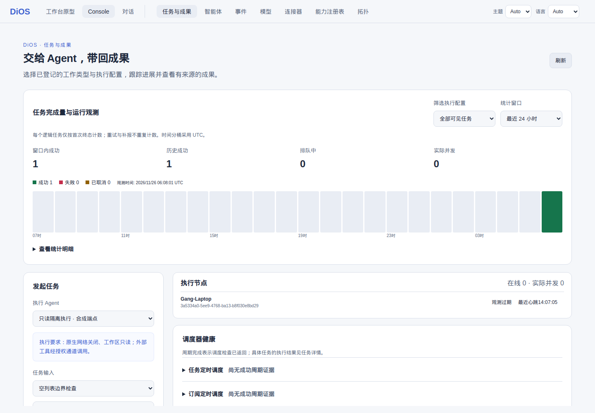

# 网络、工作区与工具预算组合策略

严格执行配置将原生网络关闭、工作区只读和 E2AG 工具门禁组合到同一次执行。策略参与 Profile 指纹和不可变 Revision；Worker 在启动前验证授权，Docker Adapter 核验实际配置后才启动进程。

```json
{
  "id": "isolated-reader",
  "bridge": "jsonl-v1",
  "governance": { "mode": "e2ag" },
  "isolation": { "version": 1, "network": "none", "workspace": "read_only" },
  "launch": {
    "image": "operator-qualified-image",
    "command": ["qualified-reader"],
    "network": "none",
    "read_only_root": true,
    "user": "1000:1000",
    "mounts": [
      { "source": "/srv/dios/inputs/example", "target": "/workspace", "read_only": true }
    ]
  }
}
```

镜像和命令由运营者登记；正式发布时沿用 Revision 的镜像摘要与输入快照要求。启用工具时另行登记 `tool_channel`，工具的权限、审批、会话绑定和调用预算沿用既有 E2AG 派发链路。

## 执行边界

| 控制点 | 行为 |
|---|---|
| 原生网络 | Docker `none` 网络，仅容器自身回环；拒绝主机网络、额外主机映射和远程 Docker 端点 |
| 工作区 | 仅允许 `/workspace` 及其下的只读挂载；启动前拒绝源中的符号链接、套接字、FIFO、设备文件及超过十万条目的目录 |
| 子挂载 | 使用 Docker `BindOptions.NonRecursive` 排除宿主子挂载，避免依赖旧内核的递归只读行为 |
| 其他挂载 | 仅允许 Worker 工具通道 `/run/dios-tools` 和 `/run/secrets` 下的只读凭据；拒绝其他挂载位置 |
| 容器权限 | 数值非 root 用户、只读根文件系统、丢弃全部 capabilities、`no-new-privileges`；拒绝主机 PID/IPC、设备与特权模式 |
| 临时文件 | `/tmp` 为 64 MiB、`noexec,nosuid` 的 tmpfs；容器标准虚拟文件系统继续存在 |
| 实际配置 | 启动及复用时读取 Docker inspect；拒绝网络或挂载漂移，以及镜像 `VOLUME` 引入的额外可写卷 |
| 工具执行 | 原生进程通过带身份校验的 Unix 通道请求；E2AG 授权和审批通过后才扣减调用预算并派发。重放复用原调用结果 |

宿主机、Docker daemon、镜像和源目录由可信运营者管理。只读挂载保护容器对宿主输入的写入；宿主管理员仍能修改源目录。源目录检查与启动之间应保持输入稳定。这里采用 Docker 的常规 Linux 容器安全边界。

## 适配范围与版本

当前资格为 Linux 本地 Docker daemon 的 `jsonl-v1` 执行器。跨主机部署由各主机上的已登记 Worker 使用当地 daemon；跨节点组合资格归 K04-2.04。直接连接远程 Docker daemon 和远端 A2A 服务不能承诺该策略，配置会以 `EXECUTION_ISOLATION_UNSUPPORTED` 拒绝。

需要直接联网调用模型的 Cursor 等 Harness 暂不能启用此严格配置。Cursor 的既有固定代理与原生动作限制见 [Cursor 控制证据](cursor-native-controls.md)。Console 只对显式登记严格策略的配置展示本页的执行要求。

启用策略会改变 Profile 指纹，需要对应 E2AG 授权。未启用策略的 Profile 指纹保持不变。Docker Adapter 实现摘要随代码更新；已发布 Revision 保留原摘要，跨实现版本加载时会拒绝。升级沿用排空和重新发布候选 Revision 的既定流程，保留历史身份。

## 验证与依据

73 项相关测试通过：真实容器只读访问、网络隔离、隐式可写卷拦截、E2AG 审批、两次工具成功后预算耗尽、授权撤销、完整 Worker 会话与成果、既有生命周期和不可变版本回归。Console 的中文、英文、暗色及移动视口检查见[交付证据](evidence/execution-isolation-20261126.json)。

```bash
DIOS_TEST_DOCKER=1 backend/.venv/bin/python scripts/qualify_execution_isolation.py \
  --output workspace/isolation-qualification.json
```

网络隔离采用 [Docker none network](https://docs.docker.com/engine/network/drivers/none/)。挂载采用 [Docker bind mounts](https://docs.docker.com/engine/storage/bind-mounts/) 的只读和非递归机制；文档明确递归只读对 Linux 5.12 及以上内核的要求，本配置通过排除子挂载消除该依赖。


