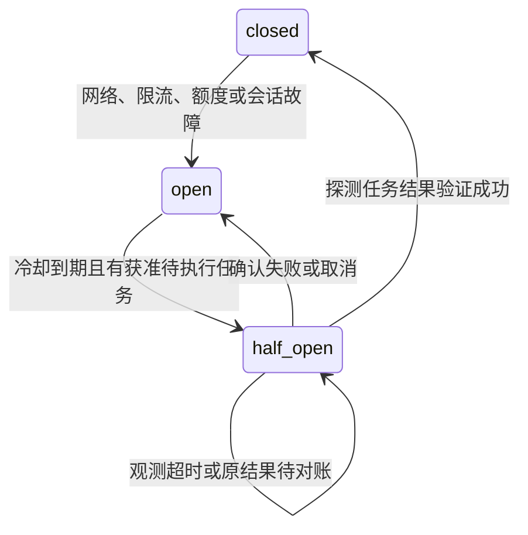

# 分类故障与单路自动恢复

文档标识：RUNTIME-FAULT-1 · 状态：待评审 · 日期：2026-11-19。
责任：Runtime；独立权限评审待认领。基线：c9110d5；关联 #30、#32、#33、#34、#56、#58，沿用 AUTHZ-1.0.0 与 ADR 0010。

## 行为与职责

Agent Bridge 将供应商的结构化错误转换为固定错误码。Worker 保存部分输出和退出回执；控制端确认退出后，按注册配置决定重试、冷却或停止。账号/端点使用不含凭据的 `resource` 标识，多个 profile 共用同一标识时共享熔断。故障范围始终限定在 Workspace scope 内。



冷却期间停止相关资源的新领取；已运行任务仍按各自租约与 E2AG 执行。冷却结束后，事务只给一个 Attempt 探测资格。探测成功后恢复已配置并发；故障前已在运行的任务晚到成功，不能提前解除熔断。探测 Worker 失联时保留探测占用，原执行对账后才允许继续。

| 故障 | 归类与默认处置 |
| --- | --- |
| `PROVIDER_NETWORK_ERROR` / `PROVIDER_TIMEOUT` | 供应商网络故障，退避并打开共享熔断 |
| `PROVIDER_RATE_LIMITED` | 服务限流，退避与单路探测 |
| `PROVIDER_QUOTA_EXHAUSTED` | 额度不足，使用独立的较长冷却 |
| `SESSION_CREATE_FAILED` | 会话创建失败，保留现场后有限重试 |
| `PROCESS_EXITED` | 已确认进程退出；仅安全重放配置可重试 |
| 格式错误、输出不完整、证据不足 | 保留失败及原始产物，等待修正或验证 |
| 授权、审批、Secret 或策略错误 | 保持拒绝，不借重试扩大权限 |
| 控制连接/查询超时、未知错误 | 原执行保持对账或明确失败；不依据查询超时重新执行 |

桥协议新增有界 JSONL 消息 `{"type":"error","code":"PROVIDER_RATE_LIMITED"}`。只接受列明的代码，不从 stderr 文本猜测权限、重试时间或账号。供应商具体错误映射由 #56/#58 的 Adapter 资格验证承接；未映射错误按保守类别处理。

## 持久状态与授权

独立 fault schema v1 增加 Attempt→策略绑定、Run 重试计划和 scope/resource 熔断记录，纳入迁移及备份。使用控制端时间，单节点与 PostgreSQL 均沿用现有事务/串行化契约。

失败 Attempt 保留错误分类、原始输出、会话和退出证据；可重试的 Run 进入既有 `retry_wait`。重试继续原 Run，创建新的 Attempt 和 lease epoch，原 Grant 关闭。新尝试必须经过 E2AG 当前工作授权、原权限范围、期限和撤销检查，再获得新 Grant；审批和未知工具副作用不继承为新执行许可。

只有 `replay_safe: true` 且未超过总尝试次数的 profile 可自动重试。`replay_safe` 是受信配置的执行契约，适用于只读或已证明幂等的工作。工具结果未知会阻断重试。远程客户端不能传入或扩大策略，控制端从已登记且摘要固定的 profile 读取。

取消冷却任务可立即完成；drain 阻止重试领取，活跃任务自然结束。人工通用 retry 命令不能跳过托管重试的冷却计划。达到总尝试预算后任务明确失败，故障和历史保留；后续符合条件的新任务仍可在冷却后探测，不留下无限期暂停开关。

## 配置与结果恢复

执行 profile 的可选字段：

```json
{
  "recovery": {
    "resource": "model-endpoint:account-reference",
    "replay_safe": true,
    "max_attempts": 3,
    "base_delay": 15,
    "max_delay": 300,
    "quota_delay": 900,
    "accept_complete_on_error": false
  }
}
```

重试次数包含初始尝试；退避按尝试次数或资源故障次数指数增加并封顶。resource 应准确反映共享的限流/额度边界。同一资源的相关 profile 都应配置相同标识。

策略进入 profile 摘要，变化需要重新准入。`accept_complete_on_error` 默认关闭；仅在 Bridge 已确认非零退出可来自结果后的清理错误时开启。开启后，完整产物优先通过格式、证据、工具回执和 E2AG accept_result 校验，校验成功沿用原 Attempt，不再调用模型；明确故障消息、部分输出和授权失败仍保持失败。

该选项关闭时，完整结果与非零退出的冲突归入 `RESULT_EXIT_CONFLICT`，保留结果供核验，不自动重放模型。

控制端凭据和策略服务故障沿用停止受管执行、保存现场和原身份对账；本功能不把控制网络故障转换成模型账号故障。

## 查询与界面

CLI `circuits` 显示资源、open/half_open/closed、下次探测时间、探测 Attempt 和原因；`show` 增加 recovery 计划及原策略绑定。受保护 `/workers` 返回相同熔断观测；任务详情增加 recovery。Console 显示冷却待重试、故障分类、下次时间、单路探测及实际并发。

## 升级、验证与后续

先 drain 并等待可切换，再备份、显式 migrate、替换服务和恢复领取。冷却任务及探测身份随备份保留。回退应用前停止相关 Worker，保留新表；回退到未识别 fault schema 的版本时须使用升级前备份进行受控恢复，不能让旧调度器绕过冷却接管。

测试覆盖 SQLite/PostgreSQL、共享资源竞争、独立账号隔离、额度冷却与重启、重复探测失败/预算、撤销/过期/取消/drain、未知工具结果、观测超时、原结果恢复、备份和远程控制接线。开发演练采用真实 Docker、mTLS 和结构化故障注入，记录浏览器状态及恢复后的报告。

后续 #30：持久定时、重叠触发合并与死信人工处置；#32：账本保留回收；#56/#58：实际供应商错误映射、双物理主机和 Agent 资格；#53：多控制节点仲裁与故障转移。独立权限评审及用户产品验收另行记录。

工程证据：[后端回归](evidence/fault-recovery-regression-20261119.json)、[开发演练](evidence/fault-recovery-development-20261119.json)。后端 383 项通过，4 项 SQLite 专属用例在 PostgreSQL 下跳过。前端构建、9 项测试及 681 项设计检查通过；浏览器分别验证限流与额度不足后的 0→1→2 路恢复，保留同一任务和两次独立授权。
