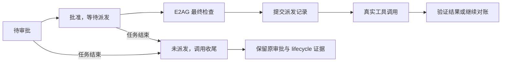

# 跨 Harness 授权与工具收尾

Cursor、DeepSeek Harness 和 Codex 已通过同一 Runtime、E2AG 和原生 OPA 的三层委派、执行授权续期、上级撤权及旧 epoch 联合验证。三种 Harness 共用执行控制点，通用内核保持业务无关。

## 真实执行矩阵

固定组合为 Cursor CLI `2026.11.05-86047df`、DSH `0.2.2-rc.5`、Codex ACP `2.11.0` / CLI `0.172.0`，DiOS SDK `0.1.5` 和 static-review `0.1.4`。DSH 使用 ECNU Max，Codex 使用已配置官方账号，Cursor 使用既有操作员凭据引用。所有任务在独立 SQLite scope、真实 Docker 进程及模型会话中运行，输入为合成源码。

| 场景 | Cursor | DSH | Codex |
| --- | --- | --- | --- |
| 三层委派下自动续期，再批准检索 | 成功报告、工具 1 次 | 成功报告、工具 1 次 | 成功报告、工具 1 次 |
| 审批通过后、派发前撤销根授权 | 派发拒绝、工具 0 次 | 派发拒绝、工具 0 次 | 派发拒绝、工具 0 次 |
| 审批通过后、派发前使原租约过期 | 旧所有者拒绝、工具 0 次 | 旧所有者拒绝、工具 0 次 | 旧所有者拒绝、工具 0 次 |

续期场景在隔离账本中将 Grant 期限缩短至约 100 秒，再等待真实 Worker 心跳自动续期。新的期限受 Work 和委派期限约束，保留 `EXECUTION_GRANT_RENEWED` 审计。成功后的同一派发请求重复提交仍只有一次真实工具调用。

撤权与旧 epoch 场景将实际 MCP 初始化停在批准后、工具派发前。撤销根授权或注入租约到期后，原 Worker 心跳分别返回 `AUTH_REVOKED` / `STALE_OWNER`，工具派发审计记录拒绝，原 Run、Attempt、Session 保留。旧 epoch 的结果由新 Worker 对账，未启动第二次模型尝试。

委派链由受信操作员建立，验证的是 Harness 在派生授权下执行的控制效果。Agent 自主创建子任务、认证 API 签发者全链路、物理跨主机和额外原生工具路径继续单独验证。权限和输出证据详见 [联合验证记录](evidence/harness-governance-20261125.json)。

## 未派发调用的终态

任务成功、失败或取消时，Runtime 在同一事务内将其 `awaiting_approval` / `prepared` 调用收尾为 `failed`，原因是 `TOOL_NOT_DISPATCHED_RUN_TERMINAL`。原审批状态、审批人和理由保持不变；新增 lifecycle 事件记录任务终态和调用原状态。事务失败时，任务状态与调用状态一起回滚。



`dispatched`、`result_unknown` 继续保留回执恢复和结果对账路径。调用是否已经派发以持久状态为依据。后台恢复按 profile、scope 和有界批次修复历史终态任务的未派发记录，重复修复保持相同版本和审计计数。

Console 显示“任务已结束，未派发”，保留审批人与调用参数，停止提供派发按钮。API 和 CLI 沿用已有 `state`、`reason`、`approval_state` 字段；无需新数据库 schema。

## 验证与运行

九组真实 Harness 场景通过；六条历史未派发调用修复为终态，三条成功调用保持原状，任务和尝试记录不变。修复后的 DSH 真实撤权场景验证了任务结束与调用收尾的原子路径。

相关回归 144 项通过、60 项条件跳过，其中启用原生 OPA 测试；发布镜像无网络环境中 33 项通过。六项新增测试覆盖成功、失败、取消、未知结果保留、审计失败回滚和历史修复幂等。设计契约 681 项通过，前端构建通过，中英文桌面与 390px 手机宽度的真实 API 页面检查通过。开发部署保留 84 条历史 Run 身份。

可复现入口：

```sh
backend/.venv/bin/python scripts/qualify_harness_governance.py \
  --profile /absolute/qualification/profile.json \
  --secrets /absolute/qualification/secret-references.json \
  --opa /absolute/qualification/opa.json \
  --case ancestor-revoke \
  --output /absolute/qualification/new-result-directory
```

`--case` 支持 `renew`、`ancestor-revoke`、`stale-epoch`。执行配置需要固定镜像 ID、E2AG、`repository_search` 工具别名和已有模型凭据引用；OPA 配置使用既有委派策略端点。输出目录必须新建。该命令会调用真实模型，期限故障仅注入新建的隔离数据库。

资格结果同时包含 `usage`：核对最新观测与原始 stdout 的 Session、序号、报告值及产物引用；没有用量帧时要求账本为空。SDK 0.1.11 的[三个真实 Harness 验证](evidence/usage-harnesses-20261125.json)分别记录报告能力，缺失字段保留未知。

后续重点为两种以上 Harness 的额外原生执行、源码写入和外发路径资格，以及 Agent 自主子任务的认证委派入口。活动请求续接、跨物理主机、G2 独立权限评审与用户验收继续沿既定门槛推进。
