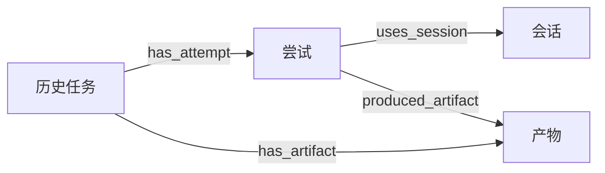

# DS-32-H：历史身份与执行关联查询

状态：开发分支实现，待 G2 联合评审。责任人：Codex；独立评审人：待认领。
日期：2026-11-11。关联：#32、#30、#60；依赖：#25 领域契约、ADR 0003 分层边界、ADR 0010 轻量默认。
适用范围：`feat/lightweight-runtime-32` 的本次历史查询增量，验收记录随提交归档。

## 目标与分层

L1 提供任务、尝试、会话和产物的可追溯关联，L2 管理服务消费查询投影，L3 的评审业务 Adapter 负责识别来源字段与业务含义。关联查询复用当前 RuntimeStore 和存储配置，支持 SQLite / PostgreSQL；存储候选比较与产品分层保持既定结论。

`HistoryQueries` 返回普通 JSON 数据，由本地 CLI 直接消费，后续认证 API 和 Console 复用同一查询语义。当前交付包含受信服务接口与 CLI；公共 HTTP 路由、对象 ACL 和真实来源 Adapter 按 #33/#34/#60 联合接入。

## 身份与关系

原生执行从 Run 展开 Attempt，Session 以 Attempt 和 Worker instance 限定身份，Artifact 保留 Run / Attempt 关联、内容摘要、大小及 Provider。两个 Attempt 使用相同外部会话句柄时保留两个上下文。详情不读取产物正文，也不返回存储路径、Run 输入或凭据。

导入历史以 `(scope, source, kind, source_id)` 标识原始对象，`target_id` 是历史身份映射 ID。原生 Run 与导入对象使用独立查询入口；导入对象的 `legacy_unverified` 标记持续保留。来源中的“成功”字段保存在原记录中，不创建已通过当前治理验收的 Run。



来源 Adapter 显式提交关系，索引保存起点原记录摘要与登记时间。原始 JSON、摘要和映射 ID 均保持不变。同一关系重复登记返回原关系；错误实体类型与不存在的起点被拒绝。关系终点可稍后导入：初始显示 `unresolved`，相同来源身份入库后显示 `resolved`，关联 ID 不变。共享会话和产物支持反向查询全部来源。

关系允许同 scope 内显式跨来源引用；查询始终限定 scope。不会从未声明格式的 JSON 字段或同名 ID 自动推断关系。错误映射的版本化修订与人工处置由 #60 接入时完善，当前关系索引没有覆盖或删除入口。

## 查询契约与 CLI

服务入口位于 `backend/app/runtime/history.py`，查询方法如下。

| 方法 | 输出与分页 |
| --- | --- |
| `list_imported(source?, kind?, limit, cursor)` | 原始身份、映射 ID、摘要、验收标记；按来源/类型/原 ID 分页 |
| `imported(source, kind, source_id, include_record=False)` | 单条来源映射；原始记录按需读取 |
| `related(source, kind, source_id, direction, limit, cursor)` | 起点摘要、关系、关联对象、解析状态；支持 outgoing / incoming |
| `run(run_id, limit, attempt_cursor, artifact_cursor)` | Run 摘要、Attempt 页、该页 Session 上下文、独立 Artifact 页 |
| `link(...)` | 受信来源 Adapter 登记关系；独立于查询，无任务派发副作用 |

所有分页默认 50 条、最大 100 条。游标绑定 scope、对象、筛选和方向，跨上下文使用返回 `INVALID_CURSOR`；游标只表示位置，不授予访问权限。各页来自单次一致性读取并带 `observed_at`，多页查询为实时视图；期间新增数据可能需要刷新后出现。原生 Session 列表对应当前 Attempt 页，Artifact 页具有独立游标，消费者按 ID 关联和去重。

沿用本地运维数据库参数，WSL 仓库目录示例：

```sh
export DIOS_RUNTIME_DATABASE_URL=sqlite+aiosqlite:////path/to/runtime.db
backend/.venv/bin/python cli/dios runtime --scope local history list --source legacy-review --kind task
backend/.venv/bin/python cli/dios runtime --scope local history show legacy-review task task-1
backend/.venv/bin/python cli/dios runtime --scope local history links legacy-review task task-1
backend/.venv/bin/python cli/dios runtime --scope local history links legacy-review artifact blob-1 --direction incoming
backend/.venv/bin/python cli/dios runtime --scope local history run run-id --limit 50
```

`history show --record` 显式返回来源原文，适用于有数据库访问权限的运维人员。远端 API 接入时，scope 必须由认证主体与对象授权决定；分页和来源过滤不替代 E2AG/ACL 校验。来源 Adapter 在导入前将凭据转为 Secret 引用，默认查询不展开原文。

## 增量迁移与兼容

主 Runtime Schema v1 文件及校验值保持冻结。`history_schema.py` 定义独立组件 v1：`runtime_history_schema` 记录版本与源码校验，`runtime_history_links` 保存双向索引关系。显式 `runtime migrate` 在同一事务中追加组件，返回 `history_version: 1`，重复执行不改变数据。

升级只增加表和索引，不改写原始历史、Run、事件或任务身份。旧版本 Runtime 可继续读取其原有表；新关联查询需要 History 组件迁移。未知组件版本、错误校验、缺失结构和未登记关系表使迁移失败。失败事务回滚后可重试；应用回退保留新增表，生产操作仍按备份与排空流程执行。本轮仅升级临时验收库。

## 验收与下一步

测试覆盖 SQLite / PostgreSQL 的双向关系、共享来源、缺失对象后续解析、重复登记、scope/来源隔离、游标绑定、分页、原始记录不变、原生重试与会话句柄复用；SQLite 另验证组件升级、失败回滚和 CLI。新增 18 项检查，完整后端回归 136 项通过、0 跳过，见 [检查记录](evidence/history-query-regression-20261111.json)。

本交付完成 #32 的基础关联查询部分。下一步优先完成备份恢复与升级排空演练，并继续 #30 真实 Worker 调度恢复、#33 凭据与 #34 完整 E2AG 工作授权；认证 API/Console 和真实评审历史接入随对应门槛推进。#30/#32 保持进行中。
