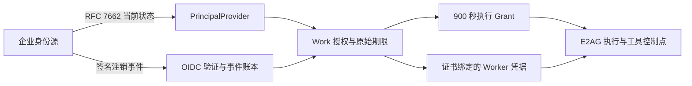

# 身份与凭据生命周期

DiOS 将身份源会话、Work 授权、执行 Grant 和 Worker 传输凭据分别管理。续期保持原任务、所有者、会话与权限约束，不能延长 Work 的绝对期限。身份源不可达时暂停依赖它的操作；收到有效撤销或注销后，原 Work 保持撤销状态。



## 有效期与轮换

| 对象 | 规则 |
| --- | --- |
| 来源会话 | 保存可信 issuer、subject、client、session 和来源版本；刷新不会扩大既有 Work 的期限 |
| Work | 授权范围和绝对期限在准入时固定；撤销、终态、权限收窄或所有者改变后不能续期执行 |
| 执行 Grant | 初始期限为 `min(now + 900, Work.expires_at)`；剩余不超过 300 秒时由执行复核自动续期，仍受 Work 期限约束 |
| Worker 凭据 | 默认 900 秒，受证书、机器身份和 Work 到期时间共同限制；客户端约在有效期的三分之二处续期 |
| 凭据回执 | nonce 重试返回同一结果；不同续期请求竞争相同版本时拒绝过期版本；记录只保存令牌摘要 |
| 旧 Worker 令牌 | 轮换后最多保留 30 秒过渡窗口，且不越过其原到期时间；不能凭旧版本再次轮换 |

Worker 的 mTLS 证书指纹、scope、profile、worker/instance、Attempt 和所有权代次共同绑定凭据。该通道沿用 DiOS Worker 协议；[RFC 8705](https://www.rfc-editor.org/rfc/rfc8705.html)提供证书绑定令牌的机制依据，DiOS 通道不声明完整 OAuth 授权服务器互操作。

## 身份源和密钥轮换

客户端密钥负责资源服务器向身份源认证。Keycloak 客户端密钥更新后，尚未替换的本地引用返回 `AUTH_PROVIDER_UNAVAILABLE`，保留 Work 和原期限；替换受保护的 Secret 文件后，同一 Work 恢复。客户端认证失败与用户会话撤销分别处理，符合 [RFC 7662](https://www.rfc-editor.org/rfc/rfc7662.html) 的认证及 active 状态语义。

签名密钥轮换使用 [Keycloak 原生优先级和被动密钥机制](https://www.keycloak.org/docs/latest/server_admin/index.html#rotating-keys)：新密钥签发后，旧密钥在显式重叠期内仍可验签；停用旧密钥后，新的验证请求拒绝其签名。DiOS 注销接收器每次从登记的 JWKS 地址读取公钥，并通过已有 `go-oidc` 验证器校验消息。由新密钥签名的原会话注销事件仍关联并撤销原 Work。

[OIDC Back-Channel Logout](https://openid.net/specs/openid-connect-backchannel-1_0.html)事件的持久去重、来源匹配及 Work/Grant 撤销沿用既有事务；已处理的历史事件和审计记录继续保留。旧密钥停用不删除历史事件。

## 工程资格与范围

资格脚本使用隔离数据库、真实证书、实际 mTLS 连接和独立 Keycloak 实例。900 秒验证不调整时钟、不修改 Grant 到期时间，由原生续期循环和执行复核自然触发。受控任务替代模型计算，已有 Cursor ACP 的任务、工具、报告与恢复证据继续复用。

```sh
backend/.venv/bin/python scripts/qualify_credential_lifetime.py \
  workspace/NEW_QUALIFICATION_DIRECTORY/lifetime.json
backend/.venv/bin/python scripts/qualify_identity_rotation.py \
  workspace/NEW_QUALIFICATION_DIRECTORY/rotation.json \
  --verifier /absolute/path/oidc-logout
```

第一项约十分钟，观察初始 900 秒授权在续期阈值处自然更新；第二项验证客户端 Secret 轮换、签名密钥重叠/停用、原生注销及 E2AG 撤销。脚本不输出凭据，退出时清理自身临时执行环境。原服务、真实用户身份和业务任务不参与故障注入。

工程结论按以下归属继续交付：

- K03-1.01：单主机身份源、凭据续期与轮换资格。
- K03-1.02：Linux 后台服务的 Secret 配置、受限引用与注入、轮换操作交付。
- K03-1.03：真实两主机、企业 TLS、跨主机撤销与对象权限资格。
- K03-1.04：指定责任人的独立安全评审。

企业 IdP 配置、通用 Worker Secret 托管、Worker 证书/签发根的运维轮换及物理多主机不由本次 Keycloak 签名轮换替代。
