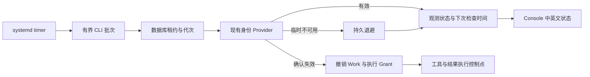

# 身份来源恢复对账

所属：#35 / K03-3；依赖 #33 的可信身份 Provider、#34 的 Work/Grant 与工具执行门槛。

## 目标与成熟组件

DiOS 对有效的 Work 定期复查来源身份。来源确认失效时持久撤销 Work 和执行 Grant；身份服务暂不可用时保留授权记录与审批，退避复查。受限动作继续经过实时 E2AG 检查，观察记录只用于状态展示和恢复对账。

调度采用原生 systemd timer；身份检查复用 Authlib 和 RFC 7662 Provider；所有权沿用 Runtime 数据库事务、租约和代次栅栏。CLI 每次执行有界批次，没有常驻的自制调度器。

| 方案 | 当前判断 |
| --- | --- |
| OAuth2 Proxy 原生登录、刷新、退出 | 已部署。上游 [#1224](https://github.com/oauth2-proxy/oauth2-proxy/issues/1224) 仍开放；`backend_logout_url` 是应用主动退出时调用 IdP，无法承担标准登出事件接收。 |
| Spring Security 原生 Back-Channel Logout | [官方实现](https://docs.spring.io/spring-security/reference/servlet/oauth2/login/logout.html)已有会话注册与失效处理；引入 JVM 网关需要独立运行资格与身份映射评估。 |
| Authlib / PyOIDC 登出消息处理 | 当前安装 Authlib 1.9.10 无对应接收模块；最新文档中的支持属于 1.10 预发布线。PyOIDC 提供 LogoutToken 校验，仍需接收服务、持久防重放及业务撤销接线资格。 |
| RFC 7662 恢复对账 | 复用已验证 Provider，可立即覆盖暂时故障与遗漏事件后的来源复查，作为本次交付。 |

[OIDC Back-Channel Logout](https://openid.net/specs/openid-connect-backchannel-1_0.html)规定签名注销消息和恢复错误重试建议；事件接收仍需可靠持久化、重放防护及恢复对账。[标准注销事件接收](backchannel-logout-35.md)已接通持久事件、Work/Grant 撤销和后续准入栅栏，并通过隔离 Keycloak 推送验证；既有浏览器 realm 回调注册继续单独验收。

## 职责与状态



每个 Run 保存一条来源观测，绑定原 Work 引用和主体来源摘要。`pending / valid / unavailable / revoked` 表示检查结果；`checking` 表示当前租约有效；`stale` 表示观测已超过下次计划时间 30 秒。API 同时提供最近检查、最近成功、下次检查及连续失败次数。它们与 Run/Attempt/Worker 状态独立。

领取前要求 Run 非终态、Work 有效且未到期。短事务内领取 30 秒租约，随后退出事务调用 Provider。落库时核验 scope、owner、generation、租约和 Work/来源绑定；迟到结果返回 `stale`。完成、取消和已撤销的 Work 优先，迟到成功不会恢复它们。

确认 `AUTH_PRINCIPAL_REVOKED` 或 `AUTH_PRINCIPAL_EXPIRED` 才持久撤销；服务、网络、配置不可用进入 `unavailable`。默认退避 15、30、60、120、240、300 秒，成功后清零失败次数，恢复 60 秒检查周期。有效结果不延长 Work 期限、不授予新权限、不替代人工审批。

审计只记录检查结果或原因变化，重复有效检查覆盖同一观察记录。输出与审计不包含来源 Token、Secret 内容或 Provider 原始错误。新 schema 纳入备份、校验和恢复；已有数据库通过显式 `migrate` 增量建表。

## 运行与接口

```sh
python -m app.runtime.cli --database-url "$DIOS_RUNTIME_DATABASE_URL" \
  --scope enterprise identity-reconcile \
  --policy-file /etc/dios/work-policy.json \
  --limit 20 --interval 60 --retry-base 15 --retry-max 300
```

示例服务与 timer 位于 `examples/runtime/dios-identity-reconcile.*`。管理员应配置专用运行用户、绝对路径、权限受限的环境文件和现有 Provider 凭据引用。配置完成后用 systemd 管理启动、重启、日志与定时；同一个活动 service 不会被 timer 重复启动。不同进程或节点共享数据库时，单条 Work 的数据库租约承担最终互斥。

`GET /api/os/runtime/runs/{id}` 的 `authorization.source_check` 返回观测状态；Console 在 E2AG 区域显示状态、时间和故障恢复提示。CLI 返回本批条目和检查数量。已有 Work/Grant/工具审批接口保持原权限判断。

默认每批 20 条，CLI 上限 1000；网络检查串行，每次使用现有 Provider 的有界超时。部署应结合活跃 Work 数、IdP 配额、实测耗时调整批量和周期，监控 `stale`；这些配置不构成撤销时限保证。现阶段以每个 Work 对账，来源共享检查与大规模分片待容量实测后优化。

## 验证与后续

专项覆盖暂时故障与自动恢复、持久退避、进程退出后租约接管、迟到结果拒绝、多进程互斥、范围隔离、审批保留、审计去重与备份恢复。开发实测使用原生 Keycloak、原生 systemd timer、独立浏览器会话和真实 Worker；结果见 [验证证据](evidence/identity-reconciliation-20261124.json)。

真实服务停机与恢复已覆盖排队任务的自动复查；单会话登出后，其排队 Work 被撤销且未启动进程，另一独立会话通过审批并完成报告。首次运行中故障实验暴露了 Worker 在身份复核不可用时直接结束 Attempt 的缺口，原失败记录保留。[原生 Docker 暂停续接](identity-pause-30.md)已补齐本地执行路径，重新核验 E2AG 后继续原进程与会话；其他执行器和 Worker 重启续接继续按 #30 验证。Worker 与对账并发撤销时，以 Work/Grant 账本为授权依据，保留各自最后观测时间。

#35 继续推进既有浏览器 realm 的标准回调资格、三层委派收窄、审批人资格变化及跨服务严格撤销排序。撤销 Work 会阻止后续受控动作；已在途动作的终止、远端取消确认和副作用处理仍使用各自执行状态，界面保持区分。

`scripts/probe_identity_reconciliation.mjs <private-fixture> <output>` 提供真实浏览器部分。fixture 沿用浏览器 SSO 的回环地址和测试账号；脚本提交两个独立会话任务并输出 `<output>.pending.json`。外部开发验证器负责控制测试 IdP、检查持久状态和独立审批，创建 `<output>.logout` 后脚本退出 A，会以 `<output>.logged-out` 确认，再等待 B 的报告。验证器应先确认只有测试任务活跃，并在异常退出时恢复 IdP 与暂停的测试 Worker。该脚本不会自动操作生产服务。
