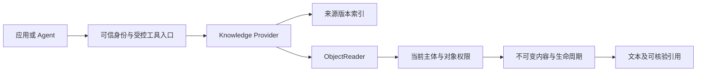

# 知识 Provider 契约

DiOS 管理可替换检索能力、来源版本和读取授权。项目、岗位、资料分类、产品字段和客户源系统的权限映射由独立应用负责。统一接口使用不透明来源标识、不可变对象引用和服务端认证主体。

## 来源与权限

每个来源包含 `source_id`、单调递增的 `revision`、精确 `object_ref`、`provenance` 和可选 `expires_at`。来源说明仅含 `namespace/key/version/locator`，URI 或位置字符串只用于引用展示，服务不主动访问。文本来源绑定一个文件或产物版本，其 SHA-256 和字节数由对象存储验证。

查询身份来自 Runtime 的认证依赖；查询参数不能指定主体、项目或权限。`object.read` 和 `object.download` 均需通过，原生产物同时检查 Run 权限。权限过滤先于匹配和排序，结果不提供未授权来源的标题、数量或位置。释放结果前重查权限、身份、到期时间及来源索引版本；检索期间来源发生替换或删除返回 `KNOWLEDGE_VIEW_CHANGED`。

对象授权沿用 E2AG 决策记录。Agent 发起工具调用仍须通过现有 Work 授权、审批和派发控制点；数据读取接口本身不签发执行授权。各对象的权限判断以其实际检查时点为准；跨服务同时撤销的全局原子快照不在本地 Provider 的一致性声明中。

## 接口

基路径 `/api/os/runtime/knowledge`。

| 接口 | 内容与权限 |
| --- | --- |
| `GET /capabilities` | 返回协议版本、支持操作、格式、限额、索引及缓存模式 |
| `POST /search` | `{query, limit}`；返回获准文本、对象摘要、来源版本和位置 |
| `GET /sources/{source_id}` | 管理者读取来源当前修订号与绑定，用于冲突处理 |
| `PUT /sources/{source_id}` | 管理者替换或删除来源；要求 `expected_revision` 和 `idempotency_key` |

替换请求使用 `state: active`、`object_ref`、`provenance` 和可选到期时间。删除请求使用 `state: deleted`，不携带对象和来源说明。旧版本不随新版本自动授权。更新同一来源只改变当前索引绑定；原对象和历史变更请求保留。

相同幂等键及请求返回原回执，不重复应用；同键不同请求拒绝。重放过去的成功更新不会恢复后来已删除的来源。并发修改以修订号冲突结束，调用者须重新读取业务状态后决定下一次变更。

Python SDK 0.1.15 提供 `knowledge_capabilities`、`search_knowledge`、`replace_knowledge_source`、`delete_knowledge_source`。

CLI 提供 `dios knowledge capabilities/search/show/apply`；`apply SOURCE_ID --file mutation.json` 使用相同修订号和幂等请求。通过 `DIOS_ACCESS_TOKEN` 提供凭据。公开 Python `dios_sdk.knowledge.KnowledgeProvider` 定义可独立实现的结构接口。

## 更新和失效传播

| 变化 | 查询效果 | 内容与历史 |
| --- | --- | --- |
| 来源替换 | 当前来源立即绑定新对象版本；新版本独立授权 | 旧对象及原变更请求保留 |
| 来源删除 | 当前索引标记删除；不再返回 | 保留来源 ID、修订号和变更回执 |
| 来源或对象到期 | 每次读取及释放结果前按当前时间过滤 | 留存与物理回收由对象服务执行 |
| 主体或对象撤销 | 使用当前凭据和对象权限重新检查 | 已下载到调用方的副本不受服务端删除控制 |
| 对象删除或派生失效 | ObjectReader 拒绝，检索结果不含该内容 | 沿用对象墓碑、恢复与共享内容回收规则 |

Provider 必须区分 `accepted`、`applied`、`failed`。只有对应索引完成更新、缓存失效完成或明确未使用缓存时，才能报告 `applied`。异步 Provider 应暴露稳定操作 ID 和查询状态；控制面观察超时不触发重复写入。当前两种实现共用事务化来源绑定与回执。

首个 `object-read-through-v1` 实现采用事务化的对象引用索引，每次查询重新读取对象，不保存派生文本索引或结果缓存。来源变更和回执在同一数据库事务提交，报告 `index_status: applied`、`cache_status: not_used`。授权、到期和删除直接作用于权威对象读取，无额外异步索引副本。响应均为 `no-store`。

本实现为有界字面检索：每个 scope 最多 100 个来源身份（含墓碑），每来源 1 MiB，每次读取总量 8 MiB，返回最多 20 条。超限明确失败，不减少范围后报告成功。支持 UTF-8 文本；向量检索、图遍历和记忆写入由 Provider 能力声明决定，本实现未声明这些操作。

## 可替换实现的共同要求

知识检索、图谱和记忆 Provider 共用来源版本、授权上下文、更新/删除回执和失效语义。图边、记忆记录等派生结果须关联全部来源版本，任一必需来源不可读时不得输出其派生文本。具体查询语言、向量维度、图遍历和记忆写入属于显式声明的扩展操作，不静默退化为字面检索。

模型和业务应用通过稳定契约消费结果；Provider 不获得调用者未授予的对象权限。后续接入可使用 MCP 工具或专用适配器，仍需保留当前受控工具链。替代实现由 S02-2.02 交付；完整更新故障矩阵与 Agent 工具集成资格由 S02-2.03 承接。

## FTS5 替代实现

通过部署配置 `DIOS_RUNTIME_KNOWLEDGE_PROVIDER` 选择 `object-read-through-v1`（默认）或 `sqlite-fts5-v1`。重启 API 生效，SDK 和 CLI 请求不变。来源 ID、修订号、权限和历史留在相同权威存储中。查询参数不允许指定 Provider；配置未知或引擎不可用返回明确错误，不静默切回另一实现。

| 实现 | 检索执行 | 内容副本 |
| --- | --- | --- |
| `object-read-through-v1` | 获准文本逐条字面匹配 | 请求内缓冲 |
| `sqlite-fts5-v1` | 获准文本的 SQLite FTS5 trigram 索引与 MATCH | 独立内存数据库，单次查询结束关闭 |

FTS5 索引在对象授权和完整性校验之后建立，只包含当前主体可读内容。排序后沿用来源修订、到期时间和对象权限复核。它不共享检索结果缓存，也不保存跨查询文本副本；新查询重新取得当前来源与权限。因此，删除、替换和撤销无需等待旁路索引同步。该实现验证第二检索引擎的可替换性；持久索引、语义检索和更大规模数据仍按后续 Provider 与容量任务推进。

[SQLite FTS5 trigram](https://sqlite.org/fts5.html#the_trigram_tokenizer)支持子串匹配，少于三个 Unicode 字符不能使用 MATCH 命中。本适配器对短词显式使用 SQLite `instr`，对其余词使用转义后的字面 MATCH；大小写统一 casefold，不把用户输入作为 FTS 查询语言执行。排序保持命中词数与来源 ID 的稳定顺序。

[SQLite 内存数据库](https://sqlite.org/inmemorydb.html)在连接关闭时释放。索引构建和查询在工作线程执行，取消通过停止信号与 SQLite progress handler 传入，等待线程结束后返回取消；引擎执行预算为 10 秒，超时返回 `KNOWLEDGE_QUERY_INTERRUPTED`。源码、依赖或运行镜像缺少 FTS5/trigram 时返回 `KNOWLEDGE_PROVIDER_UNAVAILABLE`。capabilities 暴露实际 SQLite 版本与索引生命周期。

[SQLite 本体属于公有领域](https://sqlite.org/copyright.html)，可随产品分发。此适配复用 Python 运行镜像的 SQLite 库，不引入独立数据库服务或客户业务模型；镜像中的其他组件仍遵守各自许可。Runtime 元数据后端与检索引擎独立选择。

## 方案依据

[LangChain Indexing API](https://reference.langchain.com/python/langchain-core/indexing/api/index)以来源 ID 和记录管理器跟踪更新、删除与清理；其全量清理要求输入完整数据集。DiOS 使用显式来源替换/删除，不将查询未返回某来源解释为删除。

[Qdrant 一致性说明](https://qdrant.tech/documentation/scaling/consistency-guarantees/)区分写入完成等待、写入顺序和读取一致性。DiOS 的 `applied` 要求适配器给出实际生效证据，不能仅凭入队或 WAL 接收成功确认删除。Qdrant 是后续候选适配，不是当前底座的强制依赖。
