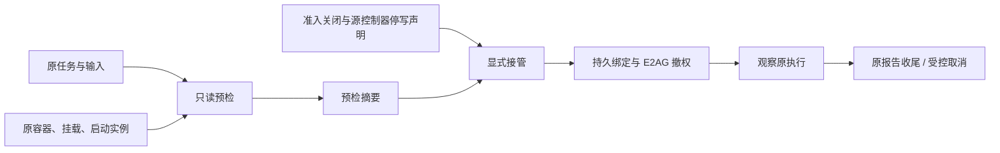

# 既有任务执行对象的显式接管

DiOS 可将已有任务与正在运行或已退出的原容器建立持久关联，随后由统一恢复控制器观察、收尾和取消。接管固定原容器完整 ID、Docker Engine 身份及启动实例，任务 ID、trace、输入和产物关系保持。对应 #10 / #30，并为 #51 的升级交接提供能力。

## 身份与职责

运行层采用 [Docker Inspect](https://docs.docker.com/reference/api/engine/version/v1.57/operations/ContainerInspect/) 与已有 [Docker SDK](https://docker-py.readthedocs.io/en/stable/containers.html)，在 RuntimeAdapter 增加可选的既有对象检查、绑定能力。兼容来源适配器识别旧版 `dios-run-<run_id>` 名称与标签，以及新版托管容器的 scope、类型和名称；企业应用与第三方 Agent 的业务规则保持在各自应用层。

持久 `managed_task_adoptions` 记录 task、scope、原生对象身份、预检摘要、声明者、交接原因和源控制器停写声明。任务 ID 与容器 ID 分别唯一。接管与运行关联、E2AG grant 撤销在同一事务提交；绑定重复确认返回原记录，发生冲突则整体回滚。



预检同时核验：活动任务、唯一旧 run_id、TASK_CONFIG 路径、工作区实际 bind mount、配置中的任务输入和输出目录，以及原容器完整配置摘要。配置正文和环境变量凭据不进入预检响应；返回配置摘要和实际用户、网络、能力集、只读根目录及资源限制。

原生对象身份和关联应采用稳定标识；[Kubernetes 所有者引用](https://kubernetes.io/docs/concepts/overview/working-with-objects/owners-dependents/)同样按所有者 UID 和作用域表达归属。当前 DiOS 接管采用自己的任务账本，未引入 Kubernetes 运行依赖。

## 交接条件

预检为只读操作，可在源执行仍运行时进行。接管要求当前安装处于 draining，关闭新任务准入；既有执行可以继续运行，因此此时整体 `ready_for_cutover` 可以为 false。

源控制器停止调度和写回由运维人员明确确认，通过 `source_quiesced=true`、actor 和 reason 留档。系统自动核验原生对象及任务映射，源控制器停写的证据类型记录为 `operator_attested`。旧控制器需要保持停写至交接结束，切换期间保持单一写入方。

接管提交前重新生成预检摘要，任务、输入、工作区、容器配置或启动实例变化都会使确认失效。接管后的每次原生操作重新核验 Engine ID、完整容器 ID、配置摘要和启动实例；绑定对象缺失时保留未知观察，替代对象或重启实例拒绝控制。绑定适配器没有启动或隐式重启权限。

已有运行关联若尚未获得进程实例，可在路径、run_id 和 scope 全部一致时补齐身份，原取消意图保留。已有明确实例的运行关联保持原恢复路径。共享服务请求由[共享请求恢复](managed-service-recovery-10-30.md)处理。

## E2AG、报告与清理

接管撤销该任务原有的网关 grant，保留授权记录，不签发新 grant。有来源事件的任务在同一事务追加 E2AG 审计链条，包含预检摘要、原生对象、声明者和交接原因；重复确认不重复追加。接管后的新工具调用仍需正常工作授权。原容器的实际隔离配置需要依据预检结果单独验收。

报告和配置通过 Python [目录文件描述符与 os.open](https://docs.python.org/3/library/os.html#os.open)读取，逐层拒绝符号链接，只接受单硬链接的普通文件。配置上限 4 MiB，报告上限 8 MiB，报告目录最多扫描 128 项。报告不存在、为空、无效 UTF-8 或超限时不会计为成功；凭据文件清理使用同样的目录约束。

## API 与 CLI

两个接口均要求显式配置的 operator token，响应使用 `Cache-Control: no-store`：

| 接口 | 输入与行为 |
| --- | --- |
| `POST /api/os/runtime/adoptions/preview` | task_id、64 位 native_id、可选 workspace；返回预检 record、digest 和实际观察 |
| `POST /api/os/runtime/adoptions` | 上述字段加 expected_digest、actor、reason、严格布尔 source_quiesced；在 draining 下提交绑定 |

CLI 在安装的后端环境中使用同一服务：

```bash
backend/.venv/bin/python cli/dios managed-adoption preview TASK_ID CONTAINER_ID

# 关闭新任务准入，并完成源控制器停写交接。
backend/.venv/bin/python -m app.services.managed_upgrade drain

backend/.venv/bin/python cli/dios managed-adoption adopt TASK_ID CONTAINER_ID \
  --expected-digest PREVIEW_DIGEST --actor OPERATOR \
  --reason '原控制器已停止调度和写回' --source-quiesced

backend/.venv/bin/python -m app.services.managed_recovery reconcile
backend/.venv/bin/python -m app.services.managed_upgrade status
```

CLI 使用安装的数据库、scope、工作区和锁目录配置。应用配置后来变更时，可显式指定原 workspace；该目录必须位于本安装工作区内，并匹配原容器挂载。接管后路径固化在运行关联中。

## 部署与资格

新增表由现有应用初始化增量创建。备份同时保存应用库、运行库、工作区和归档产物；接管记录位于应用库。回退时保留新增表，活跃对象的控制权需要与源控制器重新明确交接。

当前既有对象绑定已验证 Linux 本机 Docker socket 和可访问的原工作区；远程 Docker 端点被拒绝。跨主机执行继续由远程 Worker 承载，其他 Provider 的接管需要提供并验证同一可选接口。旧来源缺少标签、输入配置、唯一 run_id 或可读原工作区时，进入人工来源核验，当前接管入口拒绝绑定。

[验证证据](evidence/managed-adoption-20261124.json)包含真实旧式容器、独立 CLI 预检/接管、原实例自然完成、原容器取消、并发重复确认、过期预检拒绝、E2AG 撤权与审计、文件越界保护，以及镜像和开发环境检查。原生任务使用合成报告，生产持续评审未迁移。
