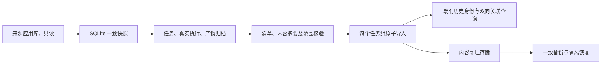

# 兼容任务历史接入

DiOS 将兼容 A2A 的已结清任务、实际执行记录和产物映射到现有历史查询。来源任务身份保持，重复导入返回原映射；历史状态与当前执行验收分别记录。归档全过程不会启动 Worker 或模型，也不会更新来源数据库。

## 能力与分层

来源适配器位于 `app.services.managed_history`，识别 DiOS 自有 A2ATask、ManagedTaskExecution、ManagedServiceCall 字段。通用 `history_archive` 负责单组事务、不可变身份与内容引用，复用 RuntimeStore、HistoryQueries、LocalArtifacts 和既有备份恢复。客户业务的历史适配仍由相应应用提供。

使用 [SQLite Online Backup API](https://www.sqlite.org/backup.html)读取包含已提交 WAL 数据的一致快照，[Python sqlite3.backup](https://docs.python.org/3/library/sqlite3.html#sqlite3.Connection.backup)提供原生绑定。来源快照位于私有临时目录，提取后删除；交付包只保留指定任务及关联记录，其他表的模型凭据不进入包。导入沿用 [SQLAlchemy 本地事务](https://docs.sqlalchemy.org/en/20/core/connections.html#using-transactions)，兼容 SQLite 和 PostgreSQL 目标。



## 身份和证据

历史对象的唯一身份为 `(target_scope, source_instance, kind, source_id)`。source_instance 是管理员指定、跨批次保持稳定的来源安装标识；source_scope 用于匹配已有执行账本。缺少 scope 的早期任务保留 `scope_evidence=operator_assignment`，有执行账本的记录保留其原 scope。重新指认来源范围会改变记录摘要并触发冲突。

| 来源 | 映射与证据 |
| --- | --- |
| A2ATask | task；原 ID、状态、Agent、context、trace 和时间保留 |
| ManagedTaskExecution | attempt；保留真实 handle、run_id、进程实例、取消和收尾信息 |
| ManagedServiceCall | attempt；保留原调用 ID、派发状态及时间；它表示服务调用尝试，进程/模型会话信息缺失时保持缺失 |
| A2ATask.artifacts | artifact；任务 ID 加原数组位置形成稳定身份，保留原 artifactId；任务拥有关系始终明确 |
| 缺少执行记录的早期任务 | 只有已知的 task/artifact；不会生成虚构的尝试 |
| 模型 Session 缺失 | `model_session_evidence=false`；ChatSession、任务 ID 和进程 ID 均不替代模型会话证据 |

导入对象统一保留 `legacy_unverified`，原始“completed”仅为来源状态。原始数据库行以完整 JSON 归档，历史索引保存精简元数据、摘要、大小和内容引用。正文超过 64 KB 时仍完整保存。相同产物正文可复用内容对象，各任务的来源与适用关系分别保留。产物缺少明确尝试归属时只登记 `has_artifact`，后续证据可补充已知关系。

## 范围、失败和重试

导出只包含 terminal A2A 任务。存在未收尾运行、active/unknown 服务调用的任务暂缓；源任务总数、活跃任务、未结清任务、其他 scope 任务、孤立执行记录和未关联到任务的服务调用分别计数。该清单显示已导入范围与待处理范围。活跃执行的所有权接管由后续迁移流程处理。

每组最多 100 个对象、200 个关系、1 MB 索引；每个原始内容对象最大 128 MB，单包索引最大 128 MB。超限使导出失败，保留诊断文件且不发布 manifest。默认导出时间预算 60 秒，可显式增加。目标目录必须不存在。文件权限由私有目录和 0600 文件保护；原报告中本身存在的敏感内容仍按历史数据保护。

导入先核验调用者提供的 manifest 摘要、完整索引、统计和内容摘要，再使用私有索引副本逐组提交。每组的对象、关系及内容登记在同一事务内，冲突回滚整组。批次中断后保留已提交组，再次导入幂等续接；冲突返回 IMPORT_CONFLICT，原记录不会被覆盖。内容对象先写入，事务失败可能留下未引用内容，不影响已登记历史。

## 操作入口

在仓库根目录使用已有后端环境：

```bash
backend/.venv/bin/python cli/dios managed-history export \
  --source-db /path/to/application.sqlite \
  --source-instance dios-installation-a --source-scope local \
  --destination /private/history-bundle

backend/.venv/bin/python cli/dios managed-history inspect /private/history-bundle

backend/.venv/bin/python cli/dios managed-history import /private/history-bundle \
  --expected-digest <manifest_digest> \
  --database-url sqlite+aiosqlite:////path/to/runtime.sqlite \
  --scope local --artifacts /private/runtime-artifacts

backend/.venv/bin/python cli/dios runtime --scope local history list --source dios-installation-a
backend/.venv/bin/python cli/dios runtime --scope local history links dios-installation-a task <task_id>
backend/.venv/bin/python cli/dios runtime --scope local history show dios-installation-a task <task_id> --record
```

最后三个查询沿用 DIOS_RUNTIME_DATABASE_URL；导入的 artifacts 必须是该安装备份使用的产物根目录。默认输出只有清单、计数、摘要及映射元数据，完整原文存于内容对象。目标数据库需先通过既有 `runtime migrate` 升级，导入命令不自动迁移。后端模块入口 `python -m app.services.managed_history` 提供相同参数。

当前入口面向具有安装数据库与产物目录权限的运维人员。面向应用主体的历史读取及正文下载需绑定 Work/来源资源授权，继续按 E2AG/ACL 契约接入。

## 存储升级与恢复

新增独立 `runtime_history_archive_schema` v1 及 `runtime_history_archive_objects`，原 Runtime v1 与 History v1 文件和校验值保持不变。内容登记通过外键关联原历史身份；未登记版本、未知校验和或缺表使迁移失败。既有迁移命令增量建表，重复执行不改变映射。

SQLite 恢复包收集已登记历史内容并验证摘要和大小。缺失内容阻止发布恢复包；恢复副本保持 restore_hold，任务身份和关系保持。使用新内容登记后，备份工具须保留本版的历史归档支持；回退执行应用时保留新增表和内容文件。

[验证证据](evidence/managed-history-20261124.json)包含大段中文与 UTF-8、WAL 快照、作用域/未决计数、幂等与冲突、事务回滚、摘要损坏、源凭据表排除、CLI、SQLite/PostgreSQL、完整备份恢复和开发部署。生产持续评审的数据接入与运行所有权切换继续由 #60 独立安排。
