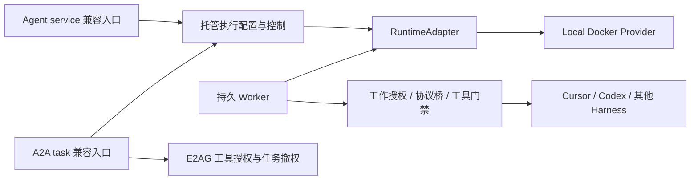

# DS-K01-1：托管任务与服务的统一生命周期

托管 task/service 与独立 Worker 共用 RuntimeAdapter。容器创建、观察、日志、停止和回收由生命周期 Provider 负责；A2A 请求、DiAgent 输入配置、模型交互与结果处理保留在协议服务层。通用服务不再导入 Docker SDK。

关联：[#10](https://github.com/HQIT/DiOS/issues/10)、[#30](https://github.com/HQIT/DiOS/issues/30)、[#31](https://github.com/HQIT/DiOS/issues/31)。责任域：L1 Runtime。状态：工程实现与开发环境资格验证，G2 独立评审待完成。证据：[生命周期验证](evidence/managed-lifecycle-20261124.json)。

## 生命周期与协议边界

`runtime/providers.py` 是 Provider 组合入口。`managed_runtime.py` 根据配置生成 LaunchSpec、稳定 handle、显式挂载与网络；`agent_runtime.py` 管理服务健康与期望状态；`a2a_service.py` 管理协议任务和结果。原 `docker_runner` 已移除，其任务和服务调用方均通过异步生命周期契约执行。

采用 [Docker SDK](https://docker-py.readthedocs.io/en/stable/containers.html) 原生 create/start/inspect/logs/stop/remove 和[资源限制](https://docs.docker.com/engine/containers/resource_constraints/)。创建使用解析后的镜像 ID；自动拉取、运行中强制删除和隐式重启均不进入普通观察路径。SDK 调用在线程中运行，取消协程时等待原生调用结束后才释放操作锁，避免后台创建仍在继续而控制层已宣称取消。

`LaunchSpec.command=None` 明确使用所选镜像自身的启动命令，实际镜像 ID 纳入运行摘要。已有显式命令的 Worker 配置摘要保持兼容；新增空 host_aliases 不改变已持久化的摘要。服务端点通过 `ServiceEndpointRuntimeAdapter.endpoint` 返回；Local Docker 从实际网络信息解析地址，协议服务不拼装容器名称。

## 任务取消、观察与回收

托管 task 的启动、取消、终态提交和清理使用相同实例操作锁。当前使用 filelock 的本机原生锁，多个 API 进程须共享锁目录。跨主机控制继续采用 #30 的持久 Worker 与认证控制通道。

依赖沿用 Docker SDK 7.1.0（Apache-2.0）与 filelock 4.3.1（MIT）；日志复用项目已有 LocalArtifacts，冻结终止调用 Linux 原生控制接口。实例锁限定本机共享目录，跨主机所有权由持久 Worker 租约负责。

| 情况 | 行为 |
| --- | --- |
| 尚未开始的 submitted 任务 | 操作锁内取消；后续启动重新读取状态，不再执行 |
| 运行中的 task 取消 | 先提交 E2AG grant 撤销，再停止运行对象；确认退出、保存日志后提交 canceled 并清理 |
| 停止超时、退出未确认 | 保留执行对象、任务状态与配置；不返回已取消 |
| 冻结对象撤权 | 本机 cgroup v2 整组终止；权限或能力缺失时保持冻结，记录 `RUNTIME_FROZEN_STOP_UNAVAILABLE`，等待对账与受控清理 |
| 观察超时 | 继续观察原 handle，不重启、不重复派发 |
| 运行对象缺失 | 标记 `RUNTIME_OBSERVATION_ABSENT`，任务保持未决；缺少退出证据时不推断成功或死亡 |
| 退出码为 0、报告存在 | 关联报告并完成；缺少报告或报告为空时失败 |
| 日志或终态提交暂时失败 | 保留对象并重试；终态落账后清理失败也继续重试清理 |
| 共享聊天 service 的单请求取消 | 当前端点没有对应协议，返回 `TaskNotCancelableError`，不停止其他会话共享的服务 |

取消失败使用 [A2A JSON-RPC 的 `-32002`](https://a2a-protocol.org/v0.2.0/specification/#82-a2a-specific-errors)，data.reason 区分能力不支持、操作正在进行和停止未确认。Agent Card 的 `_dios.task_cancellation` 显示当前能力。已有终态查询语义保持不变。

完整性检查覆盖运行退出与报告存在；报告业务结论和引用质量由上层应用验证。[兼容任务持久恢复](managed-task-recovery-10-30.md)保存运行关联和取消意图，API 重启后对账原对象并继续归档与清理。既有无映射任务、统一升级准入与共享服务请求续接继续沿 #10/#30 推进；完整 Run/Attempt/Session 调度由持久 Worker 承担。

### 冻结后的终止与 E2AG

[Docker 29.1.3 的 kill 路径](https://github.com/moby/moby/blob/docker-v29.1.3/daemon/kill.go) 在发送信号后恢复暂停对象。[runc](https://github.com/opencontainers/runc/blob/v1.3.3/libcontainer/container_linux.go) 也包含 SIGKILL 后解冻处理。带 init 进程的工作负载在 PID namespace 清理期间可能出现子进程执行窗口。原生实验 5 次中 2 次观察到冻结后的额外文件写入；退出码 137 和延迟到达的日志不足以证明零执行。

本机 Provider 使用 Linux [cgroup v2 的 cgroup.kill](https://docs.kernel.org/admin-guide/cgroup-v2.html)，一次终止该组及其后代。操作前核验完整容器 ID、宿主 PID 的 cgroup 归属与 `frozen 1`，拒绝跨目录和 kill 文件符号链接，再等待 Docker 的退出证据。测试以父子进程同步落盘计数验证冻结和终止，不以异步日志到达时间代替执行时间。

该路径要求执行节点有目标 cgroup 的读取与写入权限；远程 Docker、cgroup v1 或权限不足时保持冻结并报告能力缺失，持久 Worker 进入 reconciliation_required。当前开发账户使用此保守路径；具有 cgroup 权限的隔离测试验证了实际整组终止。跨主机自动回收需在目标执行节点提供并验收同等能力，列入 #10/#30/#51，不向通用 API 服务默认授予宿主 root 权限。

## 服务与日志

服务按实际运行状态复用；运行中不覆盖配置工作区，也不因一次查询失败重建。新启动前写入启动意图。健康检查失败时确认停止并保留日志；再次显式启动只有在原对象确认停止后才回收重建。暂停或启动结果未决的对象保持原状。

退出日志复用现有 LocalArtifacts 内容寻址存储，按 handle 归档到控制面 `workspace_root/managed-runtime-artifacts`，位于 Agent 可写挂载之外。记录实际进程实例，默认采集上限 64 KiB，并保留截断标记。产物以原子方式落盘、校验摘要、复用相同内容；文件权限为运行账户专用。服务调用失败、任务失败和取消都不以强制删除代替退出确认。

## 配置与兼容

| 配置 | 行为 |
| --- | --- |
| `DIOS_MANAGED_RUNTIME_USER` | 托管兼容入口运行用户，默认 `1000:1000`；须与已配置的工作区写权限匹配 |
| `DIOS_MANAGED_RUNTIME_MEMORY_BYTES` | 默认 512 MiB；CPU、PID、只读根文件系统和 capabilities 使用 LaunchSpec 限制 |
| `DIOS_MANAGED_RUNTIME_LOCK_DIR` | 同安装的 API 进程共享的本地操作锁目录，默认 workspace_root/managed-runtime-locks |
| `DIOS_DOCKER_NETWORK` | 当前 Local Docker 兼容 profile 的网络；空值使用 bridge；容器化控制面须显式配置可互通网络 |
| `DIOS_HOST_WORKSPACE_ROOT` / `DIOS_HOST_SHARED_CLI_ROOT` | 控制面容器路径与宿主机挂载来源的明确映射 |

系统拥有的 TASK_CONFIG 覆盖 Agent.env 中同名值。共享技能和 CLI 只读挂载，任务工作区保持可写。通用 Worker 默认的禁网、非 root 和资源配置不变；兼容入口的网络权限按部署 profile 配置。

AgentRuntime.container_id 兼容列保存受控 runtime handle，API 不再依赖底层 Docker ID。旧容器 ID 行返回 `LEGACY_RUNTIME_REQUIRES_DRAIN`，保留对象供升级排空，不自动接管或强制删除。生产升级与回退前须排空旧/新运行对象并转换相应记录；迁移命令和交付演练仍属于 #10/#51 待完成项。开发部署前验证无活跃旧对象和任务，保留数据库及历史身份备份。

E2AG task 网关和取消撤权已沿用现有实现。共享 DiAgent service 的逐请求工具授权、凭据引用与取消能力继续由 #33/#34/#56 收敛；现有 Worker 的受控 ACP 链路不受兼容入口限制。Cursor 真实任务的既有验证见 [#56/#58 证据](evidence/cursor-acp-regression-20261120.json)，本次增加实际 DiAgent 服务与合成任务生命周期验证，不把合成任务当作模型能力验收。

## 验收与后续

验证包含异步调用取消排空、历史摘要兼容、配置优先级、服务复用、健康失败、停止不确定、E2AG 先撤权后停止、迟到观察、回收重试、缺报告拒绝成功、A2A 错误及能力声明。真实 Docker 使用隔离数据库、作用域与工作区；检查现有 DiAgent 服务镜像、task 停止与日志、独立 Worker 的实际进程/会话并发。

#10 保持进行中：旧对象排空与记录迁移、共享服务治理能力接线、G2 评审和交付验收继续推进。#31 的不可变 Revision/Deployment 仍按既定依赖安排。

## 生命周期工程资格

K01-1.01 的四条验收已完成[证据对应](evidence/lifecycle-closure-20261126.json)。通用服务经 RuntimeAdapter 契约调用，Docker 构造位于 Provider 入口；第三方 Cursor 的协议逻辑位于 SDK。任务取消、缺少结果后的失败回收、服务复用和停止沿用真实容器记录，九个生命周期方法与该记录对应版本一致。

当前安装镜像中的九个相关模块与工作区摘要一致。新增测试覆盖 API 工作目录到执行机工作目录、共享 CLI 的显式映射，以及越界路径和符号链接逃逸拒绝。执行机必须具备所配置的挂载路径；物理跨主机、共享存储和远端冻结进程终止仍按其专属工作项验证。

K01-1.02 保留责任人的交付评审。
