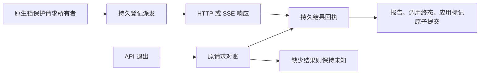

# 共享服务请求的结果恢复

DiOS 的兼容 A2A 与聊天请求保存收到的结果，再将报告、调用终态和回执应用标记原子提交。API 进程在这两个阶段之间退出时，恢复控制器读取原回执完成收尾，保持任务和请求身份，模型请求次数不增加。对应 #10 / #30 / #32。

## 执行与存储

调用者从登记请求之前到收尾结束持有已有 [filelock 原生文件锁](https://py-filelock.readthedocs.io/en/latest/)。同主机控制进程共享锁目录，进程退出后由操作系统释放锁。`managed_service_owners` 仅登记采用此协议的新调用；旧请求没有所有权记录时仍需显式核验。调用者持锁表示本地请求处理仍有所有者，实际模型并发继续由模型会话与 Worker 观测确认。

`managed_service_results` 保存调用 ID、scope、目标任务或聊天会话、正文、完成标记、协议证据、内容摘要及应用状态。收到的 JSON 回复保留原响应，流式回复保留已收集的正文及上游 DONE、截断判断。每条回执最多 16 MiB；超限无法登记成功。回执保存与报告投影复用 [SQLAlchemy 事务](https://docs.sqlalchemy.org/en/20/orm/session_transaction.html)，无需新增队列服务。

投影校验调用、scope、目标对象、所属 Agent 和回执摘要。聊天消息使用调用 ID 作为稳定消息身份，重复恢复不增加消息。A2A 任务已被终结时，迟到结果保留待核验；恢复不覆盖取消结果。同一 A2A 任务在准入锁内检查既有调用，重复调度不创建第二次请求。

## 恢复与授权

| 证据 | 处理 |
| --- | --- |
| 本地调用者仍持有原生锁 | 保持在途，不重派、不接管 |
| 调用者退出，尚未登记派发 | 调用和关联任务记为失败，撤销关联 E2AG grant |
| 已登记派发，缺少结果回执 | 调用记为 unknown；任务保留 working 和明确错误，撤销关联 grant |
| 完整回执已落库，报告尚未提交 | 校验回执，原子恢复报告和完成状态；不请求模型，不签发新 grant |
| 部分输出、空答案或截断响应 | 保存已收到内容，保持 unknown，不计为成功 |
| 回执摘要不一致或目标已终结 | 保留回执，拒绝投影，继续阻止切换 |
| 报告事务提交失败 | 回滚报告、调用终态和应用标记；原回执保留用于重试 |

恢复复用 `ManagedRecovery` 的有界批次与游标轮转，每批分别处理托管任务和共享请求。聊天客户端断开时保存已收集内容，包括最后已发送的文本片段；响应头发送失败也会释放所有权并结清未派发请求。服务端进程被强杀前尚未落库的流式片段仍可能丢失，此类请求保持未知。

网络故障或调用者退出无法证明远端模型已经停止。未知请求继续阻止共享服务回收和升级切换。恢复完整回执属于结果收尾，E2AG 授权不因此恢复；后续新的工具执行继续经过正常授权与审批。

升级状态接口为待处理请求提供 `result_retained`、`result_applied`、`result_complete`，数据库查询只读取这些摘要字段，不加载报告正文。查询超时使用 [asyncio.shield](https://docs.python.org/3/library/asyncio-task.html#asyncio.shield)让原状态查询完成连接清理；超时不会终止任务、取消数据库读取或触发请求重派。

## 升级与运维

先通过[统一升级排空](managed-upgrade-10-30.md)关闭新任务准入并等待在途工作自然结束，再备份应用库与运行库。现有应用数据库初始化增量创建 `managed_service_owners`、`managed_service_results`；旧表和历史记录保留。回退应用代码时保留新增表，使用支持这些回执的版本完成未决请求收尾。

现有 `python -m app.services.managed_recovery reconcile --limit 32` 和 `POST /api/os/a2a/runtime/reconcile` 同时对账托管任务和共享调用，结果键 `service:<call_id>` 标识共享请求。整体排空判断仍使用 `/api/os/upgrade/status`；其中 unknown 调用不会被排除。

该兼容 Provider 在一个指定控制主机运行，控制进程必须使用同一锁目录。跨主机执行由持久 Worker 通道承载；跨主机共享服务的所有权接管、远端请求查询/取消协议，以及旧无所有权记录请求的显式映射继续按既定计划推进。应用库中的回执随应用库备份；原生 Runtime 恢复包只负责运行库及其已登记产物，完整部署恢复需同时保存应用库。

[验证证据](evidence/managed-service-recovery-20261124.json)覆盖真实 HTTP 回复、原调用者进程强杀、独立 CLI 恢复、三种进程退出时点、事务失败、回执冲突与损坏、重复触发、SSE 中断及 E2AG 撤权。协议测试使用合成回复，生产持续评审保持原运行方式。
