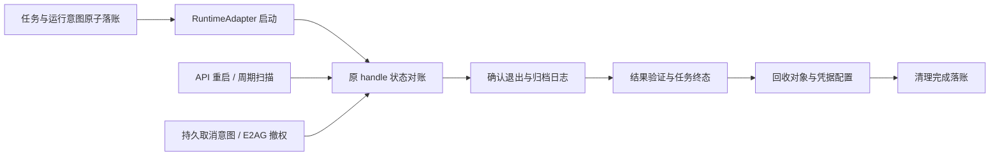

# 托管兼容任务的持久恢复

[共享服务请求恢复](managed-service-recovery-10-30.md)使用同一对账循环，校验原生调用者所有权并恢复已持久化的结果回执；缺少远端结果证据的调用继续保持未知。

兼容 A2A task 的运行关联、取消意图和清理进度持久化，API 重启后继续观察原执行对象。执行结果确认退出后归档，终态提交后的清理失败继续重试。对应 #10 / #30，属于 L1 生命周期能力。

## 结构与依据

采用 [Kubernetes 控制器](https://kubernetes.io/docs/concepts/architecture/controller/)的持久期望状态与实际状态对账模式。执行调用的重试需要端点幂等保证，[Temporal Activity 文档](https://docs.temporal.io/activities)也明确要求考虑重复副作用。当前兼容 DiAgent 入口没有重放模型调用的保证，因此恢复控制器只观察和收尾原 handle。

复用已有 SQLAlchemy、RuntimeAdapter、filelock 原生实例锁、E2AG grant 撤销及 LocalArtifacts。当前调用链无需新增队列服务；完整 Run/Attempt/Session 调度继续由现有持久 Worker 负责。

`managed_task_executions` 与 A2ATask 使用同一数据库。新启动前，在一个事务内写入 working 状态和运行意图；保存任务 ID、scope、handle、workspace、run_id、进程实例、取消请求、最后观察和清理状态。Agent 的后续配置修改不改变已登记的执行路径。任务、trace 和报告关联保持原身份。

`ManagedRecovery` 每批最多 32 个待处理对象，按 task ID 游标轮转。每个对象沿用启动、取消、收尾共享的原生实例锁；多 API 进程共享锁目录。API lifespan 启动对账，退出时等待当前观察/清理完成，保留仍在运行的 Agent。新任务只唤醒同一个控制器。

## 故障处理

| 观察或故障 | 行为 |
| --- | --- |
| API 退出，原容器继续运行 | 重启读取持久运行关联，继续观察同一 handle |
| 观察超时、连接失败 | 保存错误，保留最后观察时间；后续重试观察 |
| 对象缺失、没有退出证据 | 保持未决，记录 RUNTIME_OBSERVATION_ABSENT |
| 进程实例改变 | PROCESS_CHANGED；阻止停止、收尾和回收替代对象 |
| 取消后停止超时 | 取消意图与 grant 撤销已落账；恢复后继续受控停止，完整报告也不覆盖取消意图 |
| 退出且报告有效 | 沿用结果验证和 E2AG 收尾，提交任务终态后回收 |
| 终态已提交，回收失败 | 重试清理原对象，保留原终态和产物 |
| 原对象已回收，清理落账中断 | 已有终态支撑时完成清理登记 |
| 冻结对象缺少整组终止权限 | 保持冻结、保留取消意图，按[冻结终止契约](managed-lifecycle-10.md#冻结后的终止与-e2ag)处理 |

## API、CLI 与运维

- `GET /api/os/a2a/runtime/recovery`：待收尾、未决、无映射活跃任务计数及最多 32 条待处理记录；包含任务 ID、实际状态、最近观察时间、进程实例和错误，不返回工作区路径或凭据。
- `POST /api/os/a2a/runtime/reconcile?limit=32`：执行一批受相同锁与权限入口保护的对账，limit 范围 1–100。
- 后端目录执行 `python -m app.services.managed_recovery status` 或 `python -m app.services.managed_recovery reconcile --limit 32`，使用安装的 `DIOS_DATABASE_URL` 和 `DIOS_RUNTIME_SCOPE`。
- `DIOS_MANAGED_RECOVERY_ENABLED` 默认 true。当前兼容 Provider 在指定控制主机运行，其他控制主机关闭该循环；同主机 API 进程共享 `DIOS_MANAGED_RUNTIME_LOCK_DIR`。跨主机执行继续使用持久 Worker 通道。

新增表随现有数据库初始化创建，历史 A2ATask、EventLog 和 Runtime Run 不重置。升级前备份应用数据库和运行数据库。没有运行关联的既有任务显示在 `untracked_active_tasks`；旧运行记录的身份核验、显式映射与排空迁移继续由 #10/#51 完成。兼容记录保存最后观察与当前错误；统一 Run/Attempt/Session 历史与完整审计关联继续沿迁移计划接入。

`executions_settled` 表示当前兼容任务已无待收尾或无映射活跃记录。升级切换通过[统一排空入口](managed-upgrade-10-30.md)关闭新任务准入、排空共享 service，并结合现有 Runtime Lifecycle 判定。共享 service 的 HTTP 请求续接、逐请求授权与取消仍按原计划推进。

## 验证

[验证记录](evidence/managed-recovery-20261124.json)包含原生容器与 API 进程强杀/重启、同一进程报告恢复、取消超时后的意图恢复、清理重试、实例替换拒绝、并发对账互斥、分页公平性、CLI 与 API、全量后端和开发部署检查。原生任务使用合成协议和来源明确的测试报告；真实 Cursor 的模型与 ACP 能力沿用 #56/#58 的独立证据。
